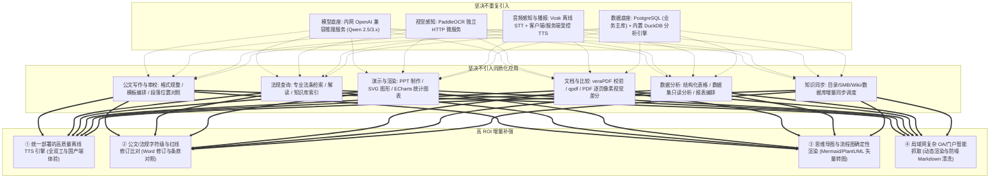
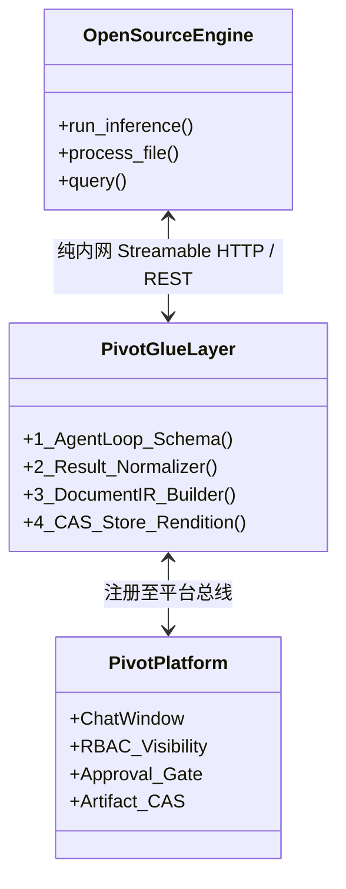
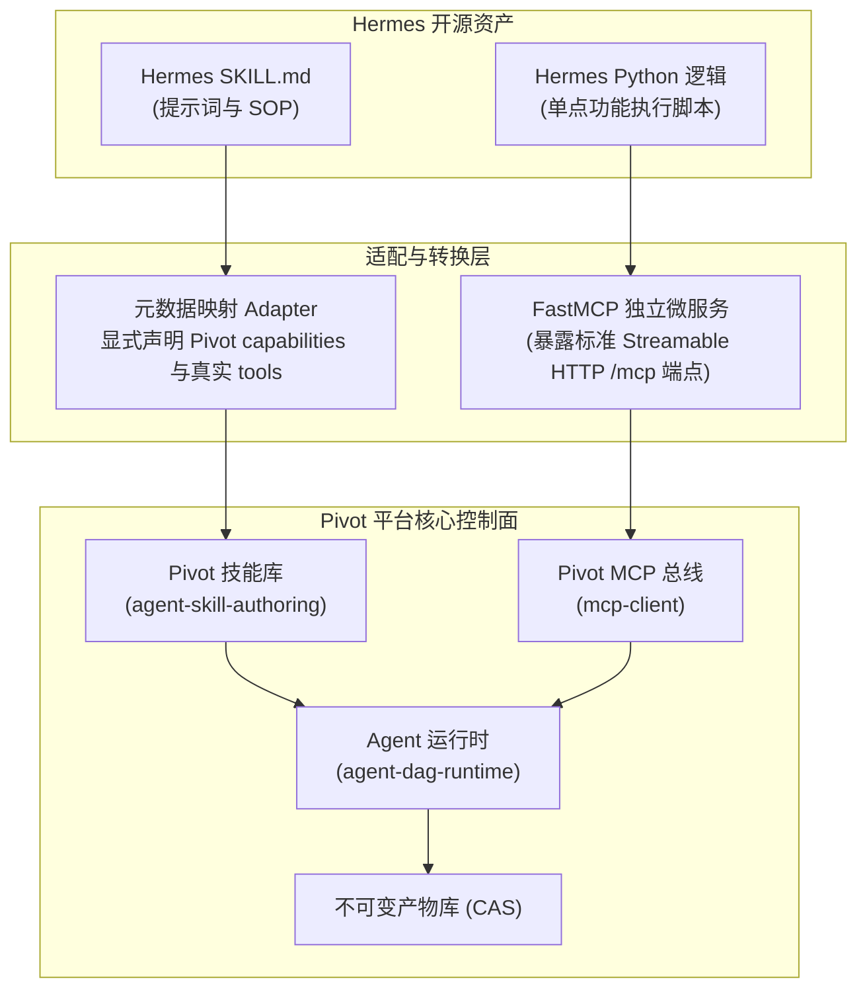
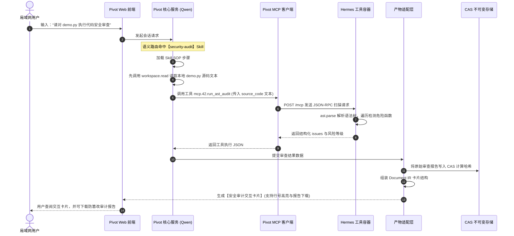

# Pivot（智枢）开源工具离线移植、精准选型与深度集成全景指南

> **版本状态说明（2026-10-23 修订版）**：  
> 本指南基于项目代码基线（版本 `0.7.31`，落地方案 v1.2 规范），依据 [《开源工具离线移植与深度集成指南审查报告_2026-10-22.md》](docs/reports/开源工具离线移植与深度集成指南审查报告_2026-10-22.md) 完成全面修复与深度重构。  
> **适用场景与核心定调**：针对**纯离线/无外网局域网**政企生产环境，系统阐述如何将优秀的开源工具（算法引擎、专业组件、技能配方等）通过自包含容器与标准化协议，原封移植并与 **Pivot 智能中枢** 实现嵌入式深度集成。  
> **核心指导原则**：  
> 1. **“复用既有运行时，拒绝双重引擎”**：坚决不引入外部大脑框架，外部开源资产仅作为被调用的单点功能微服务（Tool/Engine）；  
> 2. **“联网端自包含固化，内网零出站运行”**：所有依赖、模型、环境在外网构建期锁死并生成物料清单（BOM），内网冷启动零网络依赖；  
> 3. **“从协议打通到业务闭环”**：工具可调用（Schema 发现）不等于集成完成，必须经由适配层接入 UI Rendition、CAS 产物库与 RBAC/审批门禁。

---

## 目录
- [第一部分：现状盘点与精准选型篇（做与不做的界限）](#第一部分现状盘点与精准选型篇做与不做的界限)
  - [1.1 Pivot 现有成熟能力全景与“防重复”红线](#11-pivot-现有成熟能力全景与防重复红线)
  - [1.2 为什么拒绝全套移植通用 Agent 框架](#12-为什么拒绝全套移植通用-agent-框架)
  - [1.3 真正值得补强的四大高价值互补方向与选型分析](#13-真正值得补强的四大高价值互补方向与选型分析)
  - [1.4 新工具准入“三问评估决策法”](#14-新工具准入三问评估决策法)
- [第二部分：架构设计与深度集成篇（如何做到原装且内嵌）](#第二部分架构设计与深度集成篇如何做到原装且内嵌)
  - [2.1 总体架构拓扑图](#21-总体架构拓扑图)
  - [2.2 本项目现有成熟范本对照](#22-本项目现有成熟范本对照)
  - [2.3 原封移植如何落地“四重深度嵌入”（从协议可调用到业务深度集成）](#23-原封移植如何落地四重深度嵌入从协议可调用到业务深度集成)
  - [2.4 开源工具的三大接入形态与规范化实操](#24-开源工具的三大接入形态与规范化实操)
- [第三部分：深度实战案例：Hermes-Agent 工具与技能融合篇](#第三部分深度实战案例hermes-agent-工具与技能融合篇)
  - [3.1 资产两分法理念（Skills 技能配方 vs Tools 执行工具）](#31-资产两分法理念skills-技能配方-vs-tools-执行工具)
  - [3.2 Skill（技能配方）标准对齐、安全校验与发布门禁](#32-skill技能配方标准对齐安全校验与发布门禁)
  - [3.3 Tool（执行代码）基于 FastMCP 协议的服务化挂载与真实 AST 扫描](#33-tool执行代码基于-fastmcp-协议的服务化挂载与真实-ast-扫描)
  - [3.4 端到端执行闭环、时序图与产物回收](#34-端到端执行闭环时序图与产物回收)
- [第四部分：离线生产交付与运维保障篇（纯局域网 SOP）](#第四部分离线生产交付与运维保障篇纯局域网-sop)
  - [4.1 纯离线局域网交付标准作业流程（SOP）](#41-纯离线局域网交付标准作业流程sop)
  - [4.2 容器编排规范与内部通信安全](#42-容器编排规范与内部通信安全)
  - [4.3 离线生产环境安全、合规与避坑清单](#43-离线生产环境安全合规与避坑清单)
  - [4.4 备份、回滚与容灾预案](#44-备份回滚与容灾预案)
- [总结与实施路径建议](#总结与实施路径建议)

---

# 第一部分：现状盘点与精准选型篇（做与不做的界限）

## 1.1 Pivot 现有成熟能力全景与“防重复”红线

当前 **Pivot（智枢）** 已经完成了一个企业级/政企 AI 平台核心版图的构建，具备了完整的“办文、办事、办会、查法、识图、析数”业务矩阵。

在评估引入任何外部开源工具之前，必须严格排查，**凡属于已有成熟能力的，坚决不再重复建设**：



### 现有能力与开源工具“排重清单”

> [!NOTE]
> 模型与 OCR 应严格区分**“架构支持”**、**“目标现场已部署”**与**“当前镜像已包含”**：Pivot 自身为无状态核心控制面，通过配置对接内网模型推理端点，PaddleOCR 作为独立微服务交付，业务持久化存储依赖独立 PostgreSQL，DuckDB 专注于只读分析计算。

| 业务领域 | Pivot 本地已有实现证据 | 常见的外部开源项目 | 决策建议 | 详细理由与现状边界 |
| :--- | :--- | :--- | :--- | :--- |
| **大模型推理** | 支持接入本地部署的 **Qwen 2.5/3.x**（OpenAI 兼容接口） | Llama 系列、ChatGLM、Mistral | ❌ **不重复引入** | Qwen 中文公文理解能力处于第一梯队；只需维护现有端点配置，无需引入多套模型底座。 |
| **文字识别** | 独立部署的 **PaddleOCR** HTTP 微服务 | Tesseract、EasyOCR、Umi-OCR | ❌ **不重复引入** | 现有 PaddleOCR 已能稳定处理公文印刷体与版面结构，同质化工具无增量价值。 |
| **PDF 校验与差分** | 内置 **qpdf + veraPDF** CLI，且具备 PDF 逐页像素比对（[advanced.js](server/services/document-processing/pdf/operations/advanced.js#L222)） | PDFtk、PyMuPDF 基础裁剪 | ❌ **不重复引入** | 已具备合规校验、修复与逐页视觉差异图能力，普通裁切与视觉比对无需新设工具。 |
| **通用数据分析** | **PostgreSQL**（主库）+ **DuckDB** + [database-mcp.js](server/services/database-mcp.js) | Pandas 独立执行壳、SQLite 探针 | ❌ **不重复引入** | Pivot 已有完善的关系库和高性能列存分析能力，杜绝无鉴权的数据探针容器。 |
| **语音输入与播放** | 内置 **Vosk (STT)**，服务端 [`AGENT_TTS_ENDPOINT`](server/services/agent-media-generation.js) 与客户端 [`realtime-voice.js`](client/chat/realtime-voice.js) | Whisper、FunASR | ❌ **不重复引入** | Vosk 纯 CPU 离线运行稳定，客户端已有 Web Speech 朗读与打断；缺口在离线高质量 TTS 统一后端。 |
| **知识来源增量同步** | [knowledge-sources.js](server/services/knowledge-sources.js) 支持本地目录、Wiki、HTTP 清单与数据库模板增量同步 | Dify 知识库连接器、FastGPT 导入器 | ❌ **不重复引入** | 现有调度器已支持哈希比对与删除同步；缺口仅在内网动态复杂 OA 渲染抓取。 |

---

## 1.2 为什么拒绝全套移植通用 Agent 框架

在评估开源 Agent 框架（如 `hermes-agent`、`LangChain`、`CrewAI`、`AutoGPT`）时，部分开发者倾向于“整体引入”。在企业级生产环境中，这种做法存在显著弊端：

1. **运行时机制重复与混乱**：
   Pivot 服务端自研了严谨的企业级 Agent 运行时，已包含完整的底层控制面：
   - 任务 DAG 编排：[agent-dag-runtime.js](server/services/agent-dag-runtime.js)
   - 技能严格版本控制与鉴权：[agent-skills.js](server/services/agent-skills.js) 与 [agent-releases.js](server/services/agent-releases.js)
   - 沙箱与终端隔离：[agent-terminal-runtime.js](server/services/agent-terminal-runtime.js) 与 [agent-sandbox.js](server/services/agent-sandbox.js)
   - 不可变内容寻址产物库：[agent-artifact-cas.js](server/services/agent-artifact-cas.js)
2. **复用统一企业治理能力（RBAC 与审批门禁）**：
   外部通用 Agent 框架（如 Hermes）虽然具备单机危险命令确认和基础容器隔离能力，但通常缺乏政企所需的组织层级可见性管控（[unit-visibility.js](server/services/unit-visibility.js)）、基于角色的权限隔离，以及跨会话的高危动作多级人工审批流（[agent-approval-requests.js](server/services/agent-approval-requests.js)）。
3. **架构烟囱化与审计断裂**：
   引入完整框架会导致系统内部存在两套 Prompt 组装逻辑、两套会话记忆机制、两份不可对齐的审计日志，造成排错与合规审计的灾难。

> [!IMPORTANT]
> **结论**：坚决不引入外部“框架类/大脑类”项目。外部工具只作为被调用的**“单点功能微服务（Tool/Engine）”**挂载进 Pivot 的工具总线中，统一纳入 Pivot 的治理、审批与审计闭环。

---

## 1.3 真正值得补强的四大高价值互补方向与选型分析

结合政企实际办公中的痛点与系统真实能力现状，明确四大增量补强目标及选型约束：

### 1. 全离线统一高保真语音合成引擎（TTS，补全全终端一致体验）
* **现状与差距**：系统已有 Vosk 实现了离线输入，[agent-media-generation.js](server/services/agent-media-generation.js) 已有 `AGENT_TTS_ENDPOINT` 受控 Provider，客户端 [realtime-voice.js](client/chat/realtime-voice.js) 也已具备朗读与打断逻辑。**现有缺口在于**：缺乏统一部署、跨国产终端体验一致的高质量中文离线 TTS 独立微服务（避免依赖各客户端操作系统自带的偶发发音引擎或外部云接口）。
* **高频业务场景**：公文通读审校（文字工作者用耳朵挑错字、语病）、法规条款摘要语音播音、会议纪要要点朗读。
* **推荐选型与许可边界**：
  - **Piper**（首选推荐）：原项目 `rhasspy/piper` 已归档，当前活跃维护分支为 [OHF-Voice/piper1-gpl](https://github.com/OHF-Voice/piper1-gpl)（声明为 **GPL-3.0** 许可证；注意：中文音色模型权重需单独核查各自模型卡的 License，如商业友好度）。基于 C++ 与 ONNX Runtime，具备**低延迟、纯 CPU 运行开销小**的优势，适合打包为轻量无 GPU 依赖的微服务。
  - **CosyVoice**（阿里开源，Apache 2.0 许可证）：若现场 GPU 算力充裕（建议 4GB+ 显存）且追求极高拟人度与情感起伏，可作为可选增强节点部署。
  - **验收要求**：在目标内网 CPU 机器上实测并发吞吐、首字音频延迟（TTFB）与中文多音字发音准确率。

### 2. 公文与法规专属“红线精细比对”（Diff 引擎，字词级与 DOCX 修订）
* **现状与差距**：[apps-workbench-proofread.js](client/chat/apps-workbench-proofread.js) 已具备公文段落对照，[advanced.js](server/services/document-processing/pdf/operations/advanced.js#L222) 已具备 PDF 逐页像素级视觉渲染比对。**现有缺口在于**：字符/词级精准对齐、段落移动识别、标准 Word 审阅模式（DOCX Track Changes 修订批注）以及可核查的条款对比凭据。
* **高频业务场景**：
  - 领导批改公文草稿对比：草稿与修改稿一键生成标准 Word 审阅红线文件（增删改痕迹字字清晰）；
  - 新旧法规条文对照：条款增删、移位、变动左右双栏精准标红对照。
* **推荐选型与契约设计**：
  - 基于 AST/DOM 的文档比对微服务（封装 `python-docx` / XML 差分逻辑），作为独立微服务容器运行；
  - 明确输出契约：输出标准化 Diff JSON（包含变更类型 `add`/`delete`/`modify`/`move`、原文字符区间、修订理由）并直接合成带红线修订标记的 `.docx` 文件写入 CAS。

### 3. 思维导图与流程图确定性渲染（从代码到矢量图形可视化）
* **现状与差距**：Pivot 已具备 ECharts 统计图表（`pivot_chart`）、SVG 展示组件与 PPT 层次元素排版。但在产物视图中，通用 Mermaid 文本依然回退为纯代码块。**现有缺口在于**：从纯文本图表描述到高清矢量图形（SVG/PNG）的确定性渲染，以及可选的思维导图交互编辑能力。
* **高频业务场景**：法规审批审批流程高清流程图渲染、大型调研规划大纲一键生成思维导图（MindMap）。
* **推荐选型与许可边界**：
  - **Kroki**（首选推荐，MIT 许可证）：统一的多引擎网关镜像，传入纯文本毫秒级输出高质量 SVG/PNG。
    > [!WARNING]
    > **部署关键**：`yuzutech/kroki` 基础网关默认**不包含** Mermaid 引擎！生产部署必须额外拉起 `yuzutech/kroki-mermaid` 伴随容器，并配置环境变量 `KROKI_MERMAID_HOST`，详见 2.4 节。
  - **MindElixir**（MIT 许可证）：纯前端轻量级思维导图交互库，直接嵌入产物视图，无需额外服务端。

### 4. 局域网内网定向知识抓取与清洗（扩展动态 OA 与门户连接器）
* **现状与差距**：[knowledge-sources.js](server/services/knowledge-sources.js) 已经支持本地/SMB 目录、Wiki Markdown、HTTP API 清单与数据库模板的哈希增量同步与定时调度。**现有缺口在于**：缺少针对局域网内部复杂 OA 门户（涉及 Cookie/表单登录、动态 JavaScript 渲染、强广告/侧边栏干扰）的定向抽取与高保真 Markdown 清洗连接器。
* **高频业务场景**：定期巡检内网政务内网门户、自动抽取政策公文正文并过滤导航杂音，沉淀为干净知识库源文档。
* **推荐选型与许可边界**：
  - **Crawl4AI**（推荐，Apache 2.0 许可证）：专为 LLM 设计的高性能爬虫，基于 Playwright 支持无头渲染与结构化内容抽取，许可证友好。
  - **Firecrawl（自部署版）**：具备深层抽取能力，但主体采用 **AGPL-3.0** 许可证，且自部署依赖 Redis、Playwright 等多项重型组件，需严格核查网络边界与开源传染性风险。

---

## 1.4 新工具准入“三问评估决策法”

团队在评估引入任何外部开源工具时，必须严格执行以下决策树：

```
                ┌────────────────────────────────┐
                │ 提议引入某 GitHub 开源工具     │
                └───────────────┬────────────────┘
                                │
                                ▼
         ┌──────────────────────────────────────────────┐
         │ 第一问：该能力是否与当前已有功能重合？       │
         │ (已有 Qwen、PaddleOCR、公文段落对照、        │
         │  PDF 像素比对、knowledge-sources 同步等)     │
         └──────────────┬───────────────────────────────┘
                        │
                [否] ───┴─── [是] ─────────► ❌ 坚决否决，复用现有链路
                 │
                 ▼
         ┌──────────────────────────────────────────────┐
         │ 第二问：能否在外网完成自包含固化打包？       │
         │ (内网运行期 0 外网出站、无在线权重/wheel下载)│
         └──────────────┬───────────────────────────────┘
                        │
                [是] ───┴─── [否] ─────────► ❌ 暂缓引入，不满足离线交付
                 │
                 ▼
         ┌──────────────────────────────────────────────┐
         │ 第三问：是否属于高频真实刚需且许可证合规？   │
         │ (有业务痛点，无 AGPL 意外传染，非极客尝鲜)   │
         └──────────────┬───────────────────────────────┘
                        │
                [是] ───┴─── [否] ─────────► ⏸️ 搁置，保持系统架构精简
                 │
                 ▼
      ════════════════════════════════════════════
      ✅ 批准引入：
         1. 制作自包含 Docker 镜像挂载至 ai-bridge 网络
         2. 通过标准 Streamable HTTP (MCP) 或受控 REST 接入
         3. 编写适配层接入 UI Rendition 与 CAS 产物库
      ════════════════════════════════════════════
```

---

# 第二部分：架构设计与深度集成篇（如何做到原装且内嵌）

## 2.1 总体架构拓扑图

```mermaid
graph TD
    subgraph 用户交互层 [Pivot 前端 UI]
        Chat["会话窗口 (Chat)"]
        Cards["原生交互卡片 (Renditions: 图表/Diff/下载)"]
        ApprovalModal["审批与授权弹窗 (ApprovalModal)"]
    end

    subgraph Pivot 核心控制面 [Node.js 主服务 :3000]
        AgentEngine["Agent 决策与任务编排 (agent-dag-runtime)"]
        ToolRouter["工具总线与 MCP 客户端 (mcp-client)"]
        Security["出站网络策略 (SSRF 防护) 与安全审计"]
        AdaptorLayer["规范化适配层 (Document IR 转换器)"]
        CASStore["不可变产物库 (agent-artifact-cas)"]
    end

    subgraph 虚拟共享网络 [Docker ai-bridge (受限互联)]
        PivotHost["pivot 核心容器"]
        ToolA["开源工具 A: 离线 FastMCP 容器<br>(如: AST 代码扫描微服务)"]
        ToolB["开源工具 B: 重型算法微服务<br>(如: Kroki 渲染伴随服务组)"]
        ToolC["开源工具 C: 扩展知识抓取连接器<br>(如: Crawl4AI 无头渲染服务)"]
    end

    Chat <--> AgentEngine
    AgentEngine --> ToolRouter
    ToolRouter --> Security
    Security <-->|纯内网 Streamable HTTP / JSON-RPC| ToolA
    Security <-->|纯内网受控 REST API| ToolB
    Security <-->|纯内网抓取调度| ToolC

    ToolA -->|结构化分析数据| AdaptorLayer
    ToolB -->|高清矢量图/二进制| AdaptorLayer
    AdaptorLayer -->|写入不可变 CAS 制品| CASStore
    AdaptorLayer -->|生成规范化 Rendition| Cards
    Cards <--> CASStore
```

---

## 2.2 本项目现有成熟范本对照

在当前的 Pivot 仓库中，“自包含开源底座 + 受控业务外壳”的架构已有成熟范本可供对照参考：

| 现有组件 | 底层开源技术 | 移植与打包方式 | Pivot 内的深度嵌入实现 | 对应代码与配置 |
| :--- | :--- | :--- | :--- | :--- |
| **离线语音转写** | 开源 Vosk (C/Python) | `Dockerfile` 多阶段构建，构建期运行脚本固化离线模型权重 | 前端实时流式录音、文字上屏，异常时闭环降级 | [Dockerfile](Dockerfile#L46-L55)<br>[docker/speech-service](docker/speech-service/Dockerfile) |
| **PDF 标准校验与修复** | 开源 veraPDF (Java) 与 qpdf (C++) | 构建期拉取官方无交互 CLI 安装器，直接以二进制 CLI 固化进运行镜像 | 文档解析时自动触发合规性校验，输出不可篡改的校验报告 | [Dockerfile](Dockerfile#L25-L45)<br>[document-rendering](server/services/document-rendering/index.js) |
| **标准 MCP 工具通信** | Model Context Protocol | 采用 JSON-RPC 与 Streamable HTTP 协议与外部服务通信 | 动态拉取工具 Schema，统一前缀治理与权限映射 | [mcp-client.js](server/services/mcp-client.js)<br>[tool-library.js](server/routes/tool-library.js) |
| **多容器网络隔离** | Docker Bridge 网络 | 预建统一的 `ai-bridge` 隔离网络 | 主容器与独立微服务通过内网容器名解析，无公网暴露 | [docker-compose.yml](docker-compose.yml#L51-L54) |

---

## 2.3 原封移植如何落地“四重深度嵌入”（从协议可调用到业务深度集成）

“工具可调用”仅仅是第一步，真正的深度嵌入必须经由适配层接入 Pivot 的四大管理维度：



### 1. 会话与决策嵌入（Agent Loop & Schema）
- **实现目标**：让模型明确理解工具能力边界与入参格式，自主决定调度时机。
- **做法**：在工具提供端输出符合 JSON Schema 规范的工具清单。参考 [mcp-tool-presentation.js](server/services/mcp-tool-presentation.js)。入参设计应避免让模型组装宿主机文件绝对路径，推荐内容直传或受控 ID 引用。

### 2. 权限与审批嵌入（Governance & Approval Gates）
- **实现目标**：外部微服务不具备组织级 RBAC，Pivot 必须作为统一安全前置网关。
- **做法**：
  - **可见性控制**：通过 [unit-visibility.js](server/services/unit-visibility.js) 限制特定工具仅允许特定角色或部门使用；
  - **高危动作审批门禁**：对存在持久化修改、执行代码或大范围扫描风险的工具，在登记时设置 `risk_level: high`，执行前由 [agent-approval-requests.js](server/services/agent-approval-requests.js) 自动拦截并触发人工审批。

### 3. 产物沉淀与版本嵌入（Artifacts & CAS Lifecycle）
- **实现目标**：外部工具生成的结构化数据、比对报表或渲染图形，严禁散落在宿主机临时目录，必须进入不可变版本生命周期。
- **做法**：适配层捕获执行结果，调用 [agent-artifacts.js](server/services/agent-artifacts.js) 创建产物记录，二进制数据通过 [agent-artifact-cas.js](server/services/agent-artifact-cas.js) 计算 SHA-256 哈希落库。

### 4. 界面与交互嵌入（UI Renditions & Document IR）
- **实现目标**：拒绝简单展示原始 JSON，通过原生卡片展示交互式表格、ECharts 图表、Diff 对照或下载浮窗。
- **必须明确的端到端产物转化管线（5 步闭环）**：
  ```
  外部工具返回原始数据 
    ──► 1. 适配层解析与规范化 (Normalization)
    ──► 2. 写入/更新基础产物 (agent-artifacts.js)
    ──► 3. 组装 Document IR 结构 (document-ir.js)
    ──► 4. 创建不可变 Rendition 制品 (agent-artifact-renditions.js::createRendition)
    ──► 5. 前端安全消费与下载凭证签发 (短期一次性下载 Token)
  ```

---

## 2.4 开源工具的三大接入形态与规范化实操

### 形态 1：标准 MCP 协议微服务（推荐首选）
* **代表工具**：各类遵循 MCP 规范的 Python/Node 独立微服务（如数据查询、代码审计）。
* **对接方式**：
  1. 外部服务暴露 Streamable HTTP 端点（如 `http://hermes-tools:8501/mcp`）；
  2. 管理员在后台「工具服务管理」添加服务，协议模式选择 `standard`；
  3. [mcp-client.js](server/services/mcp-client.js) 发起初始化握手与 Schema 发现，分配数字服务 ID（如 `42`），工具全名为 `mcp.42.<tool_name>`。

### 形态 2：独立算法微服务容器（如 Kroki 图表渲染）
* **代表工具**：Kroki、文档转换服务等。
* **正确编排规范**（以支持 Mermaid 的完整 Kroki 组合为例）：

```yaml
version: '3.8'

services:
  kroki:
    image: yuzutech/kroki:latest
    pull_policy: never
    container_name: pivot-kroki
    restart: always
    environment:
      # 必须显式指定伴随渲染服务的内网主机名
      - KROKI_MERMAID_HOST=kroki-mermaid
    networks:
      - ai-bridge
    # 生产环境中仅通过内部网络通信，不映射宿主机端口

  kroki-mermaid:
    image: yuzutech/kroki-mermaid:latest
    pull_policy: never
    container_name: pivot-kroki-mermaid
    restart: always
    networks:
      - ai-bridge

networks:
  ai-bridge:
    external: true
```

* **规范化适配器编写**（示例：`server/services/agent-tool-diagram.js`）：

```javascript
const { safeJsonPost } = require('./safe-http-client');

/**
 * Kroki 图表渲染适配器
 * 满足出站策略校验、响应类型设置、数据层级提取与错误处理要求。
 */
async function executeDiagramRender({ diagramSource, diagramType = 'mermaid' }, context = {}) {
    if (!diagramSource || typeof diagramSource !== 'string') {
        throw new Error('图表源码不能为空。');
    }

    const ALLOWED_TYPES = new Set(['mermaid', 'plantuml', 'graphviz', 'c4plantuml']);
    const safeType = String(diagramType).toLowerCase().trim();
    if (!ALLOWED_TYPES.has(safeType)) {
        throw new Error(`不支持的图表类型: ${safeType}`);
    }

    // 调用局域网 kroki 容器渲染矢量图
    // 关键修正点：
    // 1. responseType 必须指定为 'text'，SVG 为 XML 文本而非 JSON
    // 2. 传入 context.user 满足出站安全策略检查
    // 3. 正确读取 response.data
    const response = await safeJsonPost(`http://kroki:8000/${safeType}/svg`, diagramSource, {
        user: context.user,
        responseType: 'text',
        timeout: 10000,
        headers: {
            'Content-Type': 'text/plain; charset=utf-8',
            'Accept': 'image/svg+xml, text/plain'
        }
    });

    const svgText = String(response.data || '');
    if (!svgText.includes('<svg')) {
        throw new Error('Kroki 服务返回了无效的 SVG 内容。');
    }

    return {
        format: 'svg',
        svgContent: svgText
    };
}
```

### 形态 3：受控 OpenAPI / REST 操作导入
* **代表工具**：自带标准 Swagger/OpenAPI 规范文档的内部业务系统接口。
* **对接方式**：
  使用 Pivot 的受控 OpenAPI 导入服务（[workflow-api-operations.js](server/services/workflow-api-operations.js)）与管理界面（[mcp-workbench-api-operations.js](client/chat/mcp-workbench-api-operations.js)），解析 API 操作定义并自动注入参数映射与认证凭据，无需硬编码调用逻辑。

---

# 第三部分：深度实战案例：Hermes-Agent 工具与技能融合篇

## 3.1 资产两分法理念（Skills 技能配方 vs Tools 执行工具）

对于 `hermes-agent` 等开源项目，正确的融合策略是：**“取其弹药，用我战车”**：
1. **技能层（Skills）**：沉淀 Prompt 指令、多步骤排错流程与标准 SOP，转换为 Pivot 标准 `SKILL.md`；
2. **工具层（Tools）**：用 Python 编写的真实执行逻辑，包装为 FastMCP 独立微服务并挂载至工具总线。



---

## 3.2 Skill（技能配方）标准对齐、安全校验与发布门禁

### 1. 规范对照与字段映射要求

在 [agent-skill-authoring.js](server/services/agent-skill-authoring.js) 和 [agent-skills.js](server/services/agent-skills.js) 中，Pivot 对 `SKILL.md` 执行严格的 Schema 门禁检查（`previewSkillSource()`）：
- **唯一标识与展示名**：稳定 ASCII 标识填入 `id` 与 `name`，中文展示名填入 `title`；
- **能力注册覆盖**：`capabilities` 中的每个标识必须在 [agent-capability-registry.js](server/services/agent-capability-registry.js) 中已登记（例如外部 MCP 工具调用需要声明 `network.request`，工作区读取需要声明 `filesystem.read_workspace`）；
- **工具名称精确绑定**：`tools` 声明必须是系统内已登记的工具名称（例如实际已挂载的数字服务 ID `mcp.42.run_ast_audit`，以及内置工作区读取工具 `workspace.read`）。

| 字段 | Hermes `SKILL.md` | Pivot 平台严格规范要求 | 转换动作与要求 |
| :--- | :--- | :--- | :--- |
| **唯一标识** | `name: security-audit` | `id: security-audit`<br>`name: security-audit` | 必须保持小写字母与连字符的稳定标识 |
| **展示标题** | （缺失） | `title: 源码安全漏洞审查专家` | 补充人类友好的展示标题 |
| **规范版本** | （无要求） | `schemaVersion: 1` | 严格模式固定填 `1` |
| **版本号** | `version: 1.0.0` | `version: 1.0.0` | 必须符合 SemVer 规范 |
| **能力授权** | （无） | `capabilities: [...]` | **必填**，必须为注册表中存在的能力，并覆盖工具所需权限 |
| **工具授权** | `allowed-tools: [...]` | `tools: [...]` | **必填**，必须使用平台实际登记的全名（如 `mcp.42.run_ast_audit`） |
| **输入输出** | （隐式说明） | `inputs: { ... }`<br>`outputs: { ... }` | 严格模式下必须声明为 JSON Schema 对象 |
| **执行指令** | Markdown 正文 | Markdown 正文 | 保留执行步骤，去除对未挂载命令的依赖 |

### 2. 转换示例：符合 Pivot 严格门禁的 `SKILL.md`

```markdown
---
id: security-audit
name: security-audit
version: 1.0.0
schemaVersion: 1
title: 源码安全漏洞审查专家
description: 针对传入的源码执行抽象语法树静态分析，排查危险内置函数调用与反序列化漏洞
capabilities:
  - network.request
  - filesystem.read_workspace
tools:
  - mcp.42.run_ast_audit
  - workspace.read
inputs:
  target_file:
    type: string
    description: 待审查的代码文件相对路径
outputs:
  audit_report:
    type: string
    description: 结构化安全审查结果与风险评估
---

# Instructions for Security Audit
1. 首先调用 workspace.read 读取待审计文件的源代码文本。
2. 调用 mcp.42.run_ast_audit 传入代码文本，执行语法树风险模式扫描。
3. 提取扫描结果中的问题清单、代码行号与风险等级。
4. 按照安全规约生成包含定位与修复建议的结构化审计报告。
```

### 3. 技能发布与 ZIP 导入规范（解决发布门禁）

根据 [agent-skill-packages.js](server/services/agent-skill-packages.js) 与 [agent-releases.js](server/services/agent-releases.js)：
* **ZIP 离线技能包结构要求**：
  - **根目录必须直接包含清单文件**（`SKILL.md` 或 `SKILL.yaml`），禁止将多个技能子目录随意合并打包；
  - 严禁包含绝对路径、符号链接或超过大小限制的条目；
  - 包内脚本目录受供应链安全扫描（`scanSkillPackageEntries`）管控。
* **发布流程**：
  1. 上传包文件至接口 `POST /api/agents/skills/package`；
  2. 系统解压并执行数字签名与供应链安全检查；
  3. 创建技能草稿版本（`createSkillVersion`）；
  4. 执行 `previewSkillSource` 完整语法与权限覆盖校验；
  5. 个人使用可直接发布；发布至组织共享范围（`shared`/`global`）必须经过管理员审批与数字签名验签。

---

## 3.3 Tool（执行代码）基于 FastMCP 协议的服务化挂载与真实 AST 扫描

### 1. 编写微型 MCP 服务包装器（`hermes_mcp_server.py`）

> [!IMPORTANT]
> **真实实现与文件传递原则**：  
> 1. 示例采用真实的 Python `ast` 模块进行语法树遍历，杜绝返回固定的占位文字；  
> 2. 入参直接传递代码文本内容（`source_code`），消除多容器间因未共享文件卷导致的路径穿透与文件不存在问题；  
> 3. SDK 采用官方 `mcp` Python SDK（v1.x），构造函数配置 `host`/`port`，`run()` 采用标准 `streamable-http`。

```python
# hermes_mcp_server.py
"""
Hermes 工具箱微服务封装（基于官方 MCP Python SDK v1.x）
提供真实的代码 AST 静态语法树安全扫描能力。
"""
import ast
from typing import Dict, Any, List
from mcp.server.fastmcp import FastMCP

# 1. 官方 SDK 规范：host、port 在 FastMCP 构造时配置
mcp = FastMCP("hermes-tools-service", host="0.0.0.0", port=8501)

DANGEROUS_CALLS = {
    "eval": "直接动态执行字符串代码（高危代码注入）",
    "exec": "直接执行动态代码块（高危代码注入）",
    "compile": "动态编译未信任代码",
    "__import__": "隐式动态导入任意模块",
}

DANGEROUS_ATTRIBUTES = {
    ("os", "system"): "直接执行宿主机操作系统命令",
    ("os", "popen"): "打开子进程管道执行宿主机命令",
    ("subprocess", "Popen"): "直接拉起外部子进程",
    ("subprocess", "call"): "调用外部命令",
    ("pickle", "loads"): "反序列化未信任数据（远程代码执行风险）",
}

class SecurityAstVisitor(ast.NodeVisitor):
    def __init__(self):
        self.issues: List[Dict[str, Any]] = []

    def visit_Call(self, node: ast.Call):
        if isinstance(node.func, ast.Name) and node.func.id in DANGEROUS_CALLS:
            self.issues.append({
                "line": node.lineno,
                "col": node.col_offset,
                "type": "dangerous_builtin_call",
                "target": node.func.id,
                "risk": "HIGH",
                "description": DANGEROUS_CALLS[node.func.id]
            })
        elif isinstance(node.func, ast.Attribute) and isinstance(node.func.value, ast.Name):
            pair = (node.func.value.id, node.func.attr)
            if pair in DANGEROUS_ATTRIBUTES:
                self.issues.append({
                    "line": node.lineno,
                    "col": node.col_offset,
                    "type": "dangerous_module_call",
                    "target": f"{pair[0]}.{pair[1]}",
                    "risk": "HIGH",
                    "description": DANGEROUS_ATTRIBUTES[pair]
                })
        self.generic_visit(node)

@mcp.tool()
def run_ast_audit(source_code: str, file_name: str = "inline.py") -> Dict[str, Any]:
    """对传入的 Python 源码文本进行抽象语法树 (AST) 安全静态扫描，查找代码注入与非安全反序列化漏洞。"""
    if not source_code or not source_code.strip():
        return {
            "status": "error",
            "file_name": file_name,
            "message": "源码内容为空，未执行扫描。",
            "issues": []
        }

    try:
        tree = ast.parse(source_code, filename=file_name)
    except SyntaxError as e:
        return {
            "status": "syntax_error",
            "file_name": file_name,
            "message": f"源码存在语法错误无法解析: {e.msg} (行 {e.lineno})",
            "issues": []
        }

    visitor = SecurityAstVisitor()
    visitor.visit(tree)

    has_high = any(item["risk"] == "HIGH" for item in visitor.issues)
    return {
        "status": "completed",
        "file_name": file_name,
        "scanned_nodes": len(list(ast.walk(tree))),
        "issues_count": len(visitor.issues),
        "risk_level": "HIGH" if has_high else ("MEDIUM" if visitor.issues else "CLEAN"),
        "verdict": "发现已知高危风险调用，建议阻断并核查" if has_high else "AST 扫描通过，未发现已知高危模式",
        "issues": visitor.issues
    }

if __name__ == "__main__":
    # 2. 锁定 Streamable HTTP 协议传输，与 Pivot 现代客户端无缝对接
    mcp.run(transport="streamable-http")
```

### 2. 独立微服务运行编排

```yaml
version: '3.8'

services:
  hermes-tools:
    image: hermes-tools:v1.0.0
    pull_policy: never
    container_name: pivot-hermes-tools
    restart: always
    networks:
      - ai-bridge
    # 仅容器内网通信，不向宿主机发布端口，杜绝绕过 Pivot 治理的访问后门

networks:
  ai-bridge:
    external: true
```

### 3. 在 Pivot 后台挂载 MCP 服务
1. 进入 **「工具服务管理」 $\rightarrow$ 「新增 MCP 服务」**；
2. 填写服务名称：`Hermes 专项分析工具箱`；
3. 填写内网通信 URL：`http://hermes-tools:8501/mcp`；
4. 协议模式选择：`standard`；协议版本保持兼容（如 `2025-11-25`）；
5. 保存后，Pivot 发起握手与 Schema 自动同步。若服务被分配为 ID `42`，则工具在技能中以 `mcp.42.run_ast_audit` 正常引用。

---

## 3.4 端到端执行闭环、时序图与产物回收



---

# 第四部分：离线生产交付与运维保障篇（纯局域网 SOP）

## 4.1 纯离线局域网交付标准作业流程（SOP）

```
[外网有网机 / CI 阶段]                   [物理介质摆渡通道]                 [内网局域网生产机]
1. 检出固定 Commit 源码
2. 下载固定版本 Wheels/依赖            ( U盘 / 光盘 / 专网单向信道 )      1. SHA-256 完整性核查
3. 构建自包含 Docker 镜像               ──────────────────────────►      2. docker load 镜像入库
4. 导出 tar 镜像包与 BOM 清单                                             3. 预建目录、权限与网络
5. 生成 sha256sum.txt                                                    4. docker compose 启动
                                                                         5. 零出站冷启动验证
```

### 生产 SOP 实施九步法：

1. **版本与依赖强锁定**：
   - 源码锁定具体 Git Commit ID 或 Release Tag；Python 必须提供精确到子版本的 `requirements.txt`；
   - 严禁在 Dockerfile 或镜像标签中使用 `latest`。
2. **交付完整物料清单（BOM）与校验和**：
   - 交付清单包含：镜像包、模型权重文件、中文字体（如思源黑体）、配置文件、SHA-256 校验和文件；
   - 现场导入前执行：`sha256sum -c sha256sum.txt`，确保物料未经损坏或篡改。
3. **架构与指令集对齐**：
   - 明确宿主机 CPU 架构（如 x86_64、ARM64）及指令集要求（如 ONNX/AVX2 支持）；
   - Linux 镜像内使用的 Python Wheels 必须在对应 Linux 架构下打包，严禁将 Windows Wheels 拷贝至 Linux 容器使用。
4. **宿主机目录预建与权限划分**：
   - 预建数据挂载目录并配置 UID/GID 权限（配合容器内 `user: "1000:1000"` 运行要求）；
   - 规划只读卷与临时可写目录（临时缓存通过 `tmpfs` 内存挂载）。
5. **网络与启动参数配置**：
   - 预建共享桥接网络：`docker network create ai-bridge`；
   - 必须通过参数 `--no-build --pull never` 启动，防止生产环境尝试编译或外网拉取镜像：
     ```bash
     docker compose -f docker-compose.tool.yml up -d --no-build --pull never
     ```
6. **零外网出站冷启动验证（Zero-Egress Check）**：
   - 启动后检查网络连接，验证无外部公网连接发起；
   - 检查容器启动日志，验证无在线下载权重、无在线更新检查、无遥测上报。
7. **组织可见性与审批门禁验证**：
   - 以普通用户账号登录，验证新工具是否受到组织可见性管控；
   - 触发高危工具调用，验证是否正确阻断并生成人工审批工单；测试审批通过与驳回分支。
8. **功能闭环与异常验收用例**：
   - 准备包含合规样本、恶意代码样本、语法错误样本与超限大文件的测试集；
   - 验证工具调用超时、服务崩溃重启后系统的稳定性与错误提示可读性。
9. **审计追溯核验**：
   - 检查审计日志，确认调用发起人、输入参数摘要、审批人、执行耗时与 CAS 制品哈希均已被完整记录。

---

## 4.2 容器编排规范与内部通信安全

在编写第三方工具的 Compose 文件时，必须遵循以下生产安全规范：

```yaml
version: '3.8'

services:
  my-offline-tool:
    image: ${REGISTRY:-}my-offline-tool:v1.0.0
    pull_policy: never
    container_name: pivot-offline-tool
    restart: always
    user: "1000:1000"
    security_opt:
      - no-new-privileges:true
    read_only: true
    tmpfs:
      - /tmp:rw,noexec,nosuid,size=256m
    networks:
      - ai-bridge
    volumes:
      - ./data/tool-data:/app/data:ro
    deploy:
      resources:
        limits:
          cpus: '4.0'
          memory: 8G
        reservations:
          cpus: '1.0'
          memory: 2G
    # 纯内部微服务：禁止配置 ports 宿主机端口映射

networks:
  ai-bridge:
    external: true
```

---

## 4.3 离线生产环境安全、合规与避坑清单

- [ ] **模型与权重 100% 本地化**：代码中严禁存在 `from_pretrained("huggingface/...")` 等自动联网代码，模型加载路径必须使用环境变量显式指向容器内本地绝对路径。
- [ ] **拉取策略锁死**：所有服务的 Compose 配置中必须强制声明 `pull_policy: never`。
- [ ] **开源许可证合规排查**：
  - **GPL-3.0 项目**（如 Piper 维护版）：作为独立容器微服务通过 HTTP 远程调用，不与 Pivot 核心进程静态链接，保持网络隔离；
  - **AGPL-3.0 项目**（如 Firecrawl）：评估企业网络服务条款影响，严格限定在容器独立边界内运行，优先选用 Apache 2.0 / MIT 竞品（如 Crawl4AI）。
- [ ] **SSRF 安全放行与出站管控**：
  - Pivot 服务端具备严格的出站检查（[security.js](server/security.js)）；
  - 新增容器内网通信 URL 时，必须通过统一出站策略校验，禁止通过全局关闭安全策略的方式放行。
- [ ] **容器安全基线**：
  - 强制非 root 用户运行（`user: "1000:1000"`）；
  - 开启 `no-new-privileges: true` 与 `read_only: true`；
  - 严禁使用 `network_mode: host`。
- [ ] **能力与工具注册对齐**：
  - 在 Skill 中声明的任何能力，必须已在 [agent-capability-registry.js](server/services/agent-capability-registry.js) 登记；
  - 外部 MCP 工具必须以 `mcp.<数字ID>.<工具名>` 格式引用。
- [ ] **文件传递与参数安全**：
  - 严禁通过工具参数传递不受信任的宿主机绝对路径；
  - 优先采用内容文本直传，或通过受控短时文件令牌经 Pivot 存储网关拉取。

---

## 4.4 备份、回滚与容灾预案

在升级或引入新开源工具前，必须建立可复原的应急回滚机制：

1. **同时间戳原子备份**：
   - 执行前创建统一时间戳标记（如 `backup_20261023_0800`）；
   - 使用 `pg_dump` 备份 PostgreSQL 主业务库；
   - 对 CAS 产物存储目录与上传目录创建快照：
     ```bash
     tar -czf cas_backup.tar.gz ./data/cas ./data/uploads
     ```
2. **快速回滚步骤**：
   - 停止异常微服务：`docker compose -f docker-compose.tool.yml down`；
   - 恢复数据库表记录；
   - 撤销技能发布版本（通过 [agent-releases.js](server/services/agent-releases.js) 执行版本回滚）；
   - 验证核心对话与业务应用功能正常。

---

## 总结与实施路径建议

通过本全景指南的规范化重构：
1. **战略层**：守住防重复红线，立足于已有的 Qwen 推理、PaddleOCR、公文段落比对与知识来源同步调度底座，仅针对高保真 TTS、字词级 Diff、流程图渲染与动态页面抓取进行精准补强；
2. **架构层**：落实“四重深度嵌入”，通过规范化适配层打通工具返回到 Document IR、不可变 CAS 产物与交互卡片的完整闭环；
3. **实现层**：纠正 Skill 门禁校验、FastMCP 接口参数与通信模式错误，采用真实 AST 语法树算法与内容直传模式，保障示例的真实可执行性；
4. **交付层**：依托九步 SOP 流程、物料清单校验与严格容器安全规范，确保系统在纯无网生产环境中的高可靠与合规闭环。
