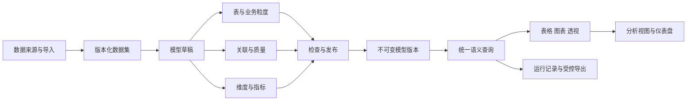

# Pivot BI 数据建模产品级建设方案

> 版本：v1.0  
> 编制日期：2026-11-06  
> 文档状态：产品与技术设计，作为后续开发拆解和评审基线；本文新增能力尚未实施。  
> 核查基线：当前工作区 v0.7.108，Git `251c1506`。代码核查为静态阅读，未在本次文档工作中重新执行功能测试。  
> 适用范围：应用中心内的数据分析应用，面向 BI 关系建模、维度、指标与分析资产复用。

## 1. 建设目标与关键决策

将现有“跨数据集模型配置 + 简单关联汇总”升级为可供业务人员持续使用的分析模型：先明确一条记录代表什么，再维护关联、定义指标、检查口径，最终让同一模型服务于表格、图表、透视、仪表盘和受控问数。

本方案整合此前关于指标语义层、跨数据集关系、质量检查、字段血缘和分析资产的规划，并按当前代码能力重新划定实施边界。建设重点是统计正确、操作可理解、结果可复现和现有能力复用。

| 决策 | 本版采用的方案 | 原因 |
| --- | --- | --- |
| 产品归属 | 仍属于“数据分析”，增加应用内“数据建模”主入口 | 模型与数据准备、分析消费共用上下文，不增加系统一级菜单 |
| 首版模型 | 单事实表，关联维度表及维度层级；支持仅含事实表的模型 | 先覆盖常见经营、业务台账与交易分析，控制统计歧义 |
| 正式分析 | 从事实表粒度出发，只通过已验证的一对一、多对一关联扩展 | 防止金额、数量和记录数被关联放大 |
| 原有关系 | 保留现有关联探索能力及旧接口，显式标记尚未通过正式模型校验 | 不静默改变历史统计行为，不把历史结果自动认证 |
| 指标 | 统一定义基础指标与有限的派生指标，分析端复用指标 ID | 减少各图表各写一套计算口径 |
| 生命周期 | 草稿、检查、发布版本、归档；质量和运行状态单独展示 | 编辑不影响已发布分析，数据变化也不冒充模型版本变化 |
| 数据引擎 | PostgreSQL 管理元数据，DuckDB 查询受控 Parquet | 延续现有架构，不重复引入数据库或 BI 引擎 |
| 数据接入 | 复用导入、派生清洗、数据库拉取和既有数据集 | 建模不直接保存数据库凭据，也不承担实时联邦查询 |
| 共享 | 默认个人；显式共享只读，运行时继续检查底层数据与字段权限 | 模型共享不能扩大数据访问范围 |
| AI | 可辅助解释、建议和生成草稿；不决定关联、发布和数值结果 | 模型判断与确定性统计各负其责 |
| 交付门槛 | M0—M3 完成后才称为“BI 数据建模首版产品闭环” | 避免只有关系图或后台接口就认定产品完成 |

本版不纳入机器学习建模、通用数据仓库开发、DAX/MDX 语言、任意跨表 SQL 编辑器、实时数据库联邦查询，以及尚未落地的组织级多租户治理。

## 2. 当前基础与实际缺口

### 2.1 经代码核对的基础

| 能力 | 当前事实 | 证据 | 本方案处理 |
| --- | --- | --- | --- |
| 模型管理 | 创建、修改、软删除；有版本号和条件更新 | `server/services/data-analysis/semantic-models.js`；`server/repositories/analysis-models.js` | 保留模型 ID，增量扩展 |
| 关联管理 | 左关联、内关联；单字段等值匹配；可编辑删除 | 同上；`client/chat/data-analysis/semantic-models.js` | 扩展为节点、复合键和版本化关系 |
| 图规划 | 1—8 条有效关系；从已加入表连接新的右表，拒绝环路和不连通关系 | `server/services/data-analysis/model-analysis.js` | 正式模型显式指定事实表，不再依赖第一条关系推断根节点 |
| 基数 | 可声明四种基数；质量不符目前主要返回警告 | `semantic-models.js`；`relation-quality.js` | 正式模型提升为可执行的阻断规则 |
| 质量检查 | 重复键、空键、匹配行数、预计关联行数；先按键聚合，避免物化巨大关联 | `server/services/data-analysis/relation-quality.js` | 复用实现思路，增加版本绑定与完整检查状态 |
| 关联预览 | 单条两表关系预览，关联键统一转为文本比较 | `server/services/data-analysis/semantic-models.js` | 保留旧行为；新模型明确类型及键规范化规则 |
| 跨表汇总 | 一个分组字段、一个汇总值；支持计数、和、均值、最小、最大 | `server/services/data-analysis/model-analysis.js` | 新增统一语义查询；旧接口不自动切换语义 |
| 字段治理 | 业务含义、单位、逻辑类型、敏感级别、维度/指标标记 | `server/services/data-analysis/governance.js` | 继续作为源字段治理依据 |
| 指标定义 | 基于单个数据集的五种基础聚合，含单位、有效期和共享属性 | `semantic-models.js`；`analysis_metric_definitions` | 增加模型归属、语义配置与不可变发布快照 |
| 分析资产 | 已有查询、图表、透视视图、仪表盘及刷新；主要绑定单数据集 | `governance.js`；`analysis_saved_views`；`analysis_dashboard_items` | 扩展来源类型，统一消费模型查询 |
| 数据版本 | 已有 `source_version` 和数据版本、分区、物化记录 | `analysis-bi-product.js`；`analysis-scalability.js` | 区分数据版本、治理变化和模型发布版本 |
| 后台查询 | 已有单数据集异步查询、执行代次、心跳、取消与恢复 | `server/services/data-analysis/async-query-jobs.js` | 扩展多来源清单，复用任务机制 |

现有 `version` 是可变配置的并发修订号，不等于完整、不可变的已发布模型版本。现有 `source_version` 也会随字段治理更新，不应直接当作不可变文件版本使用。

### 2.2 尚需补齐的产品能力

1. 事实表、业务粒度、维度主键和合法统计路径缺少统一定义。
2. 一对多、多对多导致的重复统计目前以提示为主，不能保证正式指标正确。
3. 关系、维度、指标尚未形成一个可整体检查、发布、回滚的分析模型。
4. 跨表表格、图表、透视、分析视图和仪表盘尚未统一使用同一语义查询结果。
5. 缺少多来源版本清单、模型依赖检查，以及数据更新后的自动失效处理。
6. 主操作仍聚集在字段治理弹窗内，难以承载完整建模流程。

历史文档中的“阶段 B 已完成基础实现”按基础能力理解；其中关系图、字段血缘等规划不能据此视为本方案所述完整产品已经验收。已有测试文件和历史验收记录是可复用证据，正式开发仍须对新行为重新验收。

## 3. 用户、场景与成功标准

### 3.1 使用者及职责

| 使用者 | 主要任务 | 权限边界 |
| --- | --- | --- |
| 模型维护者 | 选择来源、定义粒度和关联、维护指标、检查发布、调整共享 | 首版仅模型所有者可修改；不能修改他人源数据 |
| 业务分析者 | 选择已发布模型，使用维度和指标制作分析 | 只读使用模型；底层数据权限独立检查 |
| 报表使用者 | 查看仪表盘、口径和来源，在授权范围下载结果 | 不因收到仪表盘链接获得模型或数据权限 |
| 系统管理员 | 配置配额、检查任务健康、管理既有访问策略 | 管理员身份不在本方案中新增跨用户数据读取特权 |

“模型维护者”等为产品职责称谓，不新建一套角色或授权系统。多人共同编辑和独立发布审批为后续扩展。

### 3.2 首版优先场景

- **订单明细分析**：订单明细关联客户、产品、部门，按月份和地区统计金额、订单数、客单价。
- **业务办理台账**：一条办理记录关联机构和事项字典，统计受理量、完成量、完成率。
- **收支交易分析**：一条交易关联账户或机构字典，按日期、分类统计收支；沿用来源中的正负和币种口径。
- **单表口径治理**：已有一张完整明细表，也能直接定义维度、指标并发布，不强制用户再建关联。

订单表与订单明细表不能因为都含金额就直接相加。建模时需选择当前分析的事实粒度；订单金额分析和明细金额分析可以建立两个模型。跨事实比较进入后续扩展。

### 3.3 首版产品验收目标

- 授权用户可完成“选来源 → 定粒度 → 配关联 → 定指标 → 检查 → 发布 → 图表/透视 → 保存 → 仪表盘 → 导出”的闭环。
- 同一发布版本、数据清单、过滤条件和当前权限下，所有消费入口的指标数值一致。
- 黄金样例中的金额、计数、均值、去重计数、比率和总计全部符合明确期望值。
- 未验证的基数、无效字段、歧义路径和缺失权限不能生成正式分析结果。
- 刷新和失败状态可区分，旧结果保留原时间和来源，不能显示为本次刷新成功。
- 邀请 5—8 名目标用户完成固定样例；首个模型到图表的中位耗时建议不超过 20 分钟。该项为试点目标，需记录样本和实际值，不是现状数据。

## 4. 产品对象与信息架构

### 4.1 对象关系



| 对象 | 定义 | 必须明确的内容 |
| --- | --- | --- |
| 数据集 | 已接入并受控保存的表格数据 | 所有者、字段标识、数据版本、完整性、执行位置 |
| 模型节点 | 数据集在模型中的一个逻辑实例 | 稳定节点 ID、数据集 ID、事实/维度角色、显示名 |
| 事实粒度 | 事实表每条记录代表的业务事件 | 业务说明、粒度键、空值和唯一性检查 |
| 关联 | 两个节点间的受控等值连接 | 键对、类型、基数、规范化规则、检查结果 |
| 维度 | 可用于分组和筛选的业务属性 | 字段引用、类型、展示、排序、空值规则 |
| 指标 | 按固定业务定义计算的数值 | 原子聚合或派生公式、来源粒度、单位、有效期 |
| 发布版本 | 一次完整语义定义的不可变快照 | 节点、关系、字段映射、维度、指标及依赖版本 |
| 运行记录 | 在指定身份、版本及数据范围上的执行 | 查询定义、来源清单、状态、结果、警告和时间 |

模型是逻辑分析资产，保存模型不产生一张全量大宽表。只有用户明确选择物化或导出时，才生成受控结果文件。

### 4.2 应用内入口

- 新增“数据分析 → 数据建模”，与既有数据准备、分析能力同级；实际页签位置沿用应用现有导航组织。
- 原“字段治理 → 跨数据集模型”改为指向同一模型列表的快捷入口，不维护第二套编辑器。
- “字段治理”继续负责源字段类型、业务定义、敏感级别和派生清洗；模型工作区引用这些规则。
- 图表、透视和查询提供“数据集 / 已发布模型”来源选择。模型模式只展示当前可用维度与指标。
- 旧模型保留“查看关联探索”入口；转换草稿成功并通过检查后再进入正式模型使用流程。

### 4.3 列表与工作区

模型列表显示：名称、用途、所有者、最近发布时间、当前版本、可用状态、更新时间和操作。搜索支持名称、用途；筛选支持“我的/共享给我”、生命周期及可用状态。

进入模型后使用独立工作区，顶部显示模型名、草稿/发布版本、保存状态；主操作为“保存草稿”“检查”“发布”“开始分析”，低频操作放入“更多”。

工作区按任务分为“表与关联”“维度与指标”“检查与依赖”“试算”四个区域：

- 桌面端左侧为节点和字段，中部关系图/关系表，右侧显示当前选中对象的属性。
- 图中突出事实表、关系方向、基数、未通过检查的位置；拖动画布仅调整布局，不能隐式修改关联。
- 每个图操作都有表格或表单替代路径。键盘用户可添加、编辑、删除关系。
- 窄屏以表格、分步表单和结果查看为主，关闭不必要的三栏并排；不要求在手机上完成复杂拖拽。
- 复用全局按钮、表格、分页、弹窗和主题变量；图形资源本站离线加载，不新增公共 CDN。

## 5. 关键用户流程

### 5.1 创建与发布

1. **新建模型**：填写名称、用途，选择一个事实数据集。即使尚未配置完成，也可保存为私人草稿。
2. **明确一行代表什么**：例如“一条订单商品明细”；选择订单号与行号作为复合粒度键。无可用粒度键时引导先在数据准备中生成稳定记录标识。
3. **添加维度表**：只列出当前有权访问的数据集；选择对应键，默认左关联、多对一。
4. **检查关系**：显示键唯一性、匹配率、空键、预计行数变化，并定位异常原因。系统可以建议关系，用户确认后才写入草稿。
5. **维护维度和指标**：选择常用业务字段、添加基础指标、设置单位及解释；预览公式依赖。
6. **试算**：选择少量分组与指标运行；展示结果、总计、数据范围和检查警告。试算通过不替代完整校验。
7. **发布检查**：运行完整来源与语义检查；展示阻断项、可接受警告和影响范围。
8. **发布**：所有者确认口径及警告后生成新版本，默认仍为个人资产；发布不会自动共享。
9. **开始分析**：携带模型发布版本进入图表或透视，完成后保存为分析视图。

### 5.2 修改已发布模型

“编辑模型”创建或继续草稿。已发布版本继续服务现有分析；修改关联、指标或字段不会直接改写历史版本。

发布前展示新增、删除、修改内容，以及受影响的视图和仪表盘数量。发布新版本不强制升级已保存分析；用户可在查看差异后逐项升级或继续使用原版本。

### 5.3 数据更新与失败恢复

来源有新数据时显示“有新数据，待检查”，先检查新版本的主键、字段类型和关联质量，再切换当前可用数据清单。失败时保留上次成功清单并显示时间；需要用户选择“查看上次结果”，不能把旧结果冒充最新分析。

字段缺失、重复键、权限收紧、数据文件过期和服务不可用分别给出可操作提示。刷新失败不自动修改模型口径，也不自动删除异常来源行。

### 5.4 共享后使用

共享页面预检模型依赖，不自动替用户共享任何源数据。接收者按当前身份检查模型、所有来源及必要关联字段的访问权；缺失时只返回“来源不可用，请联系模型维护者”等最小信息，不泄露无权访问的表名、字段和样例。

## 6. 事实粒度与关联语义

### 6.1 首版支持范围

| 项目 | 正式模型首版规则 |
| --- | --- |
| 事实表 | 每个模型恰好一个，可单独使用 |
| 维度表 | 可连接事实表，也可连接上级维度，形成有唯一连接路径的树 |
| 关系数量 | 最多 8 条有效关系；保留当前上限，不因新界面扩大资源边界 |
| 关联类型 | 左关联、内关联；默认左关联 |
| 基数 | 从事实根向外，只允许多对一或一对一；目标键必须完整验证唯一 |
| 键 | 单键和最多 3 对字段的复合等值键；不支持自定义关联 SQL |
| 空键 | 任一组成字段为空则不匹配；空字符串是否视为空由显式规范化规则决定 |
| 图结构 | 连通、无环；除事实表外每个节点唯一父节点，不存在多条有效路径 |
| 重复使用同一数据集 | 首版每个模型限一个节点；角色维度与同表多别名后续支持 |
| 一对多、多对多 | 可在旧关系探索中保留；不能作为正式模型的有效统计路径 |

采用事实和维度区分、固定事实粒度的设计，参考 [Microsoft 星型模型指导](https://learn.microsoft.com/en-us/power-bi/guidance/star-schema)。这是结合 Pivot 单机分析能力作出的产品范围选择，不要求实现 Power BI 的过滤语言和完整关系机制。

### 6.2 粒度及主键校验

- 事实粒度键必须非空且组合唯一；发现重复时阻断发布，提示检查业务粒度或生成派生数据集。
- 维度主键按相同规范化规则检查非空和组合唯一；不能采用“任取第一条”消除重复。
- 如果同一业务单号合法出现多次，应补充业务行号、事件号或真实时间序列标识，不能简单将重复当成脏数据删除。
- 自动生成的源记录 ID 只能表达来源行粒度，不能宣称已经识别出订单、客户等业务唯一性。
- 一对一同时验证两侧唯一；多对一允许事实侧重复关联键，但目标侧必须唯一。
- 完整性检查超时或仅完成抽样时，状态为“未完成”，不得标记为“唯一性已通过”。

### 6.3 键类型与规范化

新模型将关联键类型和转换规则纳入版本快照。默认保持原类型的业务含义；编号、账号等默认文本，不移除前导零。文本是否去首尾空格、是否区分大小写必须显式选择，且质量检查和实际执行使用同一编译结果。

不将所有键无条件转成文本；不自动将 `001` 与 `1` 视为相等；不使用带分隔符的字符串拼接实现复合键。复合键逐字段比较，任一转换失败记录为异常。

旧模型保留既有文本比较方式。转为新模型时先比较匹配数和汇总差异，用户确认后发布；转换过程不改写原始文件。

### 6.4 重复统计防护

正式查询对将使用的关系重新核对当前数据版本的基数验证结果。目标键不唯一时直接阻断，不通过 `SUM(DISTINCT 金额)` 修复，也不简单提高行数上限继续执行。

例：两笔明细金额都是 100，正确合计为 200；使用 `SUM(DISTINCT 金额)` 会错误得到 100。去重必须依据业务粒度与实体标识，不可依据金额是否相同。

后续需要跨事实分析时，采用各事实先按共同维度聚合，再合并聚合结果；桥接和分摊必须另外定义统计归属、权重及总计语义。多对多设计和跨事实风险可参考 [Microsoft 多对多关系指导](https://learn.microsoft.com/en-us/power-bi/guidance/relationships-many-to-many)，首版不直接开放其复杂过滤机制。

### 6.5 关联方向、筛选与裁剪

界面将“关联方向”与“筛选条件”分别说明。首版维度筛选沿唯一关系路径作用于事实数据，不提供双向过滤开关。

查询只使用必要关系，但内关联造成的数据范围限制必须保留：即使该维度未被展示，内关联及到达它所需的路径仍参与模型范围计算。左关联只有在不被维度、指标、筛选和强制范围规则引用时才可裁剪。

左关联的未匹配记录归入“未匹配”成员，真实字段空值显示为“空值”，两者在返回数据中有不同成员标识。对维度设置“等于某值”会排除未匹配记录，试算与结果来源中应能看到这一筛选范围。

不允许优化器因剪掉一个内关联，导致同一模型的不同指标使用不同事实集合。

## 7. 维度与指标体系

### 7.1 维度

维度必须保存稳定标识及节点/字段引用，显示名变化不改变引用。首版支持文本、枚举、日期与日期时间维度，以及事实表上的退化维度，例如订单号。

- 日期按明确格式解析；日期时间按模型业务时区转换后分组，默认 `Asia/Shanghai`，不得直接采用服务器时区。
- 支持年、季度、月、日粒度；首版使用自然年与自然月，自定义财年、周历、节假日历后续扩展。
- 日期区间采用左闭右开，例如 11 月为当地时间 `[11月1日, 12月1日)`，避免末日时间遗漏。
- 月份保留年份，按实际日期排序；不能仅按“一月、二月”等文本分组。
- “日期”与“时间点”语义分开，纯日期不做跨时区位移；解析失败不静默猜测月日顺序。
- 维度分组按稳定成员键计算，显示名仅用于展示；两个不同部门即使同名也不能自动合并。
- 组合层级如“地区 → 城市”可在首版保存显示层级；跨层下钻复用既有分析控件，复杂权限层级不在首版新增。

### 7.2 指标种类

| 类型 | 首版定义 | 关键规则 |
| --- | --- | --- |
| 记录数 | 过滤后的事实行数 | 以事实粒度计数，不计算关联扩展行 |
| 非空计数 | 指定字段的非空数 | 与记录数区分，零值不等于空值 |
| 去重计数 | 指定字段非空不同值数量 | 首版精确计算；需要复合业务键时引用已定义的粒度键 |
| 求和 | 事实表数值字段汇总 | 必须声明可加性与单位；不能直接汇总维度表中的金额 |
| 平均值 | 有效数值之和 / 有效数值数量 | 总计重新计算，不能平均各组平均值 |
| 最小/最大 | 事实数值字段的最小/最大 | 空值不参与 |
| 条件指标 | 基础指标附带结构化业务条件 | 如“状态=已办结”的记录数；条件不能引用其他聚合结果 |
| 派生指标 | 已定义指标间的加减乘除及安全比率 | 如完成率=办结数/受理数；建立无环依赖图 |

首版直接聚合指标只来源于事实表。若要统计客户总数，应在客户粒度模型中定义；不能对订单事实左关联后的客户维度直接计数并称为完整客户规模。

每个指标至少包含：稳定 ID、名称、业务定义、事实粒度、聚合配置、过滤条件、依赖、单位/币种、数值精度、展示精度、有效期、允许分组维度和维护者。

### 7.3 可加性与计算阶段

指标区分可加指标、半可加指标和不可加指标。首版允许配置并执行已支持的可加基础指标、均值、去重和比率；余额、库存、期末状态等跨时间半可加指标必须选择已有明确支持的计算规则，否则阻断发布，不能默认求和。

行级计算复用已有计算字段与派生数据集。例如“数量 × 单价”应先形成事实表数值字段；聚合后的“总金额 / 订单数”才是派生指标。首版不提供任意跨表行级公式。

派生指标引用指标 ID，禁止任意 SQL、脚本、网络或文件函数。表达式经过语法、类型、单位、深度、循环引用和依赖权限校验；首版建议最多 3 层派生依赖。

### 7.4 空值、精度与单位

- 空集记录数、非空计数、去重计数返回 0；空集或全为空的求和、均值、最小和最大返回 `null`，界面显示“无有效值”。是否展示为 0 只是明确的显示选项，不改写原始结果。
- 分母为 0 或空值时，比率返回 `null` 及原因，不显示 Infinity、NaN，也不自动改为 0%。
- 继承现有货币符号、千分位和百分号识别规则，但在模型字段中固定转换方式。金额无效值默认阻断正式发布/刷新；其他指标如允许忽略，必须显示数量并写入口径。
- 共享权限受限字段不能通过聚合或派生指标间接读取；“只开放汇总”不是首版已有授权能力。
- 币种不同的金额不得直接相加；首版要求按币种筛选、分组或先在数据准备中形成明确的统一币种字段。不自动调用汇率。
- 金额使用明确精度的十进制定点运算，建议字段默认 `DECIMAL(18, 2)`，源数据可指定更高小数位；汇总精度须按范围提升并检查溢出。
- 高精度数值和超出 JavaScript 安全整数范围的计数以字符串及类型信息传输，前端不统一 `Number()` 后再展示或导出。
- 派生除法通过受控十进制计算或明确的近似比率策略处理，最终按指标规则舍入。精确金额计算禁止先用浮点除法再强转十进制并宣称无误差。

现有通用数值转换使用 `DOUBLE`，新模型需增加受控精度适配，不能在文档中将其描述为现有精确金额能力。可复用 `transaction-money.js` 的定点整数处理思路，但其固定小数位与输入限制需评估，不直接替换所有场景。DuckDB 的定点数除法仍返回浮点类型，具体限制见 [DuckDB 1.5 数值类型文档](https://duckdb.org/docs/1.5/sql/data_types/numeric)。

### 7.5 过滤与总计

查询级过滤先确定事实数据范围，条件指标再叠加自身条件，派生指标最后计算。首版支持维度/事实字段的等于、集合、区间、空值及受限文本匹配，均使用结构化参数。

首版不开放任意聚合后过滤、跨模型指标或自定义窗口函数。同比、环比、累计、排名、复杂分摊进入后续扩展，不以拼接 SQL 作为临时入口。

图表、透视和表格的总计均在相同过滤范围重新计算。去重计数、均值和比率不累加分组结果。Top N 与分页只限制展示，默认总计覆盖全部过滤结果，并显示“总计包含未展示分组”。不能将截断后的 100 组当成全部数据再画透视总计。

## 8. 统一查询与分析复用

### 8.1 查询执行顺序

1. 识别实际调用用户，检查模型版本与当前依赖权限。
2. 解析维度、指标、字段和公式，形成只包含受控标识的查询 AST。
3. 固定本次所有来源的数据版本、治理指纹和不可变文件引用，取得读取保留引用。
4. 核对相同来源版本上的完整质量结果；缺失或过期时创建检查任务，查询返回“待检查”。
5. 规划事实根、必要关联及不可裁剪的模型范围关系，校验单路径和基数。
6. 在现有分析限流、超时和 DuckDB 文件访问边界下运行。
7. 全量聚合后计算总计、派生指标、排序、分页与展示截断。
8. 写入结果前及读取/下载时复核当前权限和来源授权指纹；发生收紧时撤销结果可见性。
9. 登记运行、结果文件与来源清单，返回统一结果契约。

任何路径都不能由浏览器提交 `read_parquet` 路径、任意 SQL 片段或未授权字段名来控制执行。内部生成 SQL 只能由编译器使用允许的操作符、字段映射与参数生成。

### 8.2 查询协议建议

以下为**规划中的新接口契约**，不是现有接口声明。正式路由挂载前缀沿用项目配置；路径在现有 `/apps/data-analysis` 命名空间内扩展。

```json
{
  "modelId": "model_orders",
  "publishedVersion": 3,
  "dimensions": ["dim_order_month", "dim_customer_region"],
  "metrics": ["metric_sales", "metric_orders", "metric_avg_order"],
  "filters": [
    {
      "dimensionId": "dim_order_date",
      "operator": "range",
      "value": ["2026-11-01", "2026-12-01"]
    }
  ],
  "orderBy": [{ "metricId": "metric_sales", "direction": "desc" }],
  "limit": 100,
  "execution": "auto",
  "requestKey": "client-generated-idempotency-key"
}
```

结果包含 `runId`、发布版本、已解析的数据清单标识、字段类型、结果行、总计、截断标识、警告、数据时间、执行时间和状态。来源清单对普通用户展示授权后的业务名称与版本，不返回服务端路径。

同一请求的表格、图表和导出可以复用一个运行结果；不得各自重新拼装相似 SQL。使用字符串传输的十进制字段保留明确类型和小数位，图表若需近似绘制数值，应与正式明细/导出值分别处理。

### 8.3 既有资产接入

| 消费入口 | 首版改造要求 |
| --- | --- |
| 表格查询 | 多维度、多指标、结构化筛选；可查看口径、数据范围与总计 |
| 图表 | 绑定模型维度和指标 ID；沿用既有图表类型和显示上限 |
| 透视 | 行列维度和指标来自同一语义查询，边际总计重新计算 |
| 保存的分析视图 | 保存模型发布版本、查询定义、显示配置和数据绑定策略 |
| 仪表盘 | 模型视图作为项目来源；逐项显示成功、失败、过期或来源不可用 |
| CSV/XLSX 导出 | 导出同一查询的受控结果，保留类型、指标口径、版本和范围说明 |
| PPT 与公文等应用 | 优先消费已登记的分析结果/视图，不自行推导跨表关系 |

模型分析首版最少支持同时选择 5 个分组维度、10 个指标；超过时给出明确提示。该上限是新查询合同的产品上限，须经过目标环境测试后固化为配置，不扩大既有图表和透视的显示限制。

### 8.4 问数、Agent 与工作流

M3 将模型查询注册为受控能力，输入只允许模型版本、可见维度/指标和结构化过滤条件。AI 可以解释“本月各部门完成率”，选用已发布指标；不直接提交跨表 SQL，也不修改模型。

口径、日期字段或范围有多个合理解释时先展示已解析条件或要求用户澄清。工具返回确定性数值及来源；模型不可用时仍能正常完成手工分析。

工作流绑定发布版本及执行用户；计划任务按其明确的运行主体执行，不能借所有者缓存向无权接收者发送结果。通知和报告在实际发送前重新检查接收者权限。

## 9. 质量检查与发布规则

### 9.1 检查分层

| 层次 | 检查内容 | 运行方式 |
| --- | --- | --- |
| 结构检查 | 节点引用、关系连通、唯一父节点、键对、公式类型与循环依赖 | 保存时快速检查，允许不完整草稿 |
| 数据完整性 | 事实粒度、维度主键、空键、精确匹配数、无效值和来源截断 | 绑定数据版本的全量后台检查 |
| 查询安全性 | 指标粒度、可加性、可能扩行、过滤路径、单位/币种 | 发布及运行前检查 |
| 权限与依赖 | 来源可用、必要字段、指标依赖、视图升级影响 | 发布、运行和结果读取时检查 |

关系检查继续采用按键计数后计算匹配规模，避免生成巨大明细。完整检查应说明输入行数、版本、是否全量、耗时和失败原因，不能只有一个绿色勾。

### 9.2 阻断与警告

**阻断发布或当前数据清单启用：**

- 事实粒度键或维度主键为空、重复；声明基数与实际数据不符。
- 缺失字段、类型转换失败、未完成完整校验、无效依赖或不支持的半可加指标。
- 环路、多条有效连接路径、一对多/多对多统计路径，或超出首版范围。
- 必要数据/字段无权限，指标引用受限字段，来源已删除或文件不可读。
- 金额币种不明/混合且没有隔离规则，或精度范围溢出。
- 截断导入的数据申请标记为“完整业务范围”；这种模型只能明确标记“部分数据分析”后发布。

**可由维护者接受的警告：**

- 左关联存在未匹配事实记录，结果将归入“未匹配”。
- 内关联会排除部分事实记录，需展示被排除行数及占比。
- 来源有明确的历史截止时间或有限覆盖范围。
- 非金额指标允许忽略无效数值，且口径已记录忽略数量及处理规则。

首版匹配率不采用统一“低于 95% 即失败”之类无业务依据的门槛。用户可配置业务质量阈值；一旦被设置为强约束，检查不满足即阻断。接受警告要记录人员、时间、原因和来源版本，不能对未来版本永久豁免。

### 9.3 发布事务

发布必须携带草稿并发版本、质量报告 ID 和幂等键。在一个事务内校验草稿修订未变、报告对应相同语义及数据清单，写入不可变快照并更新当前发布指针。

同一幂等键重复请求只产生一个版本。检查完成后来源发生更新，不混用新数据发布；可以基于检查时固定且仍有权访问的清单发布，同时提示有新数据待检查。文件保留引用和最终权限检查在事务外围按受控流程协调，不能假设数据库事务会锁住外部文件。

## 10. 版本、刷新与依赖管理

### 10.1 三类版本分别管理

| 版本/标识 | 表达什么 | 变化时如何处理 |
| --- | --- | --- |
| 草稿修订号 | 当前编辑内容及并发控制 | 条件保存；冲突保留用户输入 |
| 模型发布版本 | 粒度、节点、关联、维度、指标及转换规则的完整快照 | 不可变；升级分析需明确操作 |
| 来源清单 | 每个节点的数据文件版本、结构、治理和检查依据 | 数据刷新重新生成；不等同模型发布新版本 |

保留现有 `source_version` 作为兼容性/治理变化的检测依据，同时从 `analysis_dataset_versions` 解析真实数据文件版本，并记录字段结构指纹及当前治理指纹。若历史数据缺少可用版本记录，先补建受控版本清单；不能仅凭一个整数假定可重放。

权限永远按当前状态判定，不随模型版本、数据快照或历史运行被固定下来。

### 10.2 数据绑定策略

- **默认：使用最新通过检查的数据。** 固定模型发布版本，运行时解析该版本最近成功的数据清单。存在待检查更新时显著展示截止时间，不能称为实时数据。
- **复现：使用指定历史清单。** 用于报告复核和历史对比；仅在底层文件仍保留且当前有权限时可重跑。

单次运行在开始时解析所有节点到不可变版本；执行期间不再各自读取“最新文件”。这只能保证此次使用的版本一致可识别，不保证不同数据库/导入来源处于同一事务时间点。结果应显示各来源更新时间，不能承诺跨来源事务快照。

数据更新后先检查候选清单，再原子切换“最近成功清单”。候选失败保留上次成功清单，并显示失败、待处理项及数据时间。正在运行的任务保持原清单，除非权限收紧、文件损坏或任务被取消。

### 10.3 生命周期与可用性分开

- 生命周期：草稿、已有发布版本、已归档；有发布版本的模型可以同时存在草稿。
- 质量状态：未检查、检查中、通过、存在警告、检查失败、检查过期。
- 数据状态：可用、有新数据待检查、刷新失败、来源不可用。

不能用一个“启用/停用”字段混合表达这些状态。

删除维度、指标、关系和源数据前查看依赖；草稿删除可以直接保存，发布时再评估已保存资产。已发布版本不被原地改写；源字段丢失时对应数据清单失效，不能按显示名重新猜测字段映射。

归档后禁止新建分析；已有资产是否仍可读取取决于版本保留及当前权限。解除共享立即影响后续访问。回滚通过将指定旧版本重新设为可选发布版本或生成内容相同的新版本完成，并保留操作记录；已经固定版本的视图不自动改变。

### 10.4 保存及退出

首版采用显式保存草稿，显示“未保存/保存中/已保存/保存失败”。离开页面或切换模型时提示未保存修改；请求冲突不覆盖输入。

后续自动保存仍需基于修订号，不能覆盖其他窗口的新内容。模型选择、检查、试算、保存和刷新响应都绑定请求序号及当前账号；迟到响应不得更新另一个模型或账号的界面。

## 11. 权限、共享与审计

### 11.1 权限求交

正式模型可用性取决于当前用户对模型、全部节点数据集及必要关联字段的可见性；查询再对所选维度、指标及全部公式依赖逐项检查。非必要的受限展示字段从元数据候选中隐藏，不自动阻断所有其他授权指标。

指标共享范围不能大于其模型和依赖数据的有效范围；模型共享不会修改数据集共享。首版不提供借模型封装绕过字段权限的“汇总专用权限”。

沿用现有 `unit-visibility`、共享目标与数据集字段治理判断；不另外建立模型专属组织、团队或租户权限表。现有权限语义不能覆盖的需求应作为独立治理项目处理。

### 11.2 所有入口采用同一访问边界

列表、详情、关系图、字段建议、质量样例、指标说明、运行、缓存、快照、导出和下载都必须检查当前用户。共享模型中不可用的依赖只显示必要状态，不返回无权资源的名称、主键样例、业务定义或质量明细。

权限收紧应先使后续读取拒绝，再清理缓存和预览；不能依赖后台清理完成才生效。未完成的查询在登记结果前复核；导出文件在签发和实际下载时再次校验。已经合法下载到用户设备的文件无法被服务端追溯撤回。

### 11.3 缓存和计划运行

首版结果按用户隔离缓存，键至少包含用户、模型发布版本、来源清单、规范化查询、时区及权限/治理指纹。每次命中仍重新授权；权限指纹不能作为免鉴权凭证。

不跨用户复用所有者计算出的结果。计划刷新按任务记录的运行主体执行；其他人查看快照时逐项重新校验。首版不新增匿名公开分享链接。

### 11.4 审计

记录模型创建、草稿修改、关系/指标变更、检查、发布、版本切换、共享变更、归档、查询和导出等动作；关联模型、版本、运行 ID、用户、结果和错误码。

普通日志不记录源数据行、筛选敏感值、完整 SQL、凭据和服务端绝对路径。受控诊断信息按现有审计访问规则保存；用户侧错误提供可追踪编号和下一步操作。

字段依赖可采用“源数据集/字段 → 模型节点与转换 → 维度/指标 → 分析视图 → 仪表盘”的确定性血缘。此处血缘是引用与计算依赖图，不新增知识图谱或向量数据库。

## 12. 技术架构与增量数据设计

### 12.1 服务边界

继续使用现有前端模块体系和服务分层。下列名称是建议的职责划分，可以结合最终规模调整，不要求每项强行新建一个文件。

| 层次 | 复用基础 | 新增或扩展职责 |
| --- | --- | --- |
| 页面入口 | `client/chat/data-analysis/view.js`、现有工作区导航 | 接线和来源选择，避免继续堆入大文件 |
| 建模工作区 | `semantic-models.js`、`model-panels.js` | 独立列表、节点/关系编辑、指标配置、检查与版本界面 |
| 路由 | `server/routes/apps/data-analysis-product-routes.js` | 参数、授权、响应；按建模职责拆出薄注册模块 |
| 模型服务 | `server/services/data-analysis/semantic-models.js` | 模型聚合、草稿、发布、兼容分发 |
| 语义编译 | 现有表达式校验、`model-analysis.js` | 统一 AST、类型、依赖和指标阶段；与旧探索查询分开实现 |
| 关系规划 | `model-analysis.js`、`relation-quality.js` | 事实根规划、复合键、唯一性证据、必要关系及范围保留 |
| 执行 | `shared.js`、`duckdb-sandbox.js`、`async-query-jobs.js` | 绑定多来源版本，执行、取消、结果登记、保留引用 |
| 数据访问 | `server/repositories/analysis-models.js` 及现有仓储 | 事务、条件更新、版本快照、检查和依赖引用 |
| 消费适配 | `query-pivot.js`、`chart-summary.js`、`governance.js` | 接收统一结果；复用渲染、导出与仪表盘 |

数据接入仍由数据集服务负责。模型不保存数据库连接密码，不对外部数据库执行建表、更新或删除，也不在运行中重新解析上传源文件。

用户定义不能直接进入 DuckDB 文件函数。授权输入先解析为受控文件/临时表，再按现有沙箱顺序锁定扩展安装、外部访问及配置；如需输出只开放指定输出文件。内部受控扫描与用户表达式的边界分别验证，不能直接禁用所有文件访问后又绕过限制读取任意路径。

### 12.2 数据结构演进

以下为建议结构，编码前应依据实际迁移和初始化定义形成增量 DDL；不另起一套 `bi_*` 数据库或复制现有数据集体系。

| 表 | 演进方式 | 核心内容与约束 |
| --- | --- | --- |
| `analysis_data_models` | 扩展 | `model_kind` 区分旧探索/正式模型，草稿状态、当前发布指针、归档时间；现有 `version` 继续负责草稿并发 |
| `analysis_data_model_nodes` | 新增必要实体 | 稳定节点 ID、模型 ID、数据集 ID、角色、粒度键、别名及布局；首版同模型数据集唯一，且仅一个事实节点 |
| `analysis_data_model_relations` | 扩展 | 节点引用、键对 JSON、规范化规则、关系修订；保留旧单键列以兼容旧模型，正式模型以新定义为准 |
| `analysis_model_dimensions` | 新增必要实体 | 模型内稳定维度 ID、字段引用、成员键/标签、日期粒度、排序和显示配置 |
| `analysis_metric_definitions` | 扩展 | 模型 ID、指标类型、依赖、精度、可加性和结构化配置；现有 `dataset_id` 对模型指标仍指向事实数据集 |
| `analysis_data_model_versions` | 新增必要快照 | 模型 ID + 发布序号唯一；完整定义快照、语义哈希、编译规则版本、发布时间与发布人；定义内容不可变 |
| `analysis_data_model_checks` | 新增必要证据 | 草稿/发布版本语义哈希、来源清单、检查规则版本、状态、完整性、阻断项与警告；完成后检查结果不可变 |
| `analysis_model_data_bindings` | 新增必要指针 | 每个发布版本当前启用的成功检查/来源清单；条件更新切换，旧清单不被覆盖 |
| `analysis_saved_views`、`analysis_dashboard_items` | 扩展 | `source_kind=dataset/model`，模型 ID/发布版本/查询定义；数据集来源字段对模型项可空，并添加来源互斥约束 |
| `analysis_query_jobs` | 扩展 | `execution_kind`、模型版本、查询 AST、来源清单、权限指纹、结果元数据；模型任务不使用用户 SQL 执行分支 |

对视图、仪表盘项目和任务必须建立“来源类型与所需字段一致”的数据库约束。旧行默认保持 `dataset`。模型任务可将旧 `dataset_id` 改为可空，但必须同步更新仓储、调度、访问检查、清理和列表查询，不能只修改插入接口。

节点和维度是此前不存在的一等对象；发布快照、检查证据及数据绑定分别承担不可变定义、校验证据和可切换数据指针，职责不同。血缘优先从这些显式引用建立索引，不再维护一套与定义不一致的手工依赖表。

### 12.3 完整快照与事务约束

发布快照必须包含节点、粒度、关联、键规范化、维度、指标配置、依赖版本、逻辑类型、单位与精度。查询不能只固定模型版本，再去读取当前可变指标定义。

草稿节点、关系、维度和指标变更统一锁定模型行并递增草稿修订号。新接口要求提供 `expectedVersion`；旧接口在兼容期保留原有参数语义，但不能修改正式模型，防止绕过新校验。

建立模型版本唯一约束、检查查找索引、任务执行种类/状态索引、来源依赖索引和幂等键约束。源数据删除必须先处理已发布引用，不沿用级联删除直接抹掉正式模型历史；相关外键调整要覆盖源数据实际删除路径。

### 12.4 接口增量建议

| 接口 | 用途 | 合同要求 |
| --- | --- | --- |
| `GET/POST /models` | 模型列表、创建 | 新模型显式指定类型；列表先权限过滤再分页 |
| `GET/PUT /models/:id` | 模型详情、草稿基本配置 | 新写入要求并发版本，不返回无权依赖明细 |
| `PUT /models/:id/draft` | 保存节点、关系、维度和指标草稿 | 事务内整体验证；批量规模有上限 |
| `POST /models/:id/checks` | 全量质量检查 | 幂等创建后台任务，返回 202 和检查 ID |
| `GET /models/:id/checks/:checkId` | 查询检查状态与结果 | 绑定定义及来源清单；无权限样例不返回 |
| `POST /models/:id/publish` | 发布 | 草稿版本、检查 ID、警告确认与幂等键 |
| `GET /models/:id/versions` | 版本和差异 | 版本不可变，差异按业务对象展示 |
| `GET /models/:id/dependencies` | 依赖和升级影响 | 返回当前有权查看的视图/仪表盘 |
| `POST /models/:id/data-refresh` | 检查并切换候选数据清单 | 固定发布版本，失败不覆盖上次成功指针 |
| `POST /models/:id/queries` | 统一模型分析 | 只接受维度、指标和结构化过滤；幂等进入现有任务体系 |
| `GET /async-queries/:jobId` | 查看分析任务 | 扩展既有读取合同，按来源种类检查全部依赖 |
| `POST /async-queries/:jobId/cancel` | 取消分析任务 | 复用取消与执行代次保护 |
| `POST /models/:id/archive` | 归档 | 显示依赖和后续影响，保留数据集与已发布历史 |

现有 `/models/:id/query` 继续表示单关系预览，`/models/:id/analysis` 继续表示旧跨表汇总，不在原路径内静默改成新版指标语义。正式模型若被旧写接口调用，返回可识别的升级提示，不按旧单键规则保存。

错误沿用现有响应结构，增加稳定机器码，例如 `ANALYSIS_MODEL_GRAIN_DUPLICATE`、`ANALYSIS_MODEL_CARDINALITY_INVALID`、`ANALYSIS_MODEL_CHECK_REQUIRED`、`ANALYSIS_SOURCE_CHANGED`、`ANALYSIS_MODEL_VERSION_CONFLICT`。一般输入错误 400、不可见资源 404、已知资源上的字段权限拒绝沿用既有 403、状态/版本冲突 409、配额限制 429；不向无权用户区分“资源存在但不能看”和“资源不存在”。

## 13. 性能、任务与运维

### 13.1 复用上限与资源隔离

当前默认保护包括单数据集导入 20 万行/120 列、同步查询最多 5000 行、DuckDB 连接内存上限 1 GB、重型分析并发 4/队列 16。以上来自当前代码默认配置，并非容量承诺。

新模型继承这些保护。预览默认最多 100 行；界面默认展示 100 个分组，允许分页或后台导出。不能在关联前先取 100 行再汇总，也不能把图表分类上限当作查询扫描上限。

所有模型重型任务共享现有 `analysisSemaphore`。每个任务只获取一次重型分析槽位；内部帮助函数不得再次等待同一信号量，避免嵌套获取导致死锁。质量检查与导出同样计入资源预算。

### 13.2 同步体验与后台执行

模型查询统一先登记任务，`execution=auto` 可短暂等待同一任务完成，例如最多 2 秒，已完成返回结果，未完成返回 202。不能超时后另起一个相同查询。用户可离开页面，在统一任务/分析历史中继续查看。

任务至少覆盖排队、执行中、成功、失败、已取消；质量检查可细分字段、粒度、关系和指标阶段。进度无法精确计算时展示阶段和已处理对象数，不伪造百分比。

复用执行代次、心跳和恢复机制；超时、取消和失去执行权必须中断或关闭真实 DuckDB 工作，旧执行器不得登记成功。结果文件先写受控临时文件，经复核后登记；失败和孤儿文件由现有维护路径清理。

### 13.3 版本文件保留

运行、已启用数据清单和明确保留的历史报告均持有版本文件引用。清理程序必须跳过活动引用，文件不存在时返回“历史数据已过期，无法复现”，不改用最新文件代替。

首版沿用现有导出保留期和临时目录策略；历史数据保留期另行配置，必须披露重放期限及空间占用。模型快照的保留不代表所有历史原始数据永久保留。

### 13.4 测量目标

以下是待验证目标，必须在声明硬件、数据分布、文件大小和并发条件的环境运行，不能直接写入宣传材料作为已达成能力。

| 测试对象 | 建议目标 | 记录方式 |
| --- | --- | --- |
| 模型列表/元数据 | 常见列表接口 p95 ≤ 1 秒，前端切换无迟到覆盖 | 授权用户量、列表规模、冷/热缓存分开 |
| 20 万事实行 + 3 张维度表 | 常用 2 维度/3 指标查询执行 p95 ≤ 5 秒 | 排队与执行时间分开，含冷/热结果 |
| 同规模完整质量检查 | 建议 60 秒内完成；未完成保留可取消任务状态 | 复合键、重复倾斜、空值分别测试 |
| 4 个重型任务并发 | 不突破连接和队列保护，普通聊天仍可用 | CPU、进程峰值内存、磁盘和取消回收 |
| 百万事实行专项 | 以后台查询测量实际容量，不设未经验证的响应承诺 | 使用专用受控基准数据，不提高普通上传默认行数 |

至少观测排队时间、检查耗时、编译耗时、查询时间、扫描/输出行数、缓存命中、失败原因、权限拒绝、取消回收和刷新成功率。查询结果少不等于资源消耗低；倾斜键和大范围去重需要独立测试。

## 14. 兼容、迁移与回退

### 14.1 旧模型迁移

1. 盘点旧模型、关联、指标、引用视图和实际数据版本；标记缺失字段、无效图和无权来源。
2. 迁移默认将现有模型标记为旧探索类型，保留原 ID、定义和查询行为。
3. 用户选择“创建正式模型草稿”时，生成新模型 ID，并记录来源旧模型 ID；通过幂等键避免重复生成。原探索模型继续保留。
4. 用户选择事实表与粒度，处理逆向关系、重复键和不支持的多对多；系统不自动反转关系或删除异常数据。
5. 对同一固定来源比较记录数、未匹配数、金额与分组结果；展示差异和原因。
6. 新模型检查、发布后，用户明确选择将分析视图切换到它；不批量替换历史资产。

单数据集指标继续可用；导入新模型时复制为有来源引用的模型指标草稿。发布后绑定快照，原指标修改不会改变该模型历史版本。

### 14.2 上线顺序

- **先读后写**：先发布支持新来源类型、任务分发与权限检查的服务端读取端和 Worker，新功能入口保持关闭。
- **迁移再启用**：执行幂等 PostgreSQL 迁移，同步 schema 初始化、索引基线和检查脚本；验证旧数据仍可正常读写。
- **个人试点**：先允许所有者创建个人正式模型，验证查询、取消和版本保留。
- **消费与共享试点**：完成模型视图、仪表盘、当前身份读取及撤权回归后再开放共享使用。
- **完成验收后开放**：确认兼容客户端、离线资源和目标环境容量，再按配置启用正式入口。

不允许旧 Worker 将新模型任务误当成单数据集 SQL 任务领取；滚动升级时，生产者启用前必须确保所有可能领取任务的 Worker 均已支持执行类型分发。

### 14.3 回退约束

应用功能开关可停止新模型创建和发布，保留既有数据；回退前停止新模型任务、排空或取消在途工作，确认已保存新类型资产的读取路径。

数据库的可空来源列、新任务类型和模型资产不保证旧二进制能够理解。回退应使用支持这些结构的兼容版本；若只能恢复旧版本，必须采用经过演练的数据库与受控文件一致性备份，不直接删表或令旧代码处理新资产。

源数据集不因删除模型而删除；删除模型的结果引用按明确保留期处理。任何需要真正删除数据的操作仍遵循项目现有确认与审计规则。
