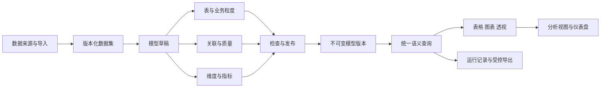
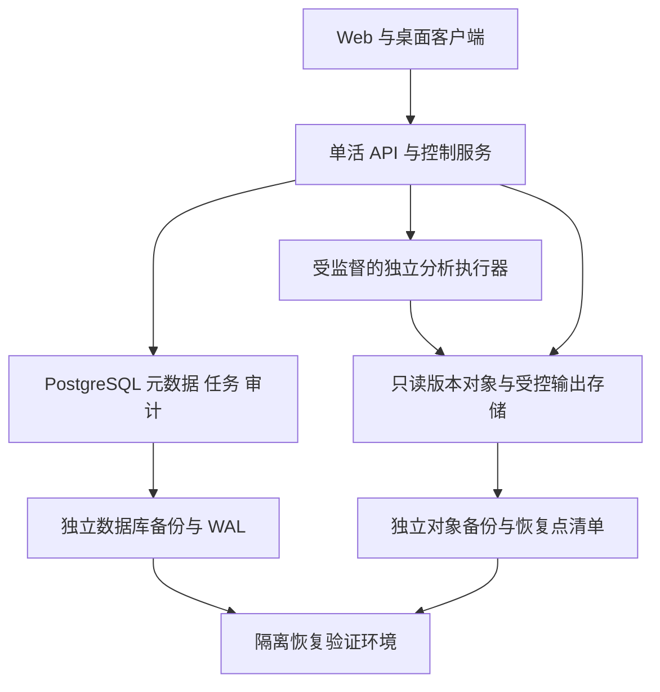

# Pivot BI 数据建模生产级建设方案

> 版本：v2.0（生产级标准修订）
>
> 编制日期：2026-11-06
>
> 文档状态：生产建设与上线验收基线；文中的“必须”均为正式交付条件，新增能力尚未实施。
>
> 核查基线：v0.7.108，原始代码基线 `251c1506`，本轮仓库 HEAD `50cd8aa1`。代码与部署文档核查为静态阅读，未在本次方案工作中执行生产演练。
>
> 适用范围：应用中心内的数据分析应用，面向 BI 关系建模、维度、指标与分析资产复用。

阅读建议：产品评审看第 1—7、15—16 节；研发看第 8—12、19—22 节；运维和上线负责人看第 13—15、23—24 节。现状证据及参考资料见第 2、18 节。

本版直接替代 v1.0 作为建设标准，沿用原文件路径以保留已有引用。实施可分里程碑推进，但正式上线必须同时满足统计正确、当前权限隔离、不可变版本、可恢复任务、容量认证、备份恢复和生产制品验收；功能内测不构成生产验收。

## 1. 建设目标与关键决策

将现有“跨数据集模型配置 + 简单关联汇总”升级为可供业务人员持续使用的分析模型：先明确一条记录代表什么，再维护关联、定义指标、检查口径，最终让同一模型服务于表格、图表、透视、仪表盘和受控问数。

本方案整合此前关于指标语义层、跨数据集关系、质量检查、字段血缘和分析资产的规划，并按当前代码能力明确生产建设范围。建设重点是统计正确、操作可理解、结果可复现、故障可恢复，以及权限与运维责任可追踪。

| 决策 | 本版采用的方案 | 原因 |
| --- | --- | --- |
| 产品归属 | 仍属于“数据分析”，增加应用内“数据建模”主入口 | 模型与数据准备、分析消费共用上下文，不增加系统一级菜单 |
| 生产模型范围 | 单事实表、维度表及维度层级，支持仅含事实表的模型；生产查询不允许未定义的统计路径 | 在明确范围内保证语义完整和结果正确 |
| 正式分析 | 从事实表粒度出发，只通过已验证的一对一、多对一关联扩展 | 防止金额、数量和记录数被关联放大 |
| 原有关系 | 保留现有关联探索能力及旧接口，显式标记尚未通过正式模型校验 | 不静默改变历史统计行为，不把历史结果自动认证 |
| 指标 | 统一定义基础指标与有限的派生指标，分析端复用指标 ID | 减少各图表各写一套计算口径 |
| 生命周期 | 草稿、检查、发布版本、归档；质量和运行状态单独展示 | 编辑不影响已发布分析，数据变化也不冒充模型版本变化 |
| 数据引擎 | PostgreSQL 管理元数据和持久任务；隔离执行进程中的 DuckDB 查询不可变 Parquet | 控制面与重型分析分离，避免查询故障拖垮主服务 |
| 数据接入 | 复用导入、派生清洗、数据库拉取和既有数据集 | 建模不直接保存数据库凭据，也不承担实时联邦查询 |
| 共享 | 默认个人；显式共享只读，运行时继续检查底层数据与字段权限 | 模型共享不能扩大数据访问范围 |
| AI | 可辅助解释、建议和生成草稿；不决定关联、发布和数值结果 | 模型判断与确定性统计各负其责 |
| 部署基线 | 单活应用、独立分析执行进程、PostgreSQL、受控版本存储及独立备份 | 遵守当前项目多节点预检门禁，落实进程故障恢复 |
| 可靠性目标 | 30 天窗口可用性与任务成功率目标 99.9%，一致恢复点 RPO ≤ 15 分钟、灾难恢复 RTO ≤ 60 分钟 | 给生产验收和持续运营提供可测合同，详见第 13、23 节 |
| 交付门槛 | G0—G7 全部通过，完成 M0—M5 建设和生产责任交接 | 统计、权限、恢复、容量与制品均不可后置到上线之后补齐 |

本版不纳入机器学习建模、通用数据仓库开发、DAX/MDX 语言、任意跨表 SQL 编辑器、实时数据库联邦查询，以及尚未落地的组织级多租户治理。

文中“首版”均指满足本版全部强制门槛的首个生产版本。多事实、桥接和其他高级语义具有独立范围边界；部署一套实例供一个授权域使用，不等于具备多租户隔离认证。

### 1.1 v2.0 的生产必交范围

| 类别 | 正式上线前必须具备 | 不通过时的处理 |
| --- | --- | --- |
| 业务与语义 | 端到端建模分析闭环，金额/去重/总计正确，覆盖完整性明确 | 阻断整个生产模型功能上线 |
| 数据与版本 | 内容校验、不可变清单、事务发布、引用保护和一致恢复点 | 停止发布、刷新及新分析，保护上次成功状态 |
| 任务与资源 | 数据库持久调度、执行代次隔离、进程隔离、硬资源上限、真实取消 | 不接收新重型任务，不用前端等待代替任务状态 |
| 权限与共享 | 元数据到下载全链路当前身份检查，撤权竞态验证，完整审计 | 默认拒绝访问，禁止以缓存或旧 Token 继续读取 |
| 消费与运营 | 图表/透视/视图/仪表盘/导出一致，明确运行记录及数据时间 | 不以“后端可查询”替代产品交付 |
| 运行与交付 | 容量档位、SLO 监测、故障演练、备份恢复、升级回退、离线制品 | 阻断正式开放，给出明确失败项和责任人 |

### 1.2 生产现状差距

当前已存在模型 CRUD、基础关系检查和查询恢复代码；尚不能据此认定具备本方案要求的进程级故障隔离、跨文件/数据库提交协议、统一授权修订栅栏、生产容量认证或恢复时限。现有数据库队列和并发工具是复用基础，生产协议仍须按第 19—24 节补齐并验证。

## 2. 当前基础与实际缺口

### 2.1 经代码核对的基础

| 能力 | 当前事实 | 证据 | 本方案处理 |
| --- | --- | --- | --- |
| 模型管理 | 创建、修改、软删除；有版本号和条件更新 | `server/services/data-analysis/semantic-models.js`；`server/repositories/analysis-models.js` | 保留模型 ID，增量扩展 |
| 关联管理 | 左关联、内关联；单字段等值匹配；可编辑删除 | 同上；`client/chat/data-analysis/semantic-models.js` | 扩展为节点、复合键和版本化关系 |
| 图规划 | 1—8 条有效关系；从已加入表连接新的右表，拒绝环路和不连通关系 | `server/services/data-analysis/model-analysis.js` | 正式模型显式指定事实表，不再依赖第一条关系推断根节点 |
| 基数 | 可声明四种基数；质量不符目前主要返回警告 | `semantic-models.js`；`relation-quality.js` | 正式模型提升为可执行的阻断规则 |
| 质量检查 | 重复键、空键、匹配行数、预计关联行数；先按键聚合，避免物化巨大关联 | `server/services/data-analysis/relation-quality.js` | 复用实现思路，增加版本绑定与完整检查状态 |
| 关联预览 | 单条两表关系预览，关联键统一转为文本比较 | `server/services/data-analysis/semantic-models.js` | 保留旧行为；新模型明确类型及键规范化规则 |
| 跨表汇总 | 一个分组字段、一个汇总值；支持计数、和、均值、最小、最大 | `server/services/data-analysis/model-analysis.js` | 新增统一语义查询；旧接口不自动切换语义 |
| 字段治理 | 业务含义、单位、逻辑类型、敏感级别、维度/指标标记 | `server/services/data-analysis/governance.js` | 继续作为源字段治理依据 |
| 指标定义 | 基于单个数据集的五种基础聚合，含单位、有效期和共享属性 | `semantic-models.js`；`analysis_metric_definitions` | 增加模型归属、语义配置与不可变发布快照 |
| 分析资产 | 已有查询、图表、透视视图、仪表盘及刷新；主要绑定单数据集 | `governance.js`；`analysis_saved_views`；`analysis_dashboard_items` | 扩展来源类型，统一消费模型查询 |
| 数据版本 | 已有 `source_version` 和数据版本、分区、物化记录 | `analysis-bi-product.js`；`analysis-scalability.js` | 区分数据版本、治理变化和模型发布版本 |
| 后台查询 | 已有单数据集异步查询、执行代次、心跳、取消与恢复 | `server/services/data-analysis/async-query-jobs.js` | 扩展多来源清单，复用任务机制 |

现有 `version` 是可变配置的并发修订号，不等于完整、不可变的已发布模型版本。现有 `source_version` 也会随字段治理更新，不应直接当作不可变文件版本使用。

### 2.2 尚需补齐的产品能力

1. 事实表、业务粒度、维度主键和合法统计路径缺少统一定义。
2. 一对多、多对多导致的重复统计目前以提示为主，不能保证正式指标正确。
3. 关系、维度、指标尚未形成一个可整体检查、发布、回滚的分析模型。
4. 跨表表格、图表、透视、分析视图和仪表盘尚未统一使用同一语义查询结果。
5. 缺少多来源版本清单、模型依赖检查，以及数据更新后的自动失效处理。
6. 主操作仍聚集在字段治理弹窗内，难以承载完整建模流程。

历史文档中的“阶段 B 已完成基础实现”按基础能力理解；其中关系图、字段血缘等规划不能据此视为本方案所述完整产品已经验收。已有测试文件和历史验收记录是可复用证据，正式开发仍须对新行为重新验收。

## 3. 用户、场景与成功标准

### 3.1 使用者及职责

| 使用者 | 主要任务 | 权限边界 |
| --- | --- | --- |
| 模型维护者 | 选择来源、定义粒度和关联、维护指标、检查发布、调整共享 | 首版仅模型所有者可修改；不能修改他人源数据 |
| 业务分析者 | 选择已发布模型，使用维度和指标制作分析 | 只读使用模型；底层数据权限独立检查 |
| 报表使用者 | 查看仪表盘、口径和来源，在授权范围下载结果 | 不因收到仪表盘链接获得模型或数据权限 |
| 系统管理员 | 配置配额、检查任务健康、管理既有访问策略 | 管理员身份不在本方案中新增跨用户数据读取特权 |

“模型维护者”等为产品职责称谓，不新建一套角色或授权系统。生产共享模型必须保留业务口径复核记录，复核不授予额外数据权限；多人同时编辑及通用审批编排为独立扩展。

### 3.2 首版优先场景

- **订单明细分析**：订单明细关联客户、产品、部门，按月份和地区统计金额、订单数、客单价。
- **业务办理台账**：一条办理记录关联机构和事项字典，统计受理量、完成量、完成率。
- **收支交易分析**：一条交易关联账户或机构字典，按日期、分类统计收支；沿用来源中的正负和币种口径。
- **单表口径治理**：已有一张完整明细表，也能直接定义维度、指标并发布，不强制用户再建关联。

订单表与订单明细表不能因为都含金额就直接相加。建模时需选择当前分析的事实粒度；订单金额分析和明细金额分析可以建立两个模型。跨事实比较进入后续扩展。

### 3.3 首版产品验收目标

- 授权用户可完成“选来源 → 定粒度 → 配关联 → 定指标 → 检查 → 发布 → 图表/透视 → 保存 → 仪表盘 → 导出”的闭环。
- 同一发布版本、数据清单、过滤条件和当前权限下，所有消费入口的指标数值一致。
- 黄金样例中的金额、计数、均值、去重计数、比率和总计全部符合明确期望值。
- 未验证的基数、无效字段、歧义路径和缺失权限不能生成正式分析结果。
- 刷新和失败状态可区分，旧结果保留原时间和来源，不能显示为本次刷新成功。
- 第 13、19—24 节的容量、恢复、安全和交付门槛必须全部通过；生产负责人、数据口径负责人和运维联系人均有明确记录。
- 邀请 5—8 名目标用户完成固定样例；首个模型到图表的中位耗时建议不超过 20 分钟。该项为试点目标，需记录样本和实际值，不是现状数据。

## 4. 产品对象与信息架构

### 4.1 对象关系



| 对象 | 定义 | 必须明确的内容 |
| --- | --- | --- |
| 数据集 | 已接入并受控保存的表格数据 | 所有者、字段标识、数据版本、完整性、执行位置 |
| 模型节点 | 数据集在模型中的一个逻辑实例 | 稳定节点 ID、数据集 ID、事实/维度角色、显示名 |
| 事实粒度 | 事实表每条记录代表的业务事件 | 业务说明、粒度键、空值和唯一性检查 |
| 关联 | 两个节点间的受控等值连接 | 键对、类型、基数、规范化规则、检查结果 |
| 维度 | 可用于分组和筛选的业务属性 | 字段引用、类型、展示、排序、空值规则 |
| 指标 | 按固定业务定义计算的数值 | 原子聚合或派生公式、来源粒度、单位、有效期 |
| 发布版本 | 一次完整语义定义的不可变快照 | 节点、关系、字段映射、维度、指标及依赖版本 |
| 运行记录 | 在指定身份、版本及数据范围上的执行 | 查询定义、来源清单、状态、结果、警告和时间 |

模型是逻辑分析资产，保存模型不产生一张全量大宽表。只有用户明确选择物化或导出时，才生成受控结果文件。

### 4.2 应用内入口

- 新增“数据分析 → 数据建模”，与既有数据准备、分析能力同级；实际页签位置沿用应用现有导航组织。
- 原“字段治理 → 跨数据集模型”改为指向同一模型列表的快捷入口，不维护第二套编辑器。
- “字段治理”继续负责源字段类型、业务定义、敏感级别和派生清洗；模型工作区引用这些规则。
- 图表、透视和查询提供“数据集 / 已发布模型”来源选择。模型模式只展示当前可用维度与指标。
- 旧模型保留“查看关联探索”入口；转换草稿成功并通过检查后再进入正式模型使用流程。

### 4.3 列表与工作区

模型列表显示：名称、用途、所有者、最近发布时间、当前版本、可用状态、更新时间和操作。搜索支持名称、用途；筛选支持“我的/共享给我”、生命周期及可用状态。

进入模型后使用独立工作区，顶部显示模型名、草稿/发布版本、保存状态；主操作为“保存草稿”“检查”“发布”“开始分析”，低频操作放入“更多”。

工作区按任务分为“表与关联”“维度与指标”“检查与依赖”“试算”四个区域：

- 桌面端左侧为节点和字段，中部关系图/关系表，右侧显示当前选中对象的属性。
- 图中突出事实表、关系方向、基数、未通过检查的位置；拖动画布仅调整布局，不能隐式修改关联。
- 每个图操作都有表格或表单替代路径。键盘用户可添加、编辑、删除关系。
- 窄屏以表格、分步表单和结果查看为主，关闭不必要的三栏并排；不要求在手机上完成复杂拖拽。
- 复用全局按钮、表格、分页、弹窗和主题变量；图形资源本站离线加载，不新增公共 CDN。

## 5. 关键用户流程

### 5.1 创建与发布

1. **新建模型**：填写名称、用途，选择一个事实数据集。即使尚未配置完成，也可保存为私人草稿。
2. **明确一行代表什么**：例如“一条订单商品明细”；选择订单号与行号作为复合粒度键。无可用粒度键时引导先在数据准备中生成稳定记录标识。
3. **添加维度表**：只列出当前有权访问的数据集；选择对应键，默认左关联、多对一。
4. **检查关系**：显示键唯一性、匹配率、空键、预计行数变化，并定位异常原因。系统可以建议关系，用户确认后才写入草稿。
5. **维护维度和指标**：选择常用业务字段、添加基础指标、设置单位及解释；预览公式依赖。
6. **试算**：选择少量分组与指标运行；展示结果、总计、数据范围和检查警告。试算通过不替代完整校验。
7. **发布检查**：运行完整来源与语义检查；展示阻断项、可接受警告和影响范围。
8. **发布**：所有者确认口径及警告后生成新版本，默认仍为个人资产；发布不会自动共享。
9. **开始分析**：携带模型发布版本进入图表或透视，完成后保存为分析视图。

### 5.2 修改已发布模型

“编辑模型”创建或继续草稿。已发布版本继续服务现有分析；修改关联、指标或字段不会直接改写历史版本。

发布前展示新增、删除、修改内容，以及受影响的视图和仪表盘数量。发布新版本不强制升级已保存分析；用户可在查看差异后逐项升级或继续使用原版本。

### 5.3 数据更新与失败恢复

来源有新数据时显示“有新数据，待检查”，先检查新版本的主键、字段类型和关联质量，再切换当前可用数据清单。失败时保留上次成功清单并显示时间；需要用户选择“查看上次结果”，不能把旧结果冒充最新分析。

字段缺失、重复键、权限收紧、数据文件过期和服务不可用分别给出可操作提示。刷新失败不自动修改模型口径，也不自动删除异常来源行。

### 5.4 共享后使用

共享页面预检模型依赖，不自动替用户共享任何源数据。接收者按当前身份检查模型、所有来源及必要关联字段的访问权；缺失时只返回“来源不可用，请联系模型维护者”等最小信息，不泄露无权访问的表名、字段和样例。

## 6. 事实粒度与关联语义

### 6.1 首版支持范围

| 项目 | 正式模型首版规则 |
| --- | --- |
| 事实表 | 每个模型恰好一个，可单独使用 |
| 维度表 | 可连接事实表，也可连接上级维度，形成有唯一连接路径的树 |
| 关系数量 | 最多 8 条有效关系；保留当前上限，不因新界面扩大资源边界 |
| 关联类型 | 左关联、内关联；默认左关联 |
| 基数 | 从事实根向外，只允许多对一或一对一；目标键必须完整验证唯一 |
| 键 | 单键和最多 3 对字段的复合等值键；不支持自定义关联 SQL |
| 空键 | 任一组成字段为空则不匹配；空字符串是否视为空由显式规范化规则决定 |
| 图结构 | 连通、无环；除事实表外每个节点唯一父节点，不存在多条有效路径 |
| 重复使用同一数据集 | 首版每个模型限一个节点；角色维度与同表多别名后续支持 |
| 一对多、多对多 | 可在旧关系探索中保留；不能作为正式模型的有效统计路径 |

采用事实和维度区分、固定事实粒度的设计，参考 [Microsoft 星型模型指导](https://learn.microsoft.com/en-us/power-bi/guidance/star-schema)。这是结合 Pivot 单机分析能力作出的产品范围选择，不要求实现 Power BI 的过滤语言和完整关系机制。

### 6.2 粒度及主键校验

- 事实粒度键必须非空且组合唯一；发现重复时阻断发布，提示检查业务粒度或生成派生数据集。
- 维度主键按相同规范化规则检查非空和组合唯一；不能采用“任取第一条”消除重复。
- 如果同一业务单号合法出现多次，应补充业务行号、事件号或真实时间序列标识，不能简单将重复当成脏数据删除。
- 自动生成的源记录 ID 只能表达来源行粒度，不能宣称已经识别出订单、客户等业务唯一性。
- 一对一同时验证两侧唯一；多对一允许事实侧重复关联键，但目标侧必须唯一。
- 完整性检查超时或仅完成抽样时，状态为“未完成”，不得标记为“唯一性已通过”。

### 6.3 键类型与规范化

新模型将关联键类型和转换规则纳入版本快照。默认保持原类型的业务含义；编号、账号等默认文本，不移除前导零。文本是否去首尾空格、是否区分大小写必须显式选择，且质量检查和实际执行使用同一编译结果。

不将所有键无条件转成文本；不自动将 `001` 与 `1` 视为相等；不使用带分隔符的字符串拼接实现复合键。复合键逐字段比较，任一转换失败记录为异常。

旧模型保留既有文本比较方式。转为新模型时先比较匹配数和汇总差异，用户确认后发布；转换过程不改写原始文件。

### 6.4 重复统计防护

正式查询对将使用的关系重新核对当前数据版本的基数验证结果。目标键不唯一时直接阻断，不通过 `SUM(DISTINCT 金额)` 修复，也不简单提高行数上限继续执行。

例：两笔明细金额都是 100，正确合计为 200；使用 `SUM(DISTINCT 金额)` 会错误得到 100。去重必须依据业务粒度与实体标识，不可依据金额是否相同。

后续需要跨事实分析时，采用各事实先按共同维度聚合，再合并聚合结果；桥接和分摊必须另外定义统计归属、权重及总计语义。多对多设计和跨事实风险可参考 [Microsoft 多对多关系指导](https://learn.microsoft.com/en-us/power-bi/guidance/relationships-many-to-many)，首版不直接开放其复杂过滤机制。

### 6.5 关联方向、筛选与裁剪

界面将“关联方向”与“筛选条件”分别说明。首版维度筛选沿唯一关系路径作用于事实数据，不提供双向过滤开关。

查询只使用必要关系，但内关联造成的数据范围限制必须保留：即使该维度未被展示，内关联及到达它所需的路径仍参与模型范围计算。左关联只有在不被维度、指标、筛选和强制范围规则引用时才可裁剪。

左关联的未匹配记录归入“未匹配”成员，真实字段空值显示为“空值”，两者在返回数据中有不同成员标识。对维度设置“等于某值”会排除未匹配记录，试算与结果来源中应能看到这一筛选范围。

不允许优化器因剪掉一个内关联，导致同一模型的不同指标使用不同事实集合。

## 7. 维度与指标体系

### 7.1 维度

维度必须保存稳定标识及节点/字段引用，显示名变化不改变引用。首版支持文本、枚举、日期与日期时间维度，以及事实表上的退化维度，例如订单号。

- 日期按明确格式解析；日期时间按模型业务时区转换后分组，默认 `Asia/Shanghai`，不得直接采用服务器时区。
- 支持年、季度、月、日粒度；首版使用自然年与自然月，自定义财年、周历、节假日历后续扩展。
- 日期区间采用左闭右开，例如 11 月为当地时间 `[11月1日, 12月1日)`，避免末日时间遗漏。
- 月份保留年份，按实际日期排序；不能仅按“一月、二月”等文本分组。
- “日期”与“时间点”语义分开，纯日期不做跨时区位移；解析失败不静默猜测月日顺序。
- 维度分组按稳定成员键计算，显示名仅用于展示；两个不同部门即使同名也不能自动合并。
- 组合层级如“地区 → 城市”可在首版保存显示层级；跨层下钻复用既有分析控件，复杂权限层级不在首版新增。

### 7.2 指标种类

| 类型 | 首版定义 | 关键规则 |
| --- | --- | --- |
| 记录数 | 过滤后的事实行数 | 以事实粒度计数，不计算关联扩展行 |
| 非空计数 | 指定字段的非空数 | 与记录数区分，零值不等于空值 |
| 去重计数 | 指定字段非空不同值数量 | 首版精确计算；需要复合业务键时引用已定义的粒度键 |
| 求和 | 事实表数值字段汇总 | 必须声明可加性与单位；不能直接汇总维度表中的金额 |
| 平均值 | 有效数值之和 / 有效数值数量 | 总计重新计算，不能平均各组平均值 |
| 最小/最大 | 事实数值字段的最小/最大 | 空值不参与 |
| 条件指标 | 基础指标附带结构化业务条件 | 如“状态=已办结”的记录数；条件不能引用其他聚合结果 |
| 派生指标 | 已定义指标间的加减乘除及安全比率 | 如完成率=办结数/受理数；建立无环依赖图 |

首版直接聚合指标只来源于事实表。若要统计客户总数，应在客户粒度模型中定义；不能对订单事实左关联后的客户维度直接计数并称为完整客户规模。

每个指标至少包含：稳定 ID、名称、业务定义、事实粒度、聚合配置、过滤条件、依赖、单位/币种、数值精度、展示精度、有效期、允许分组维度和维护者。

沿用现有指标有效期的启用语义：按当前时间判断能否发起新计算，不自动替代业务日期过滤。过期指标不再发起新分析；历史结果仍按当前权限读取，重跑时提示选择有效口径，不静默切换指标版本。

### 7.3 可加性与计算阶段

指标区分可加指标、半可加指标和不可加指标。首版允许配置并执行已支持的可加基础指标、均值、去重和比率；余额、库存、期末状态等跨时间半可加指标必须选择已有明确支持的计算规则，否则阻断发布，不能默认求和。

行级计算复用已有计算字段与派生数据集。例如“数量 × 单价”应先形成事实表数值字段；聚合后的“总金额 / 订单数”才是派生指标。首版不提供任意跨表行级公式。

派生指标引用指标 ID，禁止任意 SQL、脚本、网络或文件函数。表达式经过语法、类型、单位、深度、循环引用和依赖权限校验；生产上限为 3 层派生依赖、100 个 AST 节点。请求体最多 1 MiB、最多 20 个过滤项、每个集合过滤最多 1000 个值，查询总参数最多 2000 个；超限明确拒绝，不在执行中无限展开。

### 7.4 空值、精度与单位

- 空集记录数、非空计数、去重计数返回 0；空集或全为空的求和、均值、最小和最大返回 `null`，界面显示“无有效值”。是否展示为 0 只是明确的显示选项，不改写原始结果。
- 分母为 0 或空值时，比率返回 `null` 及原因，不显示 Infinity、NaN，也不自动改为 0%。
- 继承现有货币符号、千分位和百分号识别规则，但在模型字段中固定转换方式。金额无效值默认阻断正式发布/刷新；其他指标如允许忽略，必须显示数量并写入口径。
- 合法空值与解析失败分开统计；金额是否必填由指标规则明确，不能把缺失值直接补成 0。均值也通过受控除法计算，总计复用有效数值的和及数量。
- 共享权限受限字段不能通过聚合或派生指标间接读取；“只开放汇总”不是首版已有授权能力。
- 币种不同的金额不得直接相加；首版要求按币种筛选、分组或先在数据准备中形成明确的统一币种字段。不自动调用汇率。
- 金额使用明确精度的十进制定点运算，字段默认 `DECIMAL(18, 2)`，源数据可指定更高小数位；求和显式使用足够的汇总精度，最高到 `DECIMAL(38, s)`，溢出直接失败，不截断也不转成浮点绕过。
- 高精度数值和超出 JavaScript 安全整数范围的计数以字符串及类型信息传输，前端不统一 `Number()` 后再展示或导出。
- 派生除法通过受控十进制计算或明确的近似比率策略处理，最终按指标规则舍入。精确金额计算禁止先用浮点除法再强转十进制并宣称无误差。

默认在展示或输出指定精度时舍入，半值采用远离零的规则；业务另有要求时纳入指标版本。聚合过程不逐行套用显示精度，以免多次舍入累计误差。

现有通用数值转换使用 `DOUBLE`，新模型需增加受控精度适配，不能在文档中将其描述为现有精确金额能力。可复用 `transaction-money.js` 的定点整数处理思路，但其固定小数位与输入限制需评估，不直接替换所有场景。DuckDB 的定点数除法仍返回浮点类型，具体限制见 [DuckDB 1.5 数值类型文档](https://duckdb.org/docs/1.5/sql/data_types/numeric)。

### 7.5 过滤与总计

查询级过滤先确定事实数据范围，条件指标再叠加自身条件，派生指标最后计算。首版支持维度/事实字段的等于、集合、区间、空值及受限文本匹配，均使用结构化参数。

首版不开放任意聚合后过滤、跨模型指标或自定义窗口函数。同比、环比、累计、排名、复杂分摊进入后续扩展，不以拼接 SQL 作为临时入口。

图表、透视和表格的总计均在相同过滤范围重新计算。去重计数、均值和比率不累加分组结果。Top N 与分页只限制展示，默认总计覆盖全部过滤结果，并显示“总计包含未展示分组”。不能将截断后的 100 组当成全部数据再画透视总计。

## 8. 统一查询与分析复用

### 8.1 查询执行顺序

1. 识别实际调用用户，检查模型版本与当前依赖权限。
2. 解析维度、指标、字段和公式，形成只包含受控标识的查询 AST。
3. 固定本次所有来源的数据版本、治理指纹和不可变文件引用，取得读取保留引用。
4. 核对相同来源版本上的完整质量结果；缺失或过期时创建检查任务，查询返回“待检查”。
5. 规划事实根、必要关联及不可裁剪的模型范围关系，校验单路径和基数。
6. 在现有分析限流、超时和 DuckDB 文件访问边界下运行。
7. 全量聚合后计算总计、派生指标、排序、分页与展示截断。
8. 写入结果前及读取/下载时复核当前权限和来源授权指纹；发生收紧时撤销结果可见性。
9. 登记运行、结果文件与来源清单，返回统一结果契约。

任何路径都不能由浏览器提交 `read_parquet` 路径、任意 SQL 片段或未授权字段名来控制执行。内部生成 SQL 只能由编译器使用允许的操作符、字段映射与参数生成。

### 8.2 生产查询契约

以下为**规划中的新接口契约**，不是现有接口声明。正式路由挂载前缀沿用项目配置；路径在现有 `/apps/data-analysis` 命名空间内扩展。

```json
{
  "modelId": "model_orders",
  "publishedVersion": 3,
  "dimensions": ["dim_order_month", "dim_customer_region"],
  "metrics": ["metric_sales", "metric_orders", "metric_avg_order"],
  "filters": [
    {
      "dimensionId": "dim_order_date",
      "operator": "range",
      "value": ["2026-11-01", "2026-12-01"]
    }
  ],
  "orderBy": [{ "metricId": "metric_sales", "direction": "desc" }],
  "limit": 100,
  "execution": "auto",
  "requestKey": "client-generated-idempotency-key"
}
```

结果包含 `runId`、发布版本、已解析的数据清单标识、字段类型、结果行、总计、截断标识、警告、数据时间、执行时间和状态。来源清单对普通用户展示授权后的业务名称与版本，不返回服务端路径。

同一请求的表格、图表和导出可以复用一个运行结果；不得各自重新拼装相似 SQL。使用字符串传输的十进制字段保留明确类型和小数位，图表若需近似绘制数值，应与正式明细/导出值分别处理。

### 8.3 既有资产接入

| 消费入口 | 首版改造要求 |
| --- | --- |
| 表格查询 | 多维度、多指标、结构化筛选；可查看口径、数据范围与总计 |
| 图表 | 绑定模型维度和指标 ID；沿用既有图表类型和显示上限 |
| 透视 | 行列维度和指标来自同一语义查询，边际总计重新计算 |
| 保存的分析视图 | 保存模型发布版本、查询定义、显示配置和数据绑定策略 |
| 仪表盘 | 模型视图作为项目来源；逐项显示成功、失败、过期或来源不可用 |
| CSV/XLSX 导出 | 导出同一查询的受控结果，保留类型、指标口径、版本和范围说明 |
| PPT 与公文等应用 | 优先消费已登记的分析结果/视图，不自行推导跨表关系 |

生产查询合同支持最多 5 个分组维度、10 个指标；超过时给出明确提示。此范围必须按第 13 节完成目标环境认证，不能因测试缺失在上线时静默缩减；既有图表和透视的显示限制仍分别保留。

### 8.4 问数、Agent 与工作流

M3 将模型查询注册为受控能力，输入只允许模型版本、可见维度/指标和结构化过滤条件。AI 可以解释“本月各部门完成率”，选用已发布指标；不直接提交跨表 SQL，也不修改模型。

口径、日期字段或范围有多个合理解释时先展示已解析条件或要求用户澄清。工具返回确定性数值及来源；AI 模型服务不可用时仍能正常完成手工分析。

工作流绑定发布版本及执行用户；计划任务按其明确的运行主体执行，不能借所有者缓存向无权接收者发送结果。通知和报告在实际发送前重新检查接收者权限。

## 9. 质量检查与发布规则

### 9.1 检查分层

| 层次 | 检查内容 | 运行方式 |
| --- | --- | --- |
| 结构检查 | 节点引用、关系连通、唯一父节点、键对、公式类型与循环依赖 | 保存时快速检查，允许不完整草稿 |
| 数据完整性 | 事实粒度、维度主键、空键、精确匹配数、无效值和来源截断 | 绑定数据版本的全量后台检查 |
| 查询安全性 | 指标粒度、可加性、可能扩行、过滤路径、单位/币种 | 发布及运行前检查 |
| 权限与依赖 | 来源可用、必要字段、指标依赖、视图升级影响 | 发布、运行和结果读取时检查 |

关系检查继续采用按键计数后计算匹配规模，避免生成巨大明细。完整检查应说明输入行数、版本、是否全量、耗时和失败原因，不能只有一个绿色勾。

### 9.2 阻断与警告

**阻断发布或当前数据清单启用：**

- 事实粒度键或维度主键为空、重复；声明基数与实际数据不符。
- 缺失字段、类型转换失败、未完成完整校验、无效依赖或不支持的半可加指标。
- 环路、多条有效连接路径、一对多/多对多统计路径，或超出首版范围。
- 必要数据/字段无权限，指标引用受限字段，来源已删除或文件不可读。
- 金额币种不明/混合且没有隔离规则，或精度范围溢出。
- 截断导入的数据申请标记为“完整业务范围”；这种模型只能明确标记“部分数据分析”后发布。

**可由维护者接受的警告：**

- 左关联存在未匹配事实记录，结果将归入“未匹配”。
- 内关联会排除部分事实记录，需展示被排除行数及占比。
- 来源有明确的历史截止时间或有限覆盖范围。
- 非金额指标允许忽略无效数值，且口径已记录忽略数量及处理规则。

首版匹配率不采用统一“低于 95% 即失败”之类无业务依据的门槛。用户可配置业务质量阈值；一旦被设置为强约束，检查不满足即阻断。接受警告要记录人员、时间、原因和来源版本，不能对未来版本永久豁免。

### 9.3 发布事务

发布必须携带草稿并发版本、质量报告 ID 和幂等键。在一个事务内校验草稿修订未变、报告对应相同语义及数据清单，写入不可变快照并更新当前发布指针。

同一幂等键重复请求只产生一个版本。检查完成后来源发生更新，不混用新数据发布；可以基于检查时固定且仍有权访问的清单发布，同时提示有新数据待检查。文件保留引用和最终权限检查在事务外围按受控流程协调，不能假设数据库事务会锁住外部文件。

## 10. 版本、刷新与依赖管理

### 10.1 三类版本分别管理

| 版本/标识 | 表达什么 | 变化时如何处理 |
| --- | --- | --- |
| 草稿修订号 | 当前编辑内容及并发控制 | 条件保存；冲突保留用户输入 |
| 模型发布版本 | 粒度、节点、关联、维度、指标及转换规则的完整快照 | 不可变；升级分析需明确操作 |
| 来源清单 | 每个节点的数据文件版本、结构、治理和检查依据 | 数据刷新重新生成；不等同模型发布新版本 |

保留现有 `source_version` 作为兼容性/治理变化的检测依据，同时从 `analysis_dataset_versions` 解析真实数据文件版本，并记录字段结构指纹及当前治理指纹。若历史数据缺少可用版本记录，先补建受控版本清单；不能仅凭一个整数假定可重放。

权限永远按当前状态判定，不随模型版本、数据快照或历史运行被固定下来。

### 10.2 数据绑定策略

- **默认：使用最新通过检查的数据。** 固定模型发布版本，运行时解析该版本最近成功的数据清单。存在待检查更新时显著展示截止时间，不能称为实时数据。
- **复现：使用指定历史清单。** 用于报告复核和历史对比；仅在底层文件仍保留且当前有权限时可重跑。

单次运行在开始时解析所有节点到不可变版本；执行期间不再各自读取“最新文件”。这只能保证此次使用的版本一致可识别，不保证不同数据库/导入来源处于同一事务时间点。结果应显示各来源更新时间，不能承诺跨来源事务快照。

数据更新后先检查候选清单，再原子切换“最近成功清单”。候选失败保留上次成功清单，并显示失败、待处理项及数据时间；超过模型最大可接受陈旧时间后停止新正式分析，详见第 19.3 节。正在运行的任务保持原清单，除非权限收紧、文件损坏或任务被取消。

源治理变更需分类处理：显示名和说明变化不改写发布快照；字段 ID 稳定时可继续使用。逻辑类型、单位、币种或键业务含义变化视为破坏性变更，停止自动刷新，维护者确认差异并发布新口径后恢复。权限变化立即按当前规则生效，不等待语义升级或后台检查。

### 10.3 生命周期与可用性分开

- 生命周期：草稿、已有发布版本、已归档；有发布版本的模型可以同时存在草稿。
- 质量状态：未检查、检查中、通过、存在警告、检查失败、检查过期。
- 数据状态：可用、有新数据待检查、刷新失败、来源不可用。

不能用一个“启用/停用”字段混合表达这些状态。

删除维度、指标、关系和源数据前查看依赖；草稿删除可以直接保存，发布时再评估已保存资产。已发布版本不被原地改写；源字段丢失时对应数据清单失效，不能按显示名重新猜测字段映射。

归档后禁止新建分析；已有资产是否仍可读取取决于版本保留及当前权限。解除共享立即影响后续访问。回滚通过将指定旧版本重新设为可选发布版本或生成内容相同的新版本完成，并保留操作记录；已经固定版本的视图不自动改变。

### 10.4 保存及退出

首版采用显式保存草稿，显示“未保存/保存中/已保存/保存失败”。离开页面或切换模型时提示未保存修改；请求冲突不覆盖输入。

后续自动保存仍需基于修订号，不能覆盖其他窗口的新内容。模型选择、检查、试算、保存和刷新响应都绑定请求序号及当前账号；迟到响应不得更新另一个模型或账号的界面。

## 11. 权限、共享与审计

### 11.1 权限求交

正式模型可用性取决于当前用户对模型、全部节点数据集及必要关联字段的可见性；查询再对所选维度、指标及全部公式依赖逐项检查。非必要的受限展示字段从元数据候选中隐藏，不自动阻断所有其他授权指标。

指标共享范围不能大于其模型和依赖数据的有效范围；模型共享不会修改数据集共享。首版不提供借模型封装绕过字段权限的“汇总专用权限”。

沿用现有 `unit-visibility`、共享目标与数据集字段治理判断；不另外建立模型专属组织、团队或租户权限表。现有权限语义不能覆盖的需求应作为独立治理项目处理。

### 11.2 所有入口采用同一访问边界

列表、详情、关系图、字段建议、质量样例、指标说明、运行、缓存、快照、导出和下载都必须检查当前用户。共享模型中不可用的依赖只显示必要状态，不返回无权资源的名称、主键样例、业务定义或质量明细。

权限收紧应先使后续读取拒绝，再清理缓存和预览；不能依赖后台清理完成才生效。未完成的查询在登记结果前复核；导出文件在签发和实际下载时再次校验。已经合法下载到用户设备的文件无法被服务端追溯撤回。

### 11.3 缓存和计划运行

首版结果按用户隔离缓存，键至少包含用户、模型发布版本、来源清单、规范化查询、时区及权限/治理指纹。每次命中仍重新授权；权限指纹不能作为免鉴权凭证。

不跨用户复用所有者计算出的结果。计划刷新按任务记录的运行主体执行；其他人查看快照时逐项重新校验。首版不新增匿名公开分享链接。

### 11.4 审计

记录模型创建、草稿修改、关系/指标变更、检查、发布、版本切换、共享变更、归档、查询和导出等动作；关联模型、版本、运行 ID、用户、结果和错误码。

普通日志不记录源数据行、筛选敏感值、完整 SQL、凭据和服务端绝对路径。受控诊断信息按现有审计访问规则保存；用户侧错误提供可追踪编号和下一步操作。

字段依赖可采用“源数据集/字段 → 模型节点与转换 → 维度/指标 → 分析视图 → 仪表盘”的确定性血缘。此处血缘是引用与计算依赖图，不新增知识图谱或向量数据库。

## 12. 技术架构与增量数据设计

### 12.1 服务边界

继续使用现有前端模块体系和服务分层。下列名称是建议的职责划分，可以结合最终规模调整，不要求每项强行新建一个文件。

| 层次 | 复用基础 | 新增或扩展职责 |
| --- | --- | --- |
| 页面入口 | `client/chat/data-analysis/view.js`、现有工作区导航 | 接线和来源选择，避免继续堆入大文件 |
| 建模工作区 | `semantic-models.js`、`model-panels.js` | 独立列表、节点/关系编辑、指标配置、检查与版本界面 |
| 路由 | `server/routes/apps/data-analysis-product-routes.js` | 参数、授权、响应；按建模职责拆出薄注册模块 |
| 模型服务 | `server/services/data-analysis/semantic-models.js` | 模型聚合、草稿、发布、兼容分发 |
| 语义编译 | 现有表达式校验、`model-analysis.js` | 统一 AST、类型、依赖和指标阶段；与旧探索查询分开实现 |
| 关系规划 | `model-analysis.js`、`relation-quality.js` | 事实根规划、复合键、唯一性证据、必要关系及范围保留 |
| 执行 | `shared.js`、`duckdb-sandbox.js`、`async-query-jobs.js` | 绑定多来源版本，执行、取消、结果登记、保留引用 |
| 数据访问 | `server/repositories/analysis-models.js` 及现有仓储 | 事务、条件更新、版本快照、检查和依赖引用 |
| 消费适配 | `query-pivot.js`、`chart-summary.js`、`governance.js` | 接收统一结果；复用渲染、导出与仪表盘 |

数据接入仍由数据集服务负责。模型不保存数据库连接密码，不对外部数据库执行建表、更新或删除，也不在运行中重新解析上传源文件。

用户定义不能直接进入 DuckDB 文件函数。授权输入先解析为受控文件/临时表，再按现有沙箱顺序锁定扩展安装、外部访问及配置；如需输出只开放指定输出文件。内部受控扫描与用户表达式的边界分别验证，不能直接禁用所有文件访问后又绕过限制读取任意路径。

### 12.2 数据结构演进

以下为建议结构，编码前应依据实际迁移和初始化定义形成增量 DDL；不另起一套 `bi_*` 数据库或复制现有数据集体系。

| 表 | 演进方式 | 核心内容与约束 |
| --- | --- | --- |
| `analysis_data_models` | 扩展 | `model_kind` 区分旧探索/正式模型，草稿状态、当前发布指针、归档时间；现有 `version` 继续负责草稿并发 |
| `analysis_data_model_nodes` | 新增必要实体 | 稳定节点 ID、模型 ID、数据集 ID、角色、粒度键、别名及布局；首版同模型数据集唯一，且仅一个事实节点 |
| `analysis_data_model_relations` | 扩展 | 节点引用、键对 JSON、规范化规则、关系修订；保留旧单键列以兼容旧模型，正式模型以新定义为准 |
| `analysis_model_dimensions` | 新增必要实体 | 模型内稳定维度 ID、字段引用、成员键/标签、日期粒度、排序和显示配置 |
| `analysis_metric_definitions` | 扩展 | 模型 ID、指标类型、依赖、精度、可加性和结构化配置；现有 `dataset_id` 对模型指标仍指向事实数据集 |
| `analysis_data_model_versions` | 新增必要快照 | 模型 ID + 发布序号唯一；完整定义快照、语义哈希、编译规则版本、发布时间与发布人；定义内容不可变 |
| `analysis_data_model_checks` | 新增必要证据 | 草稿/发布版本语义哈希、来源清单、检查规则版本、状态、完整性、阻断项与警告；完成后检查结果不可变 |
| `analysis_model_data_bindings` | 新增必要指针 | 每个发布版本当前启用的成功检查/来源清单；条件更新切换，旧清单不被覆盖 |
| `analysis_saved_views`、`analysis_dashboard_items` | 扩展 | `source_kind=dataset/model`，模型 ID/发布版本/查询定义；数据集来源字段对模型项可空，并添加来源互斥约束 |
| `analysis_query_jobs` | 扩展 | `execution_kind`、模型版本、查询 AST、来源清单、权限指纹、结果元数据；模型任务不使用用户 SQL 执行分支 |
| `analysis_artifacts` | 扩展 | 模型结果支持来源类型、发布版本、运行及对象引用；相邻读取、下载、历史和清理路径按多来源清单授权，不仅更改任务写入 |

对视图、仪表盘项目、任务和产物必须建立“来源类型与所需字段一致”的数据库约束。旧行默认保持 `dataset`。模型来源可将旧 `dataset_id` 改为可空，但必须同步更新仓储、调度、访问检查、清理和列表查询，不能只修改插入接口。

节点和维度是此前不存在的一等对象；发布快照、检查证据及数据绑定分别承担不可变定义、校验证据和可切换数据指针，职责不同。血缘优先从这些显式引用建立索引，不再维护一套与定义不一致的手工依赖表。

### 12.3 完整快照与事务约束

发布快照必须包含节点、粒度、关联、键规范化、维度、指标配置、依赖版本、逻辑类型、单位与精度。查询不能只固定模型版本，再去读取当前可变指标定义。

草稿节点、关系、维度和指标变更统一锁定模型行并递增草稿修订号。新接口要求提供 `expectedVersion`；旧接口在兼容期保留原有参数语义，但不能修改正式模型，防止绕过新校验。

建立模型版本唯一约束、检查查找索引、任务执行种类/状态索引、来源依赖索引和幂等键约束。源数据删除必须先处理已发布引用，不沿用级联删除直接抹掉正式模型历史；相关外键调整要覆盖源数据实际删除路径。

### 12.4 生产接口增量合同

| 接口 | 用途 | 合同要求 |
| --- | --- | --- |
| `GET/POST /models` | 模型列表、创建 | 新模型显式指定类型；列表先权限过滤再分页 |
| `GET/PUT /models/:id` | 模型详情、草稿基本配置 | 新写入要求并发版本，不返回无权依赖明细 |
| `PUT /models/:id/draft` | 保存节点、关系、维度和指标草稿 | 事务内整体验证；批量规模有上限 |
| `POST /models/:id/checks` | 全量质量检查 | 幂等创建后台任务，返回 202 和检查 ID |
| `GET /models/:id/checks/:checkId` | 查询检查状态与结果 | 绑定定义及来源清单；无权限样例不返回 |
| `POST /models/:id/publish` | 发布 | 草稿版本、检查 ID、警告确认与幂等键 |
| `GET /models/:id/versions` | 版本和差异 | 版本不可变，差异按业务对象展示 |
| `GET /models/:id/dependencies` | 依赖和升级影响 | 返回当前有权查看的视图/仪表盘 |
| `POST /models/:id/data-refresh` | 检查并切换候选数据清单 | 固定发布版本，失败不覆盖上次成功指针 |
| `POST /models/:id/queries` | 统一模型分析 | 只接受维度、指标和结构化过滤；幂等进入现有任务体系 |
| `GET /async-queries/:jobId` | 查看分析任务 | 扩展既有读取合同，按来源种类检查全部依赖 |
| `POST /async-queries/:jobId/cancel` | 取消分析任务 | 复用取消与执行代次保护 |
| `POST /models/:id/archive` | 归档 | 显示依赖和后续影响，保留数据集与已发布历史 |

现有 `/models/:id/query` 继续表示单关系预览，`/models/:id/analysis` 继续表示旧跨表汇总，不在原路径内静默改成新版指标语义。正式模型若被旧写接口调用，返回可识别的升级提示，不按旧单键规则保存。

错误沿用现有响应结构，增加稳定机器码，例如 `ANALYSIS_MODEL_GRAIN_DUPLICATE`、`ANALYSIS_MODEL_CARDINALITY_INVALID`、`ANALYSIS_MODEL_CHECK_REQUIRED`、`ANALYSIS_SOURCE_CHANGED`、`ANALYSIS_MODEL_VERSION_CONFLICT`。一般输入错误 400、不可见资源 404、已知资源上的字段权限拒绝沿用既有 403、状态/版本冲突 409、配额限制 429；不向无权用户区分“资源存在但不能看”和“资源不存在”。

### 12.5 生产协议所需持久实体

第 12.2 节的功能结构还必须覆盖以下生产字段和引用，落地时优先扩展现有对象/CAS、任务、租约及审计设施；不能仅在内存中维护。

| 能力 | 持久化要求 | 复用边界 |
| --- | --- | --- |
| 来源清单 | 独立不可变清单及成员记录：对象 ID、摘要、长度、模式/治理/语义哈希、输入批次、数据水位、完成状态 | 复用数据集版本；现有缺少的对象状态及引用需补齐 |
| 数据对象与引用 | `staging/ready/quarantined/deleting/expired`、保留租约和引用关系；不同用途的文件均受 GC 协议保护 | 复用 `agent-artifact-cas-store.js` 的字节存储和受控路径思路；其 Agent 归属/租户语义不能直接当成 BI 授权 |
| 任务与准入 | `execution_epoch`、`lease_owner`、`lease_expires_at`、截止、幂等键、规范化请求哈希、取消意图、资源槽位 | 扩展 `analysis_query_jobs` 及既有数据库租约机制；旧 `attempts` 兼容迁移，不允许旧 Worker 领取新类型 |
| 权限修订 | 数据集、模型、主体身份/单位和共享规则修订；必要依赖的授权向量 | 延续 `unit-visibility` 判定，向其所有 BI 可达写路径接入统一修订协议 |
| 审计与事件 | 关键写操作的审计/待投递事件在同一事务落库，消费者按事件 ID 去重 | 复用项目 outbox 思路；不强行把无 Agent Run 的 BI 事件写入有 Run 外键的表 |
| 共享复核证据 | 复核者、业务负责人、语义哈希、质量规则哈希、复核时间与失效条件 | 依托模型发布记录；复核者必须已有实际数据访问权 |
| 灾备目录 | 恢复点 ID、数据库恢复位置、对象集合清单、校验摘要、备份可恢复状态 | 由既有数据库/文件备份工具扩展，不能只保存“备份任务成功”布尔值 |

对象引用、槽位与权限修订属于现有能力的生产补强，不建立平行的 BI 登录/组织体系。DDL 必须标明唯一约束、外键删除动作、状态检查、部分索引及大表回填路径；新旧节点混用或契约缺失时部署预检应拒绝启用功能。

## 13. 生产容量、SLO 与资源合同

### 13.1 部署和容量认证范围

生产基线为 Linux 服务器或 Linux 容器中的单活应用，Windows 桌面客户端和 Web 浏览器访问服务端分析能力。数据库、版本存储、分析执行进程和备份均有独立健康检查；执行进程可重启，不改变项目的单活部署约束。

参考认证环境：应用与分析执行主机至少 8 vCPU、32 GiB 内存、可用空间 500 GiB 的 SSD/NVMe；PostgreSQL 独立运维，参考至少 4 vCPU、16 GiB 内存。业务版本数据及必须恢复的数据总量以 100 GiB 为认证起点。该配置是基准测试条件，不代表硬件达到此值就自动通过性能或恢复验收；与项目其他应用共机时必须合并预算测试。

| 档位 | 输入与查询范围 | 正式交付要求 |
| --- | --- | --- |
| P-Standard | 20 万事实行、最多 8 张维度表、每表最多 120 列、最多 8 条关系 | 全产品路径必须通过；常规查询和复杂边界均纳入验收 |
| P-Large | 100 万事实行、维度总量不超过 200 万行、每次输入文件总量不超过 2 GiB | 必交后台导入/检查/查询能力；实现受控分批摄取和版本登记，不能靠放大普通上传配置交付 |
| 超出认证范围 | 千万级、超过字节/列数/复杂度上限或跨事实查询 | 受控拒绝并给出缩小范围或专门 OLAP 适配路径；未认证档位不对用户显示“已支持” |

常用查询定义为 2 个维度、3 个基础指标；复杂查询定义为最多 5 个分组维度、10 个指标，含一个精确去重和一个派生比率。至少包含高基数、数据倾斜、复合键、宽字符串和未匹配数据，不能只测试低基数字典。

### 13.2 强制 SLI/SLO

以下数值是本方案制定的上线和运营要求，并非当前项目已经达到的指标。SLO 口径和误差预算设计参考 [Google SRE 的 SLO 实施说明](https://sre.google/workbook/implementing-slos/)。首次上线通过候选环境验收，投产后持续按 30 天滚动窗口统计，不虚构上线前的 30 天运行历史。

| 指标 | 强制目标 | 测量口径 |
| --- | --- | --- |
| 控制接口可用性 | 30 天内 ≥ 99.9% | 已授权且在公布配额内的有效列表/保存/发布/提交/读取请求；服务端错误、内部超时及容量内误拒绝均算失败 |
| 已接纳任务平台成功率 | 30 天内 ≥ 99.9% | 查询、检查、刷新、导出完成其合同；检查正确发现脏数据属于完成检查，另计质量失败率；执行崩溃、超时耗尽重试算平台失败 |
| 统计与权限正确性 | 黄金集 100% 通过，生产已确认错误结果和越权泄露容忍数为 0 | 发现一例即按事故处理并暂停受影响路径，不能用平均成功率抵消 |
| 元数据延迟 | p95 ≤ 1 秒 | 模型规模至少 1000、多个用户与共享范围；包含鉴权和数据库读取 |
| P-Standard 常用查询 | 提交至结果可读 p95 ≤ 5 秒 | 冷/热数据和冷/热结果缓存分别报告，不能仅取缓存命中结果 |
| P-Large 常用/复杂查询 | 提交至结果可读 p95 分别 ≤ 15 秒 / 30 秒 | 包含排队、版本解析、权限检查、执行和登记；超载单独报告 |
| 完整质量检查 | P-Standard ≤ 60 秒，P-Large ≤ 120 秒 | 成功完成全量字段/粒度/全部关系检查；超时不能降级为抽样通过 |
| 取消与失联隔离 | 取消受理后 ≤ 5 秒终止计算或强制隔离 | 检查真实进程/资源，不能仅看 UI 状态 |
| 执行器故障恢复 | 可恢复任务在 90 秒内重新获得执行机会 | 数据库与存储可用、未过业务截止且有预算槽位；旧执行器始终无法提交 |
| 数据新鲜度 | 每个生产模型明确刷新周期与最大可接受陈旧时间 | 超时显示陈旧状态并告警；严格模式禁止新分析，禁止无限使用上次成功数据 |

鉴权失败、非法输入、用户主动取消和明确超出公布配额的请求不计入平台成功率分母，但必须独立记录数量。配额内的错误 429、因系统过载取消的任务不得伪装成用户错误。计划维护造成的不可用计入窗口，不能任意剔除。

负载测量至少运行 72 小时稳定性场景，交互负载为 10 个授权会话、平均每 5 秒提交一个常用分析请求，并混合定时刷新；复杂/长任务另行测量。以实测吞吐量形成认证报告，任何配置调整都需保留版本，不能只提高超时使检查“通过”。

### 13.3 持久准入、公平性与进程隔离

当前代码默认导入上限为 20 万行/120 列、同步查询最多 5000 行、DuckDB 内存配置 1 GB、重型分析并发 4/队列 16。这些是现状保护，生产档位由新合同管理，旧上传入口不直接改成百万行入口。

生产分析全局运行预算默认 2、全局排队上限 16、单用户运行上限 1/排队上限 3。模型检查、查询、刷新、导出和原有重型数据分析统一计入预算；数据库持久槽位负责跨进程准入，现有 `analysisSemaphore` 保留为进程内第二道保护。槽位获取只在外层进行一次，禁止嵌套等待同一预算。

按用户轮转和任务等待时间调度，查询与批处理分队列，执行超过截止的任务不再领取。队列满返回 429 和重试建议；数据库不可用时停止准入，不退回不受控的内存队列。连续运行的大导出不能长期占满所有交互机会。

所有模型重型执行必须离开 API 主进程，默认每个执行器一个任务：DuckDB `memory_limit` 为 1 GiB，执行进程硬内存上限 2 GiB，线程数 2，任务溢写目录上限 8 GiB，任务输出字节/行数受限。Linux 使用经验证的容器/cgroup 或等效进程隔离；其他服务端平台必须达到相同隔离证据才能列入支持矩阵。

DuckDB 内存配置不能覆盖所有原生分配，不能作为进程硬内存隔离的替代；相关限制见 [DuckDB OOM 指导](https://duckdb.org/docs/1.5/guides/performance/oom)。无进程级资源约束或无终止能力的部署预检必须失败，防止单个查询 OOM 终止 API 服务。

### 13.4 任务时限、展示和完整导出

模型查询统一先登记任务，`execution=auto` 最多等待同一任务 2 秒，未完成返回 202，不能另起重复计算。默认排队截止 120 秒、交互执行截止 60 秒、检查/批量导出执行截止 300 秒，并受用户请求的更早截止约束。重试不能重置业务总截止。

预览默认 100 行，结果分页每页最多 100 行，交互可读取最多 5000 组；必须先全量过滤/聚合后再限制展示。总计、截断状态和真实结果范围始终同时返回。

完整导出作为独立任务复用原查询、模型版本、来源清单和权限，默认最多 20 万结果行/200 MiB；超过时明确失败并提示筛选或分批，不偷偷交付部分文件并称为完整导出。CSV 与 XLSX 防止公式注入，账号与编码按文本保留；十进制和大整数的精确传输规则必须落实到文件。

### 13.5 版本保留与空间保护

已发布版本和引用数据不能仅按创建时间删除。当前数据绑定、活动任务、明确保留的报告引用必须得到保护；运行记录默认保留 90 天、未固定结果文件沿用现有 7 天保留期，已解除引用的数据版本最少保留 30 天。审计记录默认保留 180 天；业务有更长要求时按部署策略增加。

空间使用达到 70% 预警、85% 停止新批量导入和大导出、95% 停止新写入并保护读取；还需按剩余绝对空间预留至少两个最大并发任务的溢写和输出预算，不能仅看百分比。自动清理不得删除有效引用来“腾出空间”。

### 13.6 告警与误差预算

按用户、模型、任务类型和版本记录排队/执行/结果登记耗时、失败原因、取消回收、进程 RSS、CPU、溢写、数据库池、存储可用空间、最近成功数据时间及备份共同恢复点年龄，避免将用户 ID 等高基数维度直接作为无限制监控标签。

监控每分钟由合成账号执行一条有明确预期值的已授权查询，并验证一个无权账号确实被拒绝。监控账号只可访问专用验收数据，不能授予全库读取。

30 天 99.9% 可用性对应约 43.2 分钟不可用预算。实际已耗尽预算时暂停非修复性生产变更，优先处理故障；新鲜度超限、备份共同恢复点超过 15 分钟、孤儿执行器和硬资源越界均单独告警。值班、升级联系人和处置步骤必须随制品交付。

## 14. 兼容、迁移与回退

### 14.1 旧模型迁移

1. 盘点旧模型、关联、指标、引用视图和实际数据版本；标记缺失字段、无效图和无权来源。
2. 迁移默认将现有模型标记为旧探索类型，保留原 ID、定义和查询行为。
3. 用户选择“创建正式模型草稿”时，生成新模型 ID，并记录来源旧模型 ID；通过幂等键避免重复生成。原探索模型继续保留。
4. 用户选择事实表与粒度，处理逆向关系、重复键和不支持的多对多；系统不自动反转关系或删除异常数据。
5. 对同一固定来源比较记录数、未匹配数、金额与分组结果；展示差异和原因。
6. 新模型检查、发布后，用户明确选择将分析视图切换到它；不批量替换历史资产。

单数据集指标继续可用；导入新模型时复制为有来源引用的模型指标草稿。发布后绑定快照，原指标修改不会改变该模型历史版本。

### 14.2 上线顺序

- **先读后写**：先发布支持新来源类型、任务分发与权限检查的服务端读取端和 Worker，新功能入口保持关闭。
- **迁移再启用**：执行幂等 PostgreSQL 迁移，同步 schema 初始化、索引基线和检查脚本；验证旧数据仍可正常读写。
- **个人试点**：先允许所有者创建个人正式模型，验证查询、取消和版本保留。
- **消费与共享试点**：完成模型视图、仪表盘、当前身份读取及撤权回归后再开放共享使用。
- **完成全部生产门禁后开放**：候选环境可以分组验证，正式环境必须在 G0—G7 全部通过并完成恢复演练后，按已授权目标范围开放；个人试点记录不能替代生产证据。

不允许旧 Worker 将新模型任务误当成单数据集 SQL 任务领取；滚动升级时，生产者启用前必须确保所有可能领取任务的 Worker 均已支持执行类型分发。

### 14.3 回退约束

应用功能开关可停止新模型创建和发布，保留既有数据；回退前停止新模型任务、排空或取消在途工作，确认已保存新类型资产的读取路径。

数据库的可空来源列、新任务类型和模型资产不保证旧二进制能够理解。回退应使用支持这些结构的兼容版本；若只能恢复旧版本，必须采用经过演练的数据库与受控文件一致性备份，不直接删表或令旧代码处理新资产。

源数据集不因删除模型而删除；删除模型的结果引用按明确保留期处理。任何需要真正删除数据的操作仍遵循项目现有确认与审计规则。

## 15. 生产实施里程碑与交付清单

### 15.1 完整生产交付阶段

| 阶段 | 必交内容 | 退出标准 | 前置条件 |
| --- | --- | --- | --- |
| M0：合同与环境 | 业务范围、责任人、全量现状盘点、黄金集、容量数据集、部署/恢复/权限矩阵 | G0 通过；确认当前部署不绕过多节点门禁；每个差距有负责人 | 固定源码、隔离测试库和目标硬件 |
| M1：确定性语义 | 工作区、事实粒度、复合键、维度、指标 AST、精确计算、总计和过滤 | G1 的语义与属性测试通过，用户工作流完整 | M0 合同稳定 |
| M2：一致性和执行基础 | 内容校验清单、发布事务、文件提交/引用协议、持久任务、执行代次、授权修订、进程隔离 | G2/G3 关键竞态与崩溃注入通过；旧执行器和无权结果无法提交 | M1；存储和调度能力到位 |
| M3：业务消费和治理 | 表格/图表/透视/视图/仪表盘/导出、数据刷新、共享复核、审计、问数和工作流适配 | 所有已声明入口同口径、同权限、同版本；业务黄金集签认 | M2 查询与任务合同稳定 |
| M4：容量与运营 | 百万行受控摄取、全局配额、公平调度、72 小时稳定性、监控告警和运行手册 | G4 通过；P-Standard/P-Large 均有目标硬件报告 | M3；独立备份和演练环境可用 |
| M5：恢复与发布 | 数据库/文件一致恢复、RPO/RTO 演练、迁移回退、客户端离线制品、安全检查、责任交接 | G0—G7 全通过，形成带构建标识的唯一发布证据包 | M0—M4 完成，制品和运行环境匹配 |

各阶段可在候选环境内测，但没有“可先上线、以后再补”的生产必交项。任何阶段未满足退出条件，只能保持候选状态。AI/工作流属于已声明的受控消费接口，必须完成鉴权和正确失败路径；AI 模型服务故障时手工分析仍应可用。

### 15.2 实施工作包

| 编号 | 任务 | 主要职责 | 阶段 / 门禁 |
| --- | --- | --- | --- |
| BI-01 | 业务范围、旧资产、当前权限、生产环境和责任清单 | 产品、后端、运维 | M0 / G0 |
| BI-02 | Schema、查询合同、哈希规范、迁移和兼容读取方案 | 后端、测试 | M0 / G0 |
| BI-03 | 工作区、表单、关系图、状态、冲突与退出保存 | 前端、产品 | M1 / G1 |
| BI-04 | 粒度、键规范化、全量质量、关联与范围规划 | 后端、测试 | M1 / G1 |
| BI-05 | 指标编译、定点数、空值、总计与差分/属性测试 | 后端、测试 | M1 / G1 |
| BI-06 | 不可变对象、数据库登记、引用保护、内容校验和发布协议 | 后端、存储运维 | M2 / G3 |
| BI-07 | 持久任务、幂等、租约、执行栅栏、真实取消和隔离执行器 | 后端、运维、测试 | M2 / G3 |
| BI-08 | 全链路授权修订、撤权竞态、共享复核、下载和审计 | 后端、安全、测试 | M2—M3 / G2 |
| BI-09 | 图表、透视、视图、仪表盘、导出、刷新与数据时效合同 | 前端、后端、测试 | M3 / G1—G3 |
| BI-10 | 受控问数、工作流、计划运行主体和接收者复核 | 集成、后端、测试 | M3 / G2 |
| BI-11 | 百万行摄取、容量/压力/倾斜/公平性和资源硬上限认证 | 后端、运维、测试 | M4 / G4 |
| BI-12 | SLI、合成探针、告警、事故分级和排障手册 | 运维、后端 | M4 / G7 |
| BI-13 | 共同恢复点、备份校验、隔离恢复及 RPO/RTO 演练 | 数据库/存储运维、测试 | M5 / G5 |
| BI-14 | 并行升级、旧客户端/旧 Worker、防降级、回退演练 | 后端、客户端、运维 | M5 / G6 |
| BI-15 | 离线包、依赖清单、漏洞、制品摘要及安装/升级验收 | 发布、安全、测试 | M5 / G6 |
| BI-16 | 业务验收、证据包校对、支持矩阵、值班和生产交接 | 产品、测试、运维 | M5 / G7 |

以上均为生产必交工作。关系图继续使用已有组件和轻量连线，业务复用优先，不能把实现成本主要投入视觉画布而延后执行、数据和恢复基础。

工作量在 M0 固定差距后逐包估算，必须包含数据库迁移、受控大数据摄取、隔离执行器、并发故障注入、备份与目标环境恢复。v1.0 的内测范围估算不再作为生产工期承诺；未经目标环境和依赖核查，不提供虚假的确定上线日期。

### 15.3 独立范围的高级能力

| 扩展 | 开放前必须解决的问题 |
| --- | --- |
| 多事实模型 | 共同维度和共同粒度、各事实预聚合、缺失成员、指标可比较范围 |
| 多对多桥接 | 去重实体、是否可加、分摊权重、过滤路径与总计解释 |
| 角色维度/同表多别名 | 同一日期表的订单日与付款日、活动关系选择、权限与路径消歧 |
| 同比/环比/累计 | 连续日期范围、自然/业务历、缺失期、时间筛选和半可加指标 |
| 快照余额与库存 | 期末/期初、实体级最近值、跨时间非加性与时区 |
| 行级权限与汇总专用权限 | 与现有系统统一的策略执行、缓存隔离和推断边界 |
| 多人共同编辑和通用审批编排 | 编辑角色、冲突合并与所有者转移；生产共享口径复核已在本版范围内 |
| OLAP/实时接入 | 目标容量证据、受控连接器、权限一致性与执行计划适配 |

这些能力不通过“高级开关”绕过当前生产支持范围；每项需独立合同、样例和上线条件。统计正确、执行隔离、恢复、安全和运维能力不属于此扩展清单，必须在本版完成。

## 16. 验收样例与测试要求

### 16.1 固定业务黄金集

事实表“订单明细”，粒度键为“订单号 + 行号”，金额为人民币元，日期为业务日期：

| 订单号 | 行号 | 客户号 | 产品号 | 日期 | 数量 | 金额 | 状态 |
| --- | --- | --- | --- | --- | ---: | ---: | --- |
| O1 | 1 | C1 | P1 | 2026-11-01 | 1 | 100.00 | 已确认 |
| O1 | 2 | C1 | P2 | 2026-11-01 | 2 | 100.00 | 已确认 |
| O2 | 1 | C2 | P1 | 2026-11-02 | 1 | 50.00 | 已确认 |
| O3 | 1 | C9 | P2 | 2026-11-02 | 1 | 80.00 | 待确认 |
| O4 | 1 | C1 | P2 | 2026-11-03 | 1 | 20.00 | 已确认 |

客户维度：`C1 → 北区`、`C2 → 南区`，故 C9 未匹配。产品维度：P1 与 P2 各有一个唯一成员。两条关系均为事实表到维度表的左关联、多对一。

指标定义：销售额=金额求和；明细数=事实记录数；订单数=订单号去重计数；平均明细金额=有效金额均值；平均订单金额=销售额/订单数；确认率=已确认明细数/明细数。

| 验收项目 | 明确期望 |
| --- | --- |
| 总体 | 销售额 350.00，明细数 5，订单数 4，数量 6 |
| 平均值与比率 | 平均明细金额 70.00；平均订单金额 87.50；确认率 80.00% |
| 按地区 | 北区 220.00、南区 50.00、未匹配 80.00；未匹配事实不能丢失 |
| 北区筛选 | 销售额 220.00、明细数 3、订单数 2、平均订单金额 110.00 |
| 按产品 | P1 销售额 150.00 / 订单数 2；P2 销售额 200.00 / 订单数 3 |
| 去重总计 | 按产品展示时，总订单数仍为 4，不能将 2 + 3 得到 5 |
| 均值总计 | P1 均值 75，P2 均值为 200/3；总体仍为 70，不能平均两个分组均值 |
| 比率总计 | 按地区分组可显示 100%、100%、0%；总体仍为 80%，不能平均三个比例 |
| 内关联范围 | 客户关系改为内关联后，销售额 270.00、明细数 4、订单数 3；未展示地区时也保持此范围 |
| 展示截断 | 只显示销售额最高的一个地区时，总计仍为 350.00，并提示总计包含未展示分组 |
| 多入口一致 | 表格、图表、透视、仪表盘和导出使用同一运行范围时，以上数值一致 |

### 16.2 错误与边界黄金集

| 场景 | 必须观察到的行为 |
| --- | --- |
| 将事实粒度只设置为订单号 | O1 重复，阻断发布；提示补充真实业务行粒度 |
| 客户维度再加入一个 C1 | 多对一验证失败；不启用新数据清单，不返回放大的金额 |
| 两笔不同明细都是 100 | 合计为 200；不能通过 `SUM(DISTINCT)` 错误变为 100 |
| 关系设置为一对多或多对多 | 正式模型不能发布；旧探索结果继续保留风险提示 |
| 复合键 | 含分隔符的字段值、空组成项和不同顺序不会被拼接误匹配 |
| 编号差异 | 文本 `001` 与 `1` 默认不匹配；转换规则变更后必须重新检查 |
| 同名成员 | 不同部门编码但相同名称，结果保留两个成员身份 |
| 金额精度 | 0.10 + 0.20 返回十进制 0.30；大额、溢出和前端导出不丢精度 |
| 空值与非法值 | 合法空值、解析失败、无穷值分别处理；全空求和为 null，必填金额或解析失败按配置阻断 |
| 空数据与零分母 | 记录数 0，比率为 null 且有原因，不显示 0% 或 Infinity |
| 跨币种 | 未按币种隔离且无转换规则的金额指标无法发布/运行 |
| 日期边界 | 月末、闰日、UTC/业务时区跨日、纯日期及非法日期结果符合定义 |
| 完整检查未完成 | 取消、抽样或超时均不返回“质量通过”，发布按钮说明阻断项 |
| 并发保存/发布 | 旧草稿修订不能覆盖新内容；重复发布请求只产生一个版本 |
| 检查后数据更新 | 发布和运行使用明确清单，不混用旧检查与新数据 |
| 数据更新破坏维度唯一性 | 最新候选失败；原成功清单保留原时间，界面显著标记更新失败 |
| 字段重命名与丢失 | 稳定字段 ID 不变时可保留引用；ID 丢失时失效，不按名称猜测 |
| 查询中权限收紧 | 不能登记可读取的新结果；旧缓存、快照、下载请求立即重新授权 |
| 共享缺依赖 | 接收者不能查询，也看不到无权来源的名称、键样例和指标定义 |
| 指标受限 | 原子指标与全部派生依赖按字段权限过滤，不通过公式间接暴露 |
| 任务取消/故障恢复 | 真实工作停止或被隔离，旧执行器不能提交；重试仍用明确来源清单 |
| 文件清理与重放 | 活动任务引用不被清理；历史过期返回不能复现，不改用新文件 |
| 旧客户端/旧接口 | 旧模型保持行为；不能用旧写入口绕过正式模型语义和版本校验 |
| 离线/窄屏/长文本 | 无外部 CDN 依赖，重要操作可键盘完成，状态与表格不遮挡 |

### 16.3 测试层次与交付证据

1. **确定性单测**：键规范化、图规划、指标 AST、依赖、类型、空值、十进制与总计。
2. **真实 DuckDB 专项**：完整 Parquet 查询、复合键、内关联裁剪保护、全量聚合后限行和多指标。
3. **隔离 PostgreSQL 集成**：迁移、并发保存、幂等发布、权限、数据清单切换、任务恢复和文件引用。
4. **HTTP 契约**：创建/检查/发布/查询/取消/导出，包括非法输入、越权与配额。
5. **浏览器端到端**：从导入到正式分析与仪表盘，覆盖刷新、冲突、撤权、页面切换和宽窄屏。
6. **兼容与部署**：旧模型、旧资产、新旧任务执行类型、Web/桌面、离线构建和备份恢复。
7. **业务试点**：经脱敏的真实数据口径核对、黄金集签认与性能记录。

优先扩展现有 `tests/data-analysis-model-analysis.test.js`、`tests/data-analysis-reliability.test.js`、数值与请求隔离测试，以及现有浏览器数据分析用例。新语义能力补充对应专项文件，不以只断言函数存在或照抄实现的测试作为验收证据。

实现后的检查至少包括 `npm run check`、`npm run lint`、受影响 Node/HTTP 测试、数据分析 E2E 及必要的完整回归；正式制品另做部署验收。检查记录必须包含代码版本、命令、结果、跳过原因和目标环境，不能将历史通过记录作为新功能已通过。

**本文交付仅完成方案编制与文档校验；不代表上述功能、性能和业务验收已经通过。**

生产上线另须通过第 24 节 G0—G7，功能自动化测试通过只是其中一部分；72 小时稳定性、故障并发、独立备份恢复和运行责任交接均为必交证据。

## 17. 主要风险及处理

| 风险 | 处理方式 |
| --- | --- |
| 功能范围过快扩张 | 首版固定单事实和唯一统计路径；多事实、桥接及窗口计算单独评审 |
| 旧探索口径与新语义不同 | 保留旧资产，创建新模型草稿并展示差异，不自动替换 |
| 数据版本与权限版本混用 | 数据文件、治理指纹和当前访问权分别处理，查询/读取双重检查 |
| 元数据迁移完成但消费者不识别 | 先升级读取端和 Worker，生产者最后启用；回退使用兼容版本 |
| 所有者结果泄露给接收者 | 用户隔离缓存，快照和下载重新授权，模型共享不自动共享来源 |
| 质量检查或关联查询耗尽资源 | 按键聚合检查、复用全局分析配额、真实取消、倾斜数据基准 |
| 版本长期保留占满磁盘 | 引用保护、可配置保留期、空间观测和明确的不可复现提示 |
| 精确金额在前端再次失真 | 类型化字符串传输，正式展示/导出保持十进制，绘图近似单独处理 |
| 只完成界面和接口便宣称上线 | 使用 M0—M5 与 G0—G7 标准，任何阻断项未通过都保持候选状态 |
| 查询原生 OOM、僵尸执行器或单用户占满容量 | 独立进程硬限制、真实终止、持久全局/用户配额及公平调度 |
| 数据库恢复成功但文件/撤权状态不完整 | 共同恢复点、对象清单校验和独立安全日志重放，默认关闭读取 |
| 把单活恢复目标误报为多节点高可用 | 严格执行既有多节点门禁，按单活故障域认证并记录实际不可用时间 |

## 18. 依据、文档关系与后续维护

### 18.1 项目内依据

- [开发规范](../../开发规范.md)与 [项目设计规范](DESIGN.md)：工程分层、UI 复用、权限边界及交付规则。
- [应用全面检查与升级执行计划](../应用全面检查与升级执行计划-2026-10-10.md)：字段治理、指标语义层、跨数据集模型及分析资产的原始规划。
- [v0.2.0 数据分析产品化与生产加固](../releases/v0.2.0-数据分析产品化与生产加固.md)：既有语义层、共享与数据分析基础。
- [v0.7.78 数据分析多表关联汇总](../releases/v0.7.78-数据分析多表关联汇总.md)：基础跨表汇总及原有限制。
- [v0.7.94 基础能力可靠性与分析准确性优化](../releases/v0.7.94-基础能力可靠性与分析准确性优化.md)：现有模型维护、数值和请求可靠性改造。
- [基础能力全面优化验收记录](../reports/基础能力全面优化验收-20261105.md)：历史回归范围和目标环境边界。
- [使用帮助：数据分析](../../使用帮助.md#33-数据分析)：当前用户操作路径。
- [工具库数据接入与本机能力设计方案](工具库数据接入与本机能力设计方案.md)：数据来源、执行位置和连接边界。
- [优化路线](../optimization-roadmap.md)：历史进展及待办；本方案不回写为已实现状态。
- [多节点部署预检](../多节点部署预检.md)：当前单节点生产边界和整体多节点阻断事实。
- [PostgreSQL 主库运行与升级说明](../生产环境PostgreSQL主库运行与升级说明.md)：数据库升级、备份及应用/文件一致性要求。
- [生产环境离线部署](../生产环境离线部署.md)：目标环境、独立 PostgreSQL、离线依赖与回退边界。

源码证据见第 2、12 节列出的模块与迁移文件。后续代码变更后，应同步更新现状矩阵和阶段交付状态，不单独修改结论文字。

### 18.2 外部设计参考

外部资料核对日期为 2026-11-06；只用于解释设计取舍，不代表引入相应产品、运行时或许可证依赖。

- [Microsoft：星型模型与事实粒度](https://learn.microsoft.com/en-us/power-bi/guidance/star-schema)：支持事实、维度和一致粒度的设计依据。
- [Microsoft：多对多关系指导](https://learn.microsoft.com/en-us/power-bi/guidance/relationships-many-to-many)：说明桥接、跨事实及总计不能简单相加的复杂性。
- [DuckDB 1.5：数值类型](https://duckdb.org/docs/1.5/sql/data_types/numeric)：核对定点精度与除法的浮点返回行为；实现时仍须验证项目实际安装版本。
- [DuckDB 1.5：内存不足处理](https://duckdb.org/docs/1.5/guides/performance/oom)：内存配置不等于进程硬资源隔离。
- [PostgreSQL：SELECT 与 SKIP LOCKED](https://www.postgresql.org/docs/current/sql-select.html)：数据库队列领取的适用边界。
- [PostgreSQL：持续归档与 PITR](https://www.postgresql.org/docs/current/continuous-archiving.html)：数据库恢复链；不替代对象文件备份。
- [Google SRE：SLO 实施](https://sre.google/workbook/implementing-slos/)：服务指标与误差预算的方法；本文具体阈值是项目建设要求。

### 18.3 状态维护规则

本方案 v2.0 是 BI 数据建模生产建设与验收的专项基线，替代 v1.0 的交付标准。现有发布记录继续保留其对应版本的事实；两者不相互替代。

实施中对每个 BI 工作包记录未开始、开发中、待验收或已验收，并附代码与测试证据。未通过的检查、未跑的目标环境和未发布的安装包分别标明，避免“文档已完成”被误读为“产品已上线”。

## 19. 生产不变量与确定性执行合同

### 19.1 必须始终成立的不变量

| 编号 | 生产不变量 | 验证方式 |
| --- | --- | --- |
| INV-01 | 同一运行只使用一个完整发布快照和一个完整来源清单 | 运行记录、对象摘要及依赖向量逐项核对 |
| INV-02 | 未完成或未通过完整检查的数据不能成为当前数据绑定 | 同时刷新、发布与失败注入；绑定只指向有效检查 |
| INV-03 | 每个来源对象在被引用期间不可被覆盖或清理 | 运行/GC/备份并发测试和对象状态约束 |
| INV-04 | 事实范围、维度成员、指标和总计在所有消费入口一致 | 独立期望值、差分计算及跨入口结果对比 |
| INV-05 | 非当前执行代次不能续租、写结果、切换指针或发送完成事件 | 旧进程暂停后恢复、重复领取、租约丢失测试 |
| INV-06 | 撤权成功后开始的新响应不能携带已撤销的数据 | 授权修订锁协议及缓存/导出/分页竞态测试 |
| INV-07 | 客户端重试、调度重试和故障恢复不能产生多个可见提交 | 请求幂等、任务终态和结果登记唯一约束 |
| INV-08 | 成功响应意味着关联定义/结果已持久登记且审计可追溯 | 提交后断线、文件提交前后崩溃及恢复测试 |
| INV-09 | 原生计算失控只影响其执行单元，不终止 API 主服务 | OOM、进程杀死、磁盘满和超时故障注入 |
| INV-10 | 声称可恢复的备份拥有全部必要数据库和对象数据 | 隔离还原、全清单校验、固定查询及权限复验 |

任何一项被破坏都作为阻断缺陷处理；不能以增加警告、修改成功率分母或自动读取最新数据来掩盖。

### 19.2 确定性版本与哈希

发布快照固定 `schemaVersion`、`semanticVersion`、`compilerVersion`、`numericPolicyVersion`、`normalizationVersion`、业务时区和执行引擎兼容版本。旧快照不能由改变语义的新编译器无声重算；运行时不兼容时拒绝并提供经过差异验证的升级路径。

语义哈希采用固定规范化 JSON、UTF-8 字节和 SHA-256：对象键排序；数字和高精度数值用明确格式；集合排序，具有语义顺序的数组保持顺序；时间统一带时区。标签和用户输入文本不做会改变内容的隐式 Unicode 规范化。规范化规则本身有版本，跨平台使用相同测试向量。

文件摘要直接计算原始字节，不转换换行、不重写 Parquet。来源清单哈希覆盖节点 ID、数据对象 ID、摘要/长度、数据版本、结构指纹、数据水位和处理规则。授权向量单独记录，不把过期权限封入语义快照后永久信任。

所有分组和分页必须有完整排序：业务排序键相同后追加稳定维度成员键，明确空值顺序和文本排序规则。分页游标绑定运行 ID、结果摘要、查询哈希和最后排序键，拒绝跨运行复用；不在每页重新读取“最新数据”。

定点金额与精确计数要求相同结果；允许的近似比率必须在类型中明确，定义误差范围和舍入策略。结果可复现指可重新获得相同逻辑表、口径及精度，不承诺压缩库升级后生成的 XLSX/Parquet 二进制逐字节相同。

### 19.3 新鲜度和完整性也是查询输入

每个生产模型必须保存 `refreshCadence`、`maxStaleness`、来源业务水位和 `freshnessPolicy`。默认策略为严格：超过最大陈旧时间或更新失败超过时限时拒绝发起新正式分析；仍可按明确动作查看标有时间的历史结果。

允许人工查看历史结果不代表计划任务可以继续发送陈旧报表。工作流、告警和定时报表默认严格新鲜度，确需容忍时须在模型/任务中明确并记录业务依据。陈旧结果必须在页面、导出说明和工具返回中一致标记。

上游“成功导入”需区分全量、增量、部分、未知四种覆盖状态，并保留批次边界。追加重试通过导入批次 ID 去重，校验行数、文件摘要及数据集版本；断点续传不产生重复事实。无稳定业务主键的来源可以基于源记录身份去重，但不能声称解决了上游业务重复。

跨来源要求同一批次或账期时，候选数据清单必须满足兼容水位后才能切换；不同系统不具备共同事务快照时，保留各自截止时间及差异，不伪造一致时间点。

## 20. 文件、元数据与发布的原子可见性

### 20.1 受控对象提交流程

采用数据库登记控制可见性、不可变文件承载字节的协议，不假设存在文件系统与 PostgreSQL 的分布式事务：

1. 在受控工作目录创建 `staging` 对象和写入租约，记录归属与任务执行代次。文件名由服务端生成，拒绝链接和目录越界。
2. 写入时流式计算摘要、长度、模式与行数；超过配额立即中止。完成后验证 Parquet 可读、字段模式正确及输出范围完整。
3. 刷新文件内容到持久存储，在同一文件系统执行原子提升到不可覆盖的最终对象键，再持久化目录项；目标文件已存在时逐项校验，不静默覆盖。认证存储须证明这些持久性语义，普通 `rename` 调用成功不足以证明断电持久性。
4. 数据库事务中验证写入租约/执行代次、当前授权、发布/任务状态和对象摘要，登记 `ready` 对象及引用，并将结果/检查/版本状态切为成功，写入审计和 outbox。
5. 事务提交后才对外返回成功。事件只作唤醒提示，客户端通过已授权接口读取；丢失通知不改变真实状态。

文件成功而数据库未提交时形成未被引用的对象，由对账和宽限期回收；数据库提交后响应丢失时按幂等键返回原提交，不重做可见发布。已登记对象丢失或摘要不符时标记隔离并告警，阻断依赖运行，不能重新生成不同字节并继续沿用同一对象 ID。

数据存储支持范围以经过测试的本地持久卷/项目已接入的受控文件存储为准。S3、共享文件系统或其他适配器只有在条件写、持久性、摘要、权限及回收协议全部通过后才列为支持，不因已有环境变量便认定接入完成。

### 20.2 读取保留与 GC 互斥

任务接纳时在事务中固定来源清单并取得对象读取引用；GC 也在事务中锁定同一对象记录。新引用仅可指向 `ready` 对象；GC 仅可把零持久引用、零有效读取租约、保留期已过的对象切为 `deleting`。先改变状态再删文件，文件删除后登记过期，失败可幂等重试。

活动任务续租与执行租约绑定。执行进程失联时先停止其读取/计算或确认隔离，再释放容量；GC 宽限期必须长于租约加隔离等待，不能到期直接删仍可能被旧执行器读取的文件。备份固定点也持有对象引用。

引用保护与源数据撤销分开：引用可阻止物理清理，不能阻止立即撤权。确需删除受限制数据时先撤销访问和停止依赖任务，再按既有删除/保留政策解除引用，保留不含正文的墓碑及审计。不能以可复现为理由永久保留应删除的数据。

### 20.3 并发发布与数据绑定

发布在统一锁顺序下锁定模型修订、发布序号、检查和必要授权记录，验证语义哈希、规则版本、来源清单和当前权限。一切匹配后分配唯一发布序号并提交；同一个用户操作幂等键和请求哈希唯一。

候选刷新任务记录所基于的 `binding_revision`；切换使用比较并交换，只允许当前代次基于预期修订提交。两个候选并发完成时不能让较旧业务水位覆盖较新的已启用清单；首版同一模型版本最多一个有效刷新代次。

查询接纳在同一数据库事务中读取发布版本、当前成功绑定并取得引用，之后不再追逐指针。发布或刷新与查询同时发生时，查询使用完整旧版本或完整新版本，禁止拼接两者的部分字段。

### 20.4 对账与审计可恢复

持续对账覆盖：文件有而无引用、元数据有而文件丢失、摘要/长度不符、运行终态与产物不一致、发布/绑定与检查不匹配、过期租约及引用泄漏。增量对账每 5 分钟运行，至少每日完成一次全清单巡检，读取负载纳入资源预算。

对账不自动扩大权限、不自动切回最新文件、不修补业务数值。错误对象进入隔离状态，依赖资产显示“来源完整性异常”；修复使用可验证备份或重新生成的新对象/清单。

发布、共享、撤权、删除、查询结果登记和导出授权审计与主写事务一致落库；投递至少一次、消费去重。不具备事务能力的普通日志不是成功审计凭据。

## 21. 持久任务、租约与执行隔离协议

### 21.1 状态机与领取合同

任务使用既有任务体系，状态覆盖 `queued → running → succeeded`，可转入 `retry_wait`、`failed`、`cancel_requested → cancelled`；终态不可被旧执行器回写为运行中。每条任务固定用户、执行类型、模型版本、来源清单、幂等键、截止和资源预算。

| 动作 | 强制前提 | 持久结果 |
| --- | --- | --- |
| 接纳 | 当前权限、容量/队列配额及合同有效 | 幂等任务、请求哈希、来源引用一次落库 |
| 领取 | 截止未过、执行类型兼容、全局/用户槽位可用 | 行锁内分配递增执行代次、租约和执行者 |
| 续租 | 相同任务、执行者、代次，仍运行且租约未过 | 延长租约并记录心跳；不能复活过期代次 |
| 登记结果 | 当前租约、代次、未取消、当前权限和不可变输入均有效 | 任务终态、结果引用、审计及事件同一事务提交 |
| 释放 | 当前槽位归属且执行单元已结束/隔离 | 幂等释放槽位和短期读取租约 |

领取可复用 `FOR UPDATE SKIP LOCKED`，但它只是避免队列消费者争锁，不保证执行一次或全局顺序；相关限制见 [PostgreSQL SELECT 文档](https://www.postgresql.org/docs/current/sql-select.html)。持久唯一约束、条件更新和执行代次仍不可省略。

### 21.2 租约、取消与恢复时间

默认心跳 5 秒、租约 30 秒，时间比较统一使用数据库时间。执行器确认续租失败或在 10 秒内无法确认续租后停止提交并触发隔离，控制器先请求中断，5 秒内未退出则强制终止任务进程。数据库失联时只能保留临时文件，不得向用户登记成功。

租约过期后，确认旧执行单元已退出或失去文件/提交访问能力再重新领取；单活主机由父监督进程及 OS 进程归属确认，备用主机接管须遵守第 23 节写入者隔离。执行栅栏防止旧提交，进程隔离防止旧计算继续吃资源，两者都要具备。

取消意图先持久化，执行器轮询或接收唤醒后中断。取消与完成同时发生时以终态事务的提交先后决定：成功先提交则取消返回已完成；取消意图先提交则完成事务必须拒绝登记。UI 的“正在取消”不能提前显示为资源已释放。

### 21.3 重试、幂等与投递

只对确定可重试的临时数据库/存储/执行器故障重试，最多 3 次，默认退避 5 秒、15 秒并带抖动；原总截止、输入清单及用户不变。权限拒绝、质量失败、参数错误、取消、超额、对象损坏和截止耗尽不自动重试。

幂等键以用户、操作类型和目标范围唯一，保存至少 7 天；相同键且请求哈希相同返回原任务/发布结果，哈希不同返回 409。清理后相同键不保证再次去重，API 明确有效期。重放仍重新鉴权，不能借原成功记录读取已撤销结果。

系统保证“任务可能重复执行，但可见状态与产物最多提交一次”，不宣称任意外部副作用严格执行一次。报表通知通过现有投递框架和接收者权限检查；供应方无法幂等且结果未知时标为待核实，不自动重复发送。

### 21.4 执行器安全和就绪检查

执行器运行非特权用户，只挂载本次允许的输入及专属输出/溢写目录；禁止任意网络、扩展安装、宿主目录和密钥读取。数据库提交通过受控控制进程或最小权限接口完成，不把管理账号凭据暴露给查询进程。

启动就绪检查必须验证：引擎/编译器版本、可用资源硬限制、输入只读、输出目录权限、扩展禁用、真实中断/终止、数据库迁移、存储原子提升及剩余空间。检查失败不参与领取。部署升级先停止准入、排空/取消并确认执行单元结束，再替换进程。

上述租约与执行多进程协议仅用于单活实例内的生产可靠性，不解除项目整体多节点预检门禁。

## 22. 生产授权、发布治理与交付安全

### 22.1 当前权限修订与并发栅栏

生产检查覆盖模型、来源数据集、全部必要关系键、可见维度、指标的全部依赖，以及执行用户当前状态和单位归属。权限判定继续使用现有服务，但所有 BI 可达的共享修改、字段敏感级别变化、账号停用、单位调整和删除路径必须在事务中递增对应授权修订。

提交结果与权限变更采用统一锁顺序：先主体身份修订，再按稳定 ID 锁定模型和来源授权记录。结果事务在锁内复核授权向量，修订不匹配时重新判定；缺少记录或鉴权服务不可用时拒绝。查询与撤权的随机时序必须有竞争测试，不以“前后各检查一次”代替串行化依据。

普通读取在构建响应前核对最新修订，缓存只存数据不存永久授权决定。数据接口和下载使用禁止共享缓存的响应策略，不将模型快照、质量样例或文件暴露为可匿名访问的静态资源。

撤权的生效边界是服务端授权提交点：提交后发起的新读取一律拒绝。提交前已排入网络缓冲的合法字节可能继续到达，无法追溯撤回；活动长下载必须在下一分块授权检查发现变更后中止，最长 5 秒内停止调度新字节。授权检查间隔及分块字节上限必须可测试，不能以开始下载时校验一次覆盖整个大文件传输。

### 22.2 下载与导出合同

下载令牌默认 60 秒、绑定用户会话、运行/对象、当前授权版本及下载操作；它只是定位下载意图，不替代身份验证和当前权限检查。令牌不含文件路径、凭据或可读取正文的裸对象键。范围下载和重试仍复核权限，不能绕过已取消或过期状态。

导出文件包括查询定义摘要、模型版本、来源截止、单位、总计范围、截断/完整状态。CSV 危险公式前缀按导出策略转义，XLSX 将不应计算的文本显式写为字符串；与机器解析合同不符的值使用类型列/说明，不能悄悄改写业务编码。

存储、备份与传输的访问限制必须写入部署合同；用户到服务端使用组织批准的 TLS，数据库/备份跨主机传输加密。静态数据及备份按组织密钥管理加密，密钥与备份分开保存，丢失密钥的恢复演练不可记为通过。

### 22.3 共享口径复核与所有者离岗

个人模型可由所有者发布；共享模型进入生产前，必须有具备实际来源权限的另一位业务复核者，确认粒度、指标、完整性、新鲜度、质量警告和共享范围。复核记录绑定语义哈希及警告规则，内容变化后重新复核；数据例行刷新按已批准规则自动检查，不要求每批重新人工审批。

复核不赋予写权限，不授予额外来源权限，也不新增系统一级审批入口；在模型发布检查页维护证据即可。部署确为单人使用时只能按个人模型使用，不用“共享审批已通过”占位。

每个生产模型必须有业务负责人和维护联系人。所有者账号停用后，按其身份执行的刷新和计划立即停止，历史读取仍按当前访问权逐项判定；不借一个已停用账号继续拥有数据权。所有者转移只在受控流程中记录，受让者必须原本就具备全部所需权限，且共享范围、凭据绑定和计划主体重新确认。

### 22.4 审计强度与恢复后的撤权

关键审计至少包含事件 ID、实际用户/执行主体、动作、目标及版本、变更前后哈希、来源清单、执行代次、结果与关联请求 ID；敏感筛选值仅在业务确需且受控时单独加密保存，普通日志不保留。

安全变更采用持久安全事件序列和独立可恢复副本，撤权先在主库生效并阻断访问，再通过可靠 outbox 将变更写入受保护的安全日志；对外“安全变更已完成”只有在副本确认后才返回。副本不可用时界面显示“权限已收紧，安全记录待持久确认”，不撤销已经收紧的访问限制。

数据库恢复后默认不开放 BI 数据读取，先恢复到可验证的安全事件高水位并重放账号停用、撤权和删除墓碑；不能因业务数据库回到较早时间重新开放已撤销权限。独立日志也无法确认最新状态时保持关闭，按当前身份源和业务授权重新核对。该过程计入恢复 RTO。

审计投递失败、日志副本滞后和安全事件缺口必须告警。不得宣称普通数据库审计可以防御数据库最高权限管理员篡改；需要此威胁等级时使用受保护的远端/不可改写存储，并纳入部署认证。

## 23. 生产部署、备份恢复与事故处置

### 23.1 支持的故障域与可用边界



本次生产范围保障：单执行器崩溃、API 进程重启、短暂数据库/存储故障可控恢复，以及主机/主存储丢失后的受控灾难恢复。单活部署存在主机故障停机窗口，99.9% 是运行目标，不是架构自带保证；未通过持续测量不得标注为高可用集群。

依据 [项目多节点预检](../多节点部署预检.md)，整体多节点尚未就绪。不得为了本方案改用绕过预检的双活部署。可准备兼容备用主机，但接管前必须关闭或隔离旧写入者、冻结旧调度，再显式激活单个新写入者；不能自动同时运行两套 API 和全局任务调度。

操作系统、CPU 架构、PostgreSQL 主版本、DuckDB/Node 精确版本、文件系统、浏览器和桌面客户端构成发布支持矩阵。未通过原生绑定、资源隔离及恢复测试的平台不列为生产支持。

### 23.2 RPO/RTO 与共同恢复点

| 目标 | 生产标准 | 计时与范围 |
| --- | --- | --- |
| 一致恢复点 RPO | ≤ 15 分钟 | 故障时刻到最近同时具备数据库恢复位置及全部引用对象的可还原恢复点；不是仅看数据库 WAL 延迟 |
| 执行器/进程恢复 | 可恢复任务 90 秒内重获执行机会 | 主库、存储与预算可用，提交/队列记录仍完整 |
| 灾难恢复 RTO | ≤ 60 分钟 | 故障确认至认证数据量下完成数据库/文件、安全事件重放、核验并恢复最小完整分析服务；检测耗时另记，监测发现目标 ≤ 1 分钟 |
| 生产发布回退 | ≤ 15 分钟恢复兼容服务 | 优先应用功能关闭/兼容二进制回退；若需完整数据还原则使用灾难恢复合同，不能伪称快速镜像回退 |

认证数据量以第 13 节 100 GiB 必恢复数据为起点，恢复并校验所需吞吐量纳入实测。业务超出该量时先扩展认证，不能继续套用未测的 60 分钟承诺。

数据库至少每日完整备份并连续归档 WAL，恢复链覆盖实际恢复点；仅有每日 `pg_dump` 不能满足 15 分钟 RPO。PITR 机制参考 [PostgreSQL 连续归档与时间点恢复](https://www.postgresql.org/docs/current/continuous-archiving.html)，不要求因文档参考版本而升级项目数据库。

每 5 分钟尝试建立共同恢复点：对所有会改变恢复单位内持久对象引用的提交获取统一短时写入屏障，等待已开始的此类事务提交，在屏障内提交引用快照与保留记录，再由数据库运维身份创建有名恢复点、取得对应 WAL 位置，并在独立备份目录登记后解除屏障异步复制。屏障只覆盖元数据引用提交，不覆盖文件复制时长；认证环境内暂停写入不超过 5 秒，超时退出且不能留下无限锁等待。

列出恢复点的全部必须对象，校验摘要并保留备份引用。恢复到所记录 WAL 位置时，数据库中可见的全部引用对象必须已在备份中；对象复制、数据库恢复链及安全事件高水位均确认可用后，恢复点才标记完成。建立恢复点不得删除或覆盖进行中的版本对象，也不得将“对象还在复制”计为可恢复。

恢复单位必须明确：若恢复项目共享 PostgreSQL 整库，共同清单同时覆盖其他应用必须的 `data`、`uploads`、Artifact/CAS 等引用文件，不能只备份 BI 文件再回退全库。若采用经验证的独立逻辑恢复单元，须证明其依赖、外键、用户身份与其他模块一致；不能未经演练临时选择部分表还原。

至少保留 7 天 PITR 链、30 天日备份及其所需对象，备份存放在不同于生产主机和主存储的故障域。备份有独立访问身份与告警，主机删除不能同时删除唯一备份。保留/删除要求与数据政策冲突时，明确审批并调整恢复边界，不能隐瞒例外。

### 23.3 恢复步骤与演练

1. 确认事故范围并停止新写入，隔离旧主机/旧写入者；保存现场和安全事件最新位置。
2. 选择最后一个完整共同恢复点；恢复数据库、全部必要对象、配置和密钥，禁止混用任意日期的数据库与文件目录。
3. 校验必要对象摘要/长度、发布快照/绑定/检查关联、任务和审计。恢复后旧任务租约和槽位全部失效，旧进程没有继续提交资格。
4. 重放当前安全日志与删除墓碑，确认账号和共享不被历史备份扩权。检查未完成导入/输出并重新排队仍满足条件的任务；通知等外部效果不盲目重放。
5. 运行业务黄金集、跨用户拒绝、历史报告重放、刷新和导出测试，确认 SLO 探针与告警工作。
6. 由恢复负责人记录实际 RPO/RTO、恢复点、对象数量/字节、失去的数据范围和待恢复项，恢复单活服务。

上线前在隔离环境至少完成一次“生产主机与本地存储均不可用”的还原，之后每季度及存储/数据库/执行架构重大变更后重做。每月做一次随机恢复点的完整性校验与查询演练。复制完成日志和文件可打开不能替代恢复成功。

### 23.4 升级和迁移

数据库采用扩展、回填、验证、启用、收缩的顺序。大表回填可断点、可计数，增加约束和索引时测量锁等待与 I/O；超时可停止，不在应用启动时无限重试。每次迁移带前后校验和兼容窗口，生产 DDL 使用既有受控运维身份。

制品升级先完成读取端和所有 Worker 的执行类型兼容，再运行迁移与回填，验证后启用写入口。功能开关必须在服务端强制执行；旧客户端不能绕过开关发布，新编译器不支持旧快照时不能强行执行。

新版本至少包含停止新接纳、排空任务、恢复任务、关闭新建/发布、回退兼容服务五条可操作路径。保留固定依赖、镜像/安装包摘要、Schema 版本与恢复工具；离线环境所有依赖和图形资源随包验证，不在启动后临时下载。

### 23.5 事故分级与首要动作

| 事故 | 级别与目标 | 立即处理 |
| --- | --- | --- |
| 越权数据、已确认统计错误、对象损坏 | SEV1；5 分钟内响应、15 分钟内完成初步隔离 | 停止受影响模型/查询/下载，保留证据、定位运行和影响范围；不得继续自动发报 |
| 服务不可用、数据库/主存储故障 | SEV1；5 分钟内响应 | 停止接纳、保护队列与最后成功状态，按单活接管/恢复手册执行 |
| 持续延迟、备份 RPO 超限、刷新超过新鲜度 | SEV2；15 分钟内响应 | 控制批任务、停止陈旧自动投递、排查依赖与容量，给出明确状态 |
| 非关键展示与个别可解释失败 | SEV3；进入维护排期 | 保留诊断，不把展示问题误改成统计口径变化 |

交付必须有明确责任人、联系方式、值班覆盖时间及升级路径。上表响应标准要求相应运行保障可用；未配置值班或自动告警接收端时 G7 不通过。事故后记录受影响用户/模型/运行、纠正数值、已发报告及通知责任；由获授权负责人决定对外更正，不自动向外部联系人发消息。

## 24. 生产发布门禁与证据包

### 24.1 强制上线门禁

| 门禁 | 放行条件 | 必须提交的证据 | 负责角色 |
| --- | --- | --- | --- |
| G0 范围与设计 | 当前能力差距、支持矩阵、容量/时效/安全/恢复合同均明确；无影响实现的未决项 | 固定版本方案、需求追踪、Schema/协议评审、责任矩阵 | 产品与技术负责人 |
| G1 统计和消费 | 第 16 节黄金集、独立差分、属性测试、全入口及精度测试 100% 通过 | 数据/查询定义、期望值来源、执行结果及跨入口对比 | 业务口径负责人、测试 |
| G2 授权与审计 | 列表到下载、撤权竞态、受限依赖、主体停用及恢复撤权全部通过 | 多用户/单位矩阵、并发日志、审计与下载回归 | 安全、后端、测试 |
| G3 一致性与恢复执行 | 第 19 节不变量、文件/DB 断点、租约过期、旧提交、取消、GC 等故障场景全部通过 | 故障注入时序、进程/数据库结果、无重复提交与无引用丢失证明 | 后端、存储运维 |
| G4 容量和资源 | P-Standard/P-Large、72 小时负载、单用户公平性、OOM/磁盘压力及 SLO 阈值通过 | 硬件、数据分布、并发、p50/p95/p99、资源峰值和完整原始结果 | 性能测试、运维 |
| G5 灾难恢复 | 主机及本地存储丢失场景恢复成功，实际 RPO/RTO 满足合同 | 共同恢复点、WAL/对象清单、安全重放和计时记录 | 数据库/存储运维、测试 |
| G6 升级与制品 | 升级/回退、旧客户端/Worker、离线安装和全部依赖检查通过 | 制品/锁文件摘要、组件清单、迁移/回退记录、支持矩阵 | 发布、客户端、运维 |
| G7 业务运营 | 授权用户完成全链路，告警与值班接通，手册和责任交接完成 | 业务签认、探针/告警演练、操作与排障手册、发布检查表 | 产品、运维、上线负责人 |

门禁状态仅允许未执行、失败、通过；“环境不具备”“跳过”“后续补测”均不视为通过。没有全部证据的功能保持候选状态。无强制缺陷豁免通道；若确需改变部署支持范围，先修订合同并重新评审/验收，不能通过降低记录真实性上线。

### 24.2 强制故障与并发试验

必须覆盖至少以下时序：

- 文件写一半、文件持久提升后未登记、数据库已提交但响应丢失，各点强制终止进程。
- 质量检查后字段/权限/数据更新；两个候选刷新逆序完成；查询与发布同时发生。
- 执行器暂停超过租约后恢复，新执行器已接管，旧执行器尝试续租和提交。
- 完成与取消同时提交，重试与用户重复提交，幂等键相同但请求内容不同。
- 下载中撤权、分页间撤权、缓存命中时收紧敏感字段、计划主体停用、共享接收者变更单位。
- 运行/备份持有对象引用时 GC 竞争，解除引用与新建引用竞争，对象摘要损坏。
- 数据库失联、临时目录满、磁盘只读、进程 OOM、执行线程卡住、重启恢复、不同版本 Worker 混用。
- 共同恢复点缺少一个对象、安全日志落后、密钥缺失、从较旧数据库恢复后的撤权验证。

同样场景重复运行及随机化时序，记录种子。验证以数据库状态、文件摘要、进程资源和实际 HTTP 响应为准，不仅检查 UI 文案。

### 24.3 正确性验证强度

除固定样例外，必须使用独立参考实现/人工可核算结果作差分，禁止只用同一语义编译器生成期望值。属性测试至少包括：改变输入行序不改变精确聚合；添加未使用的合法左维度不改变数值；分页/Top N 不改变总计；合法多对一不放大事实数；同数据同版本多入口结果相同；去重/比率总计重新计算。

所有故障测试和性能结果固定源码、依赖、Schema、配置、数据摘要和硬件。对非确定性采样与浮点近似记录误差策略，不用“看起来相近”作为金额通过标准。

### 24.4 唯一生产证据包

每次发布在项目既有受控发布目录保存一个不可变证据包，至少包括：

- 发布编号、源码提交、制品 SHA-256、锁文件、引擎/编译器/Schema 版本、配置指纹。
- G0—G7 结论、测试命令与完整日志引用、未通过/跳过项清单；存在阻断项时结论只能为不放行。
- 黄金集及来源摘要、权限矩阵、故障时序、容量和 72 小时报告、恢复与回退计时。
- 生产模型清单、业务负责人、共享复核记录、数据范围/新鲜度、支持矩阵与配额。
- 运维手册、告警路由、值班联系人、备份策略、共同恢复点和密钥保管/恢复证明。

生产启用由既有获授权的发布流程执行，保留操作审计。本文完成只表示生产建设标准已形成；不创建部署、共享、通知或正式上线的授权，也不将任何尚未执行的门禁写为通过。

## 25. 可视化拖拽式数据建模（2026-11-07 用户补充）

本节依据用户明确补充“需要可视化拖拽式的数据建模功能”增加建模交互验收；沿用本方案的数据、执行、安全与恢复合同，不增加其它分析语言、数据源类型或部署架构。

- 桌面建模工作区提供可见的数据集面板，可将有权使用且尚未加入模型的数据集拖入关系图，确认表名和粒度后形成维度节点；一个事实表、最多八张维度表、不支持同表别名的原合同保持有效。
- 支持拖动表节点、缩放、适合视口和自动整理；布局持久保存于草稿，重新打开保持位置，布局变化不改变语义哈希或已发布口径。
- 从表的连接端点拖到另一维度表可发起关联；必须明确确认一至三对字段、类型、空值/文本规则、关联类型和基数后才修改草稿，不按位置或相似字段名静默建立关联。
- 关系图显示事实表、父子方向、左/内关联、基数及关联键摘要；点击或键盘选择关系可编辑，删除仍需明确确认，移除表时沿用既有依赖检查。
- 自关联、重复父路径、环路、指向事实表、超出节点上限和失去编辑权限的操作在交互层给出明确反馈；服务端原图验证与当前授权继续作为最终边界。
- 拖拽取消、拖出画布、窗口切换、账号变化和数据迟到不得产生隐式关联或丢失原输入；未保存、保存失败、冲突和离开确认沿用现有工作区机制。
- 所有拖拽操作都有按钮或键盘替代；手机可用表单与滚动关系图完成相同建模，不以复杂触摸连线作为唯一入口。共享接收者和归档模型只读，不能借端点或快捷键修改草稿。
- 通过真实浏览器验证拖入数据集、移动/取消、连线确认、编辑/删除、保存重开、语义一致、权限只读、窄屏布局和离线资源；生成与检查桌面和移动端截图。此补充单独登记功能版本，最终全量验收覆盖新增入口。

### 25.1 一体化画布、右侧弹出抽屉、算子流与节点实时预览补充（v0.7.125）

- 应用中心提供与「数据分析」并列的独立应用「数据建模」，进入后自动隐藏左侧数据分析菜单栏释放 100% 全宽沉浸式工作区，双方支持一键互跳并恢复原分析页签。
- 取消人工拆分的四步分段条及常驻侧栏/底栏，统一为单屏可视化画布；点击任意画布节点或顶栏功能时从右侧按需滑出配置抽屉，点击空白画布或按 `Esc` 收起，抽屉与画布工具栏、底部预览区采用网格协同排布互不遮挡。
- 画布节点统一为固定尺寸紧凑卡片，不在节点内罗列字段，左右至多各保留 1 个连接圆点；宽表字段收归右侧抽屉并提供实时检索与快捷建模。
- 左侧可折叠组件栏内置数据输入、多表关联、数据筛选、函数计算、分组聚合、字段清洗、上下合并、只读自定义 SQL 八类 DuckDB 算子与分类内置函数库；执行时复核数据集及列级权限并锁定 `enable_external_access = false`，支持节点到节点实时流转数据预览与一键保存输出为受治理数据集，算子图随草稿节点配置保存且不改变已发布模型语义哈希。
