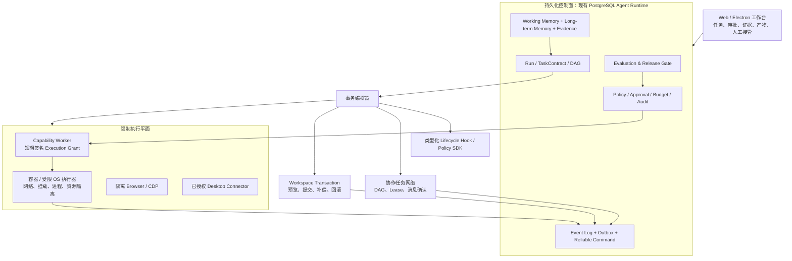

# Pivot 对照《Claude Code 架构深度剖析与前沿设计指南》的优化方案

> 审查日期：2026-10-17（Asia/Shanghai）  
> 代码基线：`bafbabb9`，应用版本 `0.3.19`  
> 对照基线：项目根目录《Claude_Code架构深度剖析与前沿设计指南.md》  
> 审查方式：通读对照文档；静态核验 Pivot 的服务、迁移、测试、架构与既有路线图。未访问真实用户数据、密钥或外部系统，未执行会改变业务数据的集成测试。

---

## 1. 结论与决策

### 1.1 总体结论

Pivot 已经不是“LLM + 工具调用”的早期原型。它已有以 PostgreSQL 为控制面、运行租约与检查点为恢复基础、工具策略/审批/审计为治理边界、DAG 为编排模型、受控技能发布为扩展机制的企业 Agent 平台。对照文档中以下能力已具备或具备更适合企业场景的等价实现：

- 工具渐进发现：`tools.search → tools.describe → tools.execute`，并绑定版本与摘要；
- 工具双轨调度：连续只读工具并发，写入/独占工具形成串行屏障；
- 持久化运行：幂等操作键、工具检查点、恢复、运行租约、事件日志和 Outbox；
- 多 Agent：父子运行、批量委派、角色、结构化 Handoff、输出 Schema 与 Supervisor 模板；
- 记忆与知识：长期记忆的来源证据、作用域、治理、有效期、合并、向量检索与评测；
- 浏览器与多模态：隔离 Playwright Profile、网络策略、浏览器会话、语音会话、上下文资料包；
- 技能供应链：清单、签名、包路径安全、验证、灰度、熔断、回滚；
- 企业运行保障：审批、审计、速率与预算、质量面板、发布审查、迁移与 313 个测试文件。

因此，**不应把 Claude Code 的终端产品形态或文件邮箱 Swarm 原样复制到 Pivot**。Pivot 的合理定位是“面向企业知识、数据、文档和受控本机能力的可托付 Agent 工作台”；编程/工作区执行应是一个高治理的能力包，而不是驱动全系统重构的唯一目标。

真正的高价值缺口集中在五条主线：

1. **把“策略拦截”升级为可证明的强制执行隔离**：当前宿主进程隔离能力明确标为 `best_effort`，不能作为任意代码/依赖安装的安全边界。
2. **把“持久化步骤”升级为事务化任务交付**：已有检查点可防重复调用，却没有统一的工作区快照、补偿动作与提交/回滚语义。
3. **把“多 Agent 委派”升级为可并发协作的任务网络**：需要独立预算、角色策略、资源锁、冲突检测和可靠消息确认，而非再建设文件轮询邮箱。
4. **把“截断与规则评分”升级为语义上下文治理与质量裁决**：现有预算裁剪、结构/关键词评测是好基础，但还缺少语义压缩、缓存可观测和经人工校准的裁判链路。
5. **把“工具/技能很多”升级为带效果证据的能力生命周期**：只有通过离线评测、灰度、线上监控与自动回滚的能力，才应扩大可见范围和权限。

### 1.2 优先级结论

| 优先级 | 计划主题 | 为什么现在做 | 核心产出 |
|---|---|---|---|
| P0 | 强制执行隔离与授权凭证 | 是扩大本机执行、代码执行、依赖安装能力的安全前提 | 受控 Capability Worker、短期执行授权、强隔离证明与 fail-closed 行为 |
| P0 | 任务事务、补偿与结果验收 | 防止长任务留下半完成状态或“模型说完成即完成” | TaskContract、WorkspaceTransaction、补偿日志、VerificationReport |
| P0 | 质量评测与发布硬门禁 | 现有确定性规则不能单独衡量语义质量和真实增益 | 风险一票否决、模型裁判双评审、人工校准、发布门禁 |
| P1 | 生命周期 Hook/Policy 平台 | 将企业合规、通知、上下文和扩展从散点接线收敛为可审计机制 | 类型化 Hook 事件、顺序/超时/权限模型、签名扩展包 |
| P1 | 协作任务网络与冲突治理 | 当前批量委派有基础，规模化前必须隔离预算、权限和资源 | 任务 DAG、资源租约、可靠消息、冲突报告、主控汇合 |
| P1 | 语义上下文治理与缓存观测 | 降低长任务丢失关键约束、无谓重读和成本不可解释 | Working Memory、压缩策略、证据引用、缓存/命中遥测 |
| P2 | 语义代码图谱与编码工作区包 | 全域 5 分目标中最后完成的能力包；范围冻结为 JS/TS 与 Python | Tree-sitter/SCIP 索引、受控 Git 工作区、语义变更验证 |
| P2 | 浏览器/IDE 深度调试与可视化交付 | 以连续任务闭环完成浏览器 5 分，再完成受控编码工作区 5 分 | CDP 证据、会话恢复、视觉回归、可交接操作面板 |
| 探索 | MCTS/PRM、CRDT/VFS、全双工音频、KV Cache Pinning | 对当前产品价值与基础设施依赖不确定，不应抢占 P0/P1 | PoC 指标达到阈值后再立项 |

---

## 2. 范围、证据等级与产品边界

### 2.1 审查范围

本方案核验了 `package.json`、`server/services` 的 Agent/模型/记忆/工具/浏览器/技能路径、`server/db/migrations`、`desktop` 运行时、`tests`、`docs/agent-experience`、`docs/optimization-roadmap.md` 与既有 Agent 全功能审查方案。对照文档共 16 章，覆盖路由、协作、Hooks、规划、记忆、安全、上下文、编排、测试和交互。

证据标记：

- **C（代码确认）**：由源码、迁移、脚本或测试契约确认。
- **D（文档确认）**：由本项目的发布台账或架构文档确认，仍需在实施前以代码复核。
- **I（改造判断）**：基于 C/D 做出的设计取舍，不应表述为线上事实。
- **U（待验收）**：需在目标操作系统、真实数据库、真实模型或受控部署环境中验证。

### 2.2 不能机械照搬的内容

| 对照文档能力 | 对 Pivot 的取舍 | 原因 |
|---|---|---|
| React + Ink 终端、Yoga、终端虚拟列表 | 不纳入主线 | Pivot 是 Web + Electron 产品；应投资运行详情、审批、产物和画布，而非平行 TUI。 |
| 文件锁 Mailbox IPC | 不采用 | Pivot 已有 PostgreSQL、事件日志、Outbox、租约和 SSE。继续以数据库/消息总线实现可靠消息，比 JSON 文件轮询更适合多实例。 |
| `/ultraplan` 云端 30 分钟长考和 Git Bundle 瞬移 | 仅作为受控异步规划能力候选 | 涉及代码、敏感工作区和外部模型；须先完成数据边界、授权和强隔离。 |
| 23 类 Bash AST 黑名单 | 不作为最终边界 | AST 审查可作纵深防御，不能替代容器/微虚拟机/受控 Worker 的文件与网络强制隔离。 |
| 只靠 `old_string` 的文本编辑 | 不作为长期代码修改方案 | Pivot 的可选代码能力应优先提交到影子工作区，使用语义校验与可审查 Diff。 |
| MCTS、PRM、CRDT、VFS、GPU 级缓存固化 | 先实验，后产品化 | 依赖模型、推理服务或编辑器内核，复杂度高；当前缺少证明其优于现有 DAG/检查点的业务指标。 |
| 全双工原生音频 | 后置 | 当前浏览器语音会话已经可表达 turn、barge-in、过期回收；先做任务中断与结果接管的一致性。 |

---

## 3. 当前能力地图与差距矩阵

成熟度说明：5=生产级闭环，4=已实现且有关键测试，3=核心实现存在但缺少关键闭环，2=局部或实验性，1=未见统一实现。评分用于排期，不是产品市场比较。

| 领域 | Pivot 已有基础（证据） | 评级 | 对照差距/风险 | 建议 |
|---|---|---:|---|---|
| 模型路由与降级 | 模型能力、质量、成本、上下文预算、原生工具调用能力模块；按任务类型汇总 Verifier 结果，使用样本数、Wilson 通过率下界、失败率与 30 天新鲜度选择质量模型；自动路由对超时、断连、429/5xx 与明确的结构化输出能力不兼容只做一次兼容候选切换 | 4 | 已阻止小样本/过期/高失败率质量剖面影响路由，并封住故障降级接线；仍缺连续运营期 SLO 与真实灰度回滚 | P1 建立任务类型×模型×质量剖面和失败升级策略 |
| 工具按需发现 | `agent-tool-progressive-discovery.js` 强制 search→describe→execute；每个 Run 的发现缓存有 30 秒 TTL；每次搜索先重建当前用户可见目录，以用户/角色/策略/allowlist 及工具授权、发布、契约、风险摘要计算 catalogVersion，变化即失效 | 4 | 已具备 TTL、授权/发布版本失效和执行前重验；仍缺持续越权探针、容量/SLO 与灰度运营证据 | P1 持续越权探针与发现缓存运营证明 |
| 工具并发与幂等 | `agent-tool-scheduler.js` 读并发/写串行；`agent-checkpoints.js` 操作键重放；跨实例 Run 并发租约、共享工具 bulkhead 租约及 Task Transaction 资源租约/冲突记录 | 4 | 已具备资源级冲突与共享限流；仍缺多实例容量 SLO、非幂等副作用压测与扩容演练 | P1 加容量证明和冲突域运营 |
| 工具策略与审批 | `tool-policy-engine.js`、`tool-execution-guard.js`、审批与审计事件；审批 grant 精确绑定工具、审批键、输入摘要与有效期，历史按工具/节点名的宽授权不再生效；已批准但仍处于 queued 的 grant 可经 CAS 撤销为 `needs_input`，撤销记录核对键/输入摘要，若执行器已经领取则明确拒绝撤销而非制造伪安全感；工具前置 Hook 可 fail-closed 拒绝或收紧，成功/失败/工作区变更以脱敏后置 Hook 审计 | 4 | 已消除历史宽审批绕过并补齐尚未执行授权的安全撤销；仍缺真实灰度、故障演练与跨域策略运营证据 | P1 类型化 Hook 平台 |
| 沙箱与本机执行 | `agent-sandbox.js`、`agent-os-isolation.js`、Capability Worker；短期 Execution Grant、一次性授权账本、受限 Docker Worker 与镜像签名校验；生产终端的命令与文件读/写/列目录均经 Worker 协议执行，受管镜像签名在消费一次性授权前校验，签名算法固定为 RSA-SHA256，Docker 固定 `--pull=never` 以只接受部署时已验证并预置的摘要镜像；`preflight:capability-workers` 检查生产签名清单、入口命令和镜像预置状态且不泄露密钥 | 4 | 已将代码、终端命令和终端文件 I/O 收敛到 fail-closed Worker 路径，并防止错误 Worker 信任配置消耗授权、降级签名算法或在请求期间在线拉取镜像；当前本机生产预检明确报告 `worker_disabled`，因此不将其视为部署证明。仍缺 Windows 等价强隔离、受管 Worker 发布证明和全高风险本机路径覆盖 | P0 强制隔离、不能降级执行 |
| 长任务恢复 | 检查点、Outbox、运行租约、residency、DAG 节点复用；Task Transaction、效果暂存、验收后提交与补偿记录；影子工作树状态记录 | 4 | 状态摘要不含文件内容，无法证明可恢复；影子工作树自动移除已禁用，需人工处理。仍缺真正的工作区备份、其他高风险外部效果、恢复演练与容量/SLO 证据 | P0 Task Transaction + 补偿 |
| 多 Agent | 父子 Run、批量委派、角色、JSON Schema Handoff、Supervisor；子任务单调继承模型、运行模式、步数、审批、工具、网络与 Token 预留；组织管理员可配置但只能收紧研究/分析/审阅/写作角色的步数/Token，工具和 MCP 审批保持平台强制边界；控制消息已持久化为 `pending→delivered→applied→acknowledged`，资源租约冲突可追溯到双方事务/运行，完成 Handoff 以稳定幂等键投递 | 4 | 已封住委派模型/网络/审批扩大、角色策略扩大、可证明恰好一次应用、可解释资源冲突并抵抗 Supervisor 重试重复投递；PostgreSQL 故障演练覆盖资源等待、持有方失败释放、失败子任务拒绝汇合、Handoff 应用/ACK 与 Supervisor 重启。仍缺生产容量/SLO、真实组织策略运营审计和受控灰度故障演练 | P1 协作任务网络 |
| DAG 编排 | 动态 DAG、条件、重试、缓存、输出契约、子工作流、审批；运行关联任务事务 | 4 | 部分副作用尚未纳入事务；回滚、补偿及跨版本恢复缺少完整集成验收 | P0/P1 统一状态与补偿 |
| 生命周期扩展 | 事件日志、Outbox、控制面；`agent-lifecycle-hooks.js` 的类型化声明式 Hook、不可变签名清单摘要、输入/输出 Schema、范围校验、超时、稳定排序和隐私化审计；运行从 queued/resuming 进入 planning 前执行 fail-closed 的 `run.started` Hook，规划请求、完成、失败与模型切换均投递脱敏的后置 Hook；系统管理员可在运营界面导入、查看、停用或吊销带组织签名的受管 Hook 包，包内 Hook 按组织租户而非导入管理员个人作用域生效 | 4 | 前置 Hook 已 fail-closed 且只能拒绝/收紧；运行启动、规划事件、组织级受管包导入与运营动作已覆盖，仍缺真实灰度与故障演练记录 | P1 Hook/Policy SDK |
| 上下文治理 | `context-budget.js`、工具输出压缩、Memory/RAG 各自预算；版本化 Working Memory 修订、压缩保留率和遗漏项审计；规划器确定性三级语义压缩（CAS 证据卡→有 ID 的 Working Memory→规则优先历史摘要）；8 类冻结压缩回归样本；指标 API/UI 展示节省率与硬字段丢失数 | 4 | 冻结集当前约束/待办/CAS 引用均为 100% 保留、阻塞项零漏失，压缩事件和聚合指标均不泄露正文；仍缺持续运行成本、延迟、质量 SLO、告警演练与生产回放证据 | P1 Working Memory + 压缩评测 |
| 提示词与结构化输出 | 原生 Structured Output 优先、JSON Schema 校验与一次修复；Prompt Section 清单、稳定/动态分段、调用指纹审计；稳定段草稿绑定影响评测并经独立管理员批准后生效，Planner/Summary 解析已批准版本；提供方缓存读/写 token 可观测 | 4 | 已具备稳定段变更审批、影响评测、运行时生效路径与缓存遥测；仍缺真实变更灰度运营证据 | P1 Prompt Registry |
| 长期记忆/知识 | 来源证据、有效期、治理、合并、向量索引、检索评测 | 4 | 缺少与任务成功、代码/文档变更的系统性失效关联 | P1 记忆效用与失效闭环 |
| 技能生态 | 签名、包路径安全、静态/沙箱验证、发布、灰度、熔断与回滚；已完成任务可提炼个人草稿 | 4 | 领域/权限/契约渐进发现与生产灰度故障演练尚缺完整验收证据 | P1/P2 能力图谱，不自动生成未验证技能 |
| 浏览器自动化 | Playwright、隔离 Profile、网络策略、CDP 入口、浏览器会话；`click/fill/select` 的操作前/后脱敏页面与视觉摘要证据、事务关联；显式 `download` 仅返回摘要并删除临时文件，显式 `upload` 仅接受当前用户已登记、就绪且摘要校验通过的 rendition；写操作后丢失运行态进入人工恢复并禁止自动重放，持久化最小脱敏控制台错误摘要；运行详情中的明确确认恢复/关闭入口 | 4 | 已形成受控写操作证据、视觉变化摘要、下载/上传内容边界与人工观察接管；仍需验证旧执行器停止、生产故障、混合版本升级和受控环境 E2E 的稳定性 | P2 连续浏览器任务与视觉验收 |
| 评测与发布 | 确定性案例、任务验证、质量面板、发布审查/回滚；分层评测 Gate、Judge Profile、双裁判分歧拦截与人工复核证据；技能与工作流均已按 Release 归因并可按冻结阈值自动暂停/回滚；Node 22 CI 强制独立执行发布质量门禁 | 4 | 组织发布已禁止冒烟/硬失败/错版本/缺层级评测绕过，灰度异常可自动隔离，CI 无法省略发布门禁；仍缺人工金标规模化校准与真实生产回滚演练 | P0 评测硬门禁 |
| 可观测性 | Trace、事件、审计、资源、模型用量、质量指标；压缩跨 Run 聚合（压缩前后 Token、节省率、硬字段丢失）；运行质量面板现聚合最小样本数、成功率、失败率与 p95 时延 SLO，低于 30 样本明确标记为“证据不足”而非通过。后台维护调度会对真实阈值越界向系统管理员写入稳定去重的高风险收件箱事件；低样本不告警 | 4 | 已新增压缩证明仪表、跨任务运行 SLO 阈值与收件箱告警；仍缺缓存/隔离证明仪表、生产告警路由验收和演练证据 | P1 增补三类指标 |
| 代码语义/IDE | 本机工作区与浏览器能力、有限 Git/搜索路径；受控 `workspace.symbols`、`workspace.definition`、`workspace.references` 使用 TypeScript Language Service 与受控 Pyright LSP 解析 JS/TS/Python 语义；跨桌面进程的增量持久化符号索引 | 4 | 已有 JS/TS/Python 符号、定义、引用导航、影子工作区和按文件版本失效的持久化索引；仍缺调试协议与跨平台验收 | P2 仅在编码场景达标后建设 |
| 语音/多模态 | 浏览器原生语音、会话状态、barge-in、图像/TTS Provider；语音会话绑定同一聊天 Agent 的暂停/检查点续跑/停止控制 | 4 | 已统一受限语音任务控制语义且不持久化转写；仍缺目标环境延迟、无障碍与多浏览器验收 | P2 在任务暂停/恢复后迭代 |

### 3.1 全域 5 分目标、口径与边界

本方案现将上表 **18 个领域全部纳入 5 分达标范围**。最终目标日期为 **2027-09-30**。5 分不是“功能演示可用”，而是该领域在受支持的生产部署范围内同时满足以下条件：

1. **能力完整**：核心用户路径、异常路径和管理路径已实现；API、数据、权限和界面语义一致。
2. **安全可证明**：最小授权、租户隔离、审计与数据脱敏可由自动化测试和运行证据验证；不能以配置说明或人工承诺替代。
3. **可靠可恢复**：超时、取消、进程重启、消息重复、外部依赖失败和并发冲突有确定的终态、重试/补偿或人工接管路径。
4. **质量可衡量**：有版本化测试集、生产指标、阈值与告警；高风险领域还要有对抗测试、灰度和自动暂停/回滚。
5. **可运营可交付**：具备运行手册、容量/成本边界、权限说明、发布/回滚演练和受支持平台的验收记录。

“支持范围”在本计划中冻结为：Web、Electron Windows、受控 Linux Worker、PostgreSQL 控制面；编码语义首批支持 JavaScript/TypeScript 与 Python；语音首批支持授权浏览器；浏览器自动化仅运行于受控 Chromium。未纳入该范围的平台不得因“理论上可以运行”被记为 5 分。

全域达标并不等于必须实现所有第 15 章的前沿研究项目。MCTS/PRM、CRDT/VFS、硬件级 KV Cache 固化等仍是探索项；它们只有在被纳入某领域的冻结验收范围后才会影响该领域评分。

### 3.2 逐领域 5 分强制验收标准与最终达标时间表

以下日期是本方案的**最终出口日期**，不是“开始开发”日期。计划以 2026-10-20 启动、至少 5 条并行工程线（平台安全、运行时、AI 质量、产品前端、QA/SRE）为前提；若人员、受控 Worker、测试环境或评测样本未到位，必须在当周更新风险和重新审批计划，不能把未验收功能标为 5 分。

| 领域 | 当前 | 达到 5 分的强制验收标准（全部满足） | 最终达标日期 |
|---|---:|---|---|
| 模型路由与降级 | 4 | 每类冻结任务均有已验证模型剖面、预算/时延/质量 SLO 和可解释路由记录；质量路由须至少 30 个样本、30 天内更新、验证通过率 Wilson 下界 ≥75% 且未完成率 ≤10%。主模型超时、过载、结构化输出不兼容时按策略降级且不扩大权限；连续 30 天质量、成本和失败升级均不低于基线。 | 2027-04-30 |
| 工具按需发现 | 4 | 每个可执行工具均经 ACL、release、digest 与输入 Schema 校验；发现缓存按版本/授权/TTL 失效，权限变化后不得命中旧条目；search/describe/execute、缓存失效和越权探针持续进入 CI。 | 2026-12-31 |
| 工具并发与幂等 | 4 | 读并发、写串行之外，资源 lease 覆盖跨 Run 读/写/独占冲突；幂等键、非幂等审批、恢复和共享限流在多实例压测下无重复副作用；达到容量 SLO 后才能扩容。 | 2027-03-31 |
| 工具策略与审批 | 4 | 每次调用冻结策略/数据分类/授权快照并可解释；审批决策绑定工具、输入摘要、资源与有效期，不能复用于更高风险动作；拒绝、过期、撤销、并发审批和审计导出全覆盖。 | 2027-02-28 |
| 沙箱与本机执行 | 4 | 任意代码、依赖安装、工作区写入仅经 `enforced` provider 执行；跨 Windows 与 Linux 的根外读写、符号链接、网络、子进程、超时/取消逃逸探针全部拒绝；provider 缺失/降级时第一条命令前 fail-closed，并保留隔离证明。达到 5 分前仍须取得 Windows/Linux 实机逃逸探针和受管发布链证据。 | 2026-12-31 |
| 长任务恢复 | 4 | 检查点保留可重放输出引用，运行重启后能从确定步骤恢复；所有副作用纳入 Task Transaction，失败得到补偿、回滚或 `needs_input`；每个恢复终态都附证据、操作键和人工接管记录。 | 2027-02-28 |
| 多 Agent | 4 | 子任务严格继承或收紧父级模型/预算/工具/审批；可靠消息完成 `delivered→applied→acked`，重复投递恰好一次应用；Supervisor 汇合必须区分终态与验收态，只有 `completed + verified + 非空交付` 的子任务可汇总；资源冲突、子任务失败、Supervisor 重启和汇合验收都有自动化故障演练。达到 5 分前仍须取得容量/SLO、组织策略运营审计和真实受控灰度故障演练证据。 | 2027-05-31 |
| DAG 编排 | 4 | 动态节点、条件、重试、缓存和子工作流均使用不可变版本、契约与资源声明；含副作用的 DAG 与 Task Transaction/补偿统一；拓扑循环、部分失败、重放、回滚和跨版本恢复通过集成测试。 | 2027-03-31 |
| 生命周期扩展 | 4 | Hook 具备签名清单、输入/输出 Schema、稳定顺序、超时、失败策略、权限范围和审计；前置 Hook 只能单调收紧授权；涉及租户、授权、隔离的 Hook 失败必须 fail-closed。另需受管扩展包导入、所有冻结事件覆盖、运营界面与灰度/故障演练记录，才可认定为 5 分。 | 2027-04-30 |
| 上下文治理 | 4 | 每个长任务持久化 Working Memory 的约束、决策、未决项、证据和下一步；三级压缩后在回归集上约束保持率 ≥98%、阻塞项漏失率为 0；原始输出可通过 ACL/CAS 引用追溯。达到 5 分前仍须取得持续运行成本、延迟、质量 SLO 与生产回放证据。 | 2027-05-31 |
| 提示词与结构化输出 | 4 | PromptSection 有版本、租户边界、所有者、稳定性标记和变更影响报告；稳定段激活必须经独立审批、原子退役旧版且任一租户/段最多一个激活版本；动态内容不污染稳定段。提供方返回缓存字段时，须按用户在质量面板展示观测覆盖率和读/写 Token；未返回字段必须标明“未观测”，不得伪造命中率。所有高风险结构化输出采用提供方原生约束或服务器 Schema 校验，失败不被静默修复为成功。 | 2027-04-30 |
| 长期记忆/知识 | 4 | 每条记忆具备来源、scope、有效期、治理决定和可撤销性；来源/文档/工作区版本变更可触发复核或失效；每次注入必须关联 Run、Verifier 或用户反馈。连续 2 个已结束周期各至少有 30 条已评估注入，且有用率 ≥75%、冲突率 ≤10%、过期命中率 ≤1%、撤销残留率 =0；任一阈值不达标、样本不足或来源复核未完成均不得认定为 5 分。 | 2027-06-30 |
| 技能生态 | 4 | 导入、签名、路径/供应链检查、隔离验证、版本、灰度、熔断、回滚全链路有效；技能按领域/权限/契约渐进发现；从运行中提炼的技能只能作为草稿，必须通过评测和发布门禁。 | 2027-03-31 |
| 浏览器自动化 | 4 | BrowserSession 与 Run/Transaction 绑定，所有写动作具备 Observe-before/Act/Observe-after 证据；普通点击下载必须取消，显式下载仅留文件名/字节数/摘要并删除临时文件；上传只能使用当前用户有权访问、状态为 `ready`、大小和 SHA-256 均匹配的 rendition，拒绝路径、文件名或正文注入；浏览器崩溃须恢复或安全终止，Cookie/Storage/令牌默认不可读。Linux Worker 与 Windows 受控 Chromium 均完成进程崩溃、失租约、滚动升级、人工接管与回滚演练；视觉、控制台、下载/上传边界纳入隔离 E2E，并满足冻结的会话成功率、恢复时延与 P0/P1=0 的完整灰度周期。 | 2027-07-31 |
| 评测与发布 | 4 | 安全、授权、证据、禁止项、必需产物为一票否决；场景集与对抗集版本化运行；双裁判与人工金标一致率达到发布阈值，灰度异常能自动暂停/回滚，CI 阻止不合格 release。达到 5 分前仍须取得金标规模化校准和真实生产演练证据。 | 2027-03-31 |
| 可观测性 | 4 | Run、Hook、消息、事务、Worker、浏览器、模型和评测能以关联 ID 串联；敏感字段脱敏经测试验证；隔离、压缩、缓存、补偿、协作和质量 SLO 都有仪表、告警和演练证据。 | 2027-05-31 |
| 代码语义/IDE | 4 | 登记工作区先在影子 worktree 中修改、构建和测试，再以可审查 Diff 提交；JS/TS、Python 支持 LSP 语义导航和按文件版本增量失效、跨桌面进程持久化的符号索引；语义修改必须经格式化、类型/测试、事务和人工审批。达到 5 分前仍须完成调试协议和跨平台验收。 | 2027-09-30 |
| 语音/多模态 | 4 | 授权浏览器语音支持稳定的开始、暂停、恢复、barge-in、取消和过期回收，并与 Run 控制语义一致；图像/文档输入有来源、ACL、保留策略与证据；目标环境中 95 分位语音中断生效 ≤800ms，隐私与无障碍测试通过。达到 5 分前仍须取得目标环境延迟与无障碍验收证据。 | 2027-08-31 |

### 3.2.1 本轮实施追踪（2026-10-17，尚未申请 5 分认定）

下表只记录已合入工作区、且已通过对应自动化回归的增量；它**不替代**上表的最终验收，也不构成版本发布或评分上调。

| 领域 | 本轮已落地的可核验证据 | 仍不能宣称达标的原因 |
|---|---|---|
| 工具按需发现 | describe、执行前审批元数据和只读批处理均重新查询当前用户的工具目录，不再以运行内旧描述替代当前授权或定义校验；执行时对同一份目录快照完成校验与派发，只读批处理在派发前再次确认工具属性。Run 内搜索结果只缓存 30 秒；缓存键包含用户/角色、策略、allowlist 与当前可见工具的发布、契约、风险、审批和连接摘要。每次搜索仍重建可见目录并计算 `catalogVersion`，摘要变化会清除 search/describe 状态；TTL 到期后必须重新 search，执行前仍重新校验目录。回归覆盖 TTL、目录变化、权限撤销、发布版本变更和只读属性变化时阻断。 | 尚缺持续越权探针、容量/SLO 与真实灰度运营证据，维持 4 分。 |
| DAG 预览边界 | 顶层 DAG、子工作流和工具编排入口共用预览安全检查；声明为副作用或需要审批的工具在检查点及实际执行前被拒绝，逐项子工作流也识别驼峰与下划线形式的声明。回归覆盖预览只读工具仍可执行，以及配置失败后继续时不能绕过子节点限制。 | 安全判断依赖工具目录的风险和副作用声明，尚需覆盖声明错误、全量工具与真实生产演练；不作为 DAG 达到 5 分的依据。 |
| 执行前失败恢复 | 授权签发或事务暂存失败时，工具编排器尝试将检查点标记为失败并调用失败回调；检查点写入失败时保留原始错误、记录告警事件，不假定可以安全重试。PostgreSQL 回归验证非幂等通知因资源租约冲突被阻断，租约释放后使用原操作键重试，最终只产生一条待提交副作用且未发送。 | 此证据仅覆盖尚未执行外部动作的失败，不证明执行中断后的非幂等重放、补偿或跨实例恢复闭环；工具并发与长任务恢复仍维持 4 分。 |
| 执行后结果不确定 | 非幂等工具进入执行器后出错，会在检查点成功落盘时标记 `uncertain`；相同操作键即使已审批或当前工具改称幂等也不能自动重放，需人工核对外部状态。连接丢失故障测试使用真实本机 HTTP 接收端与 PostgreSQL，确认接收一次后断开响应、同键重试不产生第二次请求；声明为幂等的工具可在执行错误后重试。任务所有者现在可在任务详情对事务中结果不确定的效果提交 `committed/not_committed` 结论和至少 12 字的外部证据摘要，系统保存核对人/时间/结论、解除不确定状态且始终不自动重试。外部效果若调用方提供合法业务幂等键（`idempotencyKey/requestId`），系统以数据库部分唯一索引按租户、效果类型与该稳定键阻断跨 Run 重复登记；并发回归确认两个 Run 同时登记时恰好一个成功，另一个被拒绝。未提供业务键时保留 Run 范围语义，避免错误合并独立业务请求。 | 检查点数据库不可用或进程在落盘前崩溃仍需依赖既有 pending 恢复策略；跨实例故障与生产演练尚未完成，不能认定为 5 分。 |
| 事务提交与回滚安全 | 外部提交执行后报错时保守记录结果待核实；运行中或失败的非预览效果禁止直接取消、重试提交或回滚，已提交且不可补偿的效果禁止被标为已回滚。提交/补偿/回滚不能通过通用状态转换绕过专用门禁，历史异常的补偿中状态也需通过最终回滚检查。任务面板隐藏不安全操作并提示人工核对，并只为结果不确定效果提供经证据摘要、结论、所有者和时间约束的人工消解入口。PostgreSQL 回归使用注入的测试执行器和本机 HTTP 断连模拟响应丢失，并验证不可逆效果；不代表生产 HTTP 适配器端到端验收。 | `failed` 状态对历史提交错误保守视为可能不确定，但现可由任务所有者留下外部核对证据后受控消解；租约到期、跨运行去重和完整补偿/生产故障演练仍未闭环，维持 4 分。 |
| 资源租约到期防护 | 对已声明资源键，执行中、失败待核实、补偿中、事务尚未完成的已提交效果，以及待审查的影子工作树预览，即使租约到期、释放或历史租约行缺失，其他事务仍会被阻断；效果进入执行或提交前必须仍持有自身全部租约。新增数据库资源索引，PostgreSQL 测试覆盖到期、历史记录缺失、预览与提交隔离及并发争抢。Windows 本机独立进程测试覆盖 6 进程竞争单一资源，以及执行进程终止并模拟租约到期后的抢占阻断；相关测试纳入 CI 独立运行时质量门禁。前端不再将已到期租约计为活跃，并提示到期不代表动作完成。 | 隔离依赖资源声明准确及效果记录保留；尚缺受授权的人工核对/解除隔离流程、跨平台容量压力和真实生产故障演练，不能认定为 5 分。 |
| 任务取消与记录保留 | 等待提交的运行不能通过普通取消绕过事务决策；父任务取消时保留等待提交的子任务并记录提示。取消使用状态比较更新，避免覆盖并发进入提交阶段的运行。软删除在锁定运行记录后检查未解决效果和非幂等检查点；事务暂存、效果执行、检查点创建与软删除共享运行行锁，提交执行还要求运行处于等待提交。界面不再展示等待提交任务的普通停止操作，也不允许向已停止任务发起提交。PostgreSQL 并发回归覆盖取消与检查点创建、软删除与预览暂存竞争。 | 这是应用内软删除保护，不覆盖数据库管理员直接硬删除；人工消解流程及实际生产故障演练仍需补齐，不能认定为 5 分。 |
| 检查点身份绑定 | 检查点创建锁定所属运行，拒绝已停止/隐藏的运行，并检查用户；已有操作键重放时必须匹配运行、工具及输入摘要，原始非幂等声明不能因当前工具声明变化而被放宽。回归覆盖跨运行、跨用户、跨工具和输入变更，以及 CAS 大输出的正常重放。 | 非幂等 pending 检查点的恢复审批仍需与原始审批严格区分并实现一次性消费；跨运行去重和生产故障演练尚未完成。 |
| 全局架构门禁 | 聊天路由的语音任务控制和本机桥接诊断已拆为独立模块，主路由降至 976 行；Agent 主路由的评测、事务和运行证据接口已拆分，降至 966 行。运行详情追踪、聊天桌面连接器、Agent 运行诊断、长期记忆导出、发布输入/ACL/读模型/熔断通知以及运行时错误恢复、工具准备、预算守卫、终态清理职责均已拆分；Agent 控制台从 1291 行降至 1122 行并收紧原大文件基线，长期记忆主模块降至 994 行，发布与运行时主文件均低于 1000 行治理阈值。追踪条使用模块 CSS 和受限 SVG 坐标；隔离数据库上的 Chromium 用例覆盖懒加载、恶意内容转义、诊断切页及刷新状态、桌面连接器同步和记忆真实下载。架构治理、架构边界、SQL 审核、异步调用、同步 I/O、全局变量和 E2E 脚手架门禁均已通过；死导出从 585 项降至 508 项且低于 560 项基线。 | `npm run check` 已全量通过。仍需完成 18 个领域各自的产品级 5 分证据（包括人工金标、生产故障演练和跨平台隔离），全局门禁通过不等于领域评分自动升至 5 分。 |
| DAG 编排与技能生态 | DAG 将父任务事务标识及取消信号传递到嵌套子工作流和逐项调用，回归验证多层继承；PostgreSQL 集成测试验证子工作流通知确实暂存到父事务、独立验收后仍等待提交且未发送；自主任务中已登记的受控副作用缺事务时拒绝执行。子工作流执行前校验输入和契约定义，执行后校验输出，契约失败写入节点状态与问题列表。技能支持从已完成任务生成个人草稿。技能发现接口按标签领域、声明能力及关键词筛选具备 use 权限且命中灰度的已发布版本；搜索只返回摘要，详情按发布 ID、版本和摘要重新校验并提供输入/输出契约及工具声明。能力目录弹窗提供筛选和按需查看契约入口，样式已合并到实际加载的 CSS。PostgreSQL 集成回归覆盖个人技能隔离、两个组织间的目录隔离、显式 ACL 拒绝、零灰度及暂停后搜索/详情失效；真实 HTTP 路由回归覆盖认证、失效引用冲突和发布暂停，均纳入发布门禁。隔离数据库上的 Chromium 端到端测试覆盖真实登录、技能创建验证发布、界面发现和暂停后的旧契约拒绝。组织发布行是隔离测试夹具，不能证明组织发布签名链通过。 | 部分 DAG 副作用仍未纳入事务/补偿，其他嵌套副作用、完整回滚和跨版本恢复尚缺集成验收；技能发现尚缺其他浏览器与无障碍验收和生产故障演练。两项均维持 4 分，不视为已完成。 |
| 模型路由与降级 | `auto-quality` 现按任务类型读取 Verifier 结果，只有样本不少于 30、数据不超过 30 天、验证通过率的 Wilson 下界不少于 75% 且未完成率不高于 10% 的模型才能进入质量候选池；否则明确回退到上下文匹配。Run Trace 与控制步骤记录路由原因、候选数量、质量剖面阈值证据，API 可读取当前用户的质量剖面。自动路由在提供方首响应/流式空闲超时、网络瞬断、429/5xx，或供应方明确拒绝 `response_format` / `json_schema` 时只进行一次能力兼容的候选切换，并记录原/目标模型与保留的工具、审批、预算、网络策略；`fixed`、取消、预算耗尽、安全失败和普通输入 4xx 绝不静默换模型。运行时已显式注入故障分类器和候选选择器，避免故障分支访问未定义依赖。 | 尚未取得连续 30 天真实 SLO 与灰度回滚证据，维持 4 分。 |
| 多 Agent | AgentControl 从“领取即确认”拆分为 `pending→delivered→applied→acknowledged`：交付租约过期会回到待投递，应用与 Run 元数据/Working Memory 在同一事务中持久化，`applied` 在崩溃恢复时只补 ACK、绝不二次应用；运行诊断界面以中文展示这四个阶段。资源租约竞争即使令暂存事务回滚，仍会单独保存资源键、申请/持有事务及运行、持有 Effect 和到期时间；事务详情显示待协调冲突。协作完成 Handoff 使用持久化幂等键，Supervisor 在“投递后、更新已通知标记前”重启也不会产生第二条回执。`agent.join` 将子任务“终态”与“汇合验收”分离，只有 `completed + verified + 最终结果非空 + Handoff 已送达` 才能计入可汇合结果；pending Handoff 和缺独立 VerificationReport 均阻断。PostgreSQL 故障演练覆盖资源等待、持有方 `needs_input` 释放、等待方安全取得资源、失败子任务拒绝汇合、应用/ACK、以及 Supervisor 重启后不重复投递。组织策略保存在以组织 ID 为主键的 `agent_delegation_role_policies`，原子 UPSERT 每次递增修订号；仅管理员可写，研究/分析/审阅/写作角色只能收紧为内置工具、严格 MCP 审批和平台上限以内的步数/Token；单任务、批量委派和运行时 `agent.spawn` 都保存并应用该策略快照与修订。 | 已升至 4 分；尚未取得生产容量/SLO、真实组织策略运营审计和受控灰度故障演练，不能认定为 5 分。 |
| 代码语义/IDE | `workspace.symbols`、`workspace.definition`、`workspace.references` 仅在签名桌面连接器的已授权根目录或 Pivot 管理影子工作树运行；JS/TS 使用受控 TypeScript 编译器/Language Service，Python 使用随产品锁定的 Pyright LSP 进程，均不执行项目代码。JS/TS 与 Python 符号索引均按文件 `mtime/size` 增量失效，跨桌面进程仅持久化相对路径、版本、符号位置和摘要到应用数据目录，不保存源码；JS/TS 定义/引用复用进程内 Language Service，Python 变更文件由 Pyright 重解析、定义/引用始终由 Pyright 实时解析。Python 符号优先读取 LSP、在其未实现文档符号时退回受限声明扫描；LSP 进程清理解释器注入环境、20 秒超时、4MB 响应上限，源码/结果也有上限。返回仅含工作区内 JS/TS/Python 的类型、符号、相对路径和行列；`.git`、依赖目录、嵌套工作树和符号链接越界均被拒绝。 | 已覆盖首批 JS/TS 与 Python 语义导航、跨桌面进程持久化索引与安全工作树测试，升至 4 分；尚缺调试协议与跨平台验收，不能认定 5 分。 |
| 沙箱与本机执行 | Execution Grant 绑定 Run/用户/工具/输入摘要/资源与策略快照；持久化一次性消费账本；`agent.code`、`terminal.runtime`、`workflow.foreach` 只走 Capability Worker；Docker Worker 使用非 root、只读根、受限挂载、`--network none`、capability drop、资源限额和 `--pull=never`（只能使用部署时预置的已验证摘要镜像）；终端命令以及文件 `read/write/list` 都按版本化协议在同一 Worker 内运行，拒绝符号链接、路径穿越、调用方指定根目录和超限内容，生产环境不再以宿主“受控路径”替代隔离。可变本机工作区连接器（补丁、依赖安装、测试和 Git 变更）在创建桌面任务前也必须验证并一次性消费该授权；只读工作区查询不要求授权。生产环境强制校验已签名的镜像/命令信任清单，缺少清单或公钥时不将终端能力标为可用。新增仅限 staging 的 `drill:capability-workers`，它复用正式 Docker 参数构建器，对签名且已预置的镜像验证非 root、根只读、Capabilities 清空与无网络；生产环境硬拒绝演练。 | 已升至 4 分；尚无受管生产 Worker 发布链、Windows 等价强制隔离证明及全高风险能力覆盖，因此不能评为 5 分。 |
| 长任务恢复 | 每个 Run 建立 Task Transaction；通知、HTTP 写和指定工作区效果先暂存，独立验收后才提交；副作用按 `resourceKeys` 获取跨实例租约，前端展示“等待提交”和租约状态。影子工作树预览登记名称、分支、Git HEAD、状态摘要和关联 effect；该摘要不包含未提交或忽略文件内容，不能作为备份或恢复证明。影子工作树 `workspace.patch` 成功后会在本机受控目录创建压缩、内容寻址归档（排除 `.git`、依赖目录、符号链接和凭据类文件，并限制文件数/字节数），返回 64 位归档摘要和不含本机路径的恢复句柄；事务只有同时登记二者才标记 `controlled_restore_available`。`workspace.restore_snapshot` 需人工确认、校验句柄和摘要，且只还原到 Pivot 管理的新目录，绝不覆盖原工作区。为防丢失更改，新旧事务均不自动删除影子工作树，回滚转人工处理。 | 真实 Windows/Linux 恢复演练、第三方副作用适配、完整恢复/回滚故障演练和容量/SLO 尚未完成，维持 4 分。 |
| 生命周期扩展 | Hook 发布版本现以不可变 `manifestDigest` 绑定包/版本/事件/优先级/策略/Schema/范围/超时；公开接口不能伪造签名、跨租户或跨用户写入，已发布同版本也不能原地篡改。执行前校验输入/输出 Schema、已授权范围和摘要，按优先级与 Hook ID 稳定排序、50–5000ms 超时；前置安全事件及其审计失败一律 fail-closed。每次调用仅记录独立 HMAC 载荷摘要、决策、耗时和错误，不保存 Hook 输入正文；审计 API 可按 Run/Hook 查询。系统管理员可在治理工作台粘贴已签名清单来导入、查看和停用受管 Hook 包；服务端通过 fail-closed 租户解析以组织公钥验证规范化清单签名，将包、单 Hook 摘要及签名信封原子绑定。受管 Hook 是组织级而非导入管理员个人级，运行时从 Run 读取租户，同组织用户可见、跨组织不可读；迁移会在多管理员历史重复导入时保留最新组织版本、停用重复项并保留审计。包版本不可原地替换，停用/吊销或签名信封吊销均在运行时复验并阻断 fail-closed 前置 Hook。`run.started` 在 queued/resuming 进入 planning 前真正执行并可阻断状态转换；Run 终态、工具成功/失败、上下文压缩、工作区变更及事务提交/回滚，以及规划请求、完成、失败、模型切换均产生后置 Hook 决策审计；规划 Hook 只接收 Run、步骤、模型、长度、错误码及切换原因等脱敏元数据，不接收 Prompt 或模型正文。 | 运营界面的导入/停用动作已具备；尚缺真实灰度与故障演练记录，维持 4 分。 |
| 评测与发布 | 评测用例已支持 `contract`、`scenario`、`adversarial` 分层与证据锚点；组织/团队发布需冻结目标版本、通过率、层级覆盖、无硬失败和两名独立裁判；Judge Profile、结果、分歧与人工复核持久化并在质量工作台可见。冻结决策金标由两名不同管理员的最新结论一致后才标为 `verified`；同一人重复审核、审核不足或动作分歧会保持 `pending_human_review`/`human_review_conflict`，阻断正式基准和 active 灰度。管理员设置工作台现提供“金标审核”页：可导入冻结集、查看脱敏路由上下文与允许候选、独立提交结论，并明确显示待第二审核或冲突，不展示其他审核员选择以避免锚定偏差。新增迁移会将历史单人 verified 记录降为待复核，并保留历史审核流水。工作流运行现在保存实际命中的 `workflowReleaseId`；工作流和技能发布均在发布时冻结熔断阈值，后台按策略拒绝、工具错误、超时和负反馈自动暂停或回滚坏灰度版本。CI 的 Node 22 线路单独强制执行 `test:agent:release-gates`，覆盖分层评测硬门、双裁判治理、灰度熔断与 PostgreSQL 发布集成，并以契约测试防止该步骤被移除。 | 已升至 4 分；尚未取得人工金标一致率、假放行/假拒绝率、真实生产灰度异常自动暂停/回滚演练等生产证据。项目 `decision-evaluation-set.v2.json` 的 15 个决策用例目前均待人工核验：常规格式检查允许待核验状态，`--require-verified` 校验实际失败；该集不可作为已核验金标的证明，不能评为 5 分。 |
| 上下文治理 | Working Memory 在任务创建、人工控制、工具观察和 `context_compacted` 边界持久化为不可变修订；状态摘要去除时间戳后幂等去重，压缩边界仍保留独立证据；每版计算约束/待办保留率和遗漏项，并在 Run 详情呈现。因模型上下文预算截断的工具原文会保存到既有 ACL/CAS，对 Working Memory 只写入引用、摘要和摘要指纹；修订删除触发器会释放 CAS 引用计数。规划器现按固定顺序将较早工具大输出改为含 CAS 引用的证据卡、将任务状态拆为有 ID 的 Working Memory 包、最后才归并较早普通会话为规则优先摘要；硬约束与未决交付不静默截断，仍超预算即由预算门禁拒绝。每次实际压缩写入关联 Run/Step 的 `context.compacted` 事件，仅保存 Token、层级和计数。版本化冻结集覆盖 8 类高风险长任务，在当前样本中约束、未决交付与 CAS 引用均为 100% 保留，阻塞项零漏失，且要求至少 35% Token 缩减。`/agents/metrics` 和任务面板按租户展示压缩前后 Token、节省率、事件/运行数与硬字段丢失数，不读取或返回正文。 | 尚未取得持续运行下成本/延迟/质量 SLO、告警演练及真实生产回放证据，因此维持 4 分，不能认定 5 分。 |
| 提示词与结构化输出 | Planner/Summary 已拆分为稳定平台策略段与动态任务/上下文/工具段；每次模型调用保存 key、版本、所有者、稳定性、长度和摘要而不保存动态正文；动态摘要仅在配置独立 HMAC 密钥时记录，Run 详情展示 Prompt provenance。稳定段变更仅允许系统管理员提交，并须绑定通过率 ≥80% 的已完成影响评测；另一位管理员在同一租户内审批后，系统以事务锁原子退役旧版本并激活新版本，数据库也限制每租户/段最多一个已批准激活版本；Planner/Summary 均只解析当前租户的已批准版本。动态聊天、记忆、工具内容不进入此注册表。提供方明确返回的缓存读/创建 Token 已写入用量事件；质量面板展示当前用户的观测覆盖率和读/写 Token，未返回字段明确显示为“未观测”而非命中失败。 | 尚缺真实 Prompt 变更灰度、缓存指标的持续运行 SLO 与回滚演练证据，不能评为 5 分。 |
| 长期记忆/知识 | `memory_source_evidence` 已保存来源引用及独立 HMAC 指纹；消息来源变更会原子转为 `review_required`，并阻断单条、批量与编辑路径的直接恢复；复核人只能在读取当前原消息后确认，系统记录复核人/时间并在全部来源通过后恢复活跃。来源窗口可关联当前用户已发布的知识文档、工作流、技能与授权代码工作区；知识生命周期 outbox、工作流/技能发布、暂停、回滚事件以及签名桌面连接器的工作区回执会使关联记忆隔离或撤销。工作流和技能按稳定逻辑 ID 绑定，工作区按设备/受控工作树绑定；新版发布或工作区变更后只能基于当前授权版本/快照复核。所有来源事件均仅保存独立 HMAC 或桌面端版本摘要，不保存源代码或路径。`memory_quality_periods` 已按月固化“注入→验收/反馈→有用、冲突、过期命中、撤销残留”结果，质量面板/API 展示实时指标与两周期就绪度；样本不足、阈值异常和撤销残留均会形成风险。记忆导出默认使用 PostgreSQL `REPEATABLE READ READ ONLY` 单次快照，在同一事务内固定计数、正文与来源证据；超过上限或计数/行数不一致时明确拒绝，前端只接受 `repeatable_read_snapshot`，不再把 `best_effort` 分页结果当作下载备份。真实 HTTP/PostgreSQL 与 Chromium 下载回归覆盖快照、上限、认证和用户隔离。 | 一致性导出受 100,000 条硬上限保护，超出时要求缩小筛选范围；尚未取得两个真实已结束周期各 ≥30 个评估样本、灰度与撤销残留演练证据，维持 4 分。 |
| 多 Agent 权限边界 | 单任务、批量和 `agent.spawn` 共用子任务约束；父子工具白名单无交集时拒绝创建，避免空列表被解释为不限制；`approve_all_mcp` 优先于 `safe_mcp_auto`。结构化结果修复子任务也复用父级白名单、审批、网络、运行模式和预算，数据库级测试验证实际传参。新增 `agent_delegation_role_policies` 组织主键表与管理员读写 API，原子 UPSERT 和修订号防止并发首次保存产生重复策略；策略只允许 `builtin_only`、`approve_all_mcp` 和受限步数/Token 上限；委派上下文、批量委派和运行时 `agent.spawn` 均读取并记录策略快照/修订。Supervisor 汇合只信任持久化验收记录和已应用/已确认的交接；仅领取消息或指定子任务不存在时拒绝完整汇合。 | 组织级角色配置与资源等待/子任务失败/Supervisor 重启的自动化故障演练已具备，但策略灰度/回滚、生产容量/SLO和受控灰度故障证据仍未完成，不能评为 5 分。 |
| 浏览器自动化 | `click/fill/select` 自动创建脱敏的 Observe-before/Act/Observe-after 证据：仅记录 URL、标题、页面文本摘要指纹、控件数量和定位方式，不记录 Cookie、Storage、表单正文或截图；证据关联 Run/Transaction 并在详情展示。关键写操作还在内存中将前后截图缩放为 64×64 像素摘要，审计只保存前后摘要哈希与变化比例、不保存截图正文。写动作前持久化恢复屏障，后续快照/标签切换不会清除；屏障写入失败时不执行动作，运行态丢失进入 `needs_user_recovery`，只有任务所有者确认且观察成功后才清除。浏览器上下文持有 PostgreSQL 租约并定期续期，写入与状态保存校验令牌，观察完成后、派发写动作前再次校验；不同进程不能同时持有有效租约，同进程并发动作也被拒绝。异常关闭和遗失租约保留人工恢复状态，关闭结果未确认时不会标成已关闭。普通页面点击触发的下载一律取消；显式 `download` 动作才可在会话隔离目录暂存，按网络策略大小上限校验、计算 SHA-256 摘要并立即删除，审计只保存文件名、字节数和摘要而不返回路径或正文。显式 `upload` 只接受当前用户有权访问的 `ready` rendition：服务端以受控存储流读取，复核登记大小和 SHA-256 后才写入已验证的 `input[type=file]`，忽略调用方给出的路径、文件名和正文；审计只保存 rendition ID、受控文件名、字节数和摘要。Chromium 与 PostgreSQL 回归覆盖落盘失败、状态竞争、旧记录回填、跨进程占用、动作前令牌失效、关闭失败、受控下载和受控上传；本机 HTTP 测试验证外部已收到写入后上下文中断不会自动重放。 | 恢复前用户须核对旧执行器已停止及外部结果，系统尚不能技术性证明已派发的页面动作完全停止；本机上下文中断测试不等于真实生产进程崩溃演练。混合版本滚动升级、跨平台生产故障和人工接管 UI 的稳定性仍需演练，不能评为 5 分。 |
| 语音/多模态 | 浏览器本地识别语音会话现在只接受固定的“暂停任务 / 继续任务 / 停止任务”口令来控制当前用户、当前聊天会话内的已关联 Agent Run；暂停将活跃运行中止到 `needs_input` 并保留可续跑检查点，继续只从该状态创建新 Run，停止走既有取消路径。控制口令不写入聊天消息或语音转写；会话错配、无目标、审批/提交边界均拒绝。语音会话继续不保存音频/转写，barge-in 仅中断本地播报。 | 已覆盖语音口令、会话隔离、运行暂停/续跑/停止和 TTL 回收测试，升至 4 分；尚缺真实设备 p95 延迟、多浏览器/无障碍及隐私演练证据，不能认定 5 分。 |

### 3.3 5 分认定流程

任何领域到达表中日期前，必须按以下流程认定，缺少任一项即维持原评分：

1. **实现审查**：负责人提交设计、迁移、API、权限矩阵、威胁模型和受支持范围。
2. **自动化证据**：Node 契约、PostgreSQL 集成、多进程/故障、E2E 与安全探针全部通过；测试输出与版本写入 release evidence。
3. **非功能验收**：在受支持 Windows、Linux Worker、Web/Electron 范围分别验证 SLO、容量、恢复与降级。
4. **灰度验收**：至少一个完整灰度周期无 P0/P1 事件，指标达到该领域阈值；高风险能力需人工演练提交、暂停和回滚。
5. **架构委员会签署**：平台安全、Runtime、QA/SRE 和产品共同签署，更新评分、运行手册、指标面板和 `docs/agent-experience` 发布台账。

系统以 `agent_domain_acceptance_evidence` 台账固化以上五类证据（实现审查、自动化、非功能、灰度、委员会）。系统管理员可在运行质量面板提交证据；提交人不能自行核验，须由另一位管理员在同一面板独立核验。运行质量面板对有权限的管理员展示 18 个领域的就绪度与缺失证据类型。五类证据均已核验时台账仅显示“可进入委员会评分”，**不会自动将任何领域标为 5 分**。

### 3.3.1 五类证据的结构化强制清单

从迁移 `202610180020_agent_domain_acceptance_evidence_manifest` 起，每条新证据都必须带 `evidence_json` 结构化清单；摘要、链接或截图说明只作为定位信息，**不能单独计入 5 分**。服务器会把规范化后的清单与领域、类型、摘要、引用共同计算 SHA-256 摘要；清单中的 `artifact.sha256` 还必须是受控报告/流水线产物本身的 64 位 SHA-256。提交后不能靠修改原记录或替换外部报告来改变已核验的证据。历史自由文本证据会保留审计记录，但 `evidenceManifestValid=false`，不进入就绪度计算。

所有清单首先必须包含以下不可省略的元数据：

```json
{
  "schemaVersion": 1,
  "artifact": {
    "id": "受控报告或流水线运行 ID",
    "kind": "ci_run | dashboard | canary_report | ...",
    "generatedAt": "2026-10-18T00:00:00.000Z",
    "sha256": "受控产物内容的 64 位 SHA-256"
  }
}
```

其余字段按证据类型强制如下。时间均为 ISO-8601；所有 `*Ref` 都应指向受权限控制、可审计的报告/工单/流水线，而不是聊天文本、私人截图或可变网页。

| 类型 | 必填字段与硬约束 |
|---|---|
| `implementation_review` | `reviewScope`（至少 12 字）、`changeRefs[]`、至少 7 位的 `commit`、`reviewedAt`。范围必须覆盖设计、迁移、接口、权限和支持边界。 |
| `automated` | `suite`、`runId`、`resultRef`、`completedAt`、`total`、`passed`、`failed`；只接受 `passed=total` 且 `failed=0` 的全绿运行。 |
| `nonfunctional` | 非空且正向的 `window.start/end`、`sampleSize>=30`、`dashboardRef` 与本领域表中列出的全部 `metrics[]`。 |
| `canary` | `environment` 只能为 `canary` 或 `production`；至少 24 小时的正向 `window`、`cohort`、`sampleSize>=30`、`fullCycle=true`、`p0Count=0`、`p1Count=0`、全部领域指标、`rollbackDrillRef`、`operator`。缺一项、任一 P0/P1 非零或时间不足均拒绝。 |
| `committee` | 仅在前四类均已由不同管理员独立核验后才可提交；需 `meetingAt`、`minutesRef`、`recommendation="approve_for_score"` 与四个角色的 `signatories[]`。系统管理员必须先为 `platform_security`、`runtime`、`qa_sre`、`product` 分别指定四位不同的活跃管理员；提交清单中的姓名只作会议纪要展示，不能作为签署证明。被指定的四位管理员必须以各自登录态持久化签署，提交人和任一签署人均不能核验该委员会记录。 |

每项 `metrics[]` 固定为 `{ "key", "value", "threshold", "comparator", "passed" }`。`comparator` 只能为 `>=`、`<=` 或 `=`；服务端会重新判断数值与阈值的关系，不能把不达标指标标成 `passed=true`。更重要的是，下表是服务端冻结的最低五分阈值：提交的 `threshold` 必须等于或严于它，`value` 也必须实际满足它；不能把阈值从 99% 改成 50% 来获得“通过”。除非另有 `ms` 标记，时间均以秒计。

| 领域键 | 强制指标与最低五分阈值 |
|---|---|
| `model_routing` | `quality_pass_lower_bound>=0.75`；`unfinished_rate<=0.10`；`cost_baseline<=1.00`；`latency_slo<=300000ms` |
| `tool_discovery` | `authorization_probe_block_rate=1`；`cache_invalidation_rate=1` |
| `tool_concurrency` | `duplicate_side_effect_count=0`；`lease_conflict_handling=1`；`capacity_slo>=0.95` |
| `tool_policy` | `approval_reuse_rate=0`；`revocation_effectiveness=1` |
| `sandbox_execution` | `windows_escape_probe=1`；`linux_escape_probe=1`；`provider_fail_closed_rate=1` |
| `long_task_recovery` | `recovery_success_rate>=0.95`；`unresolved_effect_count=0`；`compensation_completion_rate=1` |
| `multi_agent` | `handoff_exactly_once_rate=1`；`join_verification_rate=1`；`resource_conflict_recovery_rate>=0.95` |
| `dag_orchestration` | `replay_consistency_rate=1`；`compensation_completion_rate=1`；`cycle_rejection_rate=1` |
| `lifecycle_extensions` | `pre_hook_fail_closed_rate=1`；`hook_timeout_handling_rate=1`；`audit_coverage_rate=1` |
| `context_governance` | `constraint_retention_rate>=0.98`；`blocking_item_loss_rate=0`；`compression_cost_slo>=0.35` |
| `prompt_structured_output` | `schema_valid_rate=1`；`prompt_rollback_time<=600`；`cache_observation_rate>=0.95` |
| `long_term_memory` | `memory_helpful_rate>=0.75`；`memory_conflict_rate<=0.10`；`expired_hit_rate<=0.01`；`revocation_residual_rate=0` |
| `skill_ecosystem` | `signature_validation_rate=1`；`rollout_rollback_time<=600`；`sandbox_validation_rate=1` |
| `browser_automation` | `session_success_rate>=0.99`；`recovery_latency<=300`；`upload_download_boundary_rate=1` |
| `evaluation_release` | `golden_judge_agreement_rate>=0.88`；`release_gate_bypass_count=0`；`automatic_rollback_time<=300` |
| `observability` | `trace_correlation_rate>=0.99`；`alert_delivery_rate>=0.99`；`slo_breach_detection_time<=300` |
| `code_semantics_ide` | `semantic_navigation_accuracy>=0.98`；`shadow_workspace_verification_rate=1`；`cross_platform_acceptance_rate=1` |
| `voice_multimodal` | `voice_interrupt_p95_ms<=800`；`accessibility_pass_rate=1`；`privacy_drill_pass_rate=1` |

非功能/灰度清单的最小形态如下（以 `observability` 为例；每个指标必须按该领域实际阈值填写，下面的值只表示 JSON 结构）：

```json
{
  "schemaVersion": 1,
  "artifact": { "id": "obs-canary-2027w18", "kind": "canary_report", "generatedAt": "2027-05-03T00:00:00.000Z", "sha256": "报告文件的 64 位 SHA-256" },
  "environment": "canary",
  "window": { "start": "2027-05-01T00:00:00.000Z", "end": "2027-05-03T00:00:00.000Z" },
  "cohort": "canary-orgs-a", "sampleSize": 126, "fullCycle": true, "p0Count": 0, "p1Count": 0,
  "metrics": [
    { "key": "trace_correlation_rate", "value": 0.999, "threshold": 0.99, "comparator": ">=", "passed": true },
    { "key": "alert_delivery_rate", "value": 1, "threshold": 0.99, "comparator": ">=", "passed": true },
    { "key": "slo_breach_detection_time", "value": 4, "threshold": 5, "comparator": "<=", "passed": true }
  ],
  "rollbackDrillRef": "evidence://drills/obs-rollback-2027w18", "operator": "SRE on-call"
}
```

审核 UI 可按领域和证据类型填入受控 JSON 模板；所有 `REPLACE_WITH_*` 占位值必须由受控报告中的真实值替换，模板自身无法提交通过。服务端而非前端决定清单是否合法。独立核验只表示“证据可进入最终评分”，不代替架构委员会的正式评分动作，也不会改写任何领域的成熟度数字。

5 分状态不是永久豁免。任一强制验收项失效、SLO 连续两个观测窗口失守、出现 P0 安全事件或回滚失败时，该领域自动降为 4 分并在 5 个工作日内提交修复/降级计划。

执行顺序、命令、外部证据和禁止误判条件见 [`docs/agent-experience/five-point-acceptance-runbook.md`](../agent-experience/five-point-acceptance-runbook.md)；该运行手册是第 3.2 节的操作性补充，不能降低任何强制标准。

### 3.4 应保留并复用的资产

1. **Durable control plane**：不要引入第二套 LangGraph/Temporal 运行时来替换既有 `agent_runs`、DAG、检查点和租约；应在其上补齐事件、事务和恢复语义。
2. **渐进发现与发布治理**：安全模型已经优于“把所有工具 Schema 塞进 Prompt”；继续以 release/digest/ACL 为唯一事实源。
3. **混合检索和记忆治理**：保留证据、有效期、来源撤销和用户确认，不要退化为无来源的自由 Markdown 记忆。
4. **浏览器安全边界**：隔离 Profile、网络 allowlist、禁止读取 Cookie/Storage 的策略应作为后续 CDP 能力的前置约束。
5. **现有测试与迁移方式**：新增能力沿用迁移、Node 契约测试、PostgreSQL 集成测试、Playwright/E2E、故障演练、审计证据的分层方式。

---

## 4. 目标架构



架构原则：

- **控制面与执行面分离**：Node 服务可做计划、策略、审计和状态恢复；高风险副作用只可在具备强隔离证明的 Worker 中执行。
- **授权不可继承扩大**：每次执行收到短期、最小权限、绑定 run/step/输入摘要/资源范围的授权；子 Agent 不自动继承父 Agent 的高风险能力。
- **状态优先于输出文本**：任务、步骤、副作用、证据、批准、补偿和验收均有持久化状态；模型文本只是其中一种观察值。
- **失败可解释、可恢复、可撤销**：失败保留证据与状态，重试使用幂等键；可补偿动作进入同一事务；不能恢复时明确转入 `needs_input`。
- **效果优先于功能数量**：能力、技能和模型发布都必须通过离线集、灰度指标和回滚阈值。

---

## 5. P0 详细实施方案

### P0-A：强制执行隔离与短期授权

**现状与差距（C）**

- `agent-os-isolation.js` 将宿主进程能力描述为 `filesystem: 'best_effort'`、`enforced: false`；Linux 网络 namespace 也可能不可用。
- `agent-sandbox.js` 已有工作区路径检查、资源限制、进程清理和严格模式，但这些并不能限制任意 Node/Python 子进程直接访问宿主文件或网络。
- 项目已存在 Capability Worker、网络策略、桌面本机授权和技能沙箱验证基础，应收敛而非推倒重建。

**目标**

任何 `code`、`shell`、依赖安装、浏览器脚本、工作区写入等高风险动作，仅在返回可验证隔离能力的执行器中运行。无法获得强制隔离时，控制面拒绝执行并给出可操作配置提示；不允许“静默降级为宿主执行”。

**实施项**

1. 引入 `ExecutionGrant v1`，由策略引擎签发，字段至少包括：

   ```json
   {
     "grantId": "uuid",
     "runId": "agent_run",
     "stepId": "step",
     "subject": {"userId": 1, "tenantId": 1},
     "capability": "workspace.execute",
     "workspace": {"mountId": "ws_123", "mode": "rw", "paths": ["/workspace"]},
     "network": {"mode": "deny", "allowOrigins": []},
     "resources": {"cpuMs": 120000, "memoryBytes": 536870912, "pids": 64},
     "inputDigest": "sha256",
     "expiresAt": "ISO-8601",
     "nonce": "random",
     "policySnapshot": "sha256"
   }
   ```

2. 建立 `ExecutionProvider` 契约，最小接口为 `getCapabilities()`、`prepareWorkspace()`、`execute(grant, command)`、`cancel()`、`collectEvidence()`。能力返回必须逐项区分 `enforced`、`best_effort`、`unavailable`，不能使用模糊的“已沙箱化”。
3. 生产默认只允许受控容器/远程 Worker：只读根文件系统、指定工作区挂载、临时写层、非 root、capability drop、pid/memory/cpu 限额、网络默认 `none`，出网改为 allowlist 代理。
4. Windows 本机执行单列实现：如果没有 AppContainer/Hyper-V/受控远程 Worker 级强制边界，则仅允许签名的内置、无任意脚本能力；界面明确显示“不可用于任意代码执行”。
5. 加入 deny-by-default 凭据挂载：密钥只由 Worker 的按域名代理或一次性短凭据使用，永不以宿主目录、环境变量全集或可读文件方式交给任务。
6. 更新 `agent-tool-execution-plan.js`：一旦工具要求 `enforcedIsolation`，计划阶段即拒绝无该能力的 provider；审批不能覆盖隔离缺失。

**迁移与兼容**

- 新建 `agent_execution_grants`、`agent_execution_evidence`；旧的 audit/trace 不迁移，只建立关联引用。
- 配置增加 `AGENT_EXECUTION_PROVIDER` 和 `AGENT_REQUIRE_ENFORCED_ISOLATION`。生产配置默认后者为 true；开发环境可以显式使用模拟 provider，但任何模拟 provider 不得标记为可生产发布。
- 先把新机制接到 `agent.code`、`workflow.foreach`、技能包验证、终端/工作区工具；低风险只读数据库/HTTP 工具维持现状。

**验收**

- Linux/Windows 各有独立集成测试：不能读取、写入或列出工作区外哨兵文件；不能访问回环、局域网和公网未授权端点；取消/超时后无孤儿进程。
- grant 被篡改、过期、重放、输入摘要不一致、权限扩大时均拒绝。
- 执行页面展示真实 provider 能力、授权摘要、镜像/worker 版本、网络规则和输出哈希。
- 严格 provider 不可用时，在第一条命令执行前失败，审计事件为 `sandbox.denied`。

### P0-B：任务事务、补偿与独立验收

**现状与差距（C）**

- 工具层已用 `operationKey` 和检查点避免已完成的幂等调用被重复执行。
- DAG 节点、输出契约、重试、缓存和完成节点复用已经存在。
- 这些机制不等于多步骤副作用的原子提交：文件/本机/外部系统在第 N 步失败后可能需要补偿，且“最终文本生成”不应自动等同任务完成。

**目标状态机**

```text
draft → planned → awaiting_approval → executing → verifying
                                      │              │
                                      └→ cancelling ─┤
executing/verify 失败 → compensating → rolled_back | partial | needs_input
验证通过 → committed
```

**实施项**

1. 将现有 `agent-verification.js` 的 TaskContract/VerificationReport 设为所有“自主执行”任务的必需合同。合同含目标、硬约束、交付物、证据、验收、风险级别、补偿策略、最大重试次数和人工接管条件。
2. 新增 `agent_task_transactions`、`agent_task_effects`、`agent_compensations`：
   - 每个有副作用工具声明 `effectType`、`resourceKeys`、`idempotencyKey`、`compensation` 与 `commitMode`；
   - 输出先进入预览/暂存；只有验证通过并获得必要审批后才 `commit`；
   - 无法自动补偿的外部写入必须在计划/审批中显式标为不可逆。
3. 工作区任务先运行于快照：第一期跨平台用 Git worktree 或复制到受控临时目录；验证成功后生成 Diff，审批后再合入登记的主工作区。不要在第一期直接实现跨平台 VFS/CRDT。
4. 建立 `ResultVerifier` 注册表：确定性检查（Schema、文件、测试、链接、来源）优先；语义裁判只处理确定性验证无法覆盖的维度。Verifier 必须独立于生成模型，输入采用最小化产物和证据引用。
5. 在运行详情中明确区分 `completed`、`verified`、`committed`、`partial`、`needs_input`、`rolled_back`，不使用“模型已经回答”掩盖未验证状态。

**验收**

- 模拟在第 1/2/3 个副作用后故障，分别验证重放、补偿、人工接管和审计时间线。
- 有硬约束失败、证据缺失、关键产物不存在时，不能进入 `committed`。
- 同一 operationKey 的重放不重复创建外部副作用；不可幂等步骤在恢复前必须再次审批或确认外部状态。
- 工作区任务的失败不会改变登记主工作区，提交只应用经批准的 Diff。

### P0-C：评测、裁判校准与发布硬门禁

**现状与差距（C/D）**

- 项目已有评测案例、确定性验证、质量面板、发布审查、灰度与技能熔断回滚。
- 既有路线图已将“模型裁判、人工标注校准、可选发布/CI 回归门禁”列为未完成方向。
- 仅以关键词、长度、耗时和 JSON Schema 判断，不能衡量研究结论是否被证据支持、文档是否满足业务要求，或 Agent 是否绕过安全约束。

**实施项**

1. 建立评测集三层：
   - `contract`：策略、鉴权、Schema、幂等、隔离、回滚等确定性测试；
   - `scenario`：文档、知识、数据、浏览器、本机交付、协作等真实脱敏任务；
   - `adversarial`：提示词注入、来源冲突、重复投递、超时重试、跨租户、资源冲突和半完成任务。
2. 评测结论拆成硬门与软分：安全、授权、证据、禁止项、不可逆动作确认、必需产物属于硬门；帮助度、表达、效率属于软分，软分不得抵消硬门失败。
3. 实现 `JudgeProfile`：裁判模型、版本、提示词版本、评分 Rubric、温度、输入裁剪规则均可追溯。双裁判分歧超过阈值或置信度不足时进入人工抽检队列，不自动放行。
4. 每类任务维护最小人工金标集；按月计算裁判与人工的一致率、假放行率、假拒绝率，并把低质量 JudgeProfile 下线。
5. 发布条件分级：
   - 个人草稿：确定性检查通过；
   - 小流量组织发布：确定性 + 场景回归 + 风险评审；
   - 高风险能力：增加隔离探针、对抗集、人工审批和回滚演练；
   - 任何安全硬门失败：阻断发布，不允许灰度豁免。

**验收指标（先以基线测量，三期后固化阈值）**

| 指标 | 首次上线目标 | 稳定期目标 |
|---|---:|---:|
| 安全硬门漏放率 | 0 | 0 |
| 金标集裁判一致率 | ≥ 0.80 | ≥ 0.88 |
| 高风险技能发布前场景覆盖 | 100% | 100% |
| 灰度异常后的自动暂停时延 | ≤ 10 分钟 | ≤ 5 分钟 |
| 任务 `verified` 与 `committed` 的可解释关联率 | ≥ 95% | ≥ 99% |

---

## 6. P1 详细实施方案

### P1-A：类型化生命周期 Hook 与策略扩展平台

对照文档的 Hook 思想值得吸收，但不应允许任意未签名脚本改写运行参数。Pivot 需要的是受治理的扩展面。

**事件与约束**

| 阶段 | 事件 | 允许能力 | 禁止能力 |
|---|---|---|---|
| 计划 | `run.planned`、`approval.requested` | 添加风险说明、拒绝、要求补充参数 | 直接执行工具 |
| 工具前 | `tool.preflight` | 策略判定、输入收紧、追加不可覆盖上下文 | 扩大路径/网络/权限 |
| 工具后 | `tool.succeeded`、`tool.failed` | 追加证据引用、指标、脱敏、触发异步任务 | 改写真实工具输出或隐藏错误 |
| 上下文 | `context.assembling`、`context.compacted` | 增加受 ACL 限制的 Pack、记录预算 | 注入未经标记的用户指令 |
| 生命周期 | `run.started`、`run.cancelled`、`run.finished`、`transaction.committed` | 通知、审计、后处理 | 阻塞关键状态落盘 |
| 工作区 | `workspace.staged`、`workspace.diff_ready` | 质检、Diff 标注、请求审批 | 绕过 Transaction 提交 |

**实现要点**

- Hook 清单纳入已签名能力包，声明 `event`、`phase`、`timeoutMs`、`requiredScopes`、输入/输出 Schema、失败策略；服务端计算不可变清单摘要，禁止同一发布版本原地改写。
- `preflight` 只允许 `deny | observe` 这类单调收紧/审计结论；不支持外部 Handler、`allow` 覆盖、输入 patch 或改写工具输出。需要人工审批的动作仍由核心 Policy/Approval 路径决定，不能被 Hook 伪造。
- 钩子按照 `(priority, hookId)` 稳定排序；每个 Hook 的 HMAC 输入摘要、决策、耗时、错误和政策结论进入审计日志，原始输入/输出不进入审计表。
- Hook 超时/失败遵循声明的 fail-open/closed，但与隔离、授权、租户边界相关的 Hook 一律 fail-closed。
- 文件监听只产生去抖后的 `workspace.changed` 事件；不直接把文件内容当指令注入模型。

### P1-B：协作任务网络、资源租约和可靠控制消息

**目标**：在现有父子 Run 与 Handoff 上补齐协作协议，不引入文件轮询 Mailbox。

**数据契约**

```text
CollaborationTask {
  id, groupId, parentRunId, role, goal, status,
  dependsOn[], budgetAllocation, toolPolicySnapshot,
  resourceClaims[], resultRef, verificationRef, lease, version
}

ReliableMessage {
  id, fromRunId, toRunId, type, payloadRef,
  idempotencyKey, state(pending|delivered|applied|acked|dead_letter),
  deliveryAttempt, expiresAt
}

ResourceClaim {
  key, mode(read|write|exclusive), ownerRunId,
  leaseExpiresAt, expectedVersion
}
```

**实施项**

1. 复用 PostgreSQL 事务、Outbox、租约和 SSE；可用 `LISTEN/NOTIFY` 或外部队列做唤醒，但数据库状态才是事实来源。
2. 子任务创建时冻结 `budgetAllocation`、模型、工具 allowlist、审批策略和可读 Context Pack；默认取父级的**交集/更严策略**，不允许隐式放大。
3. 引入资源声明：文件/数据集/外部对象/浏览器会话使用稳定资源键；写入独占，读取共享；冲突可等待、失败或请求用户裁决。
4. 子任务完成先提交结构化 Handoff（结论、证据、风险、未决问题、变更引用），再由 Supervisor 汇合；汇合器不得以“文本看似完成”吞掉验证失败。
5. 控制消息从“领取即完成”改为 `delivered → applied → acked`；消费者崩溃或超时可重投，同一幂等键不得重复应用。
6. 先限制协作组规模为 8 个并发子任务，使用压测再逐步提高，而不是直接追求几十/上百 Agent。

**验收**：并发写同一资源只允许一方获得 lease；消息中断后恰好一次应用；子任务不能突破父级预算/工具权限；汇合结果可追溯到每个 Handoff、证据和验证报告。

### P1-C：语义上下文治理、工作记忆与 Prompt Registry

**现状**：`context-budget.js` 和 `agent-tool-runtime.js` 已按照模型窗口对消息、RAG、Memory、MCP 与工具结果进行预算和截断。这是必要的保护，但不足以保存“为什么这样做、哪些约束仍未满足、哪条证据支持当前结论”。

**设计**

1. 新建每运行唯一的 `WorkingMemory v1`，不把所有历史文本重新塞入 Prompt：

   ```json
   {
     "goal": "...",
     "constraints": [{"id":"c1","text":"...","sourceRef":"...","status":"active"}],
     "decisions": [{"id":"d1","decision":"...","rationaleRef":"...","supersedes":[]}],
     "openQuestions": [{"id":"q1","question":"...","blocking":true}],
     "facts": [{"claim":"...","evidenceRefs":["..."],"confidence":0.9}],
     "artifacts": [{"ref":"cas://...","status":"staged"}],
     "nextActions": [{"id":"a1","dependsOn":[]}]
   }
   ```

2. 只允许系统通过确定性工具事件、批准、Verifier 结论或带 Schema 的模型提议更新 Working Memory；每次更新记录 diff 和来源。高风险事实需要证据引用，不将模型猜测升级为事实。
3. 压缩分三级：先删除可再取回的工具大输出并保留 CAS/查询引用；再以 Working Memory + 关键证据重组上下文；最后才对低价值历史进行摘要/丢弃。每一级写入 `context.compacted` 事件。
4. 把系统提示拆成带版本的 `PromptSection`：静态全局策略、租户策略、运行策略、工具索引、动态上下文。每段声明缓存稳定性和变更原因；记录供应商返回的缓存 token/命中信息（有能力时），不伪造“KV Cache 已固定”。
5. 构建压缩回归集：在压缩前后验证关键约束、未决问题、审批条件、证据引用和最终验收结果是否保持一致。

**成功标准**：在长任务回放集中，压缩后的约束保持率 ≥ 98%，未决阻塞项漏失率为 0；上下文缩短和成本降低必须同时报告，不允许以丢失关键信息换取指标。

### P1-D：记忆效用、失效与活文档

Pivot 的长期记忆已比对照文档的纯 Markdown 记忆更结构化；下一步是提高“被注入的记忆是否真的有用”。

- 将每次记忆注入与任务结果、用户反馈、Verifier 结果关联，计算 `memory_helpful_rate`、冲突率、过期命中率、撤销后残留率。
- 月度周期以每个用户至少 30 条已评估注入为有效样本；只有连续两个已结束周期同时满足有用率 ≥75%、冲突率 ≤10%、过期命中率 ≤1%、撤销残留率 =0，才允许进入 5 分认定。样本不足或任一撤销残留均为阻断项。
- 为文档/工作流/技能/代码工作区引入 source fingerprint 或版本引用；来源变更时将相关记忆标为 `review_required`，而不是静默继续使用。
- 当前消息、知识文档、工作流、技能与授权代码工作区来源已实现“独立 HMAC 指纹 → 变更隔离 → 复核人/时间审计 → 全部来源确认后恢复”的闭环；其余连接器必须将版本变更接到同一 revalidate 入口，不能只在 UI 上展示版本号。
- 对用户档案、反馈、项目事实、参考资料维持现有治理差异；不可从代码或可重复检索内容机械生成长期记忆，防止冗余和过期污染。
- “活文档”第一期只生成建议 Diff，经过审查/验证后提交；不直接让后台 Agent 改写权威架构文档。

---

## 7. P2 能力包与实验路线

本章中的前 3 个能力包是第 3.2 节全域 5 分计划的组成部分，必须在各自最终日期前完成并通过认定流程；第 7.4 节仅是未纳入 18 个评分领域的研究性方向，不影响 2027-09-30 的全域达标判定。

### 7.1 编码工作区能力包

**范围与前置条件**：编码工作区能力纳入全域 5 分目标，首批仅支持已登记的 JavaScript/TypeScript、Python 仓库。它必须在 P0 隔离、任务事务和评测硬门全部达到 5 分后启动受控生产灰度；不得因任务量暂时较低而取消或无限期后移该领域的 5 分认定。

分期：

1. **受控工作区 V1**：登记仓库、创建 Git worktree/临时副本、只读索引、补丁暂存、测试、Diff 审查、人工提交；所有命令进入 P0 执行平面。
2. **语义导航 V2**：先接入语言特定 LSP，再采用 Tree-sitter/SCIP 构建增量符号/引用/调用图；以本地嵌入数据库保存索引，不把源代码无边界上传到模型侧。
3. **语义修改 V3**：为高频语言提供 AST 变换或 Fuzzy Patch；每次变更必须经格式化、类型/测试、Diff 与事务提交。
4. **调试 V4（可选）**：仅针对稳定语言栈接 DAP；断点/局部变量是敏感数据，默认不持久化到普通审计日志。

不建议在第一期实现 CRDT/VFS。它们适合 IDE 内核协同，不能替代受控工作区的风险闭环。

### 7.2 浏览器连续任务与视觉验收

现有隔离 Playwright 是良好基础。下一步以“可恢复任务”而非“更多点击工具”为目标：

- BrowserSession 与 Run/Transaction 绑定，保存最小必要的页面、操作、截图哈希、控制台错误摘要和网络 HAR 摘要；禁止持久化 Cookie、令牌和表单敏感值。
- 每个写操作形成 Observe-before/Act/Observe-after 三元证据；关键页面变更转为用户可读的证据卡和截图对比。
- CDP 高级能力默认关闭；heap、网络体、Storage 等字段由数据分类策略决定能否采集。
- E2E 以隔离演示站点验证：页面改动 → 热重载/导航 → 控制台与视觉检查 → 任务验收/回滚。

### 7.3 技能图谱和受控自进化

保留“签名、验证、灰度、回滚优先于自动生成”的原则。新增的是发现层而不是绕开治理：

- 技能元数据增加领域、输入输出 Schema、依赖、权限、评测集、适用任务、维护者和版本兼容性。
- 模型初始只见领域目录和少量推荐；通过现有渐进发现获取详细契约。
- “从运行中提炼技能”只能产生草稿，自动生成测试/静态检查/风险说明，必须通过 P0-C 的发布门禁才可发布。
- 因效果低、失败率升高或供应链风险触发熔断时，自动降级/暂停，保留人工恢复路径。

### 7.4 研究性 PoC 闸门

| 方向 | 在立项前必须回答的问题 | 继续条件 |
|---|---|---|
| MCTS/PRM | 哪类真实高难任务比“计划+验证+局部重试”显著增益？成本是否可承受？ | 固定预算下成功率相对基线提升 ≥ 10%，且安全/验收不下降 |
| CRDT/VFS | 是否存在高频人机同文件协作、当前 worktree/Diff 无法满足的证据？ | 冲突率和提交时延均优于影子工作区方案 |
| 原生全双工音频 | 用户是否真实需要连续口述任务控制，而非普通语音输入？ | 任务中断成功率和满意度显著提升，且隐私成本被接受 |
| Prompt 自动优化 | 是否有稳定金标集和明确任务指标，足以避免过拟合？ | 留出集提升、风险集不回退、可审计回滚 |
| KV Cache 深度优化 | 当前供应商是否暴露可信指标与控制面？ | 有真实缓存命中/TTFT 数据，不以推断宣称收益 |

---

## 8. 交付计划、依赖与工作量

以下是从 **2026-10-20 至 2027-09-30** 的全域 5 分交付日历。各波次可并行，但每个波次的出口必须通过第 3.3 节认定流程；第 3.2 节中的单领域日期优先于本表的概览日期。

| 波次 | 固定窗口 | 工作包 | 主要依赖 | 里程碑 |
|---|---:|---|---|---|
| 0：基线冻结 | 2026-10-20 ～ 2026-11-07 | 运行基线、威胁模型、P0 验收夹具、指标字典、支持范围冻结 | 无 | 所有 18 个领域有初始评分、责任人、测试资产与风险登记 |
| 1：可信执行 | 2026-11-10 ～ 2026-12-31 | P0-A ExecutionGrant、强隔离 Worker、能力证明、Windows fail-closed 策略；工具发现维护 | Worker/部署环境 | 沙箱与本机执行、工具发现达到 5 分 |
| 2：可信完成 | 2026-12-01 ～ 2027-02-28 | P0-B TaskContract、事务、补偿、恢复、资源 lease、策略/审批闭环 | 波次 1 | 长任务恢复、工具策略与审批达到 5 分 |
| 3：质量发布 | 2027-01-05 ～ 2027-03-31 | P0-C 硬门、JudgeProfile、人工金标、灰度门禁；DAG/技能全链复验 | 波次 1–2、评测样本 | 评测与发布、DAG、技能生态达到 5 分 |
| 4：可扩展智能 | 2027-03-01 ～ 2027-06-30 | 模型质量路由、Hook、协作任务网络、Working Memory、Prompt Registry、记忆效用、可观测 SLO | 波次 1–3 | 模型、并发、Hook、上下文、提示词、记忆、协作、可观测达到 5 分 |
| 5：受控交互与代码 | 2027-04-01 ～ 2027-09-30 | 连续浏览器任务、视觉验收、语音/多模态、JS/TS/Python 影子工作区和语义索引 | 波次 1–4 | 浏览器、语音/多模态、代码语义/IDE 达到 5 分；全域最终认定 |

### 8.1 关键路径

```text
隔离证明 ─┬─> 高风险工具执行 ─┬─> 事务/补偿 ─┬─> 高风险评测/发布
          │                     │               └─> 编码工作区能力包
          │                     └─> 协作资源锁
          └─> Hook 策略扩展

TaskContract/Verifier ─> 评测金标 ─> Judge 校准 ─> 灰度与自动回滚
Working Memory ────────> 压缩回归 ─> Prompt Registry ─> 长任务成本优化
```

### 8.2 人员分工建议

- 平台/安全：P0-A、执行授权、隔离验证、凭据边界、供应链审计。
- Runtime：P0-B、P1-B、检查点/事务/租约/事件迁移。
- AI 质量：P0-C、TaskContract、评测集、Judge 校准、Prompt Registry。
- 产品/前端：审批与接管、事务/Diff 页面、质量报告、协作进度、能力说明。
- QA/SRE：故障矩阵、跨平台隔离夹具、压测、发布演练、指标/告警。

---

## 9. 数据、API 和界面变更

### 9.1 建议新增数据表

| 表 | 用途 | 关键索引/约束 |
|---|---|---|
| `agent_execution_grants` | 短期执行授权与消费状态 | `grant_id` 主键；`run_id, expires_at`；nonce 唯一 |
| `agent_execution_evidence` | provider 能力、镜像/worker、资源/网络证明和输出哈希 | `run_id, step_id, created_at` |
| `agent_task_transactions` | 任务事务状态、快照、提交/回滚结果 | 每 run 可多事务，状态机约束 |
| `agent_task_effects` | 副作用、资源键、幂等/补偿元数据 | `transaction_id, idempotency_key` 唯一 |
| `agent_compensations` | 补偿计划、执行、重试、人工接管 | `effect_id` 外键，状态机约束 |
| `agent_hook_registrations` | Hook 包、事件、版本、权限、失败策略 | `(package_id, hook_id, version)` 唯一 |
| `agent_collaboration_tasks` | 协作任务 DAG、预算、策略快照与结果引用 | `group_id, status`；父子依赖约束 |
| `agent_reliable_messages` | 可靠消息状态与应用确认 | `(consumer_id, idempotency_key)` 唯一 |
| `agent_resource_claims` | 跨任务资源读写/独占 lease | `resource_key` 条件唯一/事务抢占 |
| `agent_working_memory_revisions` | 可追溯的语义工作记忆 diff | `run_id, revision` 唯一 |
| `agent_judge_profiles` / `agent_judge_results` | 裁判版本、结果、分歧与人工校准 | profile/version、case/run 关联 |

所有表均复用租户/用户范围、审计字段、软删除和 JSONB 规范。大输出、截图、报告存 CAS，仅把不可变引用与摘要存入运行表，避免检查点/事件无限膨胀。

### 9.2 建议 API

- `GET /api/agent/execution/providers`：显示 provider 的真实强制能力与可用性。
- `POST /api/agent/runs/:id/transactions`、`POST /commit`、`POST /rollback`：仅允许拥有 Run/审批的用户调用。
- `GET /api/agent/runs/:id/verification`：返回合同、证据、Verifier、结果和未通过项。
- `POST /api/agent/runs/:id/messages`：可靠控制消息，返回状态与幂等键。
- `GET /api/agent/collaboration/:groupId`：任务图、预算、租约、冲突与 Handoff。
- `GET /api/agent/hooks`、`POST /api/agent/hooks/validate`：管理员管理受签名 Hook，不暴露任意代码执行入口。
- `GET /api/agent/evaluations/profiles`、`POST /api/agent/evaluations/calibration`：评测管理员专用。

### 9.3 用户界面原则

- 任务状态以“计划中、待批准、执行中、验证中、待提交、已交付、已回滚、需要你处理”呈现，不展示内部状态机术语作为唯一信息。
- 每次高风险动作显示：影响资源、执行地点/隔离等级、网络范围、是否可回滚、所需审批、证据链接。
- 多 Agent 只展示任务、负责人角色、依赖、预算、风险、结果和阻塞原因；不暴露无价值的原始长思维链。
- 长任务上下文压缩时提供“保留了什么、丢弃了什么、可否检索原始证据”的可审计说明。

---

## 10. 验收、SLO 与故障演练

### 10.1 必须新增的回归矩阵

| 类别 | 最小用例 |
|---|---|
| 隔离 | 根外文件读写、符号链接逃逸、回环/局域网/公网访问、DNS 重绑定、子进程逃逸、超时残留、grant 重放 |
| 事务 | 每一步后崩溃、非幂等工具、补偿失败、重复恢复、Diff 冲突、不可逆操作审批 |
| 协作 | 同资源写冲突、父权限收紧、子预算耗尽、消息 ACK 丢失、Supervisor 崩溃、汇合结果缺证据 |
| Hook | 输入收紧/越权 patch、超时、签名失效、事件顺序、幂等重放、fail-closed 事件 |
| 上下文 | 超窗口、压缩前后约束一致、证据引用可取回、工具结果去重、缓存段变更影响 |
| 质量 | 禁止项、证据不足、相互矛盾来源、JSON 看似合法但业务错误、裁判分歧、人工校准漂移 |
| 发布 | 小流量异常、熔断、自动暂停、回滚、历史版本恢复、审计完整性 |

### 10.2 运营指标

在已有 `agent_task_success_rate`、恢复成功率、工具错误率、审批耗时、记忆有效率等基础上增加：

- `agent_enforced_execution_rate`：要求强隔离的实际执行中，provider 返回完全 enforced 的比例；低于 100% 是安全事件而非普通可用性问题。
- `agent_transaction_verified_commit_rate`：已提交任务中同时具备 VerificationReport 和 commit evidence 的比例。
- `agent_compensation_success_rate` 与 `agent_uncompensated_effect_count`：评估副作用治理完整性。
- `agent_collaboration_conflict_rate`、`agent_message_redelivery_rate`、`agent_child_budget_overrun_rate`：评估协作是否安全扩容。
- `agent_context_constraint_retention_rate`、`agent_context_compression_savings`、`agent_prompt_cache_observed_hit_rate`：必须同时看质量与成本。
- `agent_judge_human_agreement`、`agent_hard_gate_false_release_count`：评估裁判是否值得进入发布门禁。

### 10.3 发布策略

1. 先以影子模式记录 P0-A/P0-B/P0-C 决策，不改变真实执行路径，比较新旧结论。
2. 对内部管理员/测试租户启用新路径，强制完成所有故障演练。
3. 低风险任务小流量灰度；高风险工具始终显式授权且仅通过强制隔离 provider。
4. 任何隔离证据缺失、硬门漏放、补偿失败超阈、跨租户/资源越权，自动暂停相关 release 并转人工处理。
5. 所有新表/新状态机迁移必须可向后读取；旧 run 继续使用旧恢复逻辑，不能在中途被隐式转换。

---

## 11. 风险与缓解

| 风险 | 后果 | 缓解 |
|---|---|---|
| 强隔离在 Windows/内网环境不可用 | 功能不可用或安全承诺失真 | fail-closed；提供受控远程 Worker；明确显示能力，不用宿主 fallback 掩盖 |
| 事务模型过度泛化 | 开发成本高、常规任务变慢 | 仅覆盖有副作用或高风险任务；只读/RAG 保持轻路径 |
| 模型裁判不稳定或偏见 | 误放行、误拒绝、成本失控 | 硬门确定性优先；双裁判+人工金标+版本化+阈值退役 |
| Hook 成为扩展攻击面 | 任意脚本越权、顺序不可控 | 签名包、类型化权限、单调收紧 patch、超时和审计、默认 fail-closed |
| 协作任务激增 | 成本、锁竞争、结果噪声 | 并发上限、子预算、最小 Context Pack、按角色输出 Schema、资源 lease |
| Working Memory 变成第二个失控记忆库 | 过期、污染、上下文膨胀 | 仅任务存续期、来源可追溯、revision 上限、CAS 引用、完成后归档/提炼 |
| 盲目追前沿技术 | 延迟 P0 安全和真实用户价值 | 对每项探索能力使用第 7.4 节 PoC 闸门与停损条件 |

---

## 12. 实施前检查清单

- [ ] 确定首个高风险执行场景（建议：受控工作区脚本或技能验证），不同时改造所有工具。
- [ ] 明确目标部署操作系统、容器/Worker 可用性、镜像供应链和网络 allowlist。
- [ ] 选定 20–50 条脱敏任务作为 P0-C 金标集，覆盖至少一个文档、一个知识、一个本机执行和一个协作场景。
- [ ] 为现有 `agent_runs`、检查点、Outbox、审批、技能发布创建只读基线报表。
- [ ] 将 P0 数据表和 API 设计先做 migration review，确认租户/用户边界、索引、数据保留和回滚方案。
- [ ] 完成 Linux/Windows 隔离夹具；夹具只使用临时哨兵文件与私有测试端点。
- [ ] 设定 P0 发布负责人、紧急暂停人和人工仲裁流程。
- [ ] 在任意强制执行能力上线前，完成攻击面评审和恢复/补偿演练。

---

## 13. 代码证据索引

| 结论 | 主要证据 |
|---|---|
| 读并发、写串行 | `server/services/agent-tool-scheduler.js` |
| 渐进式工具发现 | `server/services/agent-tool-progressive-discovery.js` |
| 工具策略、检查点、事件 | `server/services/agent-tool-orchestrator.js`、`agent-checkpoints.js`、`agent-event-log.js` |
| 动态 DAG、契约、缓存、验证 | `server/services/agent-dag-runtime.js`、`agent-dag-contracts.js`、`agent-verification.js` |
| 多 Agent 委派与 Handoff | `server/services/agent-collaboration.js`、`agent-tools-delegation.js` |
| 运行租约和驻留 | `server/services/agent-run-concurrency-leases.js`、`agent-residency.js` |
| 沙箱限制的明确表述 | `server/services/agent-sandbox.js`、`agent-os-isolation.js` |
| 模型上下文与工具输出压缩 | `server/services/context-budget.js`、`agent-tool-runtime.js` |
| 长期记忆治理/证据/检索 | `server/services/long-term-memory/`、`memory-governance.js`、`memory-source-fingerprints.js` |
| 浏览器隔离和网络策略 | `server/services/agent-browser.js`、`agent-browser-sessions.js` |
| 语音会话 | `server/services/agent-voice-sessions.js` |
| 技能包签名、验证、发布与回滚 | `server/services/agent-skill-packages.js`、`agent-skill-validation.js`、`agent-releases.js`、`agent-skill-rollout.js` |
| 既知实施台账与未完成事项 | `docs/agent-experience/P0-P2-backlog.md`、`docs/optimization-roadmap.md` |
| 既有全功能审查 | `docs/design/Pivot_Agent全功能差距审查与优化改造方案_2026-09-26.md` |

## 14. 最终建议

接下来的开发顺序应是：**先让高风险执行在强边界内发生，再让任务有可验证的完成与回滚语义，然后以真实评测决定能力是否发布；最后才扩大 Hooks、协作规模、代码智能与前沿推理能力。**

这样既继承 Claude Code 架构中值得学习的“权限、上下文、协作、验证”思想，又避免把一个以终端编码为中心的产品实现误当成 Pivot 的目标架构。Pivot 应把现有企业治理和持久化运行时的优势，转化为用户真正能信任、能接管、能审计的任务交付闭环。
