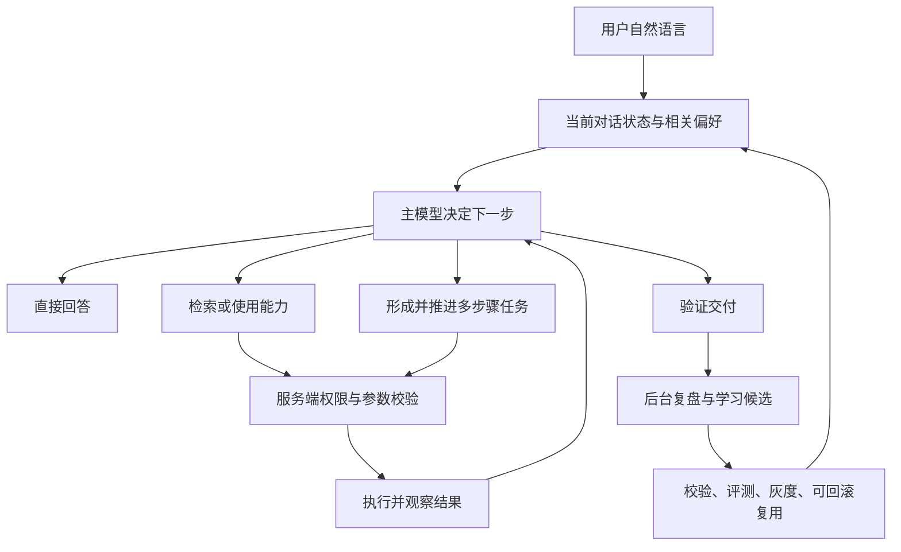

# Pivot 自然对话、自动执行与持续学习架构方案

方案版本：v2.1；核对日期：2026-10-19；实现版本：v0.7.0。

状态：v0.7.0 补齐结构化语义裁决、活动 Run 多轮接续、消息与任务幂等、执行前最新能力复核、交付物/长附件验收、自然语言偏好治理、候选版本绑定评测、个人灰度与纠正暂停、路由审计及效果指标。工程完成情况与验证证据见[工程验收报告](../reports/自然对话架构工程验收报告_2026-10-19.md)。生产真实任务灰度、独立人工核验和委员会签署须由目标环境产生，不能由代码实现替代。本文替代旧《Pivot 聊天 Agent 任务升级产品级优化方案》中“所有任务必须生成草案并手动确认”“普通发送永远不能自动进入 Agent”的目标约束；历史发布记录仍表示当时实现。

## 1. 产品决策

用户直接表达需要的结果。系统理解当前请求、相关对话、有效用户偏好、可用能力和授权范围，自行选择直接回答、检索、工具调用或持续执行。计划、执行、验证与恢复属于内部流程；只有真正需要用户提供事实、作业务选择或补充授权时才中断。

“帮我完成”“可以帮我分析吗”“按刚才的方案改”等表达都可以承载任务委托；不要求固定前缀、斜杠命令、快捷键或模式选择。讨论任务做法不等于委托执行；不能用动作词数量或文本长度代替语义判断。

已明确委托且处于当前有效授权范围的任务，自动创建必要的持久运行，不再先完整回答一次、再让用户生成计划、再确认开始。用户明确说“先给方案，不要修改”时，才进入只规划路径。

## 2. 官方产品参考及适用范围

下表区分官方公开能力与 Pivot 的设计选择，不推测产品未公开的内部路由，也不宣称三个产品采用相同默认设置。

| 参考 | 可核实的公开行为 | Pivot 采用的原则 |
|---|---|---|
| Codex | Auto 预设允许在工作区内自动读取、编辑和运行命令；沙箱和审批策略分别约束能力与中断。 | 授权范围内持续处理，避免对同一工作重复请求“开始”。 |
| Codex Auto-review | 对符合条件的审批请求使用独立审查 agent；普通已允许动作无需审查；自动审查本身不扩大权限。 | 能由策略确定的动作直接执行，边界动作按需后台审查，只有无法消除的阻断交给用户。 |
| Claude Code | `auto` 模式由后台分类器检查动作是否符合请求；auto memory 保存用户纠正和偏好。模式可用性受环境与组织配置约束。 | 意图理解与动作授权分开实现；纠正应作用于后续同类请求。 |
| Hermes（Nous Research Hermes Agent） | 使用用户档案、持久记忆和历史会话检索，并可将有价值的操作方法沉淀为按需加载的 Skills。 | 把“用户喜欢怎样交付”和“怎样可靠完成任务”分别学习、分别复用。 |

来源：[Codex 审批与安全](https://learn.chatgpt.com/docs/agent-approvals-security)、[Codex Auto-review](https://learn.chatgpt.com/docs/sandboxing/auto-review)、[Claude Code 权限](https://code.claude.com/docs/en/permissions)、[Claude Code 自动记忆](https://code.claude.com/docs/en/memory)、[Hermes Memory](https://hermes-agent.nousresearch.com/docs/user-guide/features/memory/)、[Hermes Skills](https://hermes-agent.nousresearch.com/docs/user-guide/features/skills/)。

这些产品的公开经验不等于“每次聊天都会微调模型权重”。Pivot 初期的持续学习应采用有来源的偏好、记忆、技能和评测反馈；模型训练是独立的离线治理流程。

## 3. 用户体验

| 用户输入 | 默认处理 | 需要用户选择吗 |
|---|---|---|
| 解释向量检索 | 直接回答 | 不需要 |
| 根据公司差旅制度解释报销标准 | 检索已授权资料并引用依据 | 不询问是否检索 |
| 汇总本周订单，找出异常并生成报告 | 自动读取授权数据、分析、生成报告并核验 | 范围清楚且能力已授权时不需要 |
| 先给出修复方案，不要改代码 | 只分析和交付计划 | 不自行开始改代码 |
| 按刚才的方案修改，并跑测试 | 继承相关方案与范围，自动修改、验证 | 不重复询问是否执行 |
| 再按上次的格式来一份 | 找到同项目的有效交付习惯并复用 | 找不到唯一对应对象才澄清 |
| 把这些订单处理一下 | 先判断“处理”是否已在上下文定义 | 分析、取消和退款无法区分时只问这个业务问题 |
| 把报告发给客户 | 先完成报告等已授权准备工作 | 收件人、内容或授权不足时，在发送边界一次说明 |

长任务在回答区显示“正在核对数据”“报告已生成，正在检查”等事实状态，提供停止、补充要求和展开步骤。不要把路由类别、工具策略代码、Token 上限等常驻展示给普通用户。运行详情可提供预算与审计信息。

“生成计划 / 暂不需要”卡片只作为探索性对话的可选补充。明确任务不再依赖它启动。`/task` 可兼容保留，但不作为主要发现入口；不继续增加 `/agent` 或中文固定前缀要求。

## 4. 统一对话处理循环

### 4.1 自动处理不等于所有请求都创建后台 Run

简单问答保留快路径；短工具任务使用受控工具循环；需要持久恢复、多个工作单元、异步等待或复杂预算时才创建持久 Run。用户看到一个连续对话，不需要判断执行载体。

早期的轻量准入仅用于预算和能力加载，不作不可逆的最终分类。主模型在正常回答生成中可以选择结构化能力动作，服务端验证后执行。避免“分类模型完整推理一次、答案模型再完整推理一次”的固定双重开销；弱工具调用模型走经过评测的兼容路径，不用前端正则猜测执行授权。

普通对话调用上下文和按需记忆属于理解增强，不意味着每轮检索整个知识库。缓存简短的偏好与任务状态，只在相关性成立时补充细节。简单问题、无历史用户和记忆不可用时都应能顺畅回答。

### 4.2 内部决策契约

以下是 v0.7.0 的服务端内部契约，不是客户端可以自报授权的公共 API：

| 字段 | 作用 |
|---|---|
| `intent` | 了解、创作、规划、委托、继续、纠正、停止 |
| `objective` / `constraints` | 目标与用户约束，保留消息来源引用 |
| `conversationTaskId` / `continuationOf` | 多轮关联与正在执行的任务 |
| `nextAction` | 回答、检索、调用能力、创建/继续 Run、澄清、结束 |
| `requiredCapabilities` | 所需能力的服务端标识；不得由模型发明实际工具或权限 |
| `missingFacts` | 无法从上下文解决且确实阻塞工作的事实 |
| `evidenceRefs` | 委托、参数和历史偏好的可核对来源；不保存私有推理过程 |
| `authorizationRef` / `budgetRef` | 由服务端解析，模型只提出需求，不能签发授权 |

服务端分别判断意图可信度、参数完整性和授权充分性。模型自报“高置信”不能替代权限校验；同样，低置信也不意味着必须让用户选模式，可以先做不改变结果语义的可逆准备工作。

### 4.3 上下文继承与运行切换

- “继续”“按这个做”绑定唯一可辨识的当前任务，继承目标、完成标准、已确认范围和有效授权；冲突时只澄清冲突点。
- 每条用户消息和运行转换使用幂等键。普通回答升级为 Run 时携带已完成工作，不能重放已经执行的操作。
- SSE、恢复、刷新和再次发送保留同一任务关联，避免生成两份结果或重复执行。
- 用户当前明确要求优先于历史偏好；用户说“停止”应停止后续调度，不仅隐藏前端卡片。

## 5. 把确认压缩到必要边界

执行入口不再逐任务询问是否使用 Agent。是否需要审批由实际动作、参数、目的地、当前有效授权和组织策略共同决定。

1. 已授权、范围明确、策略允许的步骤直接执行；资源可见性仍需按租户和用户过滤。
2. 已配置的有限持续授权可以复用，但每次调用都要重新核验范围、有效期、撤销状态和预算；一次性动作令牌不可重复消费。
3. 允许后台审查的边界动作，交给独立审查组件；规则拒绝不能被审查模型放行。
4. 信息不足、身份验证或策略要求人工确认时，只提出一个具体、可回答的阻断问题，同时推进其他独立且已授权工作。
5. 明确授权已经覆盖具体动作且组织规则允许时，不再机械追加确认；法规或组织要求逐次批准的动作仍保留该边界。

风险与副作用不得只按工具名称或关键词判断。`builtin_only` 也不自动等于只读或低风险；内置能力仍需要核对副作用、目标资源和实际参数。记住“用户不喜欢反复确认”可以减少无必要提问，不能作为永久扩大权限的证据。

## 6. 持续学习：四类信息各司其职

| 学习对象 | 示例 | 使用与更新规则 |
|---|---|---|
| 用户偏好 | 先结论后依据、表格展示、简洁中文 | 有明确纠正即可更新相应范围；允许查看、修改、忘记 |
| 项目记忆 | 本项目的统计口径、已选数据源、截止时间 | 绑定项目、来源和有效期；数据源权限每次使用仍要校验 |
| 操作经验 | 哪组查询与核验步骤可靠，某工具失败后的有效替代 | 从经过验证的过程形成候选 Skill，不直接照搬日志 |
| 路由经验 | 此类问题更适合直答还是检索、哪种能力更有效 | 离线比较旧策略与候选策略，再进行小范围发布 |

当前任务状态单独存放，不把未完成的临时目标永久写成用户习惯。偏好要区分本人、当前项目和组织；一个用户的纠正不能自动修改其他用户的默认行为。

学习记录至少包含 `scope`、来源消息/运行、证据类型、支持与反对证据、更新时间、有效期、版本、适用条件和状态。未知不能写成确定事实。显式纠正优先于行为推断；多次独立证据能增强置信，一次沉默、关闭建议或未点赞不能被推断成满意、永久偏好或授权。

后台复盘应做到：

1. 接收最终交付、核验结果、用户自然语言纠正与真实使用反馈，按用户去重和限额。
2. 在用户允许自动记忆的范围内更新非敏感偏好，提供不阻塞的“已按你的偏好调整”反馈及纠正入口，不逐条弹审批。
3. 将可复用方法形成候选，自动完成结构、能力、回归和隔离环境验证。
4. 不扩大权限的个人经验可在达到评测门槛后自动启用；影响共享工作流、外部动作或授权规则的变更遵循原有发布治理。
5. 用新的成功与失败证据重新评分；过期、冲突或退化的条目停用、替换或回滚。

用户应能直接说“以后报告先列异常”“这个口径只用于当前项目”“忘掉刚才那个偏好”，不必先去设置页。自动学习关闭时不新建学习记录；删除来源或撤销权限时同步处理派生条目与缓存。凭据、令牌和敏感原始数据不进入通用记忆或可复用技能。

## 7. Pivot 现有代码对应差距

下表保留方案制定时的模块差距作为需求基线；当前交付状态以第 8 节和工程验收报告为准，不是完整生产认证。

| 现有模块 | 可复用基础 | 本轮目标要求的变化 |
|---|---|---|
| `server/routes/chat/index.js` | 显式 `chatMode === 'agent'` 的持久执行桥接 | 将运行选择移到服务端统一意图决策；保留兼容协议、同一消息关联和全局许可 |
| `server/services/semantic-router.js` | 直答准入、知识库/工具候选、业务决策调用 | 覆盖委托、探索、继续、纠正和停止；支持执行中升级，不只决定检索/工具 |
| `client/chat/chat-task-suggestion.js` | 本地规则与建议卡 | 从执行入口退为可选提示；执行选择不依赖浏览器动作词计数 |
| `server/services/agent-task-drafts.js` | 草案、摘要、确认记录 | 保留显式只规划用途；自动任务持久化授权来源，不能伪造用户点击 approved |
| `server/services/agent-profile.js` | 工作习惯、交付风格、版本管理 | 将相关偏好投影到普通对话与执行决策；处理自然纠正、范围及冲突 |
| `server/services/long-term-memory/`、`memory-governance.js` | 自动捕获策略、来源与记忆治理 | 按需召回并维护证据、时效和遗忘；避免全量注入拖慢每轮聊天 |
| `server/services/agent-learning.js` | success/recovery/correction/explicit 触发、候选技能、评测与发布 | 补齐普通对话→经验候选→评测→复用→效果反馈链；不能将目前“至少 5 案例、85% 通过率”的条件当作全场景生产达标证明 |
| `server/services/decision-runtime.js`、`agent-feedback.js` | 决策与反馈入口 | 度量是否做对任务、是否重复打断、是否学错，不能只奖励卡片点击和自动启动比例 |

特别注意：不能把旧草案接口改成前端自动调用 approve/start 就称作智能路由；它既没有理解意图，也会把机器决定错误记录为人工批准。

## 8. 分期交付及验收

| 阶段 | 工程交付 | 放行条件 |
|---|---|---|
| A：统一意图与自动处理 | 工程已交付：候选语义裁决、统一交接、同活动 Run 控制/恢复、请求租约与消息唯一关联、只规划硬限制、自然停止、执行能力与验收约束 | 代表性已授权任务无需模式/计划/开始三次选择；简单问答无额外分类模型调用；断线重试无重复 Run；生产可用性仍需真实环境测量 |
| B：用户习惯融入决策 | 工程已交付：普通回答与任务按需偏好投影、自然纠正/收窄/遗忘、稳定项目范围、来源引用、事实键版本替换、写入栅栏；组织规则复用已有治理，不由个人纠正自动变更 | 当前要求覆盖历史偏好；隔离与遗忘回归通过；生产持续改善指标需收集真实样本 |
| C：经验自我改进 | 工程已交付：后台复盘、候选隔离验证、独立样本冻结评测、候选版本/摘要绑定、个人稳定灰度、纠正暂停、来源撤销、路由复核与策略制品接入 | 只有真实证据通过才自动复用；样本不足不启用；生产盲测和人工核验不能由合成测试代替 |

每阶段分别发布并记录证据，不把按钮改名或调用数增加记为智能化完成。五分生产验收仍需真实任务灰度、故障演练与独立核验；本文不承诺缺少实测依据的最终达标日期。

必须固定的行为验收用例：

- 新用户首轮“分析附件并生成报告”：不需要历史任务、不需要命令；若附件可用、授权完整则直接完成。
- “解释如何分析订单”与“分析这些订单并交付报告”分流正确；引用他人的操作指令不转成当前用户授权。
- “按刚才方案继续”“这次只给摘要”“停止”：保持多轮任务范围和最新指令优先。
- 同一具体动作不重复索要已有且有效的授权；必要审批不会被“用户习惯自动执行”绕过。
- 模型超时、分类失败或资源不可用时给出准确限制，不静默丢失委托或假装已经完成。
- 用户纠正生效，旧偏好失效；记忆来源删除或权限撤销后，派生内容与缓存受控处理。
- 学习提案生成不等于成功；技能引用真实工具、使用真实产物校验，没有通过就不自动发布。

## 9. 如何证明“越用越智能”

以同一批分层任务的基线和后续表现比较，保持用户、项目、能力与模型版本可区分。指标包括：

- 已授权可自动完成任务的端到端成功率，以及不必要追问次数；
- 用户对同一偏好的重复纠正次数、纠正后的再次犯错率；
- 计划或执行选择的误判率、多轮续接正确率；
- 经验复用后的质量、总耗时、总成本和重复失败次数；
- 简单问答首字延迟与额外模型调用开销；
- 越权、跨用户污染、已删除记忆再次使用、重复副作用等关键事件。

先测基线再冻结可达到的改善门槛；不使用任意“置信度 0.8”、任务启动率、用户沉默或模型自评成功来代替验收。学习退化时回滚该偏好、技能或路由版本，而不是让用户重新选择模式。
