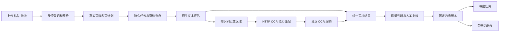

# 文字识别应用产品级审查与优化扩展实施方案

版本：1.0  
日期：2026-10-12  
对象：Pivot 文字识别应用及共享文档处理底座  
读者：产品负责人、前后端研发、OCR 服务研发、测试与运维  
状态：审查已完成，以下改造与扩展为待实施方案  
代码基线：工作区 `package.json` 为 0.2.13；HEAD 为 `270717afb47599dadb27869f23a2eae82d364ace`。审查覆盖当时工作区代码，OCR 相关文件没有本地修改。法规模块的并行变更不作为本方案已经实施的内容。

## 1 结论与实施决策

文字识别应用已有可复用的产品基础：单文件上传、持久化任务、页级结果、文字框、低置信度提示、人工校对、六种导出入口、知识库和法规分发、管理员服务配置。当前关键问题在于结果完整性、校对与交付的一致性，以及长任务的可靠性。仅升级识别模型无法解决这些问题。

建议把应用定位为“中文办公材料的可信识别与复核工作台”：上传后明确知道处理了哪些页、哪些内容需要复核，修改后的文字与导出一致，业务系统能回到原文核验。普通用户围绕材料和结果工作；模型部署、网络地址、DPI、并发和配额由管理员治理。

本次优先决策：

1. **先完成 P0 正确性修复。** 五页 PDF 实际只识别三页，却报告成功且没有截断提示；校对后旧导出与文字块没有同步；中文可检索 PDF 失败；刷新会覆盖未保存校对内容。这些问题影响实际交付，应先于功能扩展发布。
2. **继续复用共享底座。** Pivot 保留 HTTP 服务边界，OCR 引擎与模型继续放在独立 OCR 项目；不在 Node 主服务或 Electron 客户端另建模型运行时。
3. **P1 建立完整办公流程。** 补齐页级恢复、批量输入、混合 PDF 路由、预处理、结构化表格、可信导出与来源分发。
4. **P2 按收益开放场景。** 增加字段抽取、区域识别、桌面截图与受控目录接入、带来源问答、组织复核等能力。
5. **上线按证据验收。** 公共模型榜单和厂商说明只用来确定候选能力；私有中文材料的质量、资源消耗和兼容性必须实际测量。

推荐总路线：两周内完成正确性修复并发布；第 3 至 6 周完成任务可靠性与办公复核；第 7 至 10 周交付表格、版面与来源分发；第 11 至 12 周按试点收益选择一至两个扩展场景。周数是团队资源假设下的计划，不是现有能力承诺。

## 2 审查方法与证据

### 2.1 覆盖范围

- 前端：`client/chat/apps-workbench-ocr.js`、OCR 工作区样式、应用入口及公文材料衔接。
- 路由：`server/routes/apps/ocr.js`、共享文档处理路由及 PDF 工具路由。
- 服务：`server/services/document-processing/` 的任务、设置、文件、OCR HTTP 适配、导出、下载、清理与文本回退。
- 共用依赖：`server/document-text.js`、现有 CJK 字体服务、文档渲染、知识库和法规导入、维护任务、上传校验。
- 持久化：PostgreSQL 的 `document_files/jobs/pages/ocr_blocks/outputs/reviews` 表与相关模式。
- 工程要求：[开发规范](E:/pivot/开发规范.md)、[产品设计规范](E:/pivot/docs/design/DESIGN.md)、[既有文档处理方案](E:/pivot/docs/design/文档处理底座与OCR_PDF工具应用分阶段开发方案.md)、[OCR 服务协议](E:/pivot/docs/OCR服务对接协议.md)。

### 2.2 实测结果

已有回归：运行 `node scripts/run_node_tests.js tests/document-processing.test.js`，**11 项通过，0 项失败**。覆盖登记、受控输出、删除、管理员配置、HTTP 适配、图片字节限制、PDF 拆分归档和合并。

审查探针：**10 项通过，0 项失败**。探针通过表示成功复现当前异常，不表示异常已修复。

| 证据 | 实测内容 | 观察结果 |
| --- | --- | --- |
| A01 | 真实五页 PDF 请求渲染五页 | 只返回前三页 |
| A02 | 五页 PDF 创建 OCR 任务，受控 HTTP 服务返回英文文字块 | 只调用三次 OCR；报告页数为 3；状态 `succeeded`；`truncated=false` |
| A03 | 修改页文本后读取文字块与旧 TXT | 页文本为新文本；文字块和旧 TXT 仍为原文；勾选人工确认后页置信度变成 1 |
| A04 | 一个待复核页和一个未识别页，复核前者 | 整项变成 `succeeded`，另一页仍为 `processing` |
| A05 | 中文文字创建可检索 PDF | 抛出 `WinAnsi cannot encode "中" (0x4e2d)` |
| A06 | 作业序列化 | `config.password` 被原样包含在返回对象中 |
| A07 | 从 OCR 复核路由操作同一用户的 PDF 工具页面 | 数据先被修改，随后 HTTP 返回 404；这是跨应用作用域缺陷，未证明跨用户越权 |
| A08 | 引擎未给置信度且块顺序与 `sortOrder` 不同 | 自动赋 0.8；页文本仍按返回数组拼接，未按阅读顺序排序；请求 100 页在探针环境被配置压到 5 页 |
| A09 | 第一页原生文本、第二页图片文本的混合 PDF，走共享文本回退 | 返回原生文本但没有图片页文字；OCR 调用次数为 0 |
| A10 | 真实 Chromium 加载 OCR 页面与受控接口数据 | `queued` 原样显示；排队任务列表没有取消按钮；轮询不刷新纯排队状态；刷新覆盖未保存文字；125 块只显示 120 块；0 置信度没有低置信度样式 |

复现入口：`node artifacts/ocr-product-audit-2026-10-12/run-audit.js`。入口使用独立 PostgreSQL schema、临时上传目录和本地模拟 OCR 服务，结束后清理隔离 schema 和临时文件。需要配置项目已有 `TEST_DATABASE_URL` 或 `DATABASE_URL`。

复现材料：[探针代码](E:/pivot/artifacts/ocr-product-audit-2026-10-12/audit.test.js)、[隔离入口](E:/pivot/artifacts/ocr-product-audit-2026-10-12/run-audit.js)、[结果数据](E:/pivot/artifacts/ocr-product-audit-2026-10-12/evidence.json)、[运行日志](E:/pivot/artifacts/ocr-product-audit-2026-10-12/probes.log)、[现有界面截图](E:/pivot/artifacts/ocr-product-audit-2026-10-12/current-ui-1280.png)。这些材料位于 Git 忽略的 `artifacts` 中；实施前应将必要用例转成正式回归测试。

### 2.3 证据边界

本报告把“已复现”“代码确认”“待测风险”“新增建议”分开标注。未调用实际部署的 OCR 模型，未测量生产准确率、真实 GPU 吞吐或生产会话。浏览器探针使用真实前端代码与模拟接口；数据库探针是隔离环境。不得据此声称已超过竞品或满足生产 SLA。

## 3 前沿产品对标与取舍

核验日期为 2026-10-12。下表基于官方帮助、官方文档和项目仓库；产品能力可能随版本、许可档位和部署环境变化。桌面 OCR、云文档 API 和开源解析引擎处在不同层面，比较的是可借鉴的流程与契约，不直接比较“谁的准确率最高”。

| 对标对象 | 已核验的能力与来源 | Pivot 应吸收的设计 | 落地位置与优先级 |
| --- | --- | --- | --- |
| ABBYY FineReader PDF 16 | OCR 编辑器支持识别区域、识别结果检查和选定页面处理。[官方帮助](https://help.abbyy.com/en-us/finereader/16/user_guide/sendpdf_to_ocr/) | 区域与文字联动、选页处理、校对后交付 | 复核工作台 P1；区域重识别 P2 |
| Adobe Acrobat | 可检索文字与原图共存，对不确定词逐项纠正并进入下一项。[官方帮助](https://helpx.adobe.com/acrobat/desktop/create-documents/scan-documents-to-pdfs/fix-scanned-text.html) | 把“待复核问题”做成可导航队列；校正隐藏文字层 | 结果一致性 P0；逐项复核 P1 |
| Umi-OCR | 提供离线图片/PDF 识别、截图、批量图片和排除区域等功能。[官方仓库](https://github.com/hiroi-sora/Umi-OCR) | 少步骤输入、批量任务、明确排除页眉水印 | 批量与粘贴 P1；截图和排除模板 P2 |
| PaddleOCR | 官方仓库当前列出 PP-OCRv6 与 PaddleOCR-VL-1.6，支持文字识别和结构化文档解析。[官方仓库](https://github.com/PaddlePaddle/PaddleOCR) | 基础 OCR 与复杂版面模型分工，按页/区域选择能力 | 独立 OCR 项目 P1；使用现有版本参与实测后再升级 |
| MinerU | 以统一文档模型提供 Markdown/JSON 等结果，保留页块定位并面向后续检索。[官方仓库](https://github.com/opendatalab/MinerU) | 结构化中间结果、稳定来源定位、长文档逐页读取 | IR 与来源 P1；作为可选解析候选，不复制其整套产品 |
| Azure Document Intelligence | Layout 返回段落、表格、选框、坐标与置信信息；Markdown 中复杂表格使用 HTML 表达合并单元格。[官方文档](https://learn.microsoft.com/en-us/azure/ai-services/document-intelligence/prebuilt/layout?view=doc-intel-4.0.0) | 表格单元格结构、块类型、层级、坐标和文字跨度契约 | OCR 协议与表格 P1；云服务仅作为组织允许的可选接入 |
| Google Document AI | 支持原生文本、旋转校正、页范围与图像质量分析；质量可用于路由。[官方文档](https://docs.cloud.google.com/document-ai/docs/enterprise-document-ocr) | 识别前判断质量，优先保留可用原生文本，明确质量问题 | 页级路由和预处理 P1 |
| Amazon Textract | 异步多页处理和幂等请求令牌；分析接口区分文字、表单、表格、查询结果与签名位置。[异步文档](https://docs.aws.amazon.com/textract/latest/dg/api-async.html)、[分析文档](https://docs.aws.amazon.com/textract/latest/dg/how-it-works-analyzing.html) | 创建任务幂等、长任务结果读取、字段附来源 | 可靠任务 P1；字段抽取 P2 |

由上述来源得出的产品判断：领先产品的价值不止是识别字符，还包括处理完整性、结构表达、复核效率和后续交付。这个判断用于规划优先级，不能代替私有材料的对照测试。

建议默认部署仍为内网独立 OCR 服务。复杂页优先评估现有引擎、PP-OCRv6、PaddleOCR-VL-1.6、PP-StructureV3 及 MinerU 的适配候选；升级时固定版本与模型校验值。公开评测分数不得换算成中文公文准确率；未通过样本评测与硬件兼容验证的候选不得成为默认引擎。

不纳入本期默认范围：云端自动外发、全文润色替代原始识别、电子签章验真、通用 PDF 编辑器、复杂科研图表语义重建、客户端随安装包捆绑 GPU 模型。OFD、古籍、特殊字库、手写表单按独立场景验证后开放。

### 3.1 引擎评选与部署决策

当前独立 OCR 项目不在本仓库内，其部署模型和硬件应由 OCR 负责人补充，不能从 Pivot 的 `engine=http` 判断实际识别能力。引擎评选以同一盲测集和固定硬件比较当前服务与候选方案：

| 用途 | 评选候选与策略 | 采用门槛 |
| --- | --- | --- |
| 普通办公文字与批量任务 | 当前服务、PP-OCRv6；优先比较字符错误率、耗时、低分块召回和 CPU 资源 | 相同质量预算下有明确收益；当前服务已经达标时不强制升级 |
| 表格和精确区域定位 | 当前结构服务、PP-StructureV3；保留单元格与文字坐标能力 | 表格结构、坐标和数字保真通过；能力缺失时禁止启用精确区域交付 |
| 复杂图文与劣质页 | PaddleOCR-VL-1.6 或 MinerU 的可部署方案；只对路由选中的复杂页使用 | 相比基础路线质量提升可复现，资源与幻觉风险可控 |

PaddleOCR 官方说明 PP-StructureV3 提供细粒度文字与表格单元格坐标；因此精确 PDF/表格定位应单独验证这种能力，不能仅用生成的 Markdown 代替坐标契约。[官方说明](https://github.com/PaddlePaddle/PaddleOCR)

评选输出包括：每类质量与失败样本、冷/热耗时、峰值 RAM/显存、吞吐、模型包大小、部署架构、许可与离线依赖。估算年度运行投入时使用“预计处理页数 × 实测每页资源消耗 + 运维和复核工时”，商业服务则代入核验后的合同计费；本报告不填写未验证的采购报价。升级通过灰度，保留旧模型版本和回退路线。

## 4 当前能力与产品级差距

| 能力 | 当前实际状态 | 产品级差距 |
| --- | --- | --- |
| 输入 | 单文件 PDF/PNG/JPEG/WebP/BMP；服务底座还有 GIF 等格式能力 | 多文件、粘贴、上传进度、预检、真实页数、页范围和限额提示不足；不同入口格式需统一 |
| 任务 | 数据库任务、内存队列、原子抢占、过期租约恢复已有 | 无页级断点复用；恢复/重试会清空结果与校对；无集群总配额和租约所有者保护 |
| 识别 | HTTP 单页识别，中英语言选项 | 未知置信度被赋默认值；坐标协议弱；阅读顺序、模型版本与表格结构不足 |
| 复核 | 页列表、原图叠框、页文本编辑、低置信度确认 | 缺少草稿保护、块级修订、版本冲突处理、全量问题导航、缩放与撤销 |
| 导出 | TXT、Markdown、JSON、HTML、DOCX、可检索 PDF 入口已有 | DOCX 主要是页标题与段落；Markdown 为平铺文本；中文 PDF、修订一致性、失效管理、结构化 XLSX 不足 |
| 分发 | 知识库/法规真实服务分发；聊天写入输入框；公文写入文本框或本地待取用键 | 没有统一版本与原页来源清单；公文本地待取用键只找到写入点；重复分发与目标选择不足 |
| 管理 | 超级管理员 OCR 地址与引擎可用性；共享管理接口有处理限制与统计 | 普通用户看不到可用配额；健康检测仅看 2xx；配置缺少能力描述和合成样本检查 |
| 清理 | 到期输出清理、用户主动删除与受控下载已有 | 原件/预览/校对记录缺少 OCR 业务保留策略与引用保护；过期时间没有完整呈现 |
| 跨应用复用 | RAG/法规使用共享 OCR 回退 | 以“全文件有无文本”判断，混合 PDF 可能漏扫描页；入口间配置和结果契约不一致 |

已有文件签名校验、上传限流、受控路径、用户所有者查询和 HTTP 安全代理应继续保留。报告不把这些已实现能力重新列成待建设任务。

## 5 缺陷清单与修复验收

优先级定义：P0 为会导致漏内容、丢修改、交付错误或敏感信息不必要暴露的发布阻断项；P1 为办公主流程、稳定性与质量能力；P2 为有明确收益的扩展。每项均需在实际实现后更新状态；本报告不标记任何修复为完成。

| 编号 | 优先级与证据 | 原因及影响 | 必须实现的修复与验收 |
| --- | --- | --- | --- |
| D01 | P0，A01/A02 已复现 | 公共 `renderPdfPages` 把 `last` 压到 3；任务用渲染页数覆盖原件页数；截断只比较已渲染数组 | 获取真实页数；OCR 显式传选页范围；原件页数、计划页数、已处理页数独立；5/10/100 页都能逐页对账，超限明确拒绝或经确认生成部分结果 |
| D02 | P0，A10 已复现 | 后端 `queued`，前端判断 `pending` | 使用统一状态字典；旧 `pending` 只作兼容映射；排队筛选、中文标签、取消、轮询均有效 |
| D03 | P0，A10 已复现 | `loadDetail`/切页重建编辑区；没有 dirty 状态保护 | 草稿按页维护；后台进度只更新状态；刷新/切页/关闭前保存或保留；慢请求旧响应不得覆盖新页与新草稿 |
| D04 | P0，A03 已复现 | 校对只改 `document_pages.text`；块/导出无版本关联 | 建立不可变识别原文与修订版本；所有导出取同一版本；旧输出标记旧版本；不能映射坐标的全文修改不得伪装成已对齐文字层 |
| D05 | P0，A05 已复现 | 可检索 PDF 嵌入 Helvetica，不支持中文 | 复用已有 CJK 字体服务并检验 Unicode 映射；中文、数字、拉丁字符可搜索复制，罕见字缺字明确报告，不静默丢字 |
| D06 | P0，A04 已复现 | 复核完成只统计 `needs_review`，没检查未识别/失败/遗漏页 | 处理完成与复核完成分离；成功要求所有计划页都有终态；复核不改变处理覆盖率；完整性不满足时不能变成完整成功 |
| D07 | P0，A06 已复现及代码确认 | 密码写入 `config_json` 并由序列化返回 | 响应统一剔除秘密；密码用现有加密能力与短期秘密引用保存，任务终态清除；历史密码迁移清理；普通用户和管理员列表/详情均不返回明文 |
| D08 | P0，A07 已复现 | OCR 路由在共享服务产生副作用后才判断 `sourceModule` | 在服务读/写前校验所有者、应用作用域和状态；拒绝请求不改变行、文件、队列或输出；覆盖 retry/cancel/review/export/share |
| D09 | P1，A08/A10 已复现 | 缺失置信度补 0.8；0 值被逻辑排除；页平均值掩盖低分块；人工确认改成 1 | 未知值为 null；0 保留为 0；独立记录人工确认；复核由低分块、未知值、完整性和质量问题共同决定 |
| D10 | P1，A08 已复现、结构丢失代码确认 | 拼接页文本不按 `sortOrder` 排序；适配器不保留完整结构与版本 | 验证并稳定排序；引入块类型/表格/层级/来源；未知结构不丢弃但隔离原始响应；有上限与异常错误码 |
| D11 | P1，A09 已复现 | 共用回退有任意原生文本就返回整个文件文本 | 按页评估原生文本，扫描页补 OCR；同一页的图片区域允许局部 OCR；结果去重、顺序保持并带来源 |
| D12 | P1，代码确认，竞态待测 | 重试与恢复调用 `cleanupJobArtifacts`，删除校对；取消不向 adapter 传 signal；租约没有 owner/epoch；并发按进程计 | 页级检查点、受控取消、租约 fencing、集群配额；模拟崩溃/延迟/取消后续跑，不丢人工修订、不重复提交页和输出 |
| D13 | P1，代码确认 | 全量详情返回全部页面/块/输出；列表队列统计含全局运行任务 ID；同步导出且未限制处理状态 | 摘要与分页详情拆分；普通用户只看自身队列；导出异步且固定版本；失败/处理中部分结果必须明确说明 |
| D14 | P1，代码确认 | 健康请求 2xx 即可用；文字响应/坐标缺少严格契约；OCR 专用路由复用通用上传格式 | 能力与合成样本检测；格式、页数、像素和结果结构预检；非法格式/坐标/超额内容在受控边界返回可理解错误 |
| D15 | P1，A10 及代码确认 | 块列表仅展示前 120 个；按钮全部平铺；部分动作无状态约束；复制失败仍可能提示成功 | 全量虚拟列表和问题跳转；主要动作与菜单分层；逐项忙碌状态；操作回执以实际结果为准 |
| D16 | P1，代码确认 | 分发成临时 TXT，来源不是可回看的页块；公文待取用键没有发现消费路径；旧结果可重复入库 | 版本化来源清单、目标选择、幂等分发；公文使用已有用户隔离材料服务；聊天附来源材料卡片 |

### 5.1 关键代码定位

- D01：[公共 PDF 渲染](E:/pivot/server/document-text.js:350)、[OCR 准备页](E:/pivot/server/services/document-processing/jobs.js:407)、[截断判断](E:/pivot/server/services/document-processing/jobs.js:442)。公共渲染曾服务聊天小范围预览，不能直接取消所有调用方的限额；先让 OCR 显式选择范围，再保留预览入口的默认小页数预算。
- D02/D03/D15：[状态与取消](E:/pivot/client/chat/apps-workbench-ocr.js:67)、[详情渲染](E:/pivot/client/chat/apps-workbench-ocr.js:478)、[轮询](E:/pivot/client/chat/apps-workbench-ocr.js:916)。
- D04/D06/D07/D12：[校对写入](E:/pivot/server/services/document-processing/jobs.js:705)、[任务重试](E:/pivot/server/services/document-processing/jobs.js:655)、[配置与序列化](E:/pivot/server/services/document-processing/settings.js:109)。
- D05：[可检索 PDF](E:/pivot/server/services/document-processing/pdf/index.js:413)、[可复用 CJK 字体](E:/pivot/server/services/document-rendering/cjk-fonts.js:236)。
- D08：[OCR 路由](E:/pivot/server/routes/apps/ocr.js:92)。不应仅在页面隐藏按钮；校验必须进入业务服务。
- D09/D10/D14：[HTTP 适配](E:/pivot/server/services/document-processing/ocr/adapters/http.js:82)、[结果归一](E:/pivot/server/services/document-processing/ocr/adapters/shared.js:20)。
- D11：[共享文本回退](E:/pivot/server/services/document-processing/text-extraction.js:66)。
- D13/D16：[详情](E:/pivot/server/services/document-processing/jobs.js:381)、[队列统计](E:/pivot/server/services/document-processing/jobs.js:893)、[分发](E:/pivot/server/services/document-processing/jobs.js:771)、[公文材料衔接](E:/pivot/client/chat/apps-workbench-ocr.js:733)。

### 5.2 P0 的具体完成条件

**完整性对账。** 文件拥有 `sourcePageCount`；任务拥有 `selectedPages`、`plannedPageCount`、`processedPageCount`、`failedPageCount`、`omittedPages` 与 `coverageComplete`。明确空白页可计入处理完成，但应保存判定理由。限额是策略，不是无声截断。用户选择第一页至第五页，就必须得到五页逐页结果，或明确的拒绝/部分处理回执。

**校对不丢失。** 编辑草稿与请求响应分开管理；轮询不得替换当前输入控件。切页后返回仍有草稿；请求以 `pageId + revision` 判断是否仍有效；保存失败保留内容，版本冲突返回 409，并提供对比与重新提交。不要把校对全文默认写入跨账号共享的 localStorage。

**导出版本一致。** 保存校对后使任务 `contentRevision` 增加。输出记录标明所用版本；旧输出允许作为历史下载，但必须显示“旧版本”。默认导出使用最新已保存版本。若用户没有保存修改，界面必须明确提示“导出已保存版本”，提供保存后导出。所有格式用同一内容快照；全文编辑造成块对齐失效时采用第 8 节的降级规则。

**秘密不随任务对象传播。** 不只是页面隐藏密码，还要从 `serializeJob`、JSON 导出、日志、错误、事件、统计和审计载荷剔除。加密密码不能放入客户端响应；通过任务所有者与用途校验解密。多实例恢复需要共享可用的秘密存储；内存缓存不能当作唯一恢复路径。

## 6 产品流程与界面方案

### 6.1 三个主要工作场景

| 用户任务 | 主流程 | 结果与必要反馈 |
| --- | --- | --- |
| 快速提取一张图片 | 粘贴/拖拽 → 自动识别 → 复制或下载 | 识别语言、质量问题、原图定位；复制失败有可选手动复制 |
| 扫描公文可靠入库 | 上传 → 预检与选页 → 处理 → 问题复核 → 导出/分发 | 原件页数与处理范围一致；编号、日期、金额等问题可定位；分发可回到原页 |
| 批量材料转换 | 多文件 → 批次确认 → 后台执行 → 仅重试失败页 → 汇总下载 | 各文件结果独立；部分失败不阻断全部；下载清单包含成功、失败与遗漏情况 |

### 6.2 信息架构

保留“应用中心 → 文字识别”入口。在应用内组织为“任务列表”和“复核工作区”，支持返回列表与全屏复核。复核区可先复用现有全屏工作区弹窗，完成后再按全局路由模式支持可恢复的任务定位。

- 列表工具栏：新建识别、批量上传、搜索、状态与时间筛选。显示文件名、页数范围、状态、待复核数、更新时间及主操作。
- 新建识别：默认“自动识别”，可选“办公文档”“表格材料”“快速提取”；仅展示语言、处理页范围和用途。DPI、超时、模型细节收进高级设置；硬上限来自服务端。
- 复核工作区：左侧页缩略图与问题筛选；中间原图缩放、旋转显示和区域框；右侧文本/表格编辑；上部显示覆盖范围和质量状态；底部显示保存状态。
- 主动作：保存、下一个问题、完成复核、导出、分发。格式和目标收进各自菜单；重识别、取消、删除等放入更多操作，避免十二个按钮同时争夺焦点。
- 管理设置：服务能力、健康状态、限额、保留期、模型版本和离线检查；不向普通用户展示内网地址、服务端路径或凭据。

### 6.3 复核交互

1. 点击文字或表格单元格，原图定位到对应区域；点击框，编辑器滚动到内容。问题列表按页码和阅读顺序导航。
2. 可筛选低置信度、置信度未知、空结果、版面失败、编号/金额/日期异常和人工未确认。不能用页平均分代替问题清单。
3. 支持块级编辑、页级编辑、撤销/重做、保存草稿、原始/修订对比；标明“人工已确认”，保留引擎原始置信度。
4. 重识别默认仅处理选定失败页/区域；已复核内容保持。重识别候选与人工版本做比较，由用户选择是否替换。
5. 在处理中打开详情只读取已有结果；当前编辑页被冻结为明确版本，不受后台追加页影响。
6. 键盘可完成保存和问题导航；提供焦点恢复、弹窗焦点限制、状态文字与图标。颜色只作辅助。快捷键在产品内展示并避免覆盖浏览器常用组合。

### 6.4 关键状态文案

| 情况 | 建议文案与可操作下一步 |
| --- | --- |
| 超出当前处理配额 | “文件共 128 页，本次最多处理 100 页。请选择页范围或联系管理员调整限额。” |
| 部分页失败 | “已处理 98/100 页，第 17、63 页失败。可重试失败页或下载部分结果。” |
| 没有置信度 | “此引擎未提供置信度，结果待核验。” |
| 修改尚未保存 | “当前页有未保存修改。保存后继续或保留草稿。” |
| 文字与坐标不再匹配 | “全文修改后，部分文字暂无准确原图位置。可导出文本；可检索 PDF 将使用明确标注的降级模式。” |
| 服务不可用 | “识别服务暂不可用，任务已保留。恢复后可继续。”后台记录错误码与请求标识 |
| 复制不可用 | “当前环境不能自动复制。请选择文本后手动复制。”不得提示“已复制” |

界面复用全局按钮、输入、弹窗、分页、表格和主题变量。现有 OCR/PDF 共用 CSS 类较多，拆分前要确认 PDF 工具的依赖；不要全局调整 `.doc-tool-*` 造成另一应用回归。

验收视口建议：1024×768、1280×800、1440×900、1920×1080；100%/125%/150% 缩放。小屏折叠页列表与高级设置，主动作始终可达；缩略图和块列表虚拟化，不能通过只显示前 120 块解决性能。

## 7 技术架构与任务可靠性

### 7.1 目标处理链路



文件存储、路径、鉴权、任务中心、审计、配置、数据库访问均沿用现有体系。OCR 的 CPU/GPU 调度和模型选择位于独立 OCR 服务；Pivot 负责用户权限、任务调度、结果治理和业务交付。OCR 服务可在内部路由多个模型，Pivot 不为每种模型增加平行业务链路。

推荐模块拆分，名称为拟新增内容：

- `document-processing/preflight.js`：真实格式、页数、密码、大小、页范围与预算；创建不可变处理计划。
- `document-processing/worker.js` 与 `checkpoints.js`：抢占、心跳、页级恢复、取消与故障重试。
- `document-processing/quality.js`：覆盖率、未知置信度、问题清单、质量原因；不修改识别原文。
- `document-processing/results/`：统一中间结果、来源坐标、原始/人工版本及 schema 校验。
- `document-processing/reviews.js`：校对版本、冲突检测、历史与最终确认。
- `document-processing/distribution.js`：目标鉴权、固定版本、幂等分发、原页来源回执。
- `document-processing/exporters/`：按格式拆分；复用统一文档渲染和表格导出，不在路由内拼接复杂文件。
- `client/chat/ocr/`：`core`、列表、新建、复核、预览、任务动作、导出分发及事件。现有 `apps-workbench-ocr.js` 保留兼容入口。

先完成正确性修复，再按实际职责拆分，避免一次性重构扩大风险。公共模块调整要回归 PDF 工具、聊天附件、知识库和法规导入。

### 7.2 页级路由

每页先判断原生文本的覆盖、乱码比例、文字与图片区域、阅读顺序和提取异常；阈值由样本验证确定，不按“文本长度大于零”直接认定整页可用。

| 页类型 | 策略 | 必须保留的证据 |
| --- | --- | --- |
| 原生文本有效 | 优先直接抽取，保留页级文字跨度与坐标 | 提取方法、页码、文本质量检查 |
| 纯扫描页 | 渲染后 OCR | 原件页尺寸、渲染尺寸、坐标转换、引擎版本 |
| 原生文字和图片文字混合 | 对图片区域做局部 OCR，再去重与排序；能力不足时整页 OCR 作候选 | 原生/识别来源、重复过滤依据、最终采用版本 |
| 原生文本损坏 | 尝试 OCR 并保留差异供复核 | 乱码原因、候选版本、人工选择 |
| 空白页 | 标记空白已处理，不凭空生成文字 | 空白检测结果和可复核原图 |
| 模型不支持的复杂页 | 进入待复核或可选复杂模型处理 | 降级原因、原始结果、缺失结构项 |

RAG、法规和聊天入口调用同一页计划服务；逐步把现有返回字符串的函数改为“结构化提取结果 + 兼容字符串包装”。长文档入库改为引用持久任务，避免业务 HTTP 请求逐页等待。扫描法规的解析和发布仍遵守法规模块的审核与效力规则，OCR 完成不能直接视为正式发布。

### 7.3 状态设计

兼容现有 `queued/processing/succeeded/failed/needs_review/cancelled`。新增状态若确有需要，必须同时更新前端、服务、统计、恢复、维护和所有使用方。

建议内部把两个维度分离：

- 处理状态 `processingState`：`queued/running/complete/partial/failed/cancelled`。
- 复核状态 `reviewState`：`not_required/pending/in_review/reviewed`。

阶段一通过 `result` 的结构化字段表达两个维度，保留外层旧状态；阶段二增加持久字段并做兼容映射。暂停若进入本期，则新增独立暂停标志与 `paused` 映射，明确暂停后不继续领取新页、在途页如何结束、何时恢复；不能只停前端轮询。

外层 `succeeded` 的含义：**本次选定范围全部完成，必要复核满足策略**。只处理用户明确选定的前十页可以成功，但显示“范围 1–10 / 原件 128 页”，禁止呈现为全文件成功。失败页或未经确认的漏页不能通过保存另一页而消失。

### 7.4 检查点与恢复

1. 文档预检、每页渲染、每页识别、质量检查、导出和分发分别持久化检查点；页面身份由任务、原件页码和执行版本稳定定位。
2. 任务领取采用 PostgreSQL 原子抢占，增加 `leaseOwner`、`leaseExpiresAt`、递增 `executionEpoch`。心跳建议 10 秒、租约建议 90 秒，均作为待压测默认值，不与单页超时混用。
3. 页结果提交带执行 epoch；数据库条件更新同时校验 epoch 和 owner。被回收的旧 worker 即使稍后返回，也不能覆盖新结果或人工版本。
4. 恢复跳过已经成功的页；只重跑需要重跑的阶段。重新渲染产生的文件属于对应执行版本，不覆盖现有已被引用的预览。
5. 页失败不立即废弃整个文件；按策略重试，最终保留部分结果和失败清单。空响应、格式错误、授权错误和不支持格式不作无限自动重试。
6. 识别失败页的自动重试建议最多 3 次，采用带抖动退避；429 尊重 `Retry-After`，同时受任务总时限和用户配额约束。手动“重试失败页”创建新的 attempt；“整项重新识别”生成新版本并说明替换范围。
7. 导出/分发也有幂等键和独立状态。文件写入先到临时文件，经校验后原子落盘，再登记输出；失败时清理本次临时文件。

### 7.5 取消与资源控制

取消先持久化意图，worker 停止领取新页并把 `AbortSignal` 传入现有 adapter；多实例通过数据库状态/既有事件机制通知目标 worker。HTTP 断开不代表远端模型已停止，外部服务需要配合请求取消或有明确总预算。

建议第一期资源默认值：每用户最多 2 个活动文档任务、集群 OCR 页请求总并发 2、单文档页并发 1；管理员可调整但需压测。之后可让文档页并发上调到 2–4，公平轮转文档，避免一个大文件占满资源。进程数增加不能把全局并发限制相乘。

每页设置图片字节、像素、响应字节、文字块数量与文字总长度上限；现有图片/响应字节限制继续复用。预检同时估计渲染内存、OCR 请求大小和临时存储；DPI 不直接决定固定纸张尺寸。Base64 的体积与多次内存复制计入预算；若 v2 支持二进制上传，仅访问受控内网服务，不让浏览器传服务端文件路径。

删除活动任务应先阻止写入并回收执行，再清理文件；迟到 worker 不能再次登记页/输出。已被知识库或分发清单引用的材料必须走引用检查与保留策略，不能因为删除 OCR 任务导致业务来源失效。

## 8 统一结果模型与数据迁移

### 8.1 中间结果契约

建议定义 `DocumentResult v2`，让预览、校对、导出、入库和 Agent 读取同一版本。以下为拟议示例，不是当前接口响应：

```json
{
  "schemaVersion": "2.0",
  "jobId": 412,
  "contentRevision": 3,
  "source": { "fileId": 251, "sourcePageCount": 128 },
  "coverage": {
    "selectedPages": [1, 2],
    "plannedPageCount": 2,
    "processedPageCount": 2,
    "failedPages": [],
    "omittedPages": [],
    "coverageComplete": true
  },
  "pages": [{
    "pageId": 910,
    "sourcePageNumber": 1,
    "processingState": "complete",
    "reviewState": "reviewed",
    "sourceSizePt": { "width": 595.28, "height": 841.89 },
    "renderSizePx": { "width": 1654, "height": 2339 },
    "coordinateSpace": "render_px_top_left",
    "renderToSourceTransform": [0.3599, 0, 0, 0.3599, 0, 0],
    "engine": { "provider": "internal-http", "modelId": "pinned-model", "modelVersion": "pinned-version" },
    "blocks": [{
      "id": "page-1-block-7",
      "type": "paragraph",
      "readingOrder": 7,
      "polygon": [[90, 210], [1250, 210], [1250, 310], [90, 310]],
      "rawText": "原始识别结果",
      "effectiveText": "人工修订结果",
      "confidence": null,
      "confidenceSource": "unknown",
      "reviewStatus": "reviewed",
      "alignmentStatus": "aligned"
    }],
    "issues": []
  }]
}
```

坐标原点、单位和变换必须明确。变换先把渲染顶左坐标映射到原页顶左坐标；写入 PDF 时再执行 Y 翻转和页面旋转变换。不要让前端、HTML 与 PDF 各自猜 `[x,y,w,h]` 和 `[x1,y1,x2,y2]`。

示例的六参数变换适用于仿射处理；曲面矫正或其他非线性变形必须额外保存逆变换网格，或由服务直接返回原页坐标。无法反算时标记定位不可用，不把非线性矫正结果套入简单缩放公式。

表格结构至少包括 `tableId`、行列数、单元格 `rowIndex/columnIndex/rowSpan/columnSpan`、文本/数值候选、页块来源、置信度及跨页候选关系。公式保存 LaTeX 候选和原图；图片保存受控引用及说明；标题、段落、列表、页眉、页脚、印章文字和选框有明确块类型。印章/签名位置检测不能表述为真实性鉴定。

适配器校验必需字段、枚举、有限数值、坐标边界、块数与响应大小。未知字段可以留在受限原始响应中，不能直接生成不可信 HTML；原始响应不能返回秘密、内部地址或路径。V1 只有文本时保留文本能力，标记 `layoutUnavailable` 与置信度未知。

### 8.2 内容版本和对齐

- 机器原文不可变；人工修订保存为新版本，记录操作者、时间、基准 revision、修改范围和原因。
- 块编辑沿用原 polygon，但只有文字仍合理对应原区域时才保留 `aligned`；插入新块、合并/拆分或全文粘贴需重新确认位置。
- 页全文修改可保存为 `unaligned`；TXT、DOCX 纯文本和业务阅读使用最新修订。精确定位模式的可检索 PDF 在存在未对齐修改时返回可理解的 409，指导用户完成块级对齐或选择另行提供的明确降级格式。
- P0 可先把受影响旧块标为过期，阻断使用旧块的 PDF/HTML 精确叠层；不能为了可导出而继续把旧文字藏进文件。可选“原图加修订文本附页”要单独命名，不能宣称原图区域精确可检索。
- `contentRevision` 固定输出、分发和问答依据。保存时提交 `expectedRevision`，事务内做 CAS；版本不匹配返回 409，不使用最后写入覆盖。
- 复核通过保留引擎置信度，增加 `humanVerified`；置信度校准属于引擎评测，不由人工点击改成 100%。

### 8.3 持久化改造

优先扩展现有表，避免另建与现有底座重复的 OCR 数据库。拟新增结构：

| 对象 | 新增或调整内容 | 约束与索引 |
| --- | --- | --- |
| `document_files` | 真实页数、预检状态、格式签名、保留策略、引用信息；复用已有 SHA256 | 哈希查重限定用户/授权范围；相同文件不能向另一用户泄露存在性 |
| `document_jobs` | 页计划、内容版本、执行 epoch、租约 owner/expiry、取消意图、结构化错误、幂等键、处理/复核维度 | 用户+幂等键唯一；状态+租约时间索引；用户+时间/状态列表索引 |
| `document_pages` | 原件页码、原页 pt 尺寸、渲染 px 尺寸、变换、阶段状态、当前结果版本 | 任务+原件页码+执行版本唯一；页结果提交校验 epoch |
| `document_ocr_blocks` | 稳定块标识、原文、块类型、阅读顺序、置信来源与对齐状态 | 页面+结果版本+稳定块标识唯一；页+阅读顺序索引 |
| `document_page_versions` 拟新增 | 原始/人工内容快照、JSONB 结构、修订基准、操作者、校对原因、checksum | 页面+revision 唯一；大响应仅按需读取 |
| `document_reviews` | 复核结论、问题确认、基准版本；停止原地改写历史正文 | 复核关联版本；多次审核留历史，不覆盖已发布结论 |
| `document_exports` 拟新增 | 异步导出状态、格式、版本、选页、参数摘要、错误、幂等键 | 用户+导出幂等键唯一；输出仍登记到 `document_outputs` |
| `document_outputs` | 内容 revision、checksum、真实 `expires_at`、质量告警、历史标记 | 任务+版本+格式+参数摘要查重；到期索引 |
| `document_distributions` 拟新增 | 目标资源、来源版本、分发清单、状态、失败原因、幂等键 | 用户+目标+结果版本+参数摘要唯一；来源引用不能悬空 |
| `document_batches` 拟新增 | 批次创建者、子任务、汇总计数、共享参数快照 | 子任务独立恢复；跨页列表查询受所有者限制 |

表格单元格第一版可放在版本快照 JSONB 中，避免一开始过度拆表。需要跨材料检索或字段核验时再建立专用索引与字段表。

迁移必须使用项目版本化迁移与数据库访问层；更新 PG 初始化、迁移登记、模式快照、注释、索引及测试。不要手工写生产 SQL 或只修改快照。

### 8.4 历史数据迁移与兼容

1. 新字段先可空，双读旧结构和 v2；新任务开始写 v2，不要求一次性重识别全库。
2. 旧页数没有真实原件依据时标记 `coverageUnknown`，不得把已有前三页视为完整文件。后台预检补真实页数，不自动产生昂贵识别任务。
3. 原始识别文优先从已有审校 `original_text` 恢复；无法完整恢复时标记 `legacyReconstructed`，保留实际来源，不伪造机器原文。
4. 旧文字块与已修订页不一致的记录标记未对齐，旧输出标记版本未知；用户重新导出时显示升级提醒。
5. 从历史 `config_json` 提取明文密码，迁入加密短期存储或在终态清除；清理响应与日志链路。历史备份按组织既有保留策略处理，不能承诺删除所有历史副本。
6. 增加唯一约束前查重与修复孤儿关系；大表索引按项目规范安排窗口。迁移可重复执行，先在隔离 PG 与生产副本演练。
7. 保留旧创建接口和字符串提取包装；客户端能力按服务端版本展示。回滚应用时保留新数据与机器结果，新版本写入通过功能开关停止；不要用删表作为回滚。

## 9 OCR 协议与应用 API

### 9.1 外部 OCR 服务协议升级

保留 V1 `GET /health` 与 `POST /ocr`。拟增加 `GET /capabilities` 和版本化页解析接口，例如 `POST /v2/pages:analyze`，接口最终名称由两个项目共同固定。

能力响应包括协议版本、模型版本、语言、`text/layout/table/formula/quality/region` 能力、坐标空间、输入限制、取消方式与输出结构。健康检查分为进程存活、模型就绪和小样本识别成功；管理员可手动检测，常规检查要缓存和限流。

请求增加 `requestId`、幂等键、所需能力、固定模型策略、渲染信息、页码、语言、质量配置与任务预算。响应返回 schema 版本、真实引擎/模型版本、文字/结构/坐标/置信度来源、耗时、警告和可重试属性。不要在客户端直接指定任意模型路径或服务 URL。

若服务只支持 V1，Pivot 显示“支持文本，不支持结构化表格/区域”。未提供置信度按未知处理。不得根据健康页里的引擎名字推断全部能力；不得将模型未实现的功能按钮启用。

### 9.2 应用接口设计

以下是待实现契约；除标注“沿用”的接口外，不应视作现有可调用 API。路径仍在 `/api/apps/ocr` 下，业务实现落入共享文档处理服务，其他应用复用同一服务而不复制路由逻辑。

| 接口 | 目的与关键契约 | 阶段 |
| --- | --- | --- |
| `GET /capabilities` | 普通用户安全能力视图：格式、语言、可用功能、用户有效限额；无地址/凭据 | P0/P1 |
| `POST /preflight` | 受控上传、密码校验、真实页数与预算；返回短期 `fileId`/预检凭据，限期清理未使用文件 | P1 |
| `POST /jobs` 沿用 | 兼容 multipart；新客户端可引用已预检文件；要求 `Idempotency-Key` 与处理范围 | P0/P1 |
| `POST /batches` | 多文件批次，每文件独立任务，返回逐项受理结果 | P1 |
| `GET /jobs` 沿用 | 用户作用域列表；增加文件名、时间、问题数过滤和安全队列摘要 | P0/P1 |
| `GET /jobs/:id` 沿用 | 摘要优先；旧客户端 `include` 兼容；版本化详情不含密码 | P0/P1 |
| `GET /jobs/:id/pages` | 页摘要分页与状态筛选，不一次返回全部大字段 | P1 |
| `GET /pages/:id/result` | 指定内容版本，块/表格游标读取，包含下一页游标 | P1 |
| `GET /pages/:id/image` 沿用 | 所有者和引用权限检查，可选择受控缩略图，无物理路径 | P0/P1 |
| `PUT /pages/:id/review` 沿用 | `expectedRevision`、块/页修改、人工结论；原子版本提交，冲突 409 | P0/P1 |
| `GET /pages/:id/revisions` | 版本历史、差异与回退候选，不能回退机器执行状态 | P1 |
| `POST /jobs/:id/retry` 沿用 | 默认 `failed_pages`，可指定页；整项重跑明确版本策略；上限由管理员控制 | P1 |
| `POST /jobs/:id/cancel` 沿用 | 持久取消意图，202 接受后可读实际执行停止状态 | P0/P1 |
| `POST /jobs/:id/exports` | 异步固定内容版本与页范围，202 返回导出 ID | P1 |
| `POST /jobs/:id/outputs` 沿用 | 小结果兼容；大结果适配导出任务，旧客户端有清晰升级行为 | P0/P1 |
| `GET /exports/:id` | 导出进度、告警、输出、错误；任务可恢复 | P1 |
| `POST /jobs/:id/share` 沿用 | 目标白名单、目的资源权限、固定版本、幂等键、来源清单 | P1 |
| `GET /jobs/:id/events` | 可选事件流，授权后只推本任务；支持事件 ID 恢复，轮询作为降级 | P1 |
| `DELETE /jobs/:id` 沿用 | 校验引用与执行，受控清理；结果返回删除/保留引用说明 | P1 |

建议错误对象统一为 `code/message/retryable/requestId/details`。错误码覆盖 `PAGE_LIMIT_EXCEEDED`、`PASSWORD_REQUIRED`、`OCR_NOT_READY`、`OCR_TIMEOUT`、`OCR_RESULT_INVALID`、`REVIEW_REVISION_CONFLICT`、`EXPORT_ALIGNMENT_REQUIRED`、`SOURCE_IN_USE` 等；错误详情不含服务地址、秘密、正文和物理路径。

### 9.3 配置治理

复用现有文档处理设置与配置注册机制，不能新增一套 OCR 前端配置中心。保留现有图片/响应字节、页数、置信阈值、单页超时、并发和输出保留参数；新增项至少包括有效用户配额、集群页并发、页面像素限制、批次文件数、请求总预算、能力开关与原件保留策略。

所有拟新增配置必须有名称、作用域、默认值、范围、单位、重启要求、敏感级别、离线行为及回滚方式，登记到 `docs/configuration-registry.md` 的生成来源。前端输入最大值取用户有效策略；例如目前界面允许 100 页，但后端常规默认限制为 5 页，且公共渲染实际只返回 3 页，这三层必须统一。

## 10 可信导出与业务分发

### 10.1 输出标准

| 格式 | 目标行为 | 产品验收 |
| --- | --- | --- |
| TXT | 最新已保存文本，阅读顺序明确；选页和部分失败说明放清单，避免污染纯文本 | 内容 hash 对齐快照；中文、换行、特殊字符无丢失 |
| Markdown | 标题层级、列表、段落、表格和图片引用；合并单元格用 HTML 表格或告警 | 不把平铺纯文本宣传为版式还原；外链/HTML 经过受控处理 |
| JSON | schema、原文/有效文、版本、页块坐标、覆盖率、问题、引擎版本 | 能按源页重建阅读结果，不泄露用户秘密和路径 |
| HTML | 语义阅读为主，原图与块定位为可选视图；明确当前版本和告警 | HTML 转义与安全策略有效；未对齐内容不使用旧叠层 |
| DOCX | “阅读版”与“版面版”分开；阅读版先实现，保留标题/表格/分页 | Word/WPS/LibreOffice 真实打开与抽取；复杂版面降级可见 |
| XLSX/CSV 拟新增 | 表格单元格、合并关系、原文数值与来源；多表分别导出 | 身份证号、前导零、长编号按文本；金额不静默四舍五入；防公式注入 |
| 可检索 PDF | 尽量保留原页视觉/尺寸与对应文字层，中文 Unicode 可提取 | 页数、物理尺寸、旋转、搜索复制、框位置、修订版本全部核验 |

### 10.2 可检索 PDF 专项

优先保留可用原 PDF 页面，在原页上加入识别文字层；原生文本页不重复添加相同文字。扫描图片输入按其真实 DPI 或明确的用户纸张设置确定物理尺寸，不把 1654 像素当成 1654 PDF points。

复用 `cjk-fonts.js` 与现有 `@pdf-lib/fontkit`，验证字体可用、字形覆盖和 ToUnicode。采用真正不可见文字渲染方式，避免现有 `opacity:0.01` 带来的淡文字重影。文字布局需要转换 polygon、旋转、字宽与行序；不能靠截取前 1000 字或前 120 行保证文件生成。

原 PDF 含表单、附件、书签、批注或数字签名时，输出是新派生文件，并标记哪些对象被保留。不能声称签名仍有效；选择保留原页的工具链要验证其实际保存行为。无图或无坐标时说明降级，不能默认把所有行叠到页面顶端。

所有可检索 PDF 都检查：输出页数与选定页一致；文字可被标准解析器抽取；中英搜索定位可用；至少 20 组位置点对照；页面尺寸与旋转正确；最新修订文本不混入旧文。

### 10.3 分发闭环

分发清单固定 `fileId/jobId/contentRevision/pageId/blockId/sourcePageNumber/polygon/checksum`，记录目标资源、操作者、结果与时间。原件获取通过鉴权链接/受控材料服务，不能把服务器路径写入业务正文。

- **知识库**：选择有写权限的集合、标签和标题；以结构化文档进入索引，chunk 保留原件/页/块定位。低质量材料先隔离待复核；只给文本包装的旧索引入口需要逐步迁移。
- **法规库**：选择正确类型与来源信息；进入草稿/审核流程；条文能够回看 OCR 原页，保留修订版本。内容不全不能默默成为完整法规。
- **公文材料**：使用用户隔离的材料保存接口，显示已加入的材料名称、版本和来源。清理仅写入 localStorage 的待取用流程，补真实消费与完成回执。
- **聊天/Agent**：新增材料卡片，以受控引用读取正文和页块，不把整份长文强行塞入输入框。文档内指令属于材料内容，不能扩大工具许可或触发外部动作。
- **数据分析**：表格经用户确认后创建数据集，保留列类型、原文和单元格来源；类型转换可回退。

重复点击分发使用幂等键，返回既有目标而非重复入库。后续修订提示“目标使用旧版本”，由目标应用的更新规则决定是否更新，不自动覆盖用户在目标系统的修改。撤销分发不直接删除已被使用的业务资产，应提供目标应用允许的撤回或标记流程。

## 11 功能扩展方案与上线条件

### 11.1 P1 办公核心扩展

| 扩展 | 最小可交付范围 | 依赖 | 独立验收 |
| --- | --- | --- | --- |
| 多文件与粘贴输入 | 默认批次最多 20 个文件；支持拖拽、图片粘贴、文件级进度、单项失败；由策略调整上限 | 预检、幂等任务、批次汇总 | 同名文件区分；错误不重复上传；20 个文件中 1 个失败，其余继续完成 |
| 页码范围与补识别 | `1-5,8,10-12` 等范围，选定失败页重试，部分结果清单 | 真实页数、页计划、检查点 | 非法页/重复页明确处理；原件页号不变；补页不覆盖已审核内容 |
| 图像质量预处理 | EXIF 方向、旋转、去倾斜、轻量对比度；低质提示；原图/处理图切换 | 图像预算、可逆坐标变换 | 处理图不覆盖原件；旋转前后位置一致；增强无收益时可使用原图 |
| 表格提取和 XLSX | 有线简单表格优先，单元格编辑、合并单元格、多个表格；复杂表格明确告警 | IR、服务表格能力、复核、导出任务 | 单元格结构与数值保持；长编号/前导零不损坏；来源可点击 |
| 结构化 Markdown/DOCX | 标题/段落/列表/表格、简单图文阅读顺序；阅读版先上线 | IR 与文档渲染 | 双栏不串行；页眉页脚可排除但原件仍可见；降级内容有清单 |
| 问题导向复核 | 低分/未知/空页/日期编号异常队列，快捷导航、草稿、版本对比 | 质量服务、校对版本 | 125 个以上块均可定位；多人或多窗口保存冲突不会覆盖 |
| 持久任务与批量下载 | 关闭页面继续处理；重启恢复；逐页失败清单；ZIP 汇总 | 检查点、导出、配额 | 100 页任务第 60 页崩溃后只补未完成页；汇总可区分部分失败 |

预处理的去阴影、曲面矫正、复杂去噪在独立服务中按样本证明收益后启用。不能默认删除印章、签名或水印，因为它们可能是材料内容；“排除页眉/水印”应只影响提取结果并记录规则。

### 11.2 P2 场景扩展

| 场景 | 业务价值和最小方案 | 风险约束与开放条件 |
| --- | --- | --- |
| 区域与模板识别 | 框选区域重新识别；常见公文固定排除区、表格区域模板；结果做差异比较 | 坐标转换准确后开放；模板有版本和适用样本，不直接覆盖人工文本 |
| 字段抽取 | 从已识别公文/票据/表单提取标题、文号、日期、机构、金额等；使用 JSON Schema、来源与校验 | 先提供一类材料；缺失字段返回空与原因；金额/日期由人工确认，不凭常识补填 |
| 桌面截图识别 | 通过已有桌面连接器获取用户本次选定区域，快速复制/加入材料 | 首次和必要时复用现有屏幕能力授权；不做后台全屏监视；Web 端采用粘贴降级 |
| 受控目录接入 | 复用桌面目录授权，识别新文件并进入批次，支持暂停与去重 | 文件稳定写入后再处理；监听器有清晰状态和撤销入口；不能访问未授权目录 |
| 带来源问答 | 针对当前材料或批次提问、摘要、对照条款，回答附原页定位 | 使用现有聊天/RAG/Agent 能力；强制依据固定版本；对齐失效不能提供伪精确框 |
| 组织复核协作 | 所有者指定复核人、任务领取、草稿/通过/退回、双人确认 | 复用既有单位/用户授权；不全局共享全部 OCR 原件；并发版本保护先落地 |
| OFD 与国产办公适配 | 先验证原生 OFD 文本抽取，再验证扫描 OFD 渲染；WPS/UOS 文档交付兼容 | 使用固定样本与部署包；龙芯、ARM 等未验证目标不宣传可运行特定模型；允许内网远端 OCR |
| 行业词典与反馈 | 收集脱敏且明确授权的错误对，管理员审核后更新术语或路由策略 | 默认不上传材料；反馈集和评测集分开；纠错建议保留原文与版本，不自动改全部历史数据 |

P2 不同时全部启动。试点优先选择“公文字段抽取”和“区域重识别”，若桌面快速摘录使用更频繁，可用截图替代其中一项。选择依据：每周使用次数、人工复核耗时、材料错误成本及所需新依赖。

### 11.3 AI 辅助的边界

AI 可解释疑似错误、建议候选字符、判断阅读顺序和生成摘要，但原始 OCR 与人工版本独立保存。每条建议显示理由、原文区域与采用状态。涉及公文文号、金额、日期、姓名的改动不能静默接受；全文润色和翻译作为派生材料，不混进“忠实识别”结果。

复杂文档模型可产生流畅但错误的内容，质量路由不能只看模型自报分数；比较原图、文字长度、块覆盖、表格结构与关键字段。AI 输出是待校验数据，不是应用权限或执行指令。

## 12 可拆分研发任务与排期

### 12.1 执行任务表

人日指实现、开发侧验证和评审；不含表外专项测试、产品试点和运维演练。前后端联合任务不能简单按单人串行估计。依赖列为开工前必须具备的最小条件，阶段内其他工作可由团队并行推进。

| ID | 优先级与交付物 | 主责 | 依赖 | 人日估计 | 完成判据 |
| --- | --- | --- | --- | --- | --- |
| R01 | 页数/页范围对账，修复三页截断 D01 | 后端 | 无 | 3–5 | A01/A02 转为正确行为；真实页数和范围均可核验 |
| R02 | 状态统一与排队筛选/取消 D02 | 前端+后端 | 无 | 0.5–1 | 排队中文、取消、轮询、筛选都正确 |
| R03 | 页草稿、dirty 保护、响应竞态 D03 | 前端 | 无 | 2–4 | 刷新/切页/关闭/超时不丢文字 |
| R04 | 最小内容版本、旧输出标记与对齐保护 D04 | 后端+前端 | 最小 revision 迁移 | 3–5 | 各输出同一版本；旧块不能进入新版本输出 |
| R05 | CJK 可检索 PDF 与物理尺寸 D05 | 后端 | R01/R04 | 3–5 | 中文搜索复制、页尺寸、修订一致；未对齐明确阻断 |
| R06 | 完整性与复核状态分离 D06 | 后端 | R01 | 1–2 | 未完成页存在时不能标完整成功 |
| R07 | 密码响应脱敏与加密生命周期 D07 | 后端 | 无 | 2–3 | 所有返回/输出无秘密，恢复解密与终态清除有效 |
| R08 | 操作前作用域与状态校验 D08 | 后端 | 无 | 1–2 | 拒绝请求无副作用，跨用户/应用矩阵通过 |
| R09 | IR v2、结构校验、稳定块身份与坐标 D09/D10/D14 | 后端+OCR | R04 | 4–7 | 未知置信度保留，阅读顺序/坐标/结构可重放 |
| R10 | 租约 owner/epoch、心跳、集群公平配额 | 后端 | R06 | 6–10 | 双 worker/过期响应无重复与覆盖 |
| R11 | 页级检查点、失败页重试、受控取消 | 后端 | R09/R10 | 4–7 | 崩溃续跑保留成功页和人工版本 |
| R12 | 能力接口、预检、配额视图与就绪检测 | 后端+OCR+前端 | R01/R07 | 3–5 | 硬上限透明；未知/不支持格式及时拒绝 |
| R13 | 原生/扫描/混合页路由与共用回退 D11 | 后端+OCR | R09/R12 | 4–7 | 混合 PDF 不漏扫描内容，重复文字受控 |
| R14 | 图像预处理、质量问题、人工置信度分离 | OCR+后端 | R09/R12 | 3–5 | 质量告警真实，可逆坐标、不抹除原件 |
| R15 | 复核工作台、全量问题、版本对比 D15 | 前端 | R03/R09/R14 | 4–7 | 全量块可达；框/文字联动；多窗口冲突可解决 |
| R16 | 多文件/粘贴、批次汇总与上传进度 | 前端+后端 | R11/R12 | 3–5 | 20 文件逐项处理、恢复、取消和回执 |
| R17 | 表格单元格、XLSX/CSV 与数据集确认 | OCR+后端+前端 | R09/R15 | 7–12 | 合并关系、数值保真、防公式注入、来源定位 |
| R18 | 异步导出、结构化阅读版与多格式校验 | 后端 | R04/R09/R17 | 4–7 | 固定版本；可恢复；真实软件打开通过 |
| R19 | 知识/法规/公文/聊天来源分发 D16 | 后端+前端 | R09/R18 | 5–8 | 目标权限、幂等、来源回看、版本更新规则有效 |
| R20 | 摘要/分页详情、事件与轮询降级 D13 | 前端+后端 | R09/R11 | 3–5 | 大任务不全量刷新；普通用户无全局任务 ID |
| R21 | 保留期、引用保护、删除竞态和审计 | 后端+运维 | R10/R19 | 3–5 | 活动删除无迟到写入；来源引用不失效 |
| R22 | 黄金集、指标采集、评测与发布证据脚本 | OCR+测试工程 | R01 后启动 | 3–5 | 版本、硬件、样本、指标与结果可复现 |
| R23 | 区域识别与排除模板 | 前端+OCR | R09/R15 | 3–6 | 旋转/缩放后框选正确，人工结果不被直接覆盖 |
| R24 | 一类公文字段抽取与人工确认 | 后端+前端+OCR | R09/R19/R22 | 6–10 | 字段有来源，缺失不猜，关键字段校验通过 |
| R25 | 桌面截图输入 | 桌面+前端 | R12/R16 | 4–7 | 选区授权、取消、Web 降级均通过 |
| R26 | 当前材料带来源问答 | 后端+前端 | R19/R22 | 3–6 | 回答绑定版本，原页引用可核验 |
| R27 | 组织复核与双人确认 | 后端+前端 | R15/R21 | 4–7 | 授权矩阵、领取冲突和审核历史通过 |
| R28 | OFD/国产办公验证与适配 | 后端+测试 | R12/R18 | 5–8 | 只开放实测通过的格式与平台 |
| R29 | 受控目录监听 | 桌面+后端 | R16/R21/R25 | 5–8 | 授权范围、稳定文件、去重、撤销均通过 |
| R30 | 授权纠错反馈与术语模板 | 产品+OCR+后端 | R22 | 4–7 | 脱敏、审核、版本回退和评测隔离通过 |

R01–R08 合计约 **15.5–27 人日**；R09–R22 约 **56–98 人日**。核心研发合计 **71.5–125 人日**。另预留专项 QA 20–30、产品试点 8–12、运维与迁移 8–12 人日，P0+P1 总工作量约 **110–180 人日**。R23–R30 全部约 34–59 人日，本期只选择一至两项，不将它们全部压入核心排期。

建议配置：后端 2 人、前端 1 人、OCR 服务研发 0.5 人、QA 1 人、产品与运维各约 0.25 人。模型/表格适配和跨应用接入存在较大不确定性；若只有两名综合研发，应保留 P0 和任务可靠性，延后表格版面与扩展，按实际人力重新估算。

### 12.2 分阶段里程碑

| 阶段 | 建议窗口 | 交付范围 | 发布门槛 |
| --- | --- | --- | --- |
| M0 正确性修复 | 第 1–2 周 | R01–R08；R22 启动；最小迁移与兼容 | 漏页/丢草稿/错版本/中文 PDF/密码/跨作用域问题关闭；旧 OCR/PDF 流程通过 |
| M1 可靠任务与复核 | 第 3–6 周 | R09–R16、R20 的基础；页恢复与能力治理 | 100 页完整性、双 worker、取消、混合 PDF、未知置信度、草稿冲突通过 |
| M2 办公交付与来源 | 第 7–10 周 | R17–R22；表格与结构导出、分发、保留策略 | 黄金集核心场景达标，文档兼容矩阵通过，来源与配额实测有效 |
| M3 试点扩展 | 第 11–12 周起 | R23–R30 中收益最高的一至两项 | 核心稳定后单独开关；至少一周真实试点证明收益 |

关键路径：R01/R04 → R09 → R10/R11 → R15/R17 → R18/R19 → 验收。黄金集从第 1 周准备，性能与安全验证从 M1 进入，不留到发布最后一天。

### 12.3 首个十个工作日安排

| 工作日 | 行动与负责人 | 当天证据 |
| --- | --- | --- |
| 第 1 日 | 产品确认处理范围与成功定义；QA 将 A01–A10 拆为正确行为断言；后端设计最小 revision 与密码迁移 | 用例矩阵、迁移评审、职责分工 |
| 第 2–3 日 | 后端 A：R01/R06；前端：R02/R03；后端 B：R07/R08 | 五页/十页对账，排队和草稿浏览器证据，秘密返回检查 |
| 第 4–5 日 | 后端 A：R04；后端 B：R05 字体与页尺寸；前端：版本提示和不允许的动作状态 | 修改后输出比对，中文提取、字体/尺寸检查 |
| 第 6–7 日 | 联调 R04/R05/R06；QA 加入超限、混合入口与跨应用回归；OCR 研发记录当前模型基线 | 各格式版本一致报告，已有 11 项回归及新增用例 |
| 第 8 日 | 迁移演练、历史密码和旧结果兼容、功能开关与回滚测试 | 迁移日志、行数/引用核验、回滚说明 |
| 第 9 日 | Web/Windows 客户端/中文办公材料试用；修复阻断项 | 视口与交付文件核验、问题关闭记录 |
| 第 10 日 | 发布负责人核查 M0 门槛，生成发布包与监控规则 | 测试/迁移/样本/回滚证据齐备后进入现有发布流程 |

## 13 质量评测与验收矩阵

### 13.1 黄金集

建立至少 200 页、约 60 份文档的脱敏中文办公黄金集；按文档分组划分开发/校准/盲测为 20%/20%/60%，避免同一文档相邻页跨集合。每类均进入盲测；复杂样本不足时扩大集合，不用同一文件复制凑数。

| 样本类别 | 建议页数 | 必须覆盖 |
| --- | --- | --- |
| 中文印刷公文和制度 | 80 | 中英混排、文号、日期、页码、金额、罕见字 |
| 原生/扫描混合 PDF | 40 | 文本+图像同页、不同页混合、异常文本层、空白页 |
| 表格材料 | 30 | 有线/无线、合并表头、多表、跨页、前导零与长编号 |
| 拍摄或劣质扫描 | 20 | 旋转、倾斜、阴影、模糊、裁切、低对比 |
| 多栏与图文 | 10 | 双栏、标题层级、图片说明、页眉页脚 |
| 手写及印章遮挡 | 10 | 清楚手写、涂改、文字遮挡；能力不支持时正确告警 |
| 公式及特殊符号 | 10 | 公式候选、上下标、符号、特殊标点 |

另建 5/10/100/500 页容量样本、20 文件批次、损坏/加密/恶意文件集与多实例故障集。容量样本用于稳定性，不用于计算字符准确率；500 页在尚未开放的配额下应明确拒绝/选页，而不是要求早期版本默默支持。

标注包含原文、页块类型、阅读顺序、polygon、表格单元格与关键字段。至少两人复核争议标注；保留样本 hash、授权、标注版本和修改记录。关键字段总量建议不少于 1000；不足时追加材料，不用重复字段放大样本数。

### 13.2 指标与目标

以下是建议发布目标，**不是本次实测结果**。M0 先拿到当前值；M1 校准引擎和硬件后正式冻结指标。超出已开放能力的手写/复杂公式单独报表，不混入简单印刷平均值掩盖问题。

| 指标 | 定义与测量 | 建议门槛 |
| --- | --- | --- |
| 页完整性 | 每个计划页有唯一终态；原件页码与结果对应 | 支持范围内 100%；未解释遗漏为发布阻断 |
| 修订一致性 | 导出/分发有效文字与所用内容版本逐页比对 | 100%；允许明确结构降级，不允许旧字混入 |
| 中文字符错误率 CER | 字符编辑距离/参考字符数；报告文档宏平均与字符微平均 | 清晰印刷宏 CER ≤1%；普通扫描 ≤3%；关键字段单独核验 |
| 关键字段精确匹配 | 文号、金额、日期、长编号全字段匹配，保留标点/前导零 | 自动结果 ≥99% 作为候选目标；用户最终确认样本 100% 正确 |
| 简单表格结构 | 固定 TEDS 实现版本，另报单元格结构与文字准确度 | 有线简单表格平均 TEDS ≥0.90；跨页/无线分组单独报告 |
| 阅读顺序 | 标注块顺序的正确相邻关系比例，单独列双栏结果 | 简单办公材料 ≥98%；复杂材料不足时进入复核 |
| 未知置信度处理 | 未给分数时保留 null；人工确认不改原始分数 | 100% 契约符合；不得伪造默认 0.8 |
| 可检索 PDF | 页数/尺寸、文本提取、中文搜索、坐标和修订核验 | 所有支持样本通过；20 组定位点的误差 ≤原页边长 1% |
| 自动任务成功率 | 通过预检、格式受支持且服务可用的文档进入完整处理终态比例 | ≥99%；用户取消与计划外超限单独报告，不隐藏失败 |
| 复核效率 | 相同材料交叉试用，至少 5 名用户记录每页中位耗时和错误 | 相比旧界面减少 ≥30%，最终错误不增加 |
| 故障恢复 | 崩溃、租约过期、网络中断后逐页对账 | 不丢人工版本；已提交页不重复计费/提交；重复输出为 0 |

CER 规范化仅做约定的 Unicode NFC 与空白处理；原始 CER 同时保留，不能移除所有标点、金额格式或前导零后声称准确率提高。公共榜单与私有黄金集分别记录，不能混算。

### 13.3 性能测量

固定两类候选测试环境：CPU 基础 OCR 为 8 vCPU/32 GB RAM；复杂文档候选为单张 24 GB 显存 GPU/32 GB RAM。精确 CPU/GPU 型号、驱动、模型精度、服务版本、网络、DPI、并发、冷启动和预热情况全部写入证据，硬件不符合时重新设基线。

建议目标：普通列表和摘要 P95 ≤500 ms；已预检任务受理 P95 ≤2 s；单页结果读取 P95 ≤1 s。这些时间不含大文件上传和实际 OCR。单页识别 CPU 基础候选 P95 ≤10 s、GPU 复杂候选 P95 ≤30 s 作为试验目标，以真实样本验证后决定配额；不能为了达标降低内容质量或忽略冷启动。

测量 1/2/4/8 页并发和 10 个用户排队；记录队列等待、识别/渲染/导出各阶段时间、吞吐、RSS 峰值、显存、临时磁盘和重试次数。API 延迟指标与文档端到端时间分开；100 页任务端到端上限按实测页耗时和有效并发计算，而非只给一个虚构固定秒数。

### 13.4 必须通过的回归与故障用例

| 类别 | 用例 | 合格行为 |
| --- | --- | --- |
| 完整性 | 五页、十页、100 页、超限、非连续选页、空白页 | 不漏页、不改原页码；范围/遗漏有回执 |
| 草稿 | 正在编辑时轮询、切页、关闭、保存失败、迟到详情响应 | 内容保留；冲突可解决；编辑器焦点稳定 |
| 版本 | 校对、重识别、回退、导出同时发生 | 每个输出绑定明确版本；历史可追踪 |
| 置信度 | 缺失、0、百分比、NaN、超范围、平均高但局部低 | 归一正确；未知和低分问题都可到达 |
| 协议 | 200 但模型未就绪、空结果、超大响应、非法坐标、未知 schema | 正确错误/降级；无无限重试或 UI 崩溃 |
| 故障 | 第 60 页崩溃、HTTP 超时、429/503、租约过期、双 worker、旧 worker 返回 | 检查点续跑；fencing 有效；资源预算遵守 |
| 取消删除 | 排队取消、识别中取消、远端迟到返回、活动删除 | 不开始新页，不重建已删任务，不产生孤儿文件 |
| 权限 | 跨用户任务/页/输出、同用户跨应用、目标集合无写权、普通管理员改服务配置 | 按现有权限拒绝；拒绝前不产生副作用 |
| 内容安全 | 文件签名不符、图片像素炸弹、异常 PDF、HTML 注入、CSV/XLSX 公式、文档提示注入 | 上传与解析预算受控；导出安全；材料不成为执行指令 |
| 分发 | 重复点击、目标失败、任务删除、来源过期、目标被修改后更新 | 幂等；失败可重试；引用受保护；不覆盖目标人工内容 |
| 兼容 | PDF 工具拆分/合并、聊天预览、知识/法规导入、旧任务/客户端 | 公共改动无回归；不支持升级功能时明确提示 |
| 文档交付 | Word/WPS/LibreOffice、Acrobat/浏览器 PDF、Excel/WPS 表格 | 文件可打开、内容可提取、中文搜索复制和表格数据正确 |

正式用例名称可拟为 `ocr-page-coverage`、`ocr-review-revisions`、`ocr-worker-recovery`、`ocr-searchable-pdf`、`ocr-distribution-provenance` 和 OCR 浏览器流程等测试模块；这些测试当前尚未创建，不要将报告中的名称当作可运行命令。

## 14 安全 隐私 运维与发布

### 14.1 安全与隐私要求

1. 所有任务、页面、块、修订、输出、批次、分发和事件读取都使用一致的所有者/授权检查；全局管理员统计按已有权限规则提供，普通用户不看到其他人的运行任务 ID。
2. OCR 服务地址仅管理员配置；允许经过治理的内网地址，继续使用现有安全 DNS/HTTP 代理。补端点 allowlist、服务身份凭据及跳转策略，禁止跳转绕过端点限制。不能为了内网可用简单禁止全部私有网地址。
3. 对公网 OCR 的接入默认关闭；确有组织授权时显示材料外发策略、目的端点和审计。服务凭据复用现有加密能力，日志只记录请求 ID、耗时、错误码和计数。
4. 文件签名、解析总时限、PDF 页数、图片像素、块数、内存与磁盘限额一起校验；worker 资源受限，单个异常文件不能拖垮 HTTP 服务。
5. 表格文本导出防公式注入；HTML/Markdown 不执行不可信片段；聊天材料中的指令不改变系统权限。
6. 原件、预览、修订、输出分别有保留策略。建议未使用预检文件 24 小时、一般输出 30 天；原件/复核记录由组织按材料性质设定，不默认无限保留，也不在仍有业务引用时直接清除。
7. 内容落入日志、localStorage、浏览器缓存或崩溃报告要有明确策略；复制只在用户触发时进行，账号切换清理当前用户的内存草稿/缓存。
8. 组织词典或模型反馈集只能接收有授权、经过审核的材料；评测记录默认保存摘要/hash与必要标注，非必须不复制全文。

### 14.2 监控与告警

复用现有系统监控和维护任务；补文档阶段指标，不另建孤立监控页。建议指标：队列长度和等待时间、各阶段 P50/P95、页覆盖率、页失败与重试、未知置信度比例、人工复核耗时、版本冲突、导出成功率、分发成功率、服务就绪、存储容量与到期清理积压。

建议初始告警：连续 3 次就绪检测失败；P95 排队超过 5 分钟；任务没有心跳超过 2 个租约周期；支持任务最近 15 分钟失败率超过 5% 且至少 20 个样本；磁盘剩余低于 20%；过期清理积压连续两轮不下降。阈值需结合试点基线调整，错误通知去重，不因每次轮询产生通知。

审计事件包括创建/选页、能力选择、自动重试、人工修订、审核通过、导出、下载、分发、撤回、删除、配置和秘密生命周期。敏感正文、密码与服务凭据不进入审计说明；追查内容时通过受控原件与版本读取。

### 14.3 灰度与回滚

- 按用户/组织开启 `ocr_result_v2`、页级 worker、结构导出、表格、来源分发等功能开关；名称为建议，实施时登记配置。
- P0 修复独立发布；不等待所有模型或表格功能完成。旧任务视图与下载兼容，历史结果的完整性未知状态必须可见。
- M1/M2 从内测人员进入一个部门，再逐步扩大；至少观察一个完整业务周的失败/复核/资源指标。
- 发布前保存数据库备份、迁移日志、关键样本结果、前端/服务版本与 OCR 模型校验值；离线包包含所需字体与固定模型依赖清单。
- 回滚关闭新任务写入与新功能入口；保留已有 v2 数据、人工版本和引用；旧 worker 不得接管它无法理解的新任务。必要时停止领取新任务，保留任务可读，等待兼容 worker 恢复。
- 出现未解释漏页、人工修订丢失、跨用户读取、秘密响应或错误版本导出，立即停止相关新处理/交付功能并进入现有事故流程。

### 14.4 发布证据包

每个里程碑交付以下材料：任务完成列表与未决问题、代码/模型版本、正式回归结果、黄金集分组指标、容量/故障报告、导出兼容性、权限矩阵、迁移/回滚演练、运维配置与用户帮助。功能负责人、QA、产品负责人共同确认适用范围；未开放的复杂格式在界面与说明里保持一致。

## 15 验收清单与后续实施入口

### 15.1 M0 发布阻断清单

- [ ] 五页文件的五页内容全部可核验，原件页数没有被渲染数组覆盖。
- [ ] 超额、失败、空白和选页结果都有明确覆盖说明。
- [ ] `queued` 的列表、筛选、取消和自动刷新有效。
- [ ] 校对草稿在刷新、切页、关闭和保存失败时保留。
- [ ] 旧块与旧导出不会被当成新修订结果交付。
- [ ] 中文可检索 PDF 可生成、搜索与复制；页尺寸和旋转正确。
- [ ] 存在未处理页时，复核操作不能将任务标成完整成功。
- [ ] 响应、导出、日志和事件不含 PDF 密码；历史密码有清理策略。
- [ ] 跨用户/跨应用/非法状态操作在副作用前拒绝。
- [ ] 已有文档处理 11 项回归及新增正确行为用例通过，共享入口没有回归。

### 15.2 M1 与 M2 完整办公清单

- [ ] 外部服务能力和有效配额真实可见，不把未知能力当作支持。
- [ ] 原生、扫描和混合 PDF 走统一逐页计划，未知置信度可复核。
- [ ] 100 页任务断点恢复、双 worker、取消与迟到响应测试通过。
- [ ] 多文件和粘贴输入有逐项状态与恢复，块列表无静默截断。
- [ ] 表格与阅读版导出达到已冻结的黄金集标准。
- [ ] 导出和分发固定内容版本，目标权限、幂等、来源回看与引用保留有效。
- [ ] 大任务分页/事件更新符合资源预算，用户看不到全局运行任务信息。
- [ ] Web、桌面与办公软件兼容矩阵完成，离线依赖和字体检查通过。
- [ ] 产品帮助、错误处理、管理员配置、监控与回滚说明齐备。

建议从 R01–R08 建立首个实施迭代。每条任务在研发管理工具中至少填写“用户问题、影响入口、代码范围、数据迁移、依赖、验收用例、负责人和回滚方式”。以后完成一项，应在本报告另附实施记录或里程碑验收文档；不要直接把本次“已复现”证据改成“已修复”而不保留新测试证据。

### 15.3 v0.2.22 实施状态

2026-10-13 已完成并发布 `v0.2.22` 的实现范围：R01–R09、R11–R21、R23–R28、R30 的最小可交付闭环。已落地真实页数/范围预检、任务覆盖率、页级失败续跑、内容版本与坐标对齐保护、中文可搜索 PDF、短期密码秘密、作用域校验、未知置信度/阅读顺序/表格契约、混合 PDF 页级 OCR 回退、质量问题、全量块复核、批量与粘贴输入、表格 Excel、固定内容快照的异步导出与恢复、版本化且幂等的来源分发、页块分页、字段候选、原图框选区域候选、同单位协作复核、授权纠错反馈、带任务/修订/页码的聊天上下文、桌面授权截图入口、OFD 文本包解析、类型化配置、保留期与引用保护。

R10 的 lease owner/epoch 已实现并通过任务状态路径验证；组织部署仍应以双实例压测数据决定实际并发阈值。R22 的自动化回归、隔离数据库迁移、浏览器验证、60 份/206 页夹具、CER/字段/顺序评估器与发布证据已落地；真实 OCR 模型 CER、TEDS、硬件吞吐和一周试点数据属于独立 OCR 服务与组织材料的现场验收，不能由主仓库测试伪造。R29 的受控目录监听依赖桌面设备目录授权与组织部署的稳定写入策略，保留为部署后启用项；主仓库没有把用户目录作为服务端任意路径读取。

实现与验证详情见 [v0.2.22 发布记录](../releases/v0.2.22-文字识别应用产品级升级.md)。

## 16 参考来源与工程约束

### 16.1 外部主要来源

以下来源用于本报告第 3 节对标与方案推导，查阅日期均为 2026-10-12：

1. [ABBYY FineReader PDF 16 OCR 编辑器和选页帮助](https://help.abbyy.com/en-us/finereader/16/user_guide/sendpdf_to_ocr/)。
2. [Adobe Acrobat 识别疑似错误修正](https://helpx.adobe.com/acrobat/desktop/create-documents/scan-documents-to-pdfs/fix-scanned-text.html)。
3. [Umi-OCR 官方仓库](https://github.com/hiroi-sora/Umi-OCR)。
4. [PaddleOCR 官方仓库及当前模型能力](https://github.com/PaddlePaddle/PaddleOCR)。
5. [MinerU 官方仓库与结构结果](https://github.com/opendatalab/MinerU)。
6. [Azure Document Intelligence Layout 文档](https://learn.microsoft.com/en-us/azure/ai-services/document-intelligence/prebuilt/layout?view=doc-intel-4.0.0)。
7. [Google Document AI Enterprise OCR 文档](https://docs.cloud.google.com/document-ai/docs/enterprise-document-ocr)。
8. [Amazon Textract 异步处理与幂等](https://docs.aws.amazon.com/textract/latest/dg/api-async.html)。
9. [Amazon Textract 文档分析结构](https://docs.aws.amazon.com/textract/latest/dg/how-it-works-analyzing.html)。

候选模型和第三方解析器的代码、模型权重、字体与运行依赖应分别确认许可及交付方式；本方案没有决定采购商业许可或启用云 API。版本固定、许可证清单和离线资源校验纳入真实实施，不依据“开源”两个字推断所有资产都可按同一许可交付。

### 16.2 本项目工程约束

- 业务逻辑在共享服务中，路由负责鉴权/校验/响应；所有受拒绝操作在写入前完成权限与作用域判断。
- 使用现有数据库访问与迁移规范；新增配置登记；模块分层、异步任务、错误码、受控上传下载与现有审计保持一致。
- 界面遵守全局样式和组件语义；不复制一套弹窗、分页或表格；任何公共 CSS 变更回归 PDF 工具。
- 新增依赖有清晰收益、版本/许可/离线资源清单；优先复用现有 `sharp`、`pdf-lib`、CJK 字体、文档渲染、表格能力和桌面连接器。
- 本次仅新增审查方案与隔离复现材料，应用功能改造需按上文任务和验收标准实施；不改变当前工程版本、不替其他并行工作提交或发布。
