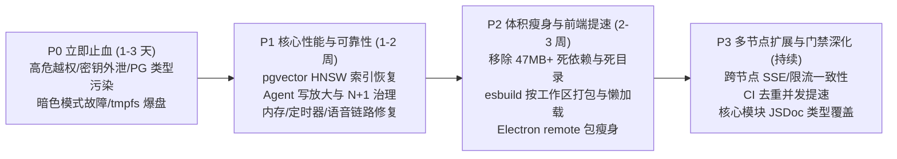
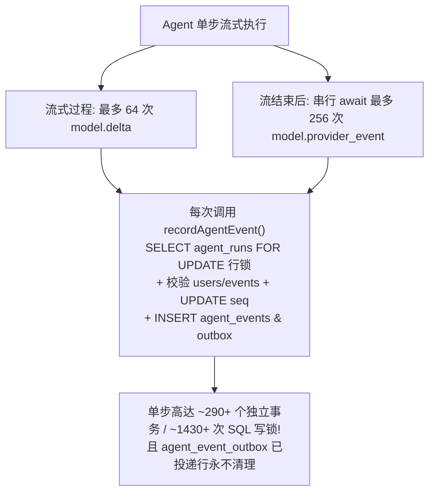
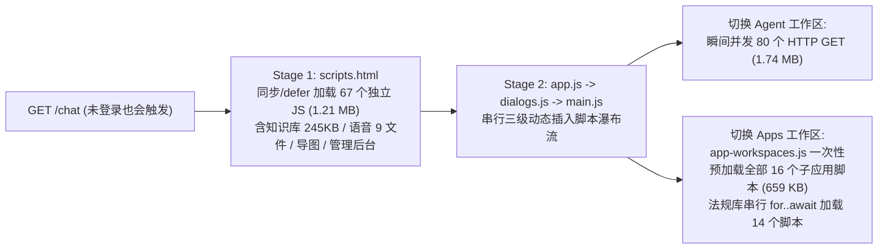

# Pivot (智枢) v0.7.74 全景深度审计与系统优化方案

## 复核与执行修订（2026-10-30）

本报告是待验证的工作清单，以下修订优先于后文的绝对化结论、工期、风险和收益数字；未经真实数据、部署环境及回归验证，不应将这些数字视作验收结果。跨模块改造需独立设计、分批验证和回滚，不应整体标为低风险。

### 2026-10-31 跨节点流式快照与渠道重放（阶段性，未验收）

开发实现为流式任务保存最近一次加密快照：按运行和用户读取，并用数据库租约代次防止旧执行者覆盖；旧节点重新认领也会由数据库触发器提升代次。快照最多 32 MiB，写入会合并，进程在写入前退出、数据库不可用或超出上限时，最新流式片段可能不可恢复；仅有效租约且五分钟内的快照可读取，最终任务结果继续依赖既有持久化流程。隔离 PostgreSQL 双进程和浏览器专项验证跨节点读取、用户隔离、执行权切换及页面恢复；未覆盖所有崩溃与滚动升级时序。

Web 渠道增加独立数据库游标及重放端点，消息入队和游标登记处于同一事务，支持用户隔离、按游标补发与已送达记录七天后批量清理。旧节点写入可由数据库触发器登记；隔离双节点测试覆盖并发写入、节点重启、监听中断与补发。但普通客户端的独立渠道连接尚未启用：新旧节点混跑时握手和游标交接仍存在重复或遗漏风险。现有本地投递路径保留，不能宣称逐条跨节点投递已完成。

针对相关文件的定向 Node 回归 55 项中 54 项通过、1 项压力探针按开关跳过；该探针此前单独通过。多节点模式浏览器专项验证快照恢复及独立端点重放通过，但该测试直接访问端点，不代表普通客户端已启用。完整静态检查、针对改动文件的 Lint 和类型检查通过；按要求未运行全量回归。严格多节点预检继续阻断；此阶段工作已记录至 [v0.7.76 发布记录](../releases/v0.7.76-跨节点实时恢复阶段记录.md)。

### 2026-10-31 实时事件开发续项（未完成）

持久 Agent 事件增加事务提交后 PostgreSQL 唤醒通知：消息只包含 schema 和用户标识，接收节点仍按用户游标查询数据库，不将通知当作数据通道。连接正常时按通知立即补查；通知丢失时每 5 秒补查，监听连接中断时自动重建，恢复后触发补查和客户端状态刷新。数据库回滚不会发送通知，批量事务中重复的用户提示可由 PostgreSQL 合并。隔离 PostgreSQL 和两个独立进程覆盖提交、回滚、用户/schema 隔离、监听连接强制断开、重订阅及事件恢复。

开发环境合成压力探针使用两个节点、同一用户的 16 个连接和 24 个并发任务，核对全部 384 次事件投递的顺序与去重，整批耗时约 447 毫秒；该单次小样本包含任务写入与等待，不是逐事件延迟分位数，也不能代表生产并发、容量和性能。可在隔离测试库设置 `PIVOT_REALTIME_STRESS=1` 并定向运行 `tests/realtime-multiprocess.test.js` 中的压力探针。

任务状态、通知和演示文稿变化新增跨节点轻量刷新提示，流式进度只传步骤与完成等元数据，不传正文或工具参数；提示使用 `DATA_ENCRYPTION_KEY` 派生密钥签名，接收端验证签名和目标用户，通过原有授权接口刷新，迟到的元数据不能让状态倒退或覆盖已有正文。提示队列有界并可合并，但它不是持久消息：故障或溢出可能丢失，客户端须依赖重连及周期补查；通知提示本身不保证弹出提醒。Agent 流式完整快照、渠道消息逐条实时投递与所有事件的可靠恢复、生产负载、滚动升级和真实网络故障验收尚未完成，严格多节点预检继续阻断；v0.7.76 仅记录阶段性成果。

开发环境定向 Node 回归 29 项中 28 项通过、1 项压力探针按环境开关跳过；同一压力探针此前单独启用并通过。聊天任务和演示文稿浏览器专项 9 项通过；完整静态检查及类型检查通过。本轮按要求未运行全量测试回归。

### 2026-10-31 多节点 token 汇总与 CSS 复核

多节点模式的 token 指标使用 PostgreSQL 中按当前 schema 隔离的可重算快照。快照过期后通过事务咨询锁串行重算，取得锁后再次检查，避免多个节点重复聚合；快照的有效期与原进程缓存一致，当天边界变化、数据库时间回拨、原始记录修改或删除后会在下次重算中校正。数据库或重算失败时沿用既有错误指标及进程内旧值策略。单节点继续直接读取原始记录，不增加共享快照查询。隔离 PostgreSQL 测试覆盖六个并发连接、过期重算、修正、删除、日期切换、失败及持锁进程被强制终止后的恢复，且验证实际指标渲染接口。

这是多节点共享全量快照，**不是持久增量汇总**：每个刷新周期仍有一次历史数据扫描，生产表规模、慢查询及锁等待尚未测量。多节点实时事件的预检阻断不受此改动影响；模式切换和真实部署仍需验收。

在现有六个样式包上使用 `esbuild 0.28.2` 做不落盘对照，未产生解析警告，总大小从 1,750,369 字节降至 1,715,906 字节，约减少 2.0%，不能支持原报告预计的 35%–45% 结论。生产镜像以 `npm ci --omit=dev` 安装依赖，但启动流程仍需要生成样式，不能未经离线构建设计就把开发期压缩器设为运行时必需。此次未更改生成样式或容器依赖；按需打包、公共样式拆分及级联等价性仍需单独完成。

新增 [历史向量只读检查工具及验收说明](../向量数据检查与验收.md)：按 bigint 游标分批检查知识库、记忆和法规记录的 JSON 数值形状、维度及配置标识，不输出向量或业务内容，不执行清洗。工具在每次执行内使用只读事务并限制行数、单条语句耗时和处理时间；跨页不是同一快照，非 JSON 格式也不等于数据库无效。隔离 PostgreSQL 测试覆盖只读事务、大整数游标、异常数据、超长输入和结果脱敏；生产数据尚未检查，也尚未完成历史数据迁移。

在本机隔离 PostgreSQL 的 25,000 条、64 维合成数据上，工具按 20,000 和 5,000 条两页完整扫描，耗时分别约 345 ms 和 85 ms；这是热缓存单次结果，只验证分页与执行可行性，不代表生产负载。该实验发现并修正了文本别名排序导致数字游标遗漏的问题，增加了跨多个批次的回归。

本轮完整静态检查、Lint 和类型检查通过；隔离 PostgreSQL 全量 Node 回归两组共 2547 项，2545 项通过、2 项因离线工具环境未启用而跳过，零失败。两项跳过的真实 FastMCP 和隔离容器绘图集成随后单独补测通过，测试创建的容器、网络和临时密钥已清理。本轮未重新运行完整浏览器 E2E；本次新增功能未在目标生产数据或正式多节点环境验收。

### 2026-10-31 实时补查索引工具

新增 `scripts/realtime_event_index.js`，默认只检查 `agent_events` 的索引，只有提供独立数据库连接并显式指定创建才在事务外并发建立 `(user_id, id)` 索引。已有有效等价索引时跳过，名称冲突和其他执行者持锁时拒绝，失败索引留待运维核查，不自动删除。隔离 PostgreSQL 使用 3 万行数据验证建索引、计划命中、锁竞争及对象冲突；未在生产库执行，不能据此认定生产性能或多节点完整就绪。使用条件见 [多节点部署预检](../多节点部署预检.md)。

演示文稿的可见编辑器在实时通知丢失时继续每 5 秒检查文稿，并每 15 秒补查评论；实时连接建立或重连时主动同步。文稿补查确认无权访问或不存在时关闭当前编辑器，服务器暂时失败不会误判撤权；迟到的文稿与评论响应不会覆盖新打开的文稿或更新结果。这是客户端状态补查，不提供完整跨节点实时广播；隐藏工作区不会进行这些补查。浏览器测试模拟通知丢失、临时错误及撤权，客户端定向测试控制请求完成顺序以验证迟到响应；实际生产网络及多节点故障验收仍未完成。

演示文稿在线状态接口现要求文稿访问权限，并统一使用规范文稿 ID；多节点模式改用共享 PostgreSQL 在线状态，45 秒后过期，读取时排除已撤权或停用账号，过期一天的记录每次最多清理 500 条。单节点保留原内存实现。隔离数据库的两个独立进程测试覆盖跨节点心跳、节点强制退出后重启、过期、撤权及未经授权的读写；新旧节点混跑期间在线状态不一致，生产负载尚未验证。完整实时事件广播仍未完成，预检继续阻断。

本轮完整静态检查、Lint 和类型检查通过；隔离 PostgreSQL 全量 Node 回归共 2550 项，2548 项通过、2 项因离线工具环境未启用而跳过、零失败。演示文稿真实浏览器专项两项通过；此前针对依赖定时器的迟到响应浏览器用例出现超时，现改为受控完成顺序的客户端竞态测试，文稿和评论两项均通过。本轮没有重新运行完整浏览器 E2E；两项离线集成在本次改动之前的上一轮单独补测通过。

### 2026-10-31 继续优化：配置、指标、长流与停机

个人 RAG 设置读取已改为异步按用户和键批量查询，使用最多 512 项、5 秒过期的进程缓存，单项快照超过 64 KiB 不缓存。缓存未命中会等待数据库；数据库失败向调用方报告，不再把缺失的个人设置静默解释为系统默认。写入、删除及用户级刷新只使对应用户的缓存和在途旧读取失效；全量刷新仍清除全部缓存。其他节点的修改最多可能滞后一个缓存周期，不能视为实时撤销。同步的系统默认配置仍保留，个人配置必须使用异步接口。

token 指标在一个 PostgreSQL 查询和同一快照中计算累计与当日值，继续直接从消息和用量记录计算，因此修正、删除及其他节点的写入仍会在刷新后反映；该方案减少重复读取，但累计统计仍需扫描历史数据，尚未完成可校正的持久增量汇总。真实 PostgreSQL 临时表对照旧查询覆盖时间边界、空值、修改和删除。

持久事件补查对同一进程、同一用户和游标的并发查询合并在途请求，结果不跨查询缓存，连接仍各自处理背压与断线恢复。此优化不解决其他事件类型的跨节点广播，也不能解除多节点预检阻断。

文档 ZIP 读取改为异步解压，保留单条及声明的总解压限制，并额外限制实际总解压量；思维导图导出和交易分析队列加入受管停机，取消未启动工作并等待在途批次。旧流式服务不再自行监听退出信号并调用 `process.exit`，改由统一停机流程清理心跳和会话，避免抢先中断其他清理；服务整体停机等待上限仍为 5 秒。长流 token 估算按增量累计；连续的简单单段文本复用文本节点，一旦出现 Markdown 或 HTML 等复杂内容立即回退到既有完整解析和消毒。移除首屏中无调用方的旧流式渲染器脚本引用，源文件保留。

知识库导入 Worker 现停止轮询并等待启动恢复、任务领取、在途索引及租约续期；法规导入与法规向量恢复执行器也停止轮询并等待在途工作，停机期间阻止新的启动或巡检请求。服务停机仍有 5 秒总等待上限，超时后依赖已有数据库租约到期与任务恢复机制，不能保证超长任务在进程退出前完成。

验证记录：隔离 PostgreSQL 的两组全量 Node 回归共 2532 项，2530 项通过、2 项离线工具环境跳过、零失败；运行期间增加的停机修复和后续缓存改动分别通过定向回归，不能把该全量结果视为最终单一代码快照。第二轮浏览器 E2E 104 项全部通过；该轮启动后进一步将缓存失效收窄为用户级，最新设置、检索及路由定向回归 174 项通过。第一轮浏览器回归的音频用例因 PowerShell 在合成音频 Base64 后附加本机诊断而失败，测试现只剔除该已知诊断并验证 WAV 头，修复后单项及第二轮浏览器回归通过。

最新 Windows 未签名目录测试包已重新构建，`app.asar` 为 196,184,593 字节；包内相关源码与当前工作区逐文件摘要一致。Electron 实际加载并验证 PDF 文本、逐页提取和页面渲染、异步 ZIP 解压、本机桥接、DuckDB 和 Sharp；浏览器运行包未在此次构建中验证。该结果不代表正式签名安装器或更新链路已通过验收。

### 2026-10-31 多节点持久事件阶段性改造

配置为多节点时，SSE 连接按认证用户的数据库事件游标定期读取已提交的 Agent 持久事件，不再依赖单个 outbox 领取者的本地推送；连接失败后使用最后收到的 ID 补读。首次连接写入起始游标，空库也写入 `0`，防止首条事件在重连时被跳过。独立 PostgreSQL 测试覆盖两个节点、用户隔离及节点重启后的恢复；附加测试覆盖数据库失败、跨页和零游标。

该实现当前每个 SSE 连接约每秒查询一次数据库，尚未做生产负载或索引验证；它只覆盖 `agent.event` 持久事件，不覆盖演示文稿、即时通知和流式快照的跨节点广播。旧节点与新节点混跑也不保证提交顺序。**严格多节点预检继续阻断**，不得把此阶段成果当作完整多节点就绪。孤儿资源清理、生产检索验收、远程包瘦身及正式安装器和更新链路仍待完成。

隔离 PostgreSQL 18 / pgvector 0.8.6 上新增可复现的 `scripts/benchmark_vector_fixture.js`：10 万条、64 维、10 个合成租户、10 次查询，精确检索 P50/P95 为 32.94/37.22 ms。强制 HNSW 时默认参数平均 Recall@10 为 0.44，最少只返回 3 条；`ef_search=200` 且启用严格迭代扫描时平均 Recall@10 为 0.87，最少返回 10 条。两组计划均使用 HNSW，但这是小样本、顺序执行和合成数据，延迟受缓存影响，不能作为生产性能或召回验收；也不据此更改线上检索参数。执行基准只使用显式指定的测试数据库和临时表。

稠密候选的向量二次加载也改为复用原授权范围；在首次召回与二次读取之间撤权或删除的文档不再参与排序。隔离 PostgreSQL 检索、权限与性能相关回归 161 项通过。

qpdf 新工作目录使用独立 PostgreSQL 会话锁，清理器只处理带新版随机标记、超过一天且可取得同一锁的目录；活动目录、历史格式和未知目录保持不动。锁连接意外断开时会中止 qpdf 子进程并保留目录，之后交由巡检回收。隔离数据库及真实 qpdf 回归覆盖持锁进程强制退出和数据库锁连接断开。浏览器 Profile 和其他历史临时文件的孤儿回收仍未完成；数据库不可用时 qpdf 新任务会失败，而不会创建无租约目录。

内网安装器验收沿用已有 `Pivot Local Dev` 证书和原分发逻辑，不修改正式证书或系统信任。隔离的离线配置生成了签名 NSIS 安装器，但 Windows Authenticode 返回证书链根不受信任，现有签名验收因此拒绝该产物，未发布更新。既有内网 HTTP 分发配置还缺少显式 `allowInsecureHttp`；不修改正式配置或信任策略的前提下，正式安装器及更新链路仍未验收通过。针对本机诊断污染证书枚举输出增加窄范围解析兼容，不改变证书选择和签名校验。

本轮最终代码在隔离 PostgreSQL 的全量 Node 回归共 2523 项，2521 项通过、2 项离线工具环境跳过、零失败；两项离线工具集成在此前同机环境单独补测通过。本轮 `npm run check`、`npm run lint` 和 `npm run typecheck` 通过；未在本轮重新运行完整浏览器 E2E 或进行目标生产环境验收。

### 2026-10-31 桌面包体积优化

保留远程／本地模式切换和本机授权、浏览器、工作区、交付及更新功能，仅在打包阶段排除 `pdf-parse`、`pdfjs-dist`、`pdf-lib` 的源码映射文件。与此前同机目录包对比，`app.asar` 从 237,671,483 字节降至 196,172,645 字节，减少 41,498,838 字节（约 39.6 MiB）；逐文件对比没有发现其他删除项。包内 Electron 验证通过 PDF 文本提取、逐页提取、页面渲染及桌面本机桥接模块加载；隔离 PostgreSQL 的桌面与文档定向回归 126 项通过。测试目录包未签名，未生成或发布正式安装器；安装器压缩后的体积尚未测量。源码映射不影响 PDF 执行，但这些依赖的包内错误堆栈不能直接映射回原始源码。

本轮已实施内容归入 v0.7.75，按 W1–W4 分类记录在 [四阶段发布记录](../releases/v0.7.75-四阶段系统优化与验证.md)和 [更新日志](../../CHANGELOG.md)；原报告标题和基线版本保留审计时点，不表示四个工作包已全部完成。

- **已实施**：桌面隐身请求仅向当前服务同源注入令牌并清除跨源残留头，状态 IPC 不再返回密钥；主库 PostgreSQL 类型解析器限定在连接池，外部连接设置语句超时；健康详情限制管理员访问，目录探针不返回物理路径，在途请求只记录粗粒度路径；产物评论和交互执行访问检查，非公开分享默认拒绝，服务端 500 不再返回原始异常；出站策略覆盖 CGNAT、IPv4 兼容 IPv6 和 NAT64 特定前缀。相关回归测试见 `tests/optimization-security-boundaries.test.js` 和 `tests/artifact-access-boundaries.test.js`。
- **修正 2.1**：外部 PostgreSQL 连接已经执行 `SET default_transaction_read_only = on`；并非缺失只读事务。主库保留现有 Number 和时间字符串契约，外部连接恢复驱动默认解析；对主库大整数精度的既有风险仍需另行评估。
- **修正 1.4**：现有产物 `status = 'public'` 允许登录用户读取，因此评论和交互权限需与该契约一致；匿名分享必须验证实际分享记录和有效期。当前只支持公开分享，其他可见性值拒绝访问，不能凭猜测开放登录用户或私有分享。
- **修正 2.3**：Wiki 列表原先先 LIMIT 后过滤，权限同时受空间和关联专题库约束。现按稳定游标分批读取并复用双层权限判定，直到可见结果达到上限或数据读完；隔离 PostgreSQL 测试覆盖超过 100 条不可见记录和微秒时间戳。大租户性能仍应通过真实数据评估，必要时再建立与现有规则完全等价的 SQL 谓词。
- **修正 2.2 / 3.1 / 4**：在 PostgreSQL 18 / pgvector 0.8.6 的 1 万行隔离样本中，单距离排序和追加 `id` 排序均使用 HNSW Index Scan，后者使用 Incremental Sort；因此原文“二级排序必然全表扫描”的断言不成立，此实验也不能代表生产数据或召回。生产计划、过滤后召回率和收益仍需 `EXPLAIN (ANALYZE, BUFFERS)` 与基准确认；移除历史向量校验前需先清洗并迁移数据。并发建索引要脱离事务并处理失败索引。事件批处理不能丢失重放顺序或持久性；跨节点推送须验证订阅、断线恢复和重复投递。
- **本轮已实施**：旧模板独立页面重定向至工作台；隐身密钥加密存储并通过条件更新迁移旧明文；限制 DuckDB 数据源过滤与用户查询外部访问；Worker 输入在沙箱域内构造；MCP 会话按用户、账号、凭据和目标隔离并限量过期；流式事件中的 provider 事件批量事务写入，已投递 outbox 分批保留 24 小时并保留去重标记；上下文裁剪保留工具调用配对；受租约保护的已关闭浏览器目录清理；语音双路径兼容、强制网关密钥并修正部署说明；限制内存缓存和临时 socket；缓存生产工作区模板、修复 Pyright 子进程及打包配置；CI 避免 Node 22 重复执行全量测试并并行运行浏览器测试。具体实现以代码和测试为准。
- **继续实施**：长期记忆 HNSW 在事务外并发创建并防止重复构建；仅在具备观察其他构建者权限时自动清理无效索引。迁移按 schema 取得互斥锁；各业务限流器接入共享存储；登录和改密的 bcrypt 操作移入有界工作线程，聊天在准备完上下文后才占模型并发槽；qpdf 和 veraPDF 探测改为异步，后者限制运行时间和 JVM 堆。应用中心按需加载子应用并预取法规脚本；演示文稿复用实时事件连接，隐藏工作区不再发起相关轮询；设置页保持实际字号并由宽表格自身滚动，桌面和窄屏浏览器测试通过。只读容器补齐 Chromium 用户目录临时挂载并移除 capabilities；已有镜像的无网络启动探针已通过。
- **更新器修订**：原实现将 Authenticode 状态 1、6 作为自签名例外，但这两项分别表示签名无效和无法验证，而非单纯的不受信任证书；现在一律拒绝非有效状态。自签名更新还必须在客户端建立证书信任并固定证书 SHA-256 指纹；非回环 HTTP 更新源必须显式配置 `allowInsecureHttp`。原依赖 `natural` 的接口仍被实验门禁阻断，已替换为轻量索引并从生产依赖移除；无代码引用的 `typescript-language-server` 同步移除。
- **隐身协议兼容**：客户端同时发送旧版时间戳签名和绑定 Host 的 v2 签名；新服务优先验证 v2，默认允许旧客户端。确认客户端全部升级后可将 `PIVOT_STEALTH_ALLOW_LEGACY` 设为 `false`；反向代理必须保留原 Host。签名兼容期仍允许旧协议，时间窗口也不构成一次性防重放。
- **多节点就绪状态修正**：共享存储、队列和锁均就绪并不代表实时事件可跨节点投递。现已将多节点就绪状态保持为未就绪；要求严格预检的多节点部署会拒绝启动，避免在广播和重放完成之前误报可用。
- **未完成**：WP-1 至 WP-4 尚未全部完成。暗色模式按用户要求暂缓；临时文件历史残留、向量检索、部分事件写放大、前端构建及多节点等仍须逐项核实、实施和验证。个人 RAG 配置的同步读取契约已迁移，短期有界缓存及限制见上方最新记录。
- **验证范围**：隔离 PostgreSQL 18 / pgvector 0.8.6 上全量 Node 测试两组共 2453 项，2451 项通过、2 项按环境条件跳过；随后更改过的隐身协议、扫描门禁、认证、桌面更新和界面使用了定向回归。应用子模块、设置页及流式聊天另有真实浏览器测试。本机已有 Docker 镜像的只读 Chromium 探针和 Compose 配置校验通过；新镜像构建未完成，镜像仓库连接受阻，Windows 安装包未重新构建。
- **本次继续完成**：工具治理按本次目录涉及的能力包批量读取，发布版本仅在单次目录构建中复用；批量工具预检共享本次快照，实际执行仍逐项重新核验。Agent 事件使用批量 SQL 和单次序号分配；加入用户级提交顺序锁后，128 条事件在测试中最多使用 7 次数据库操作。流式增量按最多 16 条或 2 秒合并，结束或失败时冲刷，批次失败后逐条尝试。进程在冲刷前异常退出时可能损失最多一个采样窗口的审计增量，最终结果仍按既有流程持久化。启动时通过独立数据库连接加锁，串行执行 schema、版本迁移和种子初始化，单连接池也不会自锁。
- **检索缓存版本读取**：将授权文档、图谱和反馈版本由四次查询合并为一次查询，以同一数据库快照生成缓存范围；每次命中前仍核验最新权限和版本，避免以进程缓存替代撤权检查。隔离 PostgreSQL 的 RAG 权限、缓存失效与相关回归通过。
- **静态治理补充**：生产 JavaScript 增加 60 KiB 字节基线，存量超限文件不得增长，降至阈值后须移除豁免；统计统一换行格式以保证 Windows 与 CI 一致。HTTP 边界检查增加同步子进程和 zlib 调用及认证文件扫描；启动装配文件仍不在该门禁范围内。定向测试和完整 `npm run check` 通过。
- **Outbox 领取与确认批处理**：保持 `FOR UPDATE SKIP LOCKED` 领取和失败重试语义，将领取及成功投递确认改为集合更新；两个并发领取者处理 100 条记录时无重复，领取数据库操作总数不超过 6 次。异步投递失败仍保留待重试；批量确认失败逐条回退，确认前异常退出可能重复投递。这不解决跨节点广播和断线补发问题。
- **渐进式类型检查**：将隐身目标校验、主机分类、浏览器目录清理和事件批处理四个生产模块纳入 `@ts-check`，加入正常 `npm run typecheck`。这是起点，不代表全部核心 JavaScript 已检查。
- **维护及部分执行器优雅停机**：关闭时停止 GPU 和模型端点监控、Outbox、Agent 调度和恢复、长期记忆及决策学习巡检、数据分析刷新和异步查询、知识来源同步及向量恢复、知识及工作区来源生命周期、图谱维护、Wiki 编译、发布熔断、记忆效用巡检执行器和维护定时器，等待其在途任务后再关闭数据库连接，等待上限 5 秒；周期维护任务仍在运行时不重复启动。其他后台任务仍需继续收口；隔离 PostgreSQL 的相关回归 83 项通过。
- **本轮全量回归**：隔离 PostgreSQL 的两组共 2470 项，2467 项通过、2 项跳过、1 项 5000 节点导图测试在与桌面打包并行时超时取消；该文件随后单独复测 3 项通过，其中大图导出耗时约 72 秒。全量测试本身仍未通过。最新 outbox 定向测试覆盖 PostgreSQL 并发和故障注入，11 项通过。
- **再次全量回归**：不与桌面打包并行的两组全量 Node 测试共 2486 项，2484 项通过、2 项跳过，导图大图用例通过。运行期间补入了事件用户级顺序锁，最新事件锁及大整数路径另外进行了隔离 PostgreSQL 定向验证；因此全量结果不是单一最终代码快照的验证。
- **最新全量回归**：隔离 PostgreSQL 的两组全量 Node 测试共 2489 项，2487 项通过、2 项因离线工具依赖未启用而跳过，零失败；包含事件顺序锁、分页补发及 qpdf 修复。两项跳过的 FastMCP 和隔离 Docker 绘图集成随后单独补跑通过，测试资源已清理。
- **停机改动后的全量回归**：共 2512 项，2509 项通过、2 项环境跳过、1 项旧静态契约因调度防重入移到公共执行器而失败；该契约已更新，连同真实防重入行为测试单独复测 16 项通过。该轮全量结果仍记为失败，不将补测混写为全量通过。
- **修正后的最终 Node 回归**：同一代码快照下隔离 PostgreSQL 两组共 2512 项，2510 项通过、2 项离线依赖按环境跳过、零失败；两项离线集成已另行补跑通过。
- **桌面构建复验**：定位并兼容本机运行时写入 npm 输出的尾部诊断，Windows 目录包现已构建完成；Electron 运行时自检和打包后 DuckDB、Sharp 模块加载通过。测试包未签名，使用测试配置，未验证浏览器运行包、安装器及自动更新，不可用于发布；`app.asar` 约 226.6 MiB，远程包瘦身仍未完成。
- **词法候选向量延迟读取**：关键词候选查询不再携带 embedding；仅混合排序时对没有已解析向量的候选以原权限范围批量补取，关键词降级不取向量，补取时已撤权或删除的候选不继续排序。该改动可能增加一次数据库往返，实际吞吐收益仍需代表性数据测量；隔离 PostgreSQL 相关权限、检索排序及回归 159 项通过。
- **实时游标与分页补发**：仅持久 Agent 事件更新 SSE 重连 ID；事件写入、outbox 和 SSE 游标路径使用十进制字符串保留大整数 ID，其他主库读取路径仍需单独评估。重连先登记订阅、缓存本节点实时事件，再以固定上界按 200 条分页补发，逐页等待背压消退，持续背压 30 秒后断开连接；补发期间缓存的事件在结束时排序、去重并过滤已重放事件。单次最多补发 25 页后按已送达游标重新连接；实时缓存超过 1,000 条或 4 MiB 时断开重连。事件写入以用户级事务锁保证同一用户的 ID 分配与提交顺序，新旧版本混跑或绕过该写入入口时不具备此保证；测试覆盖大整数、不同运行的并发提交、跨页、背压和查询期间事件。实时阶段仍可能因多个投递者导致乱序，跨节点广播及故障恢复仍待完整解决，不能解除多节点预检阻断。
- **流式审计故障可见性**：批量和逐条回退都失败时记录失败数量及运行 ID，不记录事件内容；主任务仍按原有策略继续，未成功写入的采样事件仍可能丢失，该改动不提供持久重试。
- **qpdf 保护与密码传递**：修复加密参数与 qpdf 11.3 不兼容的问题；解密及优化的输入密码、输出保护密码改经标准输入传递，支持以 `--` 开头的 Unicode 密码。重新保护已加密输入时，输入密码仍需受限临时文件，异常退出残留回收尚未完成。现有离线镜像中使用真实 qpdf 验证了解密、优化、保护和错误密码。
- **补发索引评估**：本机临时表 30 万行、1,000 个用户的合成实验中，现有主键的上界查询回扫约 993 行，复合 `(user_id, id)` 索引可直接定位；该样本不能代表生产分布，尚未自动增加可能在大表创建时产生 I/O 的索引。应在真实分布上测量后以并发方式建设。
- **能力执行器底座**：只使用 Node 内置模块的 code 和 foreach 执行器默认改用 `node:22-bookworm-slim`；终端执行器继续保留需要 Python、Git、ripgrep 的底座。使用本机已有 `node:22-bookworm` 覆盖底座的离线构建通过，真实容器验证了非 root、只读、无 capabilities、断网及两种执行协议；默认 slim 镜像拉取因本机代理连接失败而未验证，正式部署仍需固定已审核摘要并验证签名。
- **浏览器全量回归**：隔离 PostgreSQL 和假模型的 Playwright E2E 共 104 项通过；测试期间随后新增的维护及分析执行器停机改动另以定向生命周期测试验证。

### 剩余工作及验收条件

1. **多节点实时事件**：实现跨节点广播、断线补发、顺序与重复投递处理，完成多进程故障测试后才能解除预检阻断。
2. **检索与写放大**：在代表性数据上测量知识库、法规和记忆检索的计划、延迟及召回，设计历史向量清洗和索引迁移；继续降低流式 delta 写入及工具目录查询开销，不牺牲可重放事件和权限撤销时效。
3. **资源清理与后台任务**：针对异常退出后的浏览器 Profile 和其他文档临时文件设计安全孤儿回收；新版 qpdf 工作目录已有租约保护的回收。审查其余后台任务的关闭和资源上限；浏览器 Profile 现有清理只覆盖已确认关闭并仍持有租约的会话。
4. **前端与交付**：评估脚本/CSS 按需打包和缓存、长流增量渲染、远程客户端依赖裁剪与 Capability Worker 部署方式，完成浏览器、离线与桌面打包验收；不要仅凭体积估算删除仍被验证脚本或运行时引用的源码。
5. **配置与指标**：个人 RAG 设置已迁移至异步读取及有界短期缓存，仍须验证目标部署负载和跨节点配置变更时效；设计可校正、支持多节点的 token 持久增量汇总，避免以进程内计数替换数据库统计而改变重启和删除语义。

多节点事件的后续实现应把 PostgreSQL 通知作为唤醒提示，而不是可靠数据通道：节点在连接或重连时建立订阅，并按每个连接已送达的用户事件游标查询持久事件，周期性补查以覆盖通知丢失；监听断开时关闭或暂停 SSE，恢复后通过游标重放。单纯广播 outbox 领取结果仍可能因多个领取者或失败重试而乱序，不能直接把较大事件 ID 当作此前事件均已送达的证明。部署必须先让所有事件写入节点使用用户级事务锁，再启用新协议；对不在 `agent_events` 中的演示文稿、通知及流式状态，应分别定义持久恢复或重连后刷新语义，并以多进程断网、重连、并发提交、重复和慢客户端测试作为解除预检的条件。

> [!NOTE]
> 本报告基于当前仓库 `HEAD`（`81e46546`，`v0.7.74`）全量源码与 25 项静态门禁实测产出。审计覆盖 `server/`（915 文件）、`client/`（439 文件）、`desktop/`（54 文件）、`scripts/`（136 文件）、`docker/`（39 文件）及 `tests/`（515 节点测试 + 104 E2E 测试），所有问题均精确锚定到源码行号，并遵循 [开发规范.md](file:///e:/pivot/%E5%BC%80%E5%8F%91%E8%A7%84%E8%8C%83.md)“**低风险增量收口、不推倒重写、保护离线部署与既有契约**”的原则设计落地方案。

---

## 一、总体评估与现有工程底座亮点

在提出优化项之前，应当明确项目当前已经具备非常扎实的治理基建（实测 `npm run check` 25 项静态门禁、`npm run lint`、`npm run typecheck` 全部零错误通过）：

- **自动化工程门禁完善**：[package.json](file:///e:/pivot/package.json#L25-L60) 内置架构边界检查（[check_architecture_boundaries.js](file:///e:/pivot/scripts/check_architecture_boundaries.js)）、187 个 PG 迁移与 229 个索引一致性校验、密钥扫描、原始 SQL 增长基线（[check_no_new_raw_sql.js](file:///e:/pivot/scripts/check_no_new_raw_sql.js)）、主库热路径同步 I/O 检查等 25 道关卡。
- **核心可靠性设计成熟**：SSE 具备 256 条环形缓冲与慢客户端驱逐保护；知识库支持蓝绿双缓冲导入与孤儿清理；聊天主工作区已接入 `PivotSafeHtml` 统一消毒体系。

与此同时，随着业务快速演进到多工作区、Agent 运行时、MCP 外部数据源、DuckDB 分析与 Electron 桌面端，系统在 **跨层安全边界、数据库/向量检索规模化性能、Agent 事件写放大、内存与临时磁盘泄漏、前端加载与暗色模式兼容性、打包体积与 CI 效率** 七个维度积累了值得系统性收口的关键瓶颈。



---

## 二、七大技术域深度问题清单与优化方案

### 1. 安全边界、权限控制与桌面端加固

> [!IMPORTANT]
> 本节前 4 项属于逻辑清晰、改动面极小但安全收益极高的**优先止血项**，建议纳入第一批修复。

#### 1.1 Electron 隐身模式（Stealth）令牌无过滤外泄与主进程配置未脱敏
- **问题定位**：
  1. [main.js](file:///e:/pivot/desktop/main.js#L473-L489) 中 [`attachStealthHeaderInterceptor`](file:///e:/pivot/desktop/main.js#L473-L489) 拦截 `webRequest.onBeforeSendHeaders` 时**未传入 URL 过滤器且未校验请求目标源（Origin）**，导致渲染进程加载任意第三方图片、外链媒体或嵌入资源时，都会自动附带实时签发的 `X-Pivot-Stealth-Time` 与 `X-Pivot-Stealth-Token`。而服务端 [stealth-service.js](file:///e:/pivot/server/services/stealth-service.js#L57-L91) 的 HMAC 令牌仅签名时间戳（`±120s` 窗口内有效，未绑定 Host/Path），外部站点拿到请求头即可在有效窗口内穿透隐身网关。
  2. [main.js](file:///e:/pivot/desktop/main.js#L875-L883) 的 `pivot-desktop:status` IPC 通道（映射为渲染进程 `window.pivotDesktop.getStatus()`，见 [preload.js](file:///e:/pivot/desktop/preload.js#L20-L22)）直接原样返回 `config: runtimeConfig`，**未像 765 行的 `get-server-config` 那样剥离 `stealthSecret`**，导致明文密钥直接暴露给网页上下文。此外 `app_settings` 表中的 `stealth_secret`（[stealth-service.js](file:///e:/pivot/server/services/stealth-service.js#L34-L110)）目前也未经过 `encryptSecret` 加密存储。
- **优化方案**：
  - 在 `onBeforeSendHeaders` 中严格校验 `new URL(details.url).origin === new URL(currentTargetUrl).origin` 后才注入隐身头，并将 HMAC 输入升级为 `${timestamp}:${host}`（保留短期兼容开关）。
  - 在 `pivot-desktop:status` 返回前复用脱敏函数剥离 `stealthSecret`，对落库字段统一接入 `encryptSecret` / `decryptSecret`。

#### 1.2 遗留独立页面存储型 XSS、样式 404 与静态门禁扫描盲区
- **问题定位**：
  - [template-detail.html](file:///e:/pivot/client/agent/template-detail.html#L320-L321) 直接执行 `marked.parse(template.documentation)` 赋给 `.innerHTML` **未经过 `DOMPurify` 消毒**；同文件 [L345-L357](file:///e:/pivot/client/agent/template-detail.html#L345-L357)、[L444-L475](file:///e:/pivot/client/agent/template-detail.html#L444-L475)、[L559-L569](file:///e:/pivot/client/agent/template-detail.html#L559-L569) 及 [templates.html](file:///e:/pivot/client/agent/templates.html#L218-L390) 将接口返回的 `v.label`、`r.comment`、`r.user_name` 等字段未经转义拼入 `.innerHTML`。
  - 这两个页面还引用了不存在的 `../chat/tailwind-output.css` 与 `../styles.css`（产生 404），且内联 `<script>` 未注入服务端 CSP Nonce（在 [app.js](file:///e:/pivot/server/app.js#L177-L179) Helmet CSP 下脚本会被拦截）。
  - **门禁盲区根因**：[check_safe_html_usage.js](file:///e:/pivot/scripts/check_safe_html_usage.js#L5-L14) 与 [check_window_globals_usage.js](file:///e:/pivot/scripts/check_window_globals_usage.js#L7) 目前**仅扫描 `client/chat/` 下的 `.js` 文件**，遗漏了 `client/agent/`、`client/common/` 及所有 `.html` 内联脚本。
- **优化方案**：
  - 将 `client/agent/*.html` 内联脚本拆分为外部 `.js` 文件并接入 `PivotSafeHtml` + 现有公共样式表（或若主工作区已完全替代该独立页，直接下线并做路由重定向），同时将 `check_safe_html_usage.js` 扫描范围扩展至全量 `client/**/*.{js,html}`。

#### 1.3 `/api/health/details` 越权暴露宿主机路径与跨用户实时请求路径
- **问题定位**：
  - [app.js](file:///e:/pivot/server/app.js#L306) 中 `GET /api/health/details` 仅挂载了 `authMiddleware`（任意普通登录用户可调，缺少 `isAdmin`）。
  - 该接口通过 [system-health.js](file:///e:/pivot/server/services/system-health.js#L82-L113) 与 [runtime-diagnostics.js](file:///e:/pivot/server/services/runtime-diagnostics.js#L34-L112) 返回宿主机绝对目录路径（`data`、`uploads`、`logs` 磁盘挂载点，违反 [开发规范.md](file:///e:/pivot/%E5%BC%80%E5%8F%91%E8%A7%84%E8%8C%83.md) §4.7）、进程内存与连接池详情，以及**其他并发用户正在执行的未脱敏 `req.path` 列表**（例如 [presentation-display.js](file:///e:/pivot/client/presentation-display.js#L15) 中的 `/api/apps/presentations/remote/<token>/state` 路径凭证会直接暴露）。
- **优化方案**：
  - 为 `/api/health/details` 增加 `isAdmin` 校验；在 [runtime-diagnostics.js](file:///e:/pivot/server/services/runtime-diagnostics.js#L34-L38) 记录 `inflight` 时改为记录脱敏后的路由模板（或对 UUID/长随机 Token 段做掩码替换），并移除响应中的宿主机绝对物理路径。

#### 1.4 `/api/artifacts` 越权读写（IDOR）、分享可见性失效与原始异常透出
- **问题定位**：
  - [app.js](file:///e:/pivot/server/app.js#L712-L713) 已将 `/api/artifacts` 作为正式接口挂载（未加 `createExperimentalApiGuard`）。
  - 在 [artifacts.js](file:///e:/pivot/server/routes/api/artifacts.js#L287-L404) 与 [artifact-manager.js](file:///e:/pivot/server/services/agent-runtime/artifact-manager.js#L367-L499) 中：`getInteractionStats`（L418）校验了 `user_id`，但 [`recordInteraction`](file:///e:/pivot/server/services/agent-runtime/artifact-manager.js#L397-L411)、[`addComment`](file:///e:/pivot/server/services/agent-runtime/artifact-manager.js#L452-L467)、[`getComments`](file:///e:/pivot/server/services/agent-runtime/artifact-manager.js#L472-L499) 均未校验当前用户是否有权访问目标 Artifact；[`getShared`](file:///e:/pivot/server/services/agent-runtime/artifact-manager.js#L367-L392) 完全忽略了 `share.visibility` 字段；且 [artifacts.js](file:///e:/pivot/server/routes/api/artifacts.js#L47) 所有 `catch` 块在 500 时直接向客户端返回 `message: error.message`。
- **优化方案**：
  - 统一抽取 `assertCanReadArtifact(artifactId, userId)` 守护所有评论与交互读写接口；补齐 `share.visibility`（如仅登录用户/私有撤回）判断；统一移除 500 响应中的原始 `error.message`。

#### 1.5 SSRF 网段遗漏、DuckDB 外部访问沙箱绕过与代码沙箱/更新器加固
| 子模块 | 源码位置 | 隐患机制与影响 | 修复方案 |
| :--- | :--- | :--- | :--- |
| **SSRF 防护网段** | [security.js](file:///e:/pivot/server/security.js#L86-L191)<br/>[agent-runtime-packs.js](file:///e:/pivot/server/services/agent-runtime-packs.js#L80-L95) | 未拦截 `100.64.0.0/10`（CGNAT 网段，含阿里云 ECS 元数据地址 `100.100.100.200`）、NAT64 `64:ff9b::/96` 及兼容型 IPv6；运行时包拉取使用 `axios.get` 未禁用自动重定向（`maxRedirects: 0`）。 | 在私有地址黑名单中补齐 `100.64.0.0/10` 与 NAT64/兼容 IPv6 前缀；`agent-runtime-packs.js` 改用项目统一的 [`safe-http-client.js`](file:///e:/pivot/server/services/safe-http-client.js)。 |
| **DuckDB 本地文件扫描** | [agent-data-adapter.js](file:///e:/pivot/server/services/agent-data-adapter.js#L48-L53)<br/>[semantic-models.js](file:///e:/pivot/server/services/data-analysis/semantic-models.js#L316-L323) | `queryDataSource` 用宽松正则校验 `options.where` 后拼接 SQL，且调用 `duckReadAll` 时**未执行 `SET enable_external_access=false`**、未走 `analysisSemaphore` 限流；异步查询作业同样未锁定外部访问与扩展自动安装。 | 废弃原始 `where` SQL 字符串直拼，改用结构化过滤 AST 编译；所有面向用户/Agent 的 DuckDB 连接统一初始化 `SET autoinstall_known_extensions=false; SET enable_external_access=false; SET lock_configuration=true;`。 |
| **Worker VM 原型链与容器死锁** | [runner.js](file:///e:/pivot/docker/capability-workers/code-runner/runner.js#L62-L68)<br/>[agent-capability-worker.js](file:///e:/pivot/server/services/agent-capability-worker.js#L110-L162) | `runner.js` 将宿主机 Realm 的 `vars` 对象直接挂载进 `vm.createContext`，脚本可通过 `vars.constructor.constructor` 获取外部 `Function` 构造器；且容器部署下主镜像无 `docker` CLI / `docker.sock`，启用 `PIVOT_CAPABILITY_WORKER_ENABLED` 会因无法 `docker run` 或容器内路径挂载不匹配而失败。 | 在 `vm` 上下文内通过 `vm.runInContext('JSON.parse(...)', context)` 反序列化 `vars` 彻底切断跨 Realm 原型链；将 Capability Worker 改为独立常驻 Sidecar 服务（通过内网 HTTP/Unix Socket 通信，消除 Docker-in-Docker 依赖）。 |
| **桌面更新器与打包 Pyright** | [updater.js](file:///e:/pivot/desktop/updater.js#L106-L182)<br/>[workspace-semantic-index.js](file:///e:/pivot/desktop/workspace-semantic-index.js#L316-L336) | 更新器允许 `http://` 源，内网自签名模式仅匹配 `CN=Pivot Local Dev` 字符串而未固定证书指纹（存在中间人替换安装包风险）；桌面端拉起 Pyright 时使用 `process.execPath` 却漏传 `ELECTRON_RUN_AS_NODE: '1'` 且 `pyright` 未列入 `asarUnpack`。 | 生产默认强制 HTTPS，内网自签更新增加 `PIVOT_UPDATE_CERT_SHA256` 公钥/证书指纹校验；子进程补充 `ELECTRON_RUN_AS_NODE: '1'` 并在打包配置中按需解包或外置语言服务。 |

---

### 2. 数据库、外部数据源类型隔离与 RAG 向量检索性能

> [!WARNING]
> 下面第 **2.1 项**会导致通过 MCP 连接客户外部 PostgreSQL 数据库时发生**64 位主键精度静默截断**与**UTC 时间戳偏移 8 小时**的数据正确性事故；第 **2.2 项**导致 `pgvector` HNSW 向量索引在生产查询中**完全退化为全表扫描**。

#### 2.1 全局 `pg.types` 污染破坏外部客户 PostgreSQL 数据源精度与时区
- **问题定位**：
  - [pg-connection.js](file:///e:/pivot/server/db/pg-connection.js#L53-L59) 在进程启动时直接修改了全局单例 `pg.types`：
    1. 将 `OID_INT8`（`20`，即 `BIGINT`）全局解析为 JS `Number(val)`；
    2. 将 `OID_TIMESTAMPTZ`（`1184`）全局绑定到 `normalizePgTimestamp`（该函数假设连接已执行 `SET timezone = 'Asia/Shanghai'`，直接用正则剥离末尾 `+00` / `+08` 时区偏移）。
  - 然而在 [database-mcp/index.js](file:///e:/pivot/server/services/database-mcp/index.js#L114) 中连接**用户外部业务 PostgreSQL 数据库**时，直接创建 `new Client({...})`（未传入独立 `types` 解析器，也未设置会话时区或 `statement_timeout`）：
    - 外部业务库中任何超过 `2^53 - 1` 的 64 位雪花 ID（Snowflake `BIGINT`）会在读取时静默丢失末位精度；
    - 外部 UTC 时区业务库返回的 `2026-10-30 09:00:00+00` 会被直接剥去 `+00` 当作本地时间展示，凭空产生 **8 小时时差**。
- **优化方案**：
  - **禁止修改全局 `pg.types`**：在 [pg-connection.js](file:///e:/pivot/server/db/pg-connection.js#L53-L59) 中实例化自定义 `TypeOverrides` 仅传给 Pivot 主库 `new Pool({ ..., types: pivotPgTypes })`；同时为外部 PG MCP 连接补充只读事务（`SET default_transaction_read_only = on`）与 `statement_timeout`。

#### 2.2 `pgvector` HNSW 近似最近邻索引被二级排序与正则过滤彻底击穿
- **问题定位**：
  - [knowledge.js](file:///e:/pivot/server/repositories/knowledge.js#L230-L241) 与 [memory-retrieval-query.js](file:///e:/pivot/server/services/memory-retrieval-query.js#L104) 的向量检索 SQL 写成了：
    ```sql
    WHERE ... AND trim(c.embedding::text) ~ '^\[[-+0-9.eE,\s]+\]$'
    ORDER BY (c.embedding::vector(N)) <=> ?::vector ASC, c.id ASC
    LIMIT ?
    ```
  - **两重致命退化**：
    1. PostgreSQL 的 HNSW 索引扫描（`amcanorderbyop`）**仅在 `ORDER BY` 严格只有单个向量距离算子时生效**。一旦追加二级排序 `, c.id ASC`，规划器无法使用 HNSW 索引有序输出，直接退化为全表/全分区距离计算 + `Top-N Heapsort`；
    2. `WHERE` 子句对每行执行 `c.embedding::text` 文本序列化与正则匹配，造成巨额 CPU 开销。
  - **附带瓶颈**：
    - 法规检索 [regulations/search.js](file:///e:/pivot/server/services/regulations/search.js#L240-L260) 对应的 `regulation_articles` 表**完全未建 HNSW 向量索引**；[memory-vector-index.js](file:///e:/pivot/server/services/memory-vector-index.js#L25) 运行时动态建索引未使用 `CONCURRENTLY`（会锁表阻塞写入）；
    - 当用户分片数 `< 300` 时，[knowledge.js](file:///e:/pivot/server/repositories/knowledge.js#L250-L262) 每次查询都会额外无条件触发第二次 `embedding_dimensions = 0` 历史兼容正则扫描；
    - 全文/模糊检索（[rag-index/index.js](file:///e:/pivot/server/services/rag-index/index.js#L193-L391)）在不需要向量的路径上依然 `SELECT c.embedding`，单次查询向 Node 进程传输约 **5.4 MB** 浮点文本；每次新增单个文档都会调用 [`clearChunkEmbeddingCache()`](file:///e:/pivot/server/services/rag-index/index.js#L861) 清空全租户缓存；且命中 `ragCache` 时 [retrieval-context.js](file:///e:/pivot/server/services/rag-index/retrieval-context.js#L70-L116) 仍会先跑 4 条聚合 SQL。
- **优化方案**：
  - 用内层子查询仅按 `ORDER BY (c.embedding::vector(N)) <=> ?::vector LIMIT ?` 命中 HNSW 索引，在外层对候选集（≤300 行）再补充 `c.id ASC` 确定性排序；在入库阶段保证向量格式合法并将列逐步迁移或约束校验，移除查询期正则与多余的 `embedding_dimensions = 0` 二次扫描（改为启动时一次性迁移补齐维度字段）。
  - 为 `regulation_articles` 补齐分维度部分 HNSW 索引，`memory-vector-index.js` 改用 `CREATE INDEX CONCURRENTLY`；在本地事务中根据 `topK` 动态设置 `SET LOCAL hnsw.ef_search = 100`；FTS 查询改为按需延迟加载 `embedding`，缓存按 `userId` / `kbId` 细粒度失效。

#### 2.3 CJK N-Gram 存储 6–8 倍膨胀、Wiki 跨租户分页截断与监控全表扫描
- **检索索引膨胀**：[rag-tokenizer.js](file:///e:/pivot/server/services/rag-tokenizer.js#L23-L58) 将所有中文同时展开为 1/2/3-gram 写入 `search_content`，并在 `knowledge_chunks` 上同时维护 **3 个功能重叠的 GIN 索引**（`search_tsv` + `to_tsvector('simple', search_content)` + `gin_trgm_ops`），50 万切片规模下仅分词冗余即达 4–5 GB，且查询中 `ts_rank_cd(to_tsvector('simple', c.search_content), ...)` 未使用已持久化的 `c.search_tsv` 列。建议统一复用持久化 `c.search_tsv` 列并删除重复的函数表达式 GIN 索引，同时将 CJK 分词收敛为 Bigram（双字切分）为主。
- **Wiki 跨租户列表截断 Bug**：[knowledge-wiki.js](file:///e:/pivot/server/services/knowledge-wiki.js#L194-L216) 执行 `SELECT * FROM knowledge_wiki_spaces ORDER BY updated_at DESC LIMIT 100` 时**未带任何租户/权限 `WHERE` 条件**，随后才在 JS 内存中用 `canReadWikiSpace` 过滤——当全系统他人更新的年轻空间超过 100 个时，当前用户自己的旧空间会彻底从列表中消失！应将 `owner_id = ? OR visibility = ...` 下推到 SQL `WHERE` 子句中再执行 `LIMIT`。
- **监控与健康检查热路径开销**：
  - [metrics.js](file:///e:/pivot/server/metrics.js#L126-L150) 每 15 秒对 `messages UNION ALL model_usage_events` 执行无时间边界的全表 `GROUP BY` 聚合扫描——应改为进程内 Prometheus Counter 增量累加 + 启动时单次基线初始化；
  - [app.js](file:///e:/pivot/server/app.js#L292) 将 `/api/health` 置于 PostgreSQL 持久化的 `globalApiLimiter` 之下，导致容器健康探针每 30 秒写一次 `rate_limit_counters` 表——应将无状态存活探针移至限流写库之前（或对其免除 DB 落库限流）。

---

### 3. 智能体运行时（Agent Runtime）、MCP 与媒体/语音引擎



#### 3.1 Agent 事件持久化“写风暴”与 `agent_event_outbox` 无限膨胀
- **问题定位**：
  - [agent-event-log.js](file:///e:/pivot/server/services/agent-event-log.js#L40-L110) 中每记录一条事件都会开启独立事务，执行 `SELECT ... FROM agent_runs WHERE id = ? FOR UPDATE` 悲观行锁 + 用户存在性查询 + 序号更新 + 插入 `agent_events` + 插入 `agent_event_outbox`。
  - 在流式执行器 [agent-streaming-runtime.js](file:///e:/pivot/server/services/agent-streaming-runtime.js#L51-L94) 及 [L373-L405](file:///e:/pivot/server/services/agent-streaming-runtime.js#L373-L405) 中，单次模型回复不仅发出最多 64 个 `model.delta` 事务，还会在流结束后用 `for...of` 循环**串行 `await` 最多 256 条 `model.provider_event` 事务**（单步产生 **~290+ 次 `FOR UPDATE` 事务、~1,430+ 次 SQL 交互**）。
  - 同时 [agent-event-outbox.js](file:///e:/pivot/server/services/agent-event-outbox.js#L75-L95) 将状态更新为 `'delivered'` 后，全库**没有任何定时清理任务回收已投递的 Outbox 记录**，导致表体积与轮询开销随时间持续增长。
- **优化方案**：
  - **流式增量走内存 SSE 直推，落库批量合并**：`model.delta` 仅通过实时通道推送前端，不再逐片写入 PG；`model.provider_event` 默认聚合为单条摘要事件（或用单事务多行 `UNNEST` 批量插入，一次原子递增 `event_seq + N`）；
  - 在后台清理任务中定期物理删除 `status = 'delivered' AND delivered_at < NOW() - INTERVAL '24 hours'` 的 Outbox 记录。

#### 3.2 渐进式工具发现（Progressive Tool Discovery）被全量注入击穿 + `formatToolList` ~180 次 N+1 查询
- **问题定位**：
  1. **Token 与快照膨胀**：虽然模型调用侧启用了渐进式工具发现（只传核心工具集），但 [run-execution.js](file:///e:/pivot/server/services/agent-runtime/run-execution.js#L418) 与 [agent-streaming-runtime.js](file:///e:/pivot/server/services/agent-streaming-runtime.js#L231) 仍将**未过滤的全量 `toolList`** 塞入 `worldState.tools`。随后 [agent-step-context.js](file:///e:/pivot/server/services/agent-step-context.js#L31-L49) 与 [L224-L237](file:///e:/pivot/server/services/agent-step-context.js#L224-L237) 把 `worldState.tools` 中所有工具的完整 `inputSchema` JSON 序列化进了系统提示词（System Prompt）以及每步的 PG `world_state_json` 快照，完全抵消了渐进发现节省的上下文！
  2. **~180+ 次串行 SQL 风暴**：[mcp-client.js](file:///e:/pivot/server/services/mcp-client.js#L760-L805) 的 `formatToolList(user)` 在组装工具目录时逐个查询能力市场与治理策略（[capability-market.js](file:///e:/pivot/server/services/capability-market.js#L350-L380)），单次调用触发约 **180+ 条串行 SQL**；更严重的是 `searchToolsForUser` 在命中 `searchCache` **之前**就先调用了 `buildCapabilityCatalog(user)`，而 `tools.batch_read` 循环调用最多 16 次，单次工具调用即可瞬间打出 **~2,800 条 SQL**。
  3. **外部 MCP 会话跨用户串号**：[mcp-client.js](file:///e:/pivot/server/services/mcp-client.js#L542) 中 `externalMcpSessions` 缓存键仅包含 `id/url/transport`，**遗漏了 `user.id` 与 `accountId`**，导致多用户共用同一个上游有状态 `Mcp-Session-Id`。
- **优化方案**：
  - `worldState.tools` 仅写入已激活工具的轻量摘要（`name` + 一句话 `description`，不含冗长 `inputSchema`）；
  - 为用户级工具目录引入带版本戳/TTL（如 30s）的整包内存缓存，并将 `capability-market` 改为单条 `WHERE id = ANY(?)` 批量查询；
  - 将 `user.id` 与 `accountId` 纳入 `externalMcpSessions` 缓存键并补齐空闲驱逐。

#### 3.3 上下文窗口裁剪破坏 `tool_calls` 协议配对
- **问题定位**：[context-budget.js](file:///e:/pivot/server/services/context-budget.js#L115-L117) 计算消息 Token 时仅统计 `message.content`，忽略了 `assistant` 消息上体积巨大的 `message.tool_calls`；且 [L330-L346](file:///e:/pivot/server/services/context-budget.js#L330-L346) 按单条消息逐一裁剪历史，极易切掉 `assistant(tool_calls)` 却保留紧随其后的 `role: 'tool'` 消息（或反之），直接触发 OpenAI / DeepSeek / Claude 兼容接口 `HTTP 400 Invalid tool message pairing` 报错。
- **优化方案**：将 `JSON.stringify(message.tool_calls)` 计入 Token 估算，并将裁剪最小原子单元改为**对话轮次组（Turn Group：`assistant(tool_calls)` + 其关联的所有 `tool` 响应消息同进同退）**。

#### 3.4 浏览器/文档临时目录打爆 512MB `/tmp` 与同步子进程阻塞
- **512MB `/tmp` `tmpfs` 爆盘风险**：[docker-compose.yml](file:///e:/pivot/docker-compose.yml#L66) 将容器 `/tmp` 限制为 `512m` `tmpfs`。但 [agent-browser.js](file:///e:/pivot/server/services/agent-browser.js#L9-L15) 与 [agent-browser-sessions.js](file:///e:/pivot/server/services/agent-browser-sessions.js#L296-L298) 默认在 `os.tmpdir()/pivot-agent-browser/<sessionId>` 创建 Chromium 用户配置目录（每个 30–100+ MB），且在会话关闭（[L449-L483](file:///e:/pivot/server/services/agent-browser-sessions.js#L449-L483)）与过期清理（[L710-L741](file:///e:/pivot/server/services/agent-browser-sessions.js#L710-L741)）时**只关闭浏览器进程、从未 `fs.rm` 删除配置目录**——仅需打开 5–10 次浏览器会话即可占满 `/tmp` 引发全站上传与 DuckDB 临时溢出全面报 `ENOSPC`！同理，[agent-python.js](file:///e:/pivot/server/services/agent-python.js#L29-L30)、增量索引暂存目录 [scalability.js](file:///e:/pivot/server/services/rag-index/scalability.js#L124-L193) 以及含 `qpdf` 临时密码文件的 `data/document-processing/tmp`（[orphan-cleanup.js](file:///e:/pivot/server/services/rag-index/orphan-cleanup.js#L8-L15) 未纳入扫描）也存在残留。
  - **修复**：在会话 `close()` / TTL 回收的 `finally` 块中强制 `fs.promises.rm(profileDir, { recursive: true, force: true })`，将 Chromium Profile 默认落盘路径迁至持久化卷 `data/tmp/agent-browser`，并将 `data/document-processing/tmp` 纳入启动与定时孤儿清理。
- **文档处理主线程同步阻塞与 Java 无界进程**：
  - [qpdf.js](file:///e:/pivot/server/services/document-processing/qpdf.js#L69) 使用 `child_process.spawnSync('qpdf', ['--is-encrypted'])`（超时 10s），且在 `GET /api/document-processing/jobs/:id` 状态轮询中被同步调用，直接冻结 Node 事件循环；
  - [verapdf.js](file:///e:/pivot/server/services/document-processing/verapdf.js#L63-L78) 拉起 `java` 子进程**未传 `timeout` 也未限制 `-Xmx` 堆内存**；
  - [document-text.js](file:///e:/pivot/server/services/document-text.js#L169) 在主线程调用 `zlib.inflateRawSync` 解压最大 60MB 的 DOCX/PPTX XML。
  - **修复**：全部切换为异步 `execFile` / `zlib.inflateRaw`（配合 `util.promisify`），为 `verapdf` 注入 `JAVA_TOOL_OPTIONS="-Xmx512m"` 与 60s 硬超时。

#### 3.5 离线语音识别配置、文档与容器镜像的“三方断层”
- **问题定位**：
  1. [README.md](file:///e:/pivot/README.md#L12) 与 [.env.example](file:///e:/pivot/.env.example#L9) 均引导用户配置 `PIVOT_VOICE_PROVIDER=embedded`，但主 [Dockerfile](file:///e:/pivot/Dockerfile#L46-L55) 实际**只安装了 Vosk（对应 `local` 模式）**，既未构建 `/opt/pivot-speech/engine-venv`，也未拷贝 `docker/speech-service/embedded_worker.py`（见 [runtime-paths.js](file:///e:/pivot/server/services/speech-recognition/runtime-paths.js#L7-L14)），导致按文档配置启动容器即报 `503 VOICE_EMBEDDED_UNAVAILABLE`。与此同时，CI 工作流 [ci.yml](file:///e:/pivot/.github/workflows/ci.yml#L139-L149) 每次构建 Docker 镜像前却耗时打包数百 MB 的 `artifacts/speech-wheelhouse` 发送给 Docker Build Context，而 `Dockerfile` 根本未使用它！
  2. 独立语音编排 [docker-compose.speech.yml](file:///e:/pivot/docker-compose.speech.yml#L5) 与离线部署文档要求配置 `/v1/speech/transcriptions` 和 `/v1/speech/stream`，但服务端 [app.py](file:///e:/pivot/docker/speech-service/app.py#L77-L118) 实际暴露的路由是 `/transcribe` 与 `/stream`（路径 404），且 [docker-compose.speech.yml](file:///e:/pivot/docker-compose.speech.yml#L35) 存在硬编码默认测试密钥回退。
- **优化方案**：
  - 明确主镜像轻量化定位（默认 `PIVOT_VOICE_PROVIDER=local` 或转发至独立 `speech-service` 容器），在 [app.py](file:///e:/pivot/docker/speech-service/app.py#L77-L118) 中同时兼容 `/transcribe` 与 `/v1/speech/transcriptions` 双路由别名，移除 `docker-compose.speech.yml` 中的默认测试密钥回退（改为 `${SPEECH_API_KEY:?...}` 必填校验），并清理 CI 中无用的 wheelhouse 构建步骤。

---

### 4. 后端事件循环并发、内存/套接字泄漏与多节点扩展

| 类别 | 关键位置 | 现象与根因 | 优化措施 |
| :--- | :--- | :--- | :--- |
| **登录主线程阻塞** | [auth.js](file:///e:/pivot/server/auth.js#L269-L302) | 登录与改密在主线程调用 `bcryptjs.compare`（单次阻塞事件循环 ~250–400ms），尽管项目中**已实现**基于 `worker_threads` 的 [password-hasher.js](file:///e:/pivot/server/services/password-hasher.js) 却未在 `auth.js` 接入！此外 JWT 校验失败时会穿透查询 `api_keys` 表（L243），不存在的用户名直接跳过哈希对比（L293 时序差异）。 | `auth.js` 全面切换至 `password-hasher.js` Worker 池；对三段式 JWT 格式的无效 Token 快速失败不再查 `api_keys`；用户不存在时对比固定 Dummy Hash 消除时序侧信道；为 `authMiddleware` 的 `users` 查询增加 10–30s 轻量进程缓存（改密/封禁时主动失效）。 |
| **生产模板与大文件同步 I/O** | [app.js](file:///e:/pivot/server/app.js#L475)<br/>[version.js](file:///e:/pivot/server/version.js#L17) | `/chat` 主页有生产模板缓存，但 `GET /chat/workspaces/:name` **漏加了缓存**，每次切换工作区都会在主线程递归执行多达 20 个 Partial 的 `fs.existsSync` + `fs.readFileSync`；`version.js` 启动/读取时同步加载整份 **1.31 MB** 的 `CHANGELOG.md` 仅为了匹配首行版本号。 | 在生产环境下将 `loadChatWorkspaceTemplate(name)` 结果按工作区名缓存到 `Map`；`version.js` 优先读取 `package.json` 版本号（或仅流式读取 `CHANGELOG.md` 前 4KB），并将 `CHANGELOG.md` 移出运行时容器。 |
| **无界 `Map` 内存泄漏** | [chat-route-observability.js](file:///e:/pivot/server/services/chat-route-observability.js#L5)<br/>[host-classifier.js](file:///e:/pivot/server/services/host-classifier.js#L158-L212)<br/>[user-settings.js](file:///e:/pivot/server/repositories/user-settings.js#L4) | `chat-route-observability` 的 `live = new Map()` 以分钟桶 `route:minuteBucket` 为键，**永不清理**（每年累积 >52 万键），且 `/api/admin/monitor-summary` 每次遍历全量序列化；`host-classifier` 缓存键取自可伪造的 `Host` 请求头且无容量上限；`user-settings` 全表常驻内存无驱逐。 | `live` Map 仅保留最近 120 分钟滑动窗口；`host-classifier` 與 `user-settings` 统一改用固定容量 LRU 缓存（如 `max: 1000`）。 |
| **Keep-Alive 套接字泄漏** | [security.js](file:///e:/pivot/server/security.js#L311-L312)<br/>[safe-http-client.js](file:///e:/pivot/server/services/safe-http-client.js#L35)<br/>[mcp-transport.js](file:///e:/pivot/server/services/mcp-transport.js#L86-L90) | `createPinnedAgents()` 每次外发请求都新建 `new http.Agent({ keepAlive: true })`，请求结束后**从未调用 `.destroy()`**，导致空闲 Socket 长期滞留直至超时；`mcp-transport.js` 处理完首条 SSE JSON-RPC 消息后未关闭 `response.data` 流。 | 一次性 DNS 绑定请求改为 `keepAlive: false` 并在 `finally` 中调用 `agent.destroy()`；`mcp-transport.js` 解析出目标响应后立即 `stream.destroy()`。 |
| **大模型并发槽位空占** | [routes/chat/index.js](file:///e:/pivot/server/routes/chat/index.js#L575-L637)<br/>[chat-persistence.js](file:///e:/pivot/server/routes/chat/chat-persistence.js#L43) | 在耗时的 DB 历史加载、RAG 向量检索、MCP 工具准备**之前**就抢占了 `aiSemaphore` 与 `acquireModelSlot`，且在流式输出完毕后继续占着槽位等待 `maybeGenerateTitle()` 二次标题生成请求完成，人为降低了系统有效并发吞吐。 | 将并发槽位获取推迟到上下文组装完毕、即将发起上游 LLM 请求前一刻；主回答流一结束立即在 `finally` 释放槽位，标题生成异步独立排队。 |
| **多节点（`multi_node`）状态分裂** | [agent-event-outbox.js](file:///e:/pivot/server/services/agent-event-outbox.js#L75-L95)<br/>[routes/rag.js](file:///e:/pivot/server/routes/rag.js#L74)<br/>[bootstrap.js](file:///e:/pivot/server/bootstrap.js) | 1) Outbox 轮询通过 `SKIP LOCKED` 在节点 A 抢到事件后仅推给节点 A 本地内存 SSE Map 就标为 `delivered`，连在节点 B 上的用户会丢失实时事件；<br/>2) 10 个路由级 `rateLimit` 未接入共享 `createRateLimitStore`，且 `rag.js:74` 与 `knowledge.js:179` 未指定 `keyGenerator: getClientIp`，在 Nginx 反代后所有用户坍缩进同一个 20 次/分钟限流桶；<br/>3) 启动迁移缺少 `pg_advisory_lock`，约 25 个后台 `setInterval` 缺少优雅停机清理。 | 1) 利用 PostgreSQL `LISTEN / NOTIFY` 广播轻量实时事件通知（零新增中间件即可打通多节点 SSE）；<br/>2) 全部路由限流器统一注入 `createRateLimitStore` 与 `getClientIp`；<br/>3) 迁移入口加 `pg_advisory_lock`，为后台定时器统一注册 `stop()` 停机钩子。 |

---

### 5. 前端架构、首屏加载瀑布流与渲染/UI 体验

#### 5.1 操作系统暗色模式（OS Dark Mode）下“白底白字”严重可读性故障（P0）
- **问题定位**：
  - [theme.css](file:///e:/pivot/client/common/styles/theme.css#L50-L69) 使用 `@media (prefers-color-scheme: dark)` 在 `:root` 上直接将 `--text-main` 翻转为近乎纯白的 `#ececf1`、`--surface` 翻转为 `#2d2d2e`。
  - 但与此同时：[chat.html](file:///e:/pivot/client/chat/chat.html#L24) 写死了 `<body class="light-mode auth-active">`（全仓**没有任何 `.light-mode` CSS 规则**，也**没有任何 JS 切换 `body.dark-mode`**，导致 42 个 CSS 文件中 800+ 条 `body.dark-mode` 规则全部处于死代码状态），而大量业务面板硬编码了 `background: #fff` / `#f8fafc`（全仓硬编码色值 `9,532` 处）。
  - **直接后果**：只要用户的 Windows / macOS 系统处于深色模式，打开 Pivot 就会在白色卡片背景上渲染 `#ececf1` 浅白文字，造成多处界面几乎无法阅读！
- **优化方案**：
  - 立即将 [theme.css](file:///e:/pivot/client/common/styles/theme.css#L50-L69) 中的 `@media (prefers-color-scheme: dark) { :root { ... } }` 改为显式受控选择器 `body.dark-mode { ... }`（遵循 [开发规范.md](file:///e:/pivot/%E5%BC%80%E5%8F%91%E8%A7%84%E8%8C%83.md) 浅色为主的统一视觉基调，待所有硬编码白底收敛完毕后再开放主题切换开关）。

#### 5.2 未打包脚本 HTTP/1.1 瀑布流与未登录态过度加载

- **核心数据与定位**：
  - 项目 `devDependencies` **已安装 `esbuild@0.28.2`**，但 `client/chat/**` 下 **241 个 JS 文件（5.44 MB）** 仍以未合并、未压缩原文件直出，且全部静态资源返回 `Cache-Control: no-cache, max-age=0, must-revalidate`（每次刷新为 70+ 个资源触发条件校验往返）。
  - [scripts.html](file:///e:/pivot/client/chat/partials/scripts.html) 在**未登录的登录页**也会立即下载 67 个脚本（1.21 MB），其中包含 245 KB 的知识库/Wiki 管理脚本、9 个语音识别脚本、管理后台与从未被调用的死文件 [streaming-renderer.js](file:///e:/pivot/client/chat/streaming-renderer.js)（12 KB）。
  - [app-workspaces.js](file:///e:/pivot/client/chat/app-workspaces.js#L637-L642) 将公文、OCR、PDF、PPT 等 16 个子应用脚本全部塞入 `apps` 顶层列表一次性加载（架空了 [apps-workbench.js](file:///e:/pivot/client/chat/apps-workbench.js#L6-L31) 已写好的按子应用懒加载机制）；[apps-workbench-regulations.js](file:///e:/pivot/client/chat/apps-workbench-regulations.js#L47-L49) 用 `for (const src of SCRIPTS) { await loadScript(src); }` 串行发起 14 次网络请求；[sw.js](file:///e:/pivot/client/sw.js#L34-L40) 首访即后台静默预拉取 **1.12 MB 的 `echarts.min.js`** 等重型依赖。
- **优化方案（无需改写任何业务模块语法）**：
  1. **零侵入构建打包**：利用现有的 `esbuild` 编写轻量构建脚本（与 `build_chat_css.js` 并行），按现有加载顺序将基础包与各工作区脚本拼接/压缩为 `core.bundle.min.js`、`agent.bundle.min.js`、`knowledge.bundle.min.js` 等 5–6 个产物（自带内容 Hash，开启 `Cache-Control: public, max-age=31536000, immutable`），一步将 67~80 个并发小请求收敛为 **1 个请求**，传输体积压缩 60%+；
  2. **恢复子应用按需加载**：从 [scripts.html](file:///e:/pivot/client/chat/partials/scripts.html) 移出知识库管理、语音、导图与 `admin.js`，从 `app-workspaces.js` 顶层 `apps` 清单移出子应用专属脚本，交由子应用打开时懒加载；`regulations` 改为 `Promise.all` 并行加载；从 `sw.js` 首屏预缓存清单移出 `echarts.min.js` / `katex.min.js`。

#### 5.3 流式渲染重排抖动、长会话虚拟列表失效与后台轮询泄漏
- **发送一条消息即永久销毁虚拟列表**：[message-virtualizer.js](file:///e:/pivot/client/chat/message-virtualizer.js#L371-L398) 的 `prepareForLiveAppend()` 在用户在长会话中发送新消息时，将全部历史消息一次性挂载回真实 DOM 并执行 `state.active = false; state = null`，此后在该会话停留期间虚拟滚动**永远不会恢复**。应在流式回复结束（`finalizeStream`）后自动重新激活窗口虚拟化。
- **流式全量重解析与多重滚动定时器竞争**：[engine-streaming.js](file:///e:/pivot/client/chat/markdown/engine-streaming.js#L467-L501) 与 [render.js](file:///e:/pivot/client/chat/render.js#L529-L562) 在流式每个节拍上对整篇累积文本重跑 `marked` + 无缓存 `katex.renderToString` + `DOMPurify` + `replaceChildren` 全节点替换，同时叠加 `rAF` + `setTimeout` + `80ms setInterval` + 每条消息独立 `ResizeObserver`（[render.js](file:///e:/pivot/client/chat/render.js#L254-L288)）争抢 `scrollTop`。建议对已完成闭合的历史块（段落/代码块/已渲染公式）做增量冻结缓存，仅重渲染末尾活跃块，并收敛为单一 `ResizeObserver` 驱动滚动。
- **4 处后台轮询与重复 SSE 连接泄漏**：
  1. [agent-run-realtime.js](file:///e:/pivot/client/chat/agent-run-realtime.js#L9-L21) 使用 `!element.classList.contains('hidden')` 判断可见性——当切走工作区时 `.hidden` 加在**父容器**上而非子面板本身，导致 2.5s/5s 轮询器在离开自动化页面后**永久后台空转**（应改为 `!element.closest('.hidden')`）；
  2. [apps-workbench-presentations.js](file:///e:/pivot/client/chat/apps-workbench-presentations.js#L122) 独立新建了第二个 `new EventSource('/api/events')`（与 `realtime-events.js` 重复占用 HTTP/1.1 宝贵的 6 连接上限），且其 5s/15s 轮询在切走工作区时从不暂停；
  3. [apps-workbench-ocr.js](file:///e:/pivot/client/chat/apps-workbench-ocr.js#L928) 与 [apps-workbench-pdf-tools.js](file:///e:/pivot/client/chat/apps-workbench-pdf-tools.js#L826) 的 4s 任务轮询未在切换工作区时挂起；
  4. [mcp-workbench-local-auth.js](file:///e:/pivot/client/chat/mcp-workbench-local-auth.js#L187) 在普通网页浏览器中也无条件每 10 秒轮询桌面桥接状态。

#### 5.4 CSS 重复打包膨胀与设置页整体缩放违规
- **1.75 MB CSS 与 3,289 处 `!important`**：[build_chat_css.js](file:///e:/pivot/scripts/build_chat_css.js) 采用纯文本正则拼接，导致 `shared-target-tree.css`（25.3 KB）在多个工作区包中被重复打包 3–4 次，6 个构建产物内存在 **750 个同包重复选择器块**（其中 `apps.css` 达 569 KB、`agent.css` 达 528 KB）。通过 `esbuild --bundle --minify` 构建 CSS 并抽离公共层，可直接消减 35%–45% 体积。
- **设置页缩放违背字号规范**：[workspace-settings-scale.js](file:///e:/pivot/client/chat/workspace-settings-scale.js#L44-L68) 在 1100–1540px 常见笔记本屏幕上对整个设置工作区施加 `--settings-scale` 整体缩放（最低缩至 `0.714x`，使 11.5px 辅助文字缩至 **~8.2px**），直接违反 [开发规范.md](file:///e:/pivot/%E5%BC%80%E5%8F%91%E8%A7%84%E8%8C%83.md) §5.4.3“严禁通过整体缩小字号来塞下更多面板”的要求。建议改为标准响应式栅格折行布局，移除整体 `zoom/scale` 缩小。

---

### 6. 依赖瘦身、Docker 容器与 Electron 桌面打包优化

> [!TIP]
> 仅清理已确认无生产用途的死依赖与死目录，即可在不影响任何现有功能的前提下为 `node_modules`、Docker 镜像和 Electron 安装包立减数百 MB 体积。

#### 6.1 立即可清理的死依赖、错位依赖与死代码目录
| 目标项 | 当前体积 | 核查证据 | 建议动作 |
| :--- | :---: | :--- | :--- |
| **`natural`（连带 `wordnet-db`）** | **47.02 MB**<br/>(`13.25 + 33.77 MB`) | 全仓仅被 [tool-recommendation.js](file:///e:/pivot/server/services/agent-runtime/tool-recommendation.js#L7) 引用；该文件内部写的是不存在的 Knex 语法 `this.db('tools').where(...)`（L62），且其路由在 [app.js](file:///e:/pivot/server/app.js#L698-L705) 已被 `createExperimentalApiGuard` 永久拦截返回 `503`。 | 从 `package.json` 移除 `natural`，将 `tool-recommendation.js` 内分词替换为项目现有的轻量 [`rag-tokenizer.js`](file:///e:/pivot/server/services/rag-tokenizer.js)。 |
| **`typescript-language-server`** | **2.23 MB** | 位于生产 `dependencies`，全仓（含 `server/`、`desktop/`、`scripts/`）**零引用**。 | 直接从 `package.json` 删除。 |
| **`typescript` / `pino-pretty`** | **23+ MB** | `typescript`（22.53 MB）仅用于开发期 `tsc --noEmit` 与桌面端本地语义索引可选回退，却打进了服务端 Docker 生产镜像；`pino-pretty` 仅开发日志美化使用。 | 移入 `devDependencies`（或在 [prune_runtime_modules.js](file:///e:/pivot/scripts/prune_runtime_modules.js) 中针对服务端镜像裁剪）。 |
| **`client/src/**` React/TSX 残留目录** | 8 个源文件 + 重复 `shims-ui.d.ts` | 未接入任何构建与页面，被 `express.static` 直接暴露在公网路径下，且让 `tsconfig.json` 产生“已做类型检查”的错觉（实际 1,197 个生产 JS 文件检查覆盖率为 **0%**）。 | 删除死目录 `client/src/**` 及重复的 `shims-ui.d.ts`。 |

#### 6.2 Electron `remote` 模式安装包瘦身（当前 `app.asar` 高达 `304.79 MB`）
- **问题定位**：实测本地 `dist-electron-remote` 构建产物中，即使桌面端只是作为连接远端 Pivot 服务器的轻量壳（`remote` 模式），`electron-builder` 依然将整套服务端 `server/**`、`@duckdb`（72.9 MB）、PDF 渲染工具链（108.9 MB）、`@azure`（29.4 MB）、`playwright` 以及 `artifacts/agent-python-pack` 全部打包进了客户端安装包（安装包 `187.43 MB`，解包 `app.asar` `304.79 MB`），且 git 跟踪的默认配置与签名脚本（[desktop_auto_sign_profile.js](file:///e:/pivot/scripts/desktop_auto_sign_profile.js#L75)）中残留了硬编码测试 IP `http://50.64.150.51:9006/`。
- **优化方案**：在桌面构建脚本中区分 **瘦客户端模式（`remote`）** 与 **全量一体机模式（`standalone/bundled`）**：`remote` 构建仅打包 `desktop/**` 及桌面本地桥接所需最小依赖，可将 `remote` 桌面安装包体积从 **187 MB 降至 ~75–85 MB**；清理配置与脚本中的硬编码测试地址。

#### 6.3 Docker 生产镜像离线确定性与只读根文件系统加固
- **构建确定性**：[Dockerfile](file:///e:/pivot/Dockerfile#L88) 构建期执行在线脚本 `/usr/share/postgresql-common/pgdg/apt.postgresql.org.sh` 拉取外部源，且 L68 硬编码 `registry.npmmirror.com`；`docker/capability-workers/*/Dockerfile` 为运行一个 76 行纯 Node 脚本却直接 `FROM pivot:latest` 继承数 GB 主镜像。建议将镜像源改为 `ARG NPM_REGISTRY` 可配置，Capability Worker 改用轻量 `node:22-bookworm-slim` 基础镜像。
- **`read_only: true` 运行时隐患**：[docker-compose.yml](file:///e:/pivot/docker-compose.yml#L62-L67) 启用了只读根文件系统，但仅挂载了 `/tmp` tmpfs，**未给 `/home/node/.pki` 与 `/home/node/.config` 挂载 tmpfs**，导致容器内 Chromium 初始化 NSS 证书库时写入失败；同时建议补齐 `cap_drop: [ALL]`，并在 [.env.example](file:///e:/pivot/.env.example#L4-L8) 补齐生产环境强制校验的 `PIVOT_MEMORY_SOURCE_FINGERPRINT_SECRET`（见 [config.js](file:///e:/pivot/server/config.js#L66-L71)）。

---

### 7. CI/CD 流水线提速、静态门禁补盲与工作区治理

#### 7.1 GitHub Actions 消除全量测试二次串行重跑（预计缩短 CI 时长 45%+）
- **问题定位**：[ci.yml](file:///e:/pivot/.github/workflows/ci.yml#L90-L126) 的 Node 22 `verify` 任务（45 分钟超时上限）在单任务内串行执行了：
  1. `npm run test:all`（并发跑完全部 515 个测试文件）；
  2. `test:agent:release-gates` + `test:agent:quality`（把 `test:all` 刚跑过的 42 个重型 Agent 测试文件又重跑一遍）；
  3. `npm run test:coverage`（在 [run_node_tests.js](file:///e:/pivot/scripts/run_node_tests.js#L184) 中因为开启覆盖率被强制设为 **`workerCount = 1`、`--test-concurrency=1` 单线程串行**，把全部 515 个测试文件从头再单线程跑第二遍！）；
  4. 最后还在同一个 Job 内串行跑 104 个 Playwright E2E 用例。
- **优化方案**：
  - 将 `verify` 拆分为并行的 **Unit & Coverage Job** 与 **Playwright E2E Job**；
  - 在 Node 22 Job 中直接用一次并发 `c8` / `--experimental-test-coverage` 跑 `test:all` 同时产出测试结果与覆盖率（允许适度并发 Worker 如 `workerCount = 2~4`），移除重复的子集重跑。

#### 7.2 静态门禁补盲与本地 25.25 GB 临时产物清理
- **门禁补盲**：
  1. [check_safe_html_usage.js](file:///e:/pivot/scripts/check_safe_html_usage.js) 与 [check_window_globals_usage.js](file:///e:/pivot/scripts/check_window_globals_usage.js)：扫描范围从 `client/chat/*.js` 扩展至 `client/**/*.{js,html}`；
  2. [check_sync_io_hotpaths.js](file:///e:/pivot/scripts/check_sync_io_hotpaths.js)：新增拦截 `child_process.spawnSync` / `execSync` / `execFileSync` 以及 `zlib.*Sync`，并将 `server/app.js`、`server/auth.js`、`server/version.js` 纳入热路径检查；
  3. [check_governance_metrics.js](file:///e:/pivot/scripts/check_governance_metrics.js)：在“单文件 ≤1000 行”之外增加**单文件字节上限（如 ≤60 KB）**，防止通过压缩换行将 108.7 KB 代码塞进 995 行（如 `apps-workbench-presentations.js`）；
  4. **渐进式类型检查**：移除死目录 `client/src/**` 后，在 `tsconfig.json` 中开启 `allowJs: true, checkJs: true`，分批纳入核心高风险 JS 模块（如 `server/security.js`、`server/auth.js`、`server/db/pg-connection.js`、`desktop/preload.js`）。
- **本地工作区磁盘回收**：当前工作区存在 **25.25 GB** 未跟踪临时/构建目录（其中 `.tmp` 占 **8.74 GB**、旧验证目录 `dist-electron-v021-verify` / `dist-electron-remote` 占 **1.71 GB**）。建议更新 [clean_workspace.js](file:///e:/pivot/scripts/clean_workspace.js) 支持一键清理历史 `dist-electron-*` 验证目录并执行 `npm run clean:workspace`。

---

## 三、分阶段落地执行路线图（建议工作包）

为了确保每一步改动都**小步快跑、独立可测、零回归风险**，建议按以下 4 个工作包（Work Packages）分批推进：

| 阶段 / 工作包 | 包含的核心任务 | 预期量化收益 | 风险等级与验证方式 |
| :--- | :--- | :--- | :--- |
| **WP-1（P0 立即止血包）**<br/>安全越权、数据精度、暗色模式与 `/tmp` 爆盘修复 | 1. 修复 Electron Stealth 跨源外泄与 `status` IPC 密钥未脱敏；<br/>2. `/api/health/details` 增加 `isAdmin` 与路径/Token 脱敏；<br/>3. 修复 `/api/artifacts` 评论/交互越权与 `client/agent/*.html` XSS；<br/>4. 隔离 `pg-connection.js` 自定义 `types`，修复外部 PG MCP `BIGINT` 与 UTC 8 小时时差；<br/>5. 修复 `theme.css` 系统暗色模式白底白字故障；<br/>6. 修复 `agent-browser` `/tmp` 配置目录泄漏与 SSRF `100.64.0.0/10` 网段。 | 消除全部高危越权/密钥外泄与外部数据库数据失真；彻底解决暗色系统用户界面不可读与容器 512MB `/tmp` 爆盘故障。 | **低风险**（局部精准补丁，不改业务契约）。<br/>验证：`npm run check` + 新增安全/类型隔离单测。 |
| **WP-2（P1 核心性能包）**<br/>RAG HNSW 索引、Agent 写放大与后端并发/泄漏治理 | 1. 重写向量检索 SQL 恢复 `pgvector` HNSW 索引，补齐法规库 HNSW 索引与 FTS 延迟加载 `embedding`；<br/>2. 修复 Wiki 跨租户 `LIMIT 100` 过滤顺序；<br/>3. 合并 Agent 流式事件写库事务 + Outbox 24h 自动清理 + `worldState.tools` 瘦身 + 工具目录缓存消除 ~180 次 N+1；<br/>4. 修复 `context-budget` `tool_calls` 成对裁剪与外部 MCP 会话隔离；<br/>5. `auth.js` 接入 `password-hasher` Worker、`/chat/workspaces/:name` 模板缓存、异步化 `qpdf`/`verapdf`、修复内存 `Map` 与 `keepAlive` Agent 泄漏、释放聊天槽位空占；<br/>6. 打通前端流式结束虚拟列表恢复与 4 处后台轮询泄漏，对齐语音双路由。 | 10 万+ 切片向量检索延迟降低 **10x–50x**；Agent 单步流式数据库写事务从 **~290+ 降至 <5**；消除登录事件循环卡顿与长期运行内存缓慢爬升。 | **中低风险**（SQL 等价改写与内部缓存收敛）。<br/>验证：`EXPLAIN` 确认 `Index Scan using ... hnsw` + Agent/RAG 回归测试全绿。 |
| **WP-3（P2 瘦身与前端提速包）**<br/>死依赖清理、esbuild 打包懒加载与桌面/容器瘦身 | 1. 移除 `natural`（47MB）、`typescript-language-server` 与死目录 `client/src/**`；<br/>2. 基于现有 `esbuild` 增加前端 JS/CSS 按工作区打包压缩与 Hash 强缓存，恢复子应用懒加载并优化 `sw.js`；<br/>3. 移除设置页 `0.714x` 整体缩小，改为响应式折行；<br/>4. 拆分 Electron `remote` 轻量打包配置，补充 Docker Chromium `.pki`/`.config` tmpfs。 | `node_modules` 与服务端镜像立减 **70+ MB**；Electron `remote` 安装包减小 **~100 MB**；首屏与切换工作区请求数从 **67~80 个降至 1~2 个**。 | **中等风险**（涉及静态资源构建与桌面打包配置）。<br/>验证：`check_chat_assets.js` + Playwright E2E 冒烟与全量验证。 |
| **WP-4（P3 多节点与治理深化包）**<br/>多节点一致性、CI 并行提速与静态门禁扩容 | 1. 基于 PG `LISTEN/NOTIFY` 打通多节点 Outbox SSE 推送，统一 10 个路由限流器共享存储与 `getClientIp`，迁移加 `pg_advisory_lock` 与优雅停机钩子；<br/>2. 拆分 GitHub Actions 单测覆盖率与 E2E Job，消除 515 测试文件单线程二次重跑；<br/>3. 扩展 `check_safe_html` / `check_sync_io` / 文件字节门禁与核心模块 JSDoc `tsc` 检查，清理本地工作区临时目录。 | 支持真正无状态水平扩展（`multi_node`）；CI 流水线耗时缩短 **45%+**；彻底封堵遗留目录 XSS 与同步子进程回潮。 | **低风险**（基础设施与门禁演进）。<br/>验证：`npm run check` + 多实例集成测试。 |
